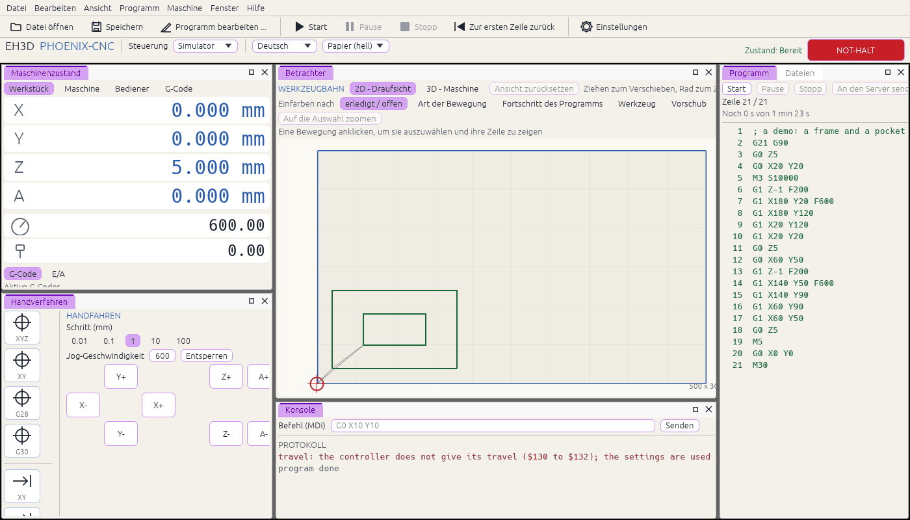

<p align="center">
  
</p>

#  EH3D-PHOENIX-CNC
<p align="center">🇺🇸 <b>English</b> | <a href="README_spa.md">🇪🇸 Español</a> | <a href="README_fra.md">🇫🇷 Français</a> | <a href="README_ita.md">🇮🇹 Italiano</a> | <a href="README_deu.md">🇩🇪 Deutsch</a> | <a href="README_zho.md">🇨🇳 中文</a> | <a href="README_jpn.md">🇯🇵 日本語</a> | <a href="README_por.md">🇵🇹 Português</a></p>

### The shared base of the EH3D machine-control programs: the view of a job, the themes and the words of the interface in eight languages

<p align="center">
  
  
  
  
  
  
</p>

---

**Honesty check - what actually runs today:** a Rust program with a window (`phoenix-cnc`) that drives a **simulated** machine: it shows the position of the machine (work and machine), moves it by hand with a jog pad, sets the zero, homes, takes the commands typed by the operator, runs a G-code program line by line (with pause, stop and the emergency stop), draws the path of the program on the table with the lines done marked, and stops at what the controller refuses. The window speaks 37 languages and wears eleven themes. The controller interface (`eh3d-controller`, in EH3D-COMMON) has GRBL written against a scripted line and lists the other families as not driven yet. 519 tests run on a computer. **Nothing here has run on a real machine**, a serial port is opened only for GRBL and a network connection only when a program is sent to the server, and arcs and the other codes are neither drawn nor run by the simulator.

---

> **Safety and security status:** by default this program drives a simulated machine. With `--grbl` (a build with `--features serial`) it opens a serial port and drives a real GRBL controller, never tried on a real machine; with a server address in the settings it opens a network connection to that server and sends the token in clear text over HTTP. When a real controller is connected it will have to prove itself on a simulator and then on a real machine before it is called working, and the limit switches and an emergency stop stay the job of the machine's own control unit; the emergency stop of the window is not a safety circuit.

## 📋 At a glance

| | |
|---|---|
| Version | `0.1.6` |
| Maturity | Functional |
| Tests | 519 |
| Stack | Rust |
| On real hardware | No: by default it drives a simulated machine; a real GRBL controller (`--grbl`) has never been tried |

**Jump to:** [Overview](#-overview) · [Architecture](#-architecture) · [Quick start](#-quick-start) · [Testing](#-testing) · [Structure](#-repository-structure) · [Related](#-related-projects)

## 🚦 Project status

Each line is one part of this repository and the light says how far it is today. It is written from what the repository can show (tests, builds, runs), not from what is planned.

🟢 Done and verified · 🟡 Works, with known limits · 🟠 Partly done or not verified yet · 🔴 Not done or not working

| Area | State | What it means here |
|---|---|---|
| Base library | 🟡 | A Rust crate that re-exports `scene`, `texts` and `theme` of `eh3d-view` under this program's name; it needs the folder of EH3D-COMMON next to it. |
| Scene and views | 🟡 | Written and tested in EH3D-COMMON; the window of this program draws the path of a program on the table and the position of the tool (seen on a computer). |
| Themes and texts | 🟡 | Eleven themes and the words of the interface in 37 languages, seen in the window of this program. |
| Tests | 🟡 | 519 tests pass on a computer (`cargo test --features gui`): the session (jog, zero, home, a program, pause, alarm, emergency stop), the path of a program and the command line; the simulated controller is tested in EH3D-COMMON. |
| Window and jog | 🟡 | Works on a computer with the simulated controller: position, jog pad, steps, feed, home, zero, unlock, a line of commands and a log; no real machine. |
| Machine control | 🟠 | Only the simulator: a program runs line by line with pause, stop and the emergency stop; no real controller is connected from here yet. |
| Documentation | 🟡 | README in eight languages, the two pictures, three sample programs and the changelog. |

## 🎯 Overview

* The **window** (`src/gui.rs`, `phoenix-cnc`): the position of the machine (work and machine), a jog pad with its steps and feed, home, zero and unlock, the emergency stop, a line of commands with its log, and the program with its path on the table.
* The **session** (`src/session.rs`): what the program does with any controller of `eh3d-controller`: jog, zero, home, send a line, run a program line by line, pause, stop and the alarms; it is tested on the simulated controller.
* The **path of a program** (`src/gcode.rs`): the straight moves (`G0`, `G1`, absolute or relative, in mm or inches) drawn before the program runs; arcs are not drawn.
* The **simulated controller** (`eh3d_controller::sim`, in EH3D-COMMON): a machine in memory with travel limits that raise an alarm; the controller families of the market are listed in `eh3d-controller`, GRBL is the first one written and the others show as not driven yet.
* The **themes and the words** of `eh3d-view`: Forge (the default), Neon Arcade, Glass Pro, the classic Windows grey and one that follows Windows, and the interface in English, Spanish, Italian, German, French, Portuguese, Chinese and Japanese. What it will be: one program to drill, to route and to do 2D and 3D CNC work on the engines of EH3D-DRILLPRO and EH3D-ROUTEPRO; that part does not exist yet.
* The **menus, the settings and the files**: the menus File, View, Program, Machine and Help with what PlanetCNC has in them (open, recent files, save, edit, the zeros, the stored positions, the spindle and the coolant); a settings window (units, language, eleven themes, travel limits, jog) that is kept between runs; and the Open and Save windows of the suite (`eh3d-filedialog`: places, sorting, filters, the extension of a saved file and the question before a file is replaced).
* **GRBL on a serial port:** built with `--features serial`, `phoenix-cnc --grbl PORT[@BAUD]` drives a GRBL controller (115200 baud by default) instead of the simulator and `phoenix-cnc --ports` lists the serial ports; a build without the feature, or a port that does not open, says so and leaves. It has been tried only against a scripted controller, never against a real one. With a real controller, `--start` (open the file and start it as the window opens) is refused unless `--start-real` is also given, and `--start-real` alone is an error; `busy_wait` in the settings file (4 hours by default) is the most a line waits for its answer while the machine says it is working, and the stop is heard meanwhile.
* **A window that follows the screen:** it opens maximized, and from 720p to 1080p and on to larger and wider screens everything grows or shrinks with it.
* **Going on after a failure:** while a program runs, the line it has reached is saved to a small file; if the window, the computer or the link goes down, the next start asks whether to go on from that line or to leave it. Nothing is sent to the controller until the operator answers.
* **Sent to the EH3D server:** with the address of the server, the token of this program and the id of the machine in the settings (section Server of the settings window, or `server_address`, `server_token` and `server_machine` in the settings file), **Program > Send to the server** sends the text of the program as a G-code job; the server runs it on its machine (a GRBL controller on its serial port, or its simulator) and the window follows it: the state, the percentage and the line it has reached in the top bar, the panel and the log. Start, Pause and Stop of the window reach the job on the server, closing the window does not stop it, and a job that stopped is taken up again from the line the server reached (the next start of the window offers it, as it does for a program of the controller): the server gives the codes in force back and waits for the operator before the first move. The spindle and the coolant are started again only with `server_restore_outputs = yes`. Tested against a stand-in server; the server's own tests send the same requests to its simulator. Never run on a machine.
* **Resuming after a failure:** a program left in the middle is first put back in its state: units and absolute distances, a safe Z (`resume_safe_z` in the settings file, 5 mm), the spindle with the time to reach its speed (`resume_spindle_wait`, 3 s), the coolant, the point it had reached and the modal state; the recovery file keeps the SHA-256 of the program and refuses to go on if the program changed. The line it goes on from is taken `resume_backoff` lines (16 by default) before the last one sent, because the controller keeps some lines in its buffer, and a plunge to the depth without a feed of the program uses `resume_plunge_feed` (100 mm/min by default).
* **Lines for the controller itself are not sent by default:** a line of a program that starts with `$` (a setting or a command of GRBL, such as `$130=9999`, `$X` or `$RST=*`) stops the program at that line without sending it; `program_system_commands = yes` in the settings file sends them.
* **The helpers of the window:** a **summary before a program starts** (the moves, the cutting distance, the time at the speeds of the settings, the reach of the axes and a check against the travel of the machine, with the warnings the suite shares: a program that is tiny or far from the corner, bigger than the table and cuts before any feed; the arcs are measured along their curve and every tool change adds its time; **Start anyway**, or a refusal when the program leaves the travel, which `reject_out_of_travel = no` turns into a warning, and `confirm_start = no` turns the summary off); **keys of the keyboard** (Ctrl+O open, Ctrl+S save, Ctrl+E edit, F5 start, Space pause, Esc stop (with a window open Esc closes it, and with the keyboard in a box of text Space and Esc are left to the box), F1 lists them; `shortcuts = no` turns them off); a **toolbar** with drawn pictures and their names; numbers that are stepped with minus and plus or **written**; the path **dragged and zoomed from above or turned and zoomed in 3D** with the tool; a **picture of the G-code file** in the Open window; the **record of a crash** (`eh3d-crash.log`); and a Safety section in the settings (`rapid`, `summary_tiny`, `summary_far` and `summary_margin` in the settings file).
* **A queue of programs and the travel of the controller:** several files chosen in the Open window with Ctrl+click, dropped together or given on the command line (`phoenix-cnc a.nc b.nc`) run one after the other, each after its own summary; the window lists them with their state, lets you remove, skip and reorder the ones that wait, and the queue stops when a program does not finish. With a GRBL controller the program reads `$130`, `$131` and `$132` (the longest travel of X, Y and Z) when it connects and uses the smaller of that and `travel_x`, `travel_y` and `travel_z` for the summary and the refusal; if the controller does not answer or does not give them, the settings are used and the log says so (`read_controller_travel = no` turns the reading off).
* **Checks of the program, soft limits of the jog and the probe:** the summary also says what looks wrong inside the program (a rapid move that ends below the surface, a cut with the spindle off, a spindle started with no speed, a tool change, no end of program, and a feed or a spindle speed above `lint_max_feed` or `lint_max_rpm`, which are 5000 mm/min and 24000 rpm by default and off at 0; `lint = no` turns the checks off and `lint_rapid_floor` sets the Z below which a rapid is said). A step of the jog that would pass the travel is shortened to the limit and one from the limit outwards is refused (`jog_soft_limits` is `homing` by default: the limit holds only after the machine was homed; `always` holds it from the start and `no` turns it off). **Machine > Probe Z** runs the cycle on a touch plate (`probe_feed`, `probe_depth`, `probe_retract`, `probe_plate` and `probe_clearance` in the settings file) and **Machine > Probe a grid** touches a grid over the cuts of the program (`probe_grid` mm apart) to build a height map; **Correct the program with the height map** cuts every cutting move into pieces of at most `heightmap_segment` mm and raises or lowers each one by the height under it (a program in absolute millimetres without arcs; one that leaves the probed area is refused) and **Undo the height correction** puts the program back. Both probes ask first because the machine moves, and a controller without a probe refuses them. Tried against stand-ins only; nothing has run on a real machine.
* **The program tools, in the window and on the command line:** **Program > Check the program...** lists what the checks find, line by line (the number beside each finding shows that line in the program panel), **Program > Keep-out boxes...** edits the places the tool must not go (a program that enters one is not started unless `keepout_reject = no`) and **Program > Statistics and simulation...** plays the path on paper with the cursor on the line, while the program panel says the time left. The queue repeats a program (a box with the number of runs), asks the operator or waits `queue_pause` seconds between two runs of it, shows its total time and is kept in a file between runs (it comes back waiting: nothing starts by itself). The **Macros** menu runs the macros of `phoenix-cnc-macros.txt` (next to the settings file) after asking; **Machine > Save the height map...** and **Machine > Load a height map...** keep the map in a file (never written over without asking) and **File > Export the session log...** saves the log as text, CSV or JSON (never over a file). Their values (`progcheck`, `keepout`, `keepout_margin`, `keepout_reject`, `queue_repeat_max`, `queue_confirm_between`, `queue_pause`, `queue_remember`, `sim_speed`, `macros_confirm`, `macros_max_lines`, `log_max_entries` and `tool_change_time`) are in the settings file, and the window keeps them when it saves the other settings. `phoenix-cnc --report FILE` prints the same findings with the statistics and the time of a program without opening the window (exit code 0 when nothing needs reading, 1 when something does, 2 when the file cannot be read; `--lang` chooses the language), and `--version` and `--help` answer at once. Tried against the simulator only; nothing has run on a real machine.
* **The settings window has five sections for the program tools:** **Checks** (the first and the second checker, the margin and the refusal of the keep-out boxes, the floor of the rapid moves and the highest feed and spindle speed), **Probe and height map** (the probe, the grid, the length of the pieces of a corrected cut and the limits of the jog) and **Queue, macros and log** (the repeats and the pause of the queue, the speed of the simulation, the entries of the session log, the macros and the time of a tool change). Every number stays inside the range the settings file accepts (the range is its tooltip), **Defaults of this section** puts a section back, and saving keeps every other key of the file. Two more sections follow: **Tool changer** (whether the changer is worked out, its rack, safe height, lock and blow with their ranges, the slots read from the table file and the lines of it that were left out, and a button that writes the example table without ever writing over one) and **Materials** (the material in use and its ranges, the library file, a button that writes the example library without writing over a file, and a small editor of the table of materials that checks every row and asks before it replaces the file).
* **A work report as one page of HTML:** **File > Export the work report...** (or `phoenix-cnc --report FILE.NC --html REPORT.html`) writes a page that holds everything in it, with no script, no link and no separate picture: the statistics and the time of the program, the tools, what looks wrong with its line, the path seen from above with the lines that have a warning ringed, and the height map as a grid of colours when one was measured. It follows the language, the colours follow the light or dark setting of the browser, and a file that is there is never written over.
* **The path can be coloured, filtered by tool and clicked:** under the title of the path (in the plan and in 3D) a row chooses how it is coloured (**done / to do**, **type of move**: rapid, cutting, plunge and arc; **progress of the program**, from blue to red along the length travelled; **tool**; or **feed rate**, from the slowest to the fastest), shows a box for each tool of the program (a tool is hidden or shown with its box, and the last one shown stays) and has **Zoom to the selection** for the plan and for 3D (in 3D the move goes to the middle of the view, at the turn it has). A click on a move selects it (it is drawn thick), the program panel shows its line, and the row says the line, its code, the kind of move, its length, its feed and its tool. The plan and the 3D view keep their drag, wheel and double click. For pictures, `--color MODE` (`state`, `kind`, `progress`, `tool` or `feed`) and `--select LINE` (a line of the program, from 1) start the window with that colouring and that move selected, to go with `--shot`.
* **An editor for the program:** the editor of the program (Ctrl+E) shows the text with the **numbers of its lines** in the margin (the lines the check has something to say about are coloured), **find and replace** (with or without capitals; Enter finds the next one; one or all are replaced and the count is said), **go to a line**, the **notes of the check for the text as it is written** (a click on the number of a note goes to its line) and **Apply**, which puts the text in the program (not while a program runs). **Apply and save** asks in the editor itself, with Replace and Cancel, before it writes over the file the program came from (the question goes away if the text changes), and **Apply and save as...** goes through the Save window, which asks before it replaces a file that is there. The rules (`src/editor.rs`) are tested without a window.
* **Machine profiles:** in the General section of the settings a machine can be saved as a profile (the travel of the three axes, the spindle speed and its warning limit, the jog feed, the rapid speed and the feed warning limit, and the probe values) and taken again with a click; Ok keeps the choice and Cancel leaves the settings as they were. The settings file holds one `profile = NAME | tx=0,500 | ty=0,300 | tz=-100,50 | spindle=10000 | ...` line for each (up to 16, names of up to 40 characters, a value that is not valid keeps its default) and `profile_active = NAME` for the one in use. `phoenix-cnc --profile NAME` starts the window (or `--report`) with the values of that profile; a name that is not saved is said in the log (or refused by `--report`) and the settings stay as they are. The rules (`src/profiles.rs`) are tested without a window.
* **Transform the program:** **Program > Transform the program...** shifts (X, Y, Z), turns (degrees, about a point), scales and mirrors (X, Y) the program that is loaded, and **Program > Undo the transformation** puts it back. The lines are rewritten in place (the words that do not change, the comments and the spacing stay as written), arcs keep their centres and an odd mirror turns a clockwise arc into a counter-clockwise one (the `G2` and `G3` codes are swapped). A program the change could make wrong is refused, saying the line and why: relative distances (`G91`), a plane other than XY, canned cycles and probing moves, codes that take machine positions or shift the zero (`G10`, `G28`, `G30`, `G53`, `G92`, `G43.1`), absolute arc centres (`G90.1`) or a scale that is not above 0. The program is taken to start at the origin, as the path does. A program that runs is never changed. `--window transform` opens it. When the first move of the program leaves out X or Y, the window warns and asks where the tool stands before the program (the origin by default), and the coordinate that move leaves out is taken from there and written whenever the change moves it. The rules (`src/transform.rs`) are tested without a window, including that the path of the new program is the old path transformed.
* **Bookmarks and starting from a line:** click a line of the program panel to select it and double-click to bookmark it (a bookmarked line has a star after its number), or use **Program > Bookmark the selected line**, **Next bookmark** and **Previous bookmark**; **Program > Bookmarks and start from a line...** (`--window bookmarks`) lists the bookmarks, jumps to one and starts from it or from the selected line. Before anything is prepared the window reads the lines before the start and says what the program had in force there: inches, a plane other than XY, the work coordinates, the tool length offset, the last tool asked for (no tool change is made), the spindle and its speed, the coolant, a shifted zero, and a cutting move before any feed; a start with relative distances (`G91`), a canned cycle or a cutter compensation still on is refused. **Prepare the start** needs a tick that says the tool, the spindle and the zero were checked (`startline_confirm = no` in the settings file, or the box in the Queue, macros and log section, turns the tick off), brings the controller back to that state in the same way as a program left in the middle (up to the safe height, the spindle with its wait, over the point the program had) and leaves the program paused at the line: the machine moves only when Resume is pressed, and a program that runs is never touched. Bookmarks belong to the program that is loaded. The bookmarks can be kept between sessions: **Save the bookmarks next to the program** writes `part.nc.marks` beside `part.nc` (the lines and the fingerprint of the program, up to 200 bookmarks and 16 KiB; it asks before it replaces a file, which `bookmarks_confirm_replace = no` turns off, and leaves a file that has these bookmarks already alone), the file is read again when the program is opened (`bookmarks_load`, on by default; a file written for another version of the program is left out and the log says so), **Load the saved bookmarks** adds them to the list, and the keys **Ctrl+B** (bookmark the selected line), **F2** and **Ctrl+F2** (next and previous bookmark) are in the list of keys and written beside the menu entries. The rules (`src/bookmarks.rs`, `src/startline.rs`) are tested without a window.
* **A tool changer with a lock and a blow, in simulation:** a line `atc = on | safe=5 | rack=0,0,-5 | pitch=20,0 | lock=3,0.5 | blow=4,1` in the settings file (off unless it says `on`) describes a changer: the rack (X, Y, Z of the slot of tool 1 and the step to the next), the safe height, the output pin and the wait of the lock and the output pin and the seconds of the blow. For each change in a program the program works out the steps (stop the spindle, put the old tool in its slot, release the lock, blow the empty spindle, take the new tool, engage the lock), the lines of G-code (`M65 P` / `M64 P`, `G4`) and the time; `--report` and the Statistics window list the changes and the estimate uses that time instead of `tool_change_time`. Nothing is sent to a machine. The slot of each tool can come from a table instead of the pitch: `phoenix-cnc-atc.txt` next to the settings file has one `tool = NUMBER | pos=X,Y` line for each tool of the rack (`examples/atc.txt` is a model; up to 64 tools numbered 1 to 255, slots at least 1 mm apart, a file of up to 16 KiB); a tool that is not in it keeps the rack and the pitch, and every line that is left out is named with its number and the reason in `--report` and in the Statistics window. With keep-out boxes in the settings, every change is also tried against them: the tool goes up, over the slots and down at the places of the rack (in machine coordinates), starting where the program has the tool at that line (its work position plus the zero of the work), and a change whose moves go through a box is named with its line, the tool and the box in `--report`, in the Check window and in the work report, and refuses the start while `keepout_reject` is on. The rules (`src/atc.rs`) are tested without a window.
* **A library of materials for the checks:** the checks section of the settings has a **Material** list (`material = NAME` in the settings file); a program is then held to the range of cutting feed and of spindle speed that is suggested for that material, and the check says when a move in X or Y runs below or above the feed range (a plunge in Z alone is not held to it) or when a spindle speed is below or above the speed range, with the line, in the eight languages. The values are in a text file, not in the program: `examples/materials.txt` is built in and used while there is no file of your own, and `phoenix-cnc-materials.txt` next to the settings file replaces it (one `material = NAME | feed=LOW,HIGH | rpm=LOW,HIGH` line each, up to 64 materials, either range may be left out). `phoenix-cnc --report` uses the material of the settings too. The ranges are only suggestions to start from: they warn, they never stop a program. The rules (`src/materials.rs`) are tested without a window.
* **Fixed views of the viewer:** **View > Top view, Front view, Side view** and **Isometric view** (or **Ctrl+1** to **Ctrl+4**) put the path in that view: the top view is the plan, the front and the side look along an axis, level with the table, and the isometric one is the view the window starts in. `--view top|front|side|iso` (besides `plan` and `3d`) starts the window in one, to go with `--shot`.
* **Tab finishes the code in the command box:** while the box under the window has the keyboard, Tab finishes the code being typed (`G38` gives `G38.`, `M30` gives `M30 `, `$J` gives `$J=`) or, when several fit, writes what they share and lists them beside the box (`G5` lists `G53` to `G59`). It works on the last word of the line, ignores capitals and small letters, and sends nothing: the line still goes with Enter.

## 🧩 Role in EH3D

EH3D-PHOENIX-CNC is the machine-control program of EH3D, today working on a simulated machine. It depends by path on EH3D-COMMON (the folder `EH3D-COMMON` must sit next to this one: the view, the themes, the words and the controllers) and on no other EH3D repository yet.

## 🏛️ Architecture

<p align="center">
  
</p>

How the parts fit together: who will use it, what this repository holds and what it relies on. The picture is drawn from `docs/architecture.json`, is checked against the code and marks what is future as future.

## 🖼️ Screenshots

<p align="center">
  
</p>

<p align="center"><em>A program running on the simulated machine: the lines done are green, the line that goes now is bright, the path is drawn on the table and the tool is where the machine is.</em></p>

<p align="center">
  
</p>

<p align="center"><em>The Midnight theme, with a long program that has finished.</em></p>

<p align="center">
  
</p>

<p align="center"><em>The interface in German with the light Paper theme: every word of the window follows the language.</em></p>

<p align="center">
  
</p>

<p align="center"><em>The settings window, with the sections on the left like the tree of PlanetCNC: the language, the eleven themes and what is shown.</em></p>

<p align="center">
  
</p>

<p align="center"><em>The Open window of the suite: places, recent files, the list of the folder with its dates and sizes, the file name and the type.</em></p>

## 🔒 Security & Safety

This program opens a serial port only when it is started for GRBL (`--grbl`, a build with `--features serial`) and a network connection only to the EH3D server whose address is in its settings, when the operator sends a program to it; the token is kept as text in the settings file. It opens no file of other people except the G-code file and the height map the operator chooses (read as text, never run by itself) and its own files next to the settings (the macros, the queue kept between runs, the line a program had reached); it writes a file only where the operator says (the program, the height map, the exported log) and never writes the log over a file. The table of slots of the tool changer, the library of materials and the bookmarks are read from where the settings (or the program) are and written only by their own buttons: the example table and the example library never over a file that is there, the library and the bookmarks after a question when the file is there already (the question about the bookmarks can be turned off in the settings), and every one of these files has a size limit. The macros it runs are lines of G-code that it asks about first, and the queue that comes back never starts by itself. It is not a safety system. See [SECURITY.md](SECURITY.md).

## 🚀 Quick start

You need a stable Rust toolchain and the folder `EH3D-COMMON` next to this one.

```bash
cargo build --release --features gui
cargo test --features gui
cargo clippy --all-targets --features gui -- -D warnings
cargo fmt --all --check
python -I tools/ci_validate.py
cargo run --release --features gui -- examples/02_frame_and_pocket.nc
```

`build.bat` / `build.sh` build the program, `test.bat` / `test.sh` run the tests and `run.bat` / `run.sh` open the window on a sample program. The scripts wait for a key at the end unless `NOPAUSE` is set.

## 🧪 Testing

`cargo test --features gui` runs 519 tests: the session (jog and zero, a program run line by line, pause and go on, a refused line, the emergency stop and the alarm, the log of the commands, homing), the path of a program and the command line; the view and the simulated controller are tested in EH3D-COMMON. The CI also runs `cargo fmt --check` and `cargo clippy` with warnings as errors, and `python -I tools/ci_validate.py` checks the manifest, the versions, the changelog and the eight READMEs.

## 🏗️ Build & Release

The version lives in `Cargo.toml` and in `eh3d.project.json`, and each version has its entry in [CHANGELOG.md](CHANGELOG.md). There is no program to package yet, so there are no ready-made binaries.

## 📂 Repository Structure

<p align="center">
  
</p>

<details>
<summary>Text version of the tree</summary>

```text
EH3D-PHOENIX-CNC/
├── src/
│   ├── lib.rs                                   the modules, and the view of eh3d-view re-exported under this program's name
│   ├── gui.rs                                   the window: position, jog, program, path, commands and log
│   ├── session.rs                               what is done with a controller: jog, zero, home, a program, pause, stop, alarms
│   ├── queue.rs                                 the queue: order, state, runs, skip, remove, reorder, stop on failure, state file
│   ├── progcheck.rs                             second check of a program: units, offsets, probing, planes
│   ├── boxes.rs                                 keep-out boxes and travel limits, move by move
│   ├── sim.rs                                   the path in time: the tool at any moment, the time left
│   ├── estimate.rs                              the time of a program measured once and kept: the loaded path and the files of the queue
│   ├── stats.rs                                 statistics of a program: distances, time, tool changes
│   ├── jobs.rs                                  repeats and pauses between the programs of the queue
│   ├── macros.rs                                the library of macros: named G-code that asks before it runs
│   ├── logbook.rs                               the session log, saved as text, CSV or JSON, never over a file
│   ├── report.rs                                the report of --report: statistics, time, what looks wrong
│   ├── workreport.rs                            the work report as one page of HTML: statistics, warnings, path, height map
│   ├── tuning.rs                                the values of these tools in the settings file
│   ├── ranges.rs                                the range of each key of these tools, shared by the window and the file
│   ├── words.rs                                 the messages of these tools in the eight languages
│   ├── gcode.rs                                 the straight moves of a G-code program, to draw its path
│   ├── heightmap.rs                             the height map of the stock and the correction of a program
│   ├── jog.rs                                   the soft limits of the jog: a step past the travel is shortened or refused
│   ├── lint.rs                                  what looks wrong in a program: rapids, spindle, feed and speed
│   ├── probe.rs                                 the probe: the Z cycle on a touch plate and the grid of touches for the height map
│   ├── view.rs                                  the plan that is dragged and zoomed and the 3D view that is turned, as numbers
│   ├── viewer.rs                                the viewer of the path: kinds, tools, progress, colours, clicks
│   ├── plan.rs                                  the check before a start: time, reach and travel of the moves
│   ├── cli.rs                                   the command line: the file, the language, the theme and the picture options
│   ├── complete.rs                              Tab in the command box: finishes the G, M and $ codes
│   ├── editor.rs                                the editor of the program: find, replace, go to a line, notes
│   ├── profiles.rs                              machine profiles: travel, spindle, feeds and probe of each machine
│   ├── transform.rs                             shift, turn, scale and mirror a program, with its rules and refusals
│   ├── atc.rs                                   the tool changer worked out in simulation: lock, blow, the steps, the G-code and the time
│   ├── bookmarks.rs                             bookmarks on the lines of a program: toggle, next, previous
│   ├── startline.rs                             what a program has in force at a line, and when starting there is refused
│   ├── materials.rs                             the library of materials: suggested feed and speed ranges the checks hold a program to
│   ├── bin/phoenix-cnc.rs                       the program that opens the window
│   ├── server.rs                                the link to the EH3D server: send, follow, hold, stop
│   ├── settings.rs                              what is kept between runs
│   ├── gui/dialogs.rs                           menus, settings, Open, Save, editor
│   ├── gui/prefs.rs                             the settings sections of the program tools: checks, probe, queue, tool changer, materials
│   ├── gui/remote.rs                            the program on the server: Start, Pause, Stop and going on
│   ├── gui/views.rs                             the centre of the window: the path from above or in 3D, with the tool
│   ├── gui/pathview.rs                          the row of the viewer: colours, tool layers, zoom, the clicked line
│   ├── gui/editwin.rs                           the editor window: line numbers, find and replace, notes, Save
│   ├── gui/xform.rs                             the Transform window and Undo of the Program menu
│   ├── gui/lines.rs                             the Bookmarks window and the start from a line, with its question
│   ├── gui/summary.rs                           the summary window before a start and the list of keys
│   ├── gui/probe.rs                             the probe in the window: questions and height-map entries
│   ├── gui/numfield.rs                          a number set with the minus and plus buttons or by writing it
│   ├── gui/keys.rs                              the keys of the keyboard and the table the menus and the list of keys read
│   ├── gui/queue.rs                             the queue in the window: runs, repeats, a question or a wait between runs
│   ├── gui/check.rs                             the Check window: what the checkers find, line by line
│   ├── gui/keepout.rs                           the editor of the keep-out boxes and the refusal of a program that enters one
│   ├── gui/sim.rs                               statistics and simulation: the tool on the path, the line, the time left
│   ├── gui/macros.rs                            the Macros menu and the question before a macro runs
│   ├── gui/files.rs                             the height map and the session log as files, through the file windows
│   └── gui/icons.rs                             the pictures of the buttons, drawn with lines, and the toolbar button
├── examples/                                    three sample G-code programs, from a square to a long spiral
├── tests/                                       more tests of the G-code and the settings
├── tools/                                       CI check, README check and the picture tools
├── docs/                                        the sources of the Architecture and Repository Structure pictures
├── .github/                                     CI workflow, issue and pull-request templates
├── images/                                      banner, the two pictures and the screenshots
├── build.sh build.bat                           build the library
├── run.sh run.bat                               say that there is no program yet and run the tests
├── eh3d.project.json                            manifest: version, role, maturity and build command
├── Cargo.toml Cargo.lock                        the Rust package and its locked dependencies
├── rust-toolchain.toml                          the pinned Rust toolchain
├── CHANGELOG.md                                 what changed in each version
├── SECURITY.md SUPPORT.md                       how to report a vulnerability and where to ask
└── CONTRIBUTING.md CODE_OF_CONDUCT.md LICENSE   how to contribute, the code of conduct and the licence
```

</details>

## 🗺️ Roadmap & Known limits

**Known limits today**

* Nothing here has run on a real machine: the controller is a simulator (or GRBL on a serial port, never tried) and the server is reached only by the tests.
* The simulator takes only basic G-code (`G0`, `G1`, `G90`, `G91`, `G20`, `G21`, `G92`, `M3` to `M9`); arcs, canned cycles and probing are refused, and the path of a program does not draw arcs.
* It needs the folder `EH3D-COMMON` next to it, because it depends on it by path.

**Next**

* A real controller: GRBL over a serial port first, then the other families, then the controller of HYDRA-UMC.
* Arcs and the rest of the G-code in the simulator and in the path.
* A 3D view of the path with the height of the cuts.
* Probing, the tool changer and the materials of the machine.
* Join the engines of EH3D-DRILLPRO and EH3D-ROUTEPRO so that one program drills and routes.

## 🌍 Languages

README and texts exist in English, Spanish, French, Italian, German, Chinese, Japanese and European Portuguese.

## 🔗 Related Projects

* [EH3D-COMMON](https://github.com/JuanenRac/EH3D-COMMON): where the view (`eh3d-view`) and the ZIP of jobs (`eh3d-archive`) live
* [EH3D-DRILLPRO](https://github.com/JuanenRac/EH3D-DRILLPRO): the drilling program whose engine will be joined here
* [EH3D-ROUTEPRO](https://github.com/JuanenRac/EH3D-ROUTEPRO): the routing program whose engine will be joined here

## 📚 Documentation

* [Changelog](CHANGELOG.md)
* [Security policy](SECURITY.md) and [support](SUPPORT.md)
* The view of a job is documented in EH3D-COMMON, where it lives.

## 🤝 Contributing & Community

* Before a pull request run `cargo fmt --all --check`, `cargo clippy --all-targets -- -D warnings`, `cargo test` and `python -I tools/ci_validate.py`: all must pass. See [CONTRIBUTING.md](CONTRIBUTING.md) and the [code of conduct](CODE_OF_CONDUCT.md).
* The README exists in eight languages: a change to the text is made in all eight files, and the two pictures are drawn from `docs/architecture.json` and `docs/structure.json` by `tools/make_architecture.py` and `tools/make_structure.py`.
* Do not describe as working what has not been run on a machine.
* Report a vulnerability privately: [SECURITY.md](SECURITY.md). Questions, ideas and reports: electrohobby3d@gmail.com ([SUPPORT.md](SUPPORT.md)).

## 👤 AUTHOR

**JuanenRac (Electro Hobby 3D)** · electrohobby3d@gmail.com

## 📜 LICENSE

Software: GPL-3.0-or-later. See [LICENSE](LICENSE). Hardware designs of the suite use CERN OHL-S.
