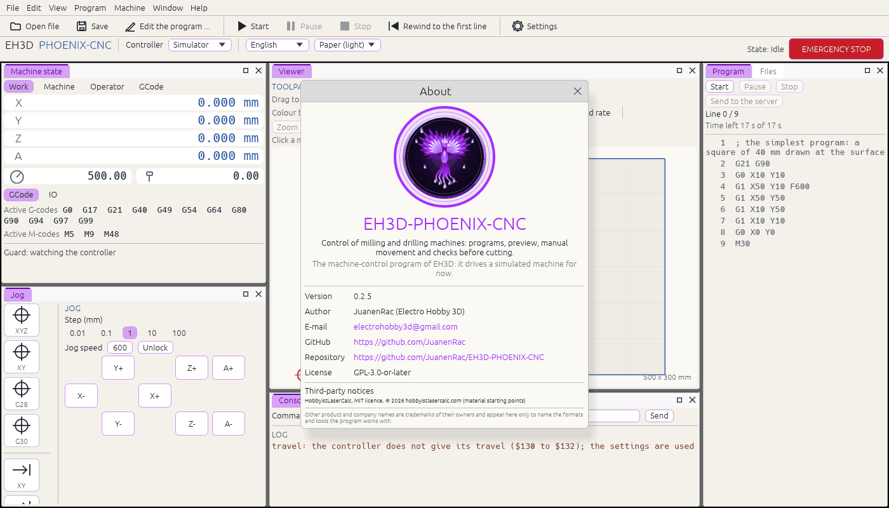

<p align="center">
  
</p>

#  EH3D-PHOENIX-CNC
<p align="center"><a href="README.md">🇺🇸 English</a> | <a href="README_spa.md">🇪🇸 Español</a> | 🇫🇷 <b>Français</b> | <a href="README_ita.md">🇮🇹 Italiano</a> | <a href="README_deu.md">🇩🇪 Deutsch</a> | <a href="README_zho.md">🇨🇳 中文</a> | <a href="README_jpn.md">🇯🇵 日本語</a> | <a href="README_por.md">🇵🇹 Português</a></p>

### La base commune des programmes de commande de machine EH3D : la vue d'un travail, les thèmes et les textes de l'interface en huit langues

<p align="center">
  
  
  
  
  
  
</p>

---

**Vérification d'honnêteté - ce qui tourne aujourd'hui :** un programme Rust avec une fenêtre (`phoenix-cnc`) qui pilote une machine **simulée** : il montre la position de la machine (pièce et machine), la déplace à la main avec un pavé de jog, fixe le zéro, fait la prise d'origine, prend les commandes tapées par l'opérateur, exécute un programme G-code ligne par ligne (avec pause, arrêt et arrêt d'urgence), dessine la trajectoire du programme sur la table, en plan ou en 3D, avec les lignes faites marquées, et s'arrête sur ce que le contrôleur refuse. En plus, il vérifie, mesure et prépare des programmes (arcs, cycles fixes, compensation de rayon, boîtes interdites, un palpeur, une carte des hauteurs, un changeur d'outils, une table d'outils et une de matériaux), importe des dessins et les fichiers Gerber et Excellon de cartes, et envoie un programme au serveur EH3D. L'interface des contrôleurs (`eh3d-controller`, dans EH3D-COMMON) est pilotée pour GRBL, grblHAL, Marlin et Klipper contre des simulateurs de leurs dialectes sur des câbles simulés ; les autres familles qu'elle liste ne sont pas pilotées. 1275 tests tournent sur un ordinateur. **Rien ici n'a tourné sur une vraie machine** : un port série n'est ouvert que pour GRBL, grblHAL ou Marlin et une connexion réseau que pour envoyer un programme au serveur ou joindre Klipper avec `--klipper`. Les machines simulées ne prennent que des déplacements droits et refusent arcs, cycles fixes et palpage ; ceux-ci sont donc mesurés, vérifiés et chronométrés sur le papier, la trajectoire dessinée montre un arc par sa corde, et un programme qui en contient s'arrête à cette ligne sur le simulateur. La fenêtre porte onze thèmes et propose huit langues, celles de la vue partagée d'EH3D-COMMON : ses mots existent en anglais, espagnol, allemand, français, italien, japonais, chinois et portugais européen.

---

> **État de sécurité :** ce programme pilote par défaut une machine simulée. Avec `--grbl`, `--grblhal` ou `--marlin` (une compilation avec `--features serial`) il ouvre un port série et pilote un vrai contrôleur GRBL, grblHAL ou Marlin, et avec `--klipper HOST[:PORT]` il ouvre une connexion HTTP non chiffrée vers Moonraker, l'interface de Klipper (le réseau local seulement, sauf si `klipper.allow_non_local` est activé ; il n'y a pas de chiffrement, donc l'identifiant `klipper.api_key`, s'il y en a un, circule en clair dans un en-tête), rien de cela jamais essayé sur une vraie machine ; avec une adresse de serveur dans les réglages il ouvre une connexion réseau vers ce serveur et envoie le jeton en clair par HTTP. Quand un vrai contrôleur sera connecté, il devra faire ses preuves sur un simulateur puis sur une vraie machine avant d'être dit fonctionnel, et les fins de course et un arrêt d'urgence restent l'affaire de l'unité de commande de la machine ; l'arrêt d'urgence de la fenêtre n'est pas un circuit de sécurité.

## 📋 En un coup d'œil

| | |
|---|---|
| Version | `0.2.5` |
| Maturité | Fonctionnel |
| Tests | 1275 |
| Pile technique | Rust |
| Sur du matériel réel | Non : par défaut il pilote une machine simulée ; un vrai contrôleur GRBL (`--grbl`) n'a jamais été essayé |

**Aller à :** [Présentation](#-présentation) · [Architecture](#-architecture) · [Démarrage rapide](#-démarrage-rapide) · [Tests](#-tests) · [Structure](#-structure-du-dépôt) · [Liés](#-projets-liés)

## 🚦 État du projet

Chaque ligne est une partie de ce dépôt et le feu dit où elle en est aujourd'hui. Il est écrit d'après ce que le dépôt peut montrer (tests, compilations, exécutions), pas d'après ce qui est prévu.

🟢 Fait et vérifié · 🟡 Fonctionne, avec des limites connues · 🟠 À moitié fait ou pas encore vérifié · 🔴 Pas fait ou ne fonctionne pas

| Domaine | État | Ce que cela signifie ici |
|---|---|---|
| Bibliothèque de base | 🟡 | Un crate Rust qui réexporte `scene`, `texts` et `theme` d'`eh3d-view` sous le nom de ce programme ; il a besoin du dossier d'EH3D-COMMON à côté. |
| Scène et vues | 🟡 | Écrite et testée dans EH3D-COMMON ; la fenêtre de ce programme dessine la trajectoire d'un programme sur la table et la position de l'outil (vue sur un ordinateur). |
| Thèmes et textes | 🟡 | Onze thèmes et les mots de l'interface : la fenêtre propose les huit langues de la vue partagée, et les mots des panneaux et outils propres à ce programme sont dans ces mêmes huit ; vu dans la fenêtre de ce programme. |
| Tests | 🟡 | 1275 tests réussissent sur un ordinateur (`cargo test --features gui`) : la session (jog, zéro, prise d'origine, un programme, pause, alarme, arrêt d'urgence), la trajectoire d'un programme et la ligne de commande ; le contrôleur simulé est testé dans EH3D-COMMON. |
| Fenêtre et jog | 🟡 | Fonctionne sur un ordinateur avec le contrôleur simulé : position, pavé de jog, pas, avance, prise d'origine, zéro, déverrouillage, une ligne de commandes et un journal ; pas de vraie machine. |
| Commande de machine | 🟠 | Seulement des simulateurs : un programme s'exécute ligne par ligne avec pause, arrêt et arrêt d'urgence sur la machine simulée ou sur un GRBL, grblHAL, Marlin ou Klipper simulé ; le port série de GRBL, grblHAL et Marlin est derrière une option de compilation, la liaison HTTP de Klipper n'a rencontré qu'un Moonraker de substitution et aucun vrai contrôleur n'a été connecté. |
| Documentation | 🟡 | README en huit langues, les deux images, trois programmes d'exemple et le changelog. |

## 🎯 Présentation

* La **fenêtre** (`src/gui.rs`, `phoenix-cnc`) : la position de la machine (pièce et machine), un pavé de jog avec ses pas et son avance, prise d'origine, zéro et déverrouillage, l'arrêt d'urgence, une ligne de commandes avec son journal, et le programme avec sa trajectoire sur la table.
* La **fenêtre à panneaux ancrables** (`src/gui/shell.rs`, `src/panels.rs` et le cadre `eh3d-dock` d'EH3D-COMMON) : treize panneaux que l'on peut retirer, remettre, déplacer, mettre en onglets, faire flotter et replier contre un bord (la trajectoire, la commande manuelle, l'état de la machine, le programme, les fichiers, la table d'outils, le capteur d'outil, la sonde et la carte des hauteurs, l'import, la planification et le temps, le rapport et la console), quatre espaces de travail selon la tâche (Préparer, Exécuter, Réviser et Compact), la barre de menus et une disposition conservée dans le fichier de réglages (lignes `dock.*`), avec ses textes en huit langues. Le contrôleur est enveloppé dans la garde (`guard = off` dans le fichier de mouvement l'enlève) : la fenêtre lui donne l'heure à chaque image, montre pourquoi elle a arrêté la machine et propose le feu vert, et un jog qui en croise un autre annule d'abord le mouvement en cours, de sorte que la règle d'un seul ordre de mouvement à la fois ne se déclenche pas sur une paire de jogs normale. Le panneau de planification montre le temps avec et sans anticipation, le panneau d'import lit HPGL, DXF ou SVG à travers un post-processeur au choix, et le panneau du capteur d'outil n'envoie la machine au capteur qu'après la confirmation de l'opérateur qu'il est en place et dégagé, et n'écrit la longueur dans la table d'outils que sur demande. Dessinée et testée sans fenêtre (images d'egui dans les tests) ; pas encore vue sur un écran réel ni sur une machine réelle.
* La **session** (`src/session.rs`) : ce que le programme fait avec n'importe quel contrôleur de `eh3d-controller` : jog, zéro, prise d'origine, envoyer une ligne, exécuter un programme ligne par ligne, pause, arrêt et les alarmes ; elle est testée sur le contrôleur simulé.
* La **trajectoire d'un programme** (`src/gcode.rs`) : les déplacements (`G0`, `G1`, `G2`, `G3`, absolus ou relatifs, en mm ou en pouces) dessinés avant l'exécution, en plan et en 3D ; la trajectoire dessinée prend un arc par sa corde, tandis que la longueur, le temps, les boîtes interdites et l'anticipation suivent la courbe.
* Le **contrôleur simulé** (`eh3d_controller::sim`, dans EH3D-COMMON) : une machine en mémoire avec des limites de course qui déclenchent une alarme ; il ne prend que le G-code de base (déplacements droits, unités, mode de distance, le zéro pièce, broche et arrosage) et refuse arcs, cycles fixes et palpage. `eh3d-controller` liste les familles de contrôleurs du marché : ce programme pilote GRBL, grblHAL, Marlin et Klipper (contre des simulateurs de leurs dialectes) et les autres apparaissent comme pas encore pilotées.
* Les **thèmes et les mots** de `eh3d-view` : Forge (par défaut), Neon Arcade, Glass Pro, le gris classique de Windows et un qui suit Windows, et l'interface en anglais, espagnol, italien, allemand, français, portugais, chinois et japonais. Ce qu'il sera : un programme pour percer, fraiser et faire de la CNC 2D et 3D sur les moteurs d'EH3D-DRILLPRO et EH3D-ROUTEPRO ; cette partie n'existe pas encore.
* Les **menus, les réglages et les fichiers** : les menus Fichier, Édition, Affichage, Programme, Machine, Fenêtre et Aide avec les entrées habituelles (ouvrir, récents, enregistrer, modifier, les zéros, les positions mémorisées, la broche et l'arrosage) ; une fenêtre de réglages (unités, langue, onze thèmes, limites de course, jog) mémorisée entre les exécutions ; et les fenêtres Ouvrir et Enregistrer de la suite (`eh3d-filedialog` : lieux, tri, filtres, l'extension d'un fichier enregistré et la question avant de remplacer).
* **GRBL sur un port série :** compilé avec `--features serial`, `phoenix-cnc --grbl PORT[@BAUD]` pilote un contrôleur GRBL (115200 bauds par défaut) à la place du simulateur et `phoenix-cnc --ports` liste les ports série ; une version sans la fonctionnalité, ou un port qui ne s'ouvre pas, le dit et quitte. Essayé seulement contre un contrôleur scénarisé, jamais contre un vrai. Avec un vrai contrôleur, `--start` (ouvrir le fichier et le lancer à l'ouverture de la fenêtre) est refusé sauf si `--start-real` est aussi donné, et `--start-real` seul est une erreur ; `busy_wait` dans le fichier de réglages (4 heures par défaut) est le temps maximal qu'une ligne attend sa réponse tant que la machine dit qu'elle travaille, et l'arrêt est entendu pendant ce temps.
* **GRBL, grblHAL, Marlin et Klipper, face à des simulateurs :** `--grblhal PORT[@BAUD]` et `--marlin PORT[@BAUD]` (une compilation avec `--features serial` ; Marlin est à 250000 bauds si aucun n'est donné) pilotent ces contrôleurs derrière la même garde que GRBL, `--klipper HOST[:PORT]` pilote Klipper par Moonraker en HTTP non chiffré derrière la même garde (le réseau local seulement, sauf si `klipper.allow_non_local` est activé ; les limites de la liaison et l'identifiant, si Moonraker en demande un, sont les clés `klipper.*` du fichier de mouvement, et l'identifiant n'est jamais affiché ni réécrit), et `--sim grbl|grblhal|marlin|klipper` pilote le dialecte de l'un d'eux sur un câble simulé sans rien de réel : le câble coupe les réponses en morceaux, ajoute du bruit, inverse des bits et se tait, à partir d'une graine fixe (les clés `wire_` du fichier de mouvement), et Marlin peut numéroter ses lignes avec une somme de contrôle pour qu'une ligne abîmée soit redemandée (`marlin_numbering`, désactivé par défaut). Les contrôleurs, les appareils simulés, le câble et les textes des erreurs en huit langues sont ceux de `eh3d-controller` (EH3D-COMMON) ; ce programme garde la détection du dialecte (`src/dialect.rs`), la garde (`src/guard.rs`), les réglages et ses propres mots (`src/ctltext.rs`, `src/problem.rs`). `phoenix-cnc --dialect-check grbl|grblhal|marlin|klipper` fait passer un dialecte par une batterie d'étapes (état, mouvement, jog, prise d'origine, un refus par numéro, un contrôleur muet sous la garde, câbles bruités) et se termine par le code de sortie 2 si l'une ne passe pas. Tout est simulation ; rien n'a rencontré un vrai contrôleur, et la liaison HTTP de Klipper n'a rencontré qu'un Moonraker factice dans les tests.
* **Les cartes à partir de leurs fichiers Gerber et Excellon :** `phoenix-cnc --import FICHIER` lit aussi une couche Gerber ou un fichier de perçage Excellon avec les lecteurs d'EH3D-CORE-LIBS (ceux des autres programmes de la suite) et imprime le G-code correspondant (`src/pcb.rs`) : l'isolation d'une couche de cuivre (les chemins à un rayon d'outil du cuivre, en autant de passes que demandé), le contour d'une couche de bord (à l'extérieur de la carte et à l'intérieur des découpes, en passes de profondeur) et les trous et rainures d'un fichier de perçage (le plus petit foret d'abord, une pause pour le changer, des débourrages). La couche est celle que dit le fichier (`--layer isolation|profile|drill` dit autre chose), les couches du dessous sont inversées (`--mirror` le demande) et le panneau Importer de la fenêtre a les mêmes choix. L'outil, les passes, les profondeurs, les avances, les débourrages, la grille et les limites sont les clés `pcb_` du fichier de mouvement (`examples/motion.txt`) ; aucune n'est dans le code. Rien n'a été coupé sur une machine. Un fichier avec une erreur n'est pas usiné, et un fichier de perçage qui ne dit pas son format de coordonnées, ses zéros ou ses unités est refusé sauf si `pcb_allow_assumed_drill` l'autorise.
* **Une fenêtre qui suit l'écran :** elle s'ouvre agrandie et, de 720p à 1080p et jusqu'aux écrans plus grands et plus larges, tout grandit ou rétrécit avec elle.
* **Reprendre après une panne :** pendant qu'un programme tourne, la ligne atteinte est enregistrée dans un petit fichier ; si la fenêtre, l'ordinateur ou la liaison tombe, le démarrage suivant demande s'il faut reprendre à cette ligne ou abandonner. Rien n'est envoyé au contrôleur tant que l'opérateur n'a pas répondu.
* **Envoyé au serveur EH3D :** avec l'adresse du serveur, le jeton de ce programme et l'identifiant de la machine dans les réglages (section Serveur de la fenêtre des réglages, ou `server_address`, `server_token` et `server_machine` dans le fichier de réglages), **Programme > Envoyer au serveur** envoie le texte du programme comme un travail G-code ; le serveur l'exécute sur sa machine (un contrôleur GRBL sur son port série, ou son simulateur) et la fenêtre le suit : l'état, le pourcentage et la ligne atteinte dans la barre du haut, le panneau et le journal. Démarrer, Pause et Arrêter de la fenêtre atteignent le travail sur le serveur, fermer la fenêtre ne l'arrête pas, et un travail arrêté est repris à la ligne atteinte par le serveur (le démarrage suivant de la fenêtre le propose, comme pour un programme du contrôleur) : le serveur rend les codes en vigueur et attend l'opérateur avant le premier mouvement. Quand l'opérateur le laisse repartir, le serveur ramène la machine là où elle s'était arrêtée et **démarre la broche que le programme avait en marche**, et le journal le dit avant ; `server_restore_outputs = yes` ne concerne que l'arrosage. Essayé avec un faux serveur ; les tests du serveur lui-même envoient les mêmes requêtes à son simulateur. Jamais sur une machine. La liaison est le client commun de la suite (`eh3d-serverclient` d'EH3D-COMMON) : quatre réglages de plus, `server_timeout_s` (secondes qu'un essai peut durer, 1 à 120, 15 par défaut), `server_retries` (essais en plus après un échec réseau, 0 à 5, 2), `server_mdns` (chercher le serveur sur le réseau, `on` ou `off`, désactivé par défaut ; le programme n'a pas encore de résolveur à lui, donc activé il ne trouve rien) et `server_max_answer_mib` (le plus de Mio lus dans une réponse, 1 à 256, 8) ; une connexion échouée est retentée avec des pauses croissantes et une requête qui crée quelque chose n'est jamais envoyée deux fois ; les refus du serveur sont dits par leur code dans la langue de la fenêtre ; une connexion perdue met fin au suivi aussitôt au lieu d'attendre quarante réponses échouées ; et le journal dit quand la liaison monte, tombe ou est déconnectée. L'arrêt d'urgence de la fenêtre et du menu va aussi à la machine du serveur tant que le travail n'est pas connu comme terminé ; un serveur qui ne le prend pas reçoit l'arrêt normal, et le journal dit dans les huit langues quand un arrêt n'est pas arrivé et que la machine bouge peut-être encore. Un travail n'est recréé que si le serveur dit que l'ancien est terminé ou qu'il ne l'a pas.
* **Reprise après une panne :** un programme resté en cours est d'abord remis dans son état : unités et distances absolues, un Z sûr (`resume_safe_z` dans le fichier de réglages, 5 mm), la broche avec le temps d'atteindre sa vitesse (`resume_spindle_wait`, 3 s), le liquide de refroidissement, le point atteint et l'état modal ; le fichier de reprise garde le SHA-256 du programme et refuse de continuer si le programme a changé. La ligne de reprise est prise `resume_backoff` lignes avec mouvement (16 par défaut) avant la dernière envoyée, car le contrôleur garde quelques mouvements dans son tampon (à augmenter pour un contrôleur au planificateur plus grand). Il n'y a pas de reprise en distances relatives, avec un cycle fixe ou une compensation d'outil encore actifs, après un décalage `G92`, avec un axe déplacé en dernier par `G28`, `G30` ou `G53`, ni là où une ligne `G10` a pu déjà s'exécuter ; le journal dit pourquoi ; une plongée à la profondeur sans avance du programme utilise `resume_plunge_feed` (100 mm/min par défaut). La reprise est aussi refusée là où le programme continue en arc, en palpage ou en `G80` sans le répéter, avec l'avance en `G93` ou `G95`, et avec une correction de longueur de la table de la commande (`G43`) ; l'avance et la correction de longueur sont réécrites dans les unités où elles ont été données.
* **Ce qui n'est pas deviné :** un cycle de palpage ou du palpeur d'outil se fait en millimètres quelle que soit l'unité laissée par le programme, la mise à zéro et le palpage écrivent le système de travail en cours, la carte des hauteurs refuse ce qu'elle ne peut pas corriger et une coupe depuis un endroit que le programme n'a pas dit, un miroir change le côté de la compensation d'outil, une macro qui démarre la broche ou change l'outil demande d'abord, et un programme n'est pas repris sur un zéro décalé à la main. Les dessins DXF, SVG et de traceur sont lus avec leurs unités, transformations et arcs, les calques cachés ne sont pas coupés et ce qui est illisible fait refuser le fichier. Le journal de la session, du serveur et de la file est dans les huit langues. Essayé seulement contre des simulacres.
* **Les lignes destinées au contrôleur lui-même ne sont pas envoyées par défaut :** une ligne de programme qui commence par `$` (un réglage ou une commande de GRBL, comme `$130=9999`, `$X` ou `$RST=*`) arrête le programme à cette ligne sans l'envoyer ; `program_system_commands = yes` dans le fichier de réglages les envoie.
* **Les aides de la fenêtre :** un **résumé avant le démarrage d'un programme** (les mouvements, la distance de coupe, la durée aux vitesses des réglages, la portée des axes et une vérification par rapport à la course de la machine, avec les avertissements que la suite partage : un programme minuscule ou loin du coin, plus grand que la table et des coupes avant toute avance ; les arcs sont mesurés le long de leur courbe et chaque changement d'outil ajoute sa durée ; **Démarrer quand même**, ou un refus quand le programme sort de la course, que `reject_out_of_travel = no` transforme en avertissement, et `confirm_start = no` désactive le résumé) ; des **touches du clavier** (Ctrl+O ouvrir, Ctrl+S enregistrer, Ctrl+E modifier, F5 démarrer, Espace pause, Échap arrêter (avec une fenêtre ouverte Échap la ferme, et avec le clavier dans une zone de texte Espace et Échap restent à la zone), F1 les liste ; `shortcuts = no` les désactive) ; une **barre d'outils** avec des dessins et leurs noms ; des nombres qu'on règle avec moins et plus ou qu'on **écrit** ; la trajectoire **déplacée et zoomée de dessus ou tournée et zoomée en 3D** avec l'outil ; un **aperçu du fichier G-code** dans la fenêtre Ouvrir ; le **journal d'un plantage** (`eh3d-crash.log`) ; et une section Sécurité dans les réglages (`rapid`, `summary_tiny`, `summary_far` et `summary_margin` dans le fichier des réglages).
* **Une file de programmes et la course du contrôleur :** plusieurs fichiers choisis dans la fenêtre Ouvrir avec Ctrl+clic, déposés ensemble ou donnés sur la ligne de commande (`phoenix-cnc a.nc b.nc`) s'exécutent l'un après l'autre, chacun après son propre résumé ; la fenêtre les liste avec leur état, permet de retirer, ignorer et réordonner ceux qui attendent, et la file s'arrête quand un programme ne se termine pas. Avec un contrôleur GRBL, le programme lit `$130`, `$131` et `$132` (la plus grande course de X, Y et Z) à la connexion et prend la plus petite entre cela et `travel_x`, `travel_y` et `travel_z` pour le résumé et le refus ; si le contrôleur ne répond pas ou ne les donne pas, les réglages sont utilisés et le journal le dit (`read_controller_travel = no` désactive la lecture). Un arrêt, un arrêt d'urgence ou une alarme arrête la file, aussi pendant l'attente entre deux passages. Un programme en marche ou en pause ne peut pas être remplacé, vidé ni rembobiné.
* **Vérifications du programme, limites logicielles du jog et sonde :** le résumé dit aussi ce qui semble faux dans le programme (un déplacement rapide qui finit sous la surface, une coupe broche arrêtée, une broche démarrée sans vitesse, un changement d'outil, un programme sans fin, et une avance ou une vitesse de broche au-dessus de `lint_max_feed` ou `lint_max_rpm`, qui valent 5000 mm/min et 24000 tr/min par défaut et sont désactivées à 0 ; `lint = no` coupe les vérifications et `lint_rapid_floor` fixe le Z sous lequel un rapide est signalé). Un pas du jog qui dépasserait la course est raccourci jusqu'à la limite et un pas qui part de la limite vers l'extérieur est refusé (`jog_soft_limits` vaut `homing` par défaut : la limite ne vaut qu'après la prise d'origine ; `always` l'applique dès le début et `no` la désactive). **Machine > Palper Z** exécute le cycle sur une plaque de contact (`probe_feed`, `probe_depth`, `probe_retract`, `probe_plate` et `probe_clearance` dans le fichier de réglages) et **Machine > Palper une grille** touche une grille sur les coupes du programme (`probe_grid` mm d'écart) pour construire une carte des hauteurs ; **Corriger le programme avec la carte des hauteurs** découpe chaque déplacement de coupe en morceaux d'au plus `heightmap_segment` mm et monte ou descend chacun selon la hauteur dessous (un programme en millimètres absolus sans arcs ; celui qui sort de la zone palpée est refusé) et **Annuler la correction de hauteur** remet le programme tel qu'il était. Les deux palpages demandent d'abord confirmation car la machine bouge, et un contrôleur sans sonde les refuse. Essayé seulement avec des doublures ; rien n'a tourné sur une machine réelle. La vérification signale aussi un arc donné par son centre qui finit à une distance du centre différente de celle de son départ, ou donné par un rayon inférieur à la moitié de la distance entre ses extrémités (un contrôleur les refuse avec une erreur de rayon), une broche à qui l'on ordonne de tourner dans l'autre sens sans l'arrêter avant, et une avance de zéro.
* **Une ligne lue comme le contrôleur la lit :** les commentaires (un `;` à l'intérieur en fait partie) et les espaces ne cachent rien aux vérifications ni à la garde ; une ligne `$` derrière un commentaire arrête le programme comme toute autre, et les avertissements disent quand une ligne est illisible, quand le programme fait une pause broche en rotation et quand `G93` ou `G95` change le sens de `F`.
* **Les outils du programme, dans la fenêtre et en ligne de commande :** **Programme > Vérifier le programme...** liste ce que trouvent les vérifications, ligne par ligne (le numéro à côté de chaque constat montre cette ligne dans le panneau du programme), **Programme > Boîtes interdites...** modifie les endroits où l'outil ne doit pas aller (un programme qui entre dans l'une n'est pas démarré, sauf avec `keepout_reject = no`) et **Programme > Statistiques et simulation...** joue la trajectoire sur le papier avec le curseur sur la ligne, pendant que le panneau du programme indique le temps restant. La file répète un programme (une case avec le nombre de passes), demande à l'opérateur ou attend `queue_pause` secondes entre deux passes, montre son temps total et est gardée dans un fichier entre deux exécutions (elle revient en attente : rien ne démarre seul). Le menu **Macros** exécute après confirmation les macros de `phoenix-cnc-macros.txt` (à côté du fichier de réglages) ; **Machine > Enregistrer la carte des hauteurs...** et **Machine > Charger une carte des hauteurs...** gardent la carte dans un fichier (jamais écrasé sans demander) et **Fichier > Exporter le journal de session...** enregistre le journal en texte, CSV ou JSON (jamais par-dessus un fichier). Leurs valeurs (`progcheck`, `keepout`, `keepout_margin`, `keepout_reject`, `queue_repeat_max`, `queue_confirm_between`, `queue_pause`, `queue_remember`, `sim_speed`, `macros_confirm`, `macros_max_lines`, `log_max_entries` et `tool_change_time`) sont dans le fichier de réglages, et la fenêtre les conserve quand elle enregistre les autres réglages. `phoenix-cnc --report FICHIER` affiche les mêmes constats avec les statistiques et le temps d'un programme sans ouvrir la fenêtre (code de sortie 0 si rien n'est à lire, 1 si quelque chose l'est, 2 si le fichier est illisible ; `--lang` choisit la langue), et `--version` et `--help` répondent aussitôt. Essayé seulement sur le simulateur ; rien n'a tourné sur une vraie machine. Un mouvement sur un arc est testé contre les boîtes interdites le long de sa courbe et pas seulement par sa corde (un arc dont la courbe ne peut pas être calculée reste testé par sa corde et le rapport le dit), et les statistiques donnent le Z le plus bas atteint par les coupes et le nombre de niveaux de profondeur où elles finissent.
* **La fenêtre des réglages a cinq sections pour les outils du programme :** **Vérifications** (le premier et le second contrôleur, la marge et le refus des zones interdites, le plancher des mouvements rapides, l'avance et la vitesse de broche les plus hautes), **Palpeur et carte des hauteurs** (le palpeur, la grille, la longueur des morceaux d'une coupe corrigée et les limites du déplacement manuel) et **File, macros et journal** (les répétitions et la pause de la file, la vitesse de la simulation, les entrées du journal de session, les macros et la durée d'un changement d'outil). Chaque nombre reste dans la plage que le fichier de réglages accepte (la plage est son info-bulle), **Valeurs par défaut de cette section** remet une section à zéro et l'enregistrement conserve toutes les autres clés du fichier. Deux autres sections suivent : **Changeur d'outils** (si le changeur est calculé, son magasin, la hauteur de sécurité, le verrou et le soufflage avec leurs plages, les emplacements lus dans le fichier de la table et ses lignes écartées, et un bouton qui écrit la table d'exemple sans jamais écrire sur une table existante) et **Matériaux** (le matériau utilisé et ses plages, le fichier de la bibliothèque, un bouton qui écrit la bibliothèque d'exemple sans écrire sur un fichier, et un petit éditeur de la table des matériaux qui vérifie chaque ligne et demande avant de remplacer le fichier).
* **Un rapport de travail en une seule page HTML :** **Fichier > Exporter le rapport de travail...** (ou `phoenix-cnc --report FICHIER.NC --html RAPPORT.html`) écrit une page qui contient tout, sans script, sans lien et sans image à part : les statistiques et la durée du programme, les outils, ce qui semble anormal avec sa ligne, la trajectoire vue de dessus avec les lignes qui ont un avertissement entourées, et la carte des hauteurs comme une grille de couleurs quand une a été mesurée. Il suit la langue, les couleurs suivent le mode clair ou sombre du navigateur et un fichier existant n'est jamais écrasé.
* **La trajectoire peut être colorée, filtrée par outil et cliquée :** sous le titre de la trajectoire (dans le plan et en 3D) une ligne choisit la façon de la colorer (**fait / à faire**, **type de mouvement** : rapide, coupe, plongée et arc ; **avancement du programme**, du bleu au rouge le long du parcours ; **outil** ; ou **vitesse d'avance**, de la plus lente à la plus rapide), montre une case par outil du programme (un outil se masque ou se montre avec sa case, le dernier affiché reste) et propose **Zoomer sur la sélection** pour le plan et pour la 3D (en 3D le mouvement passe au centre de la vue, avec la rotation qu'elle a). Un clic sur un mouvement le sélectionne (il est dessiné en gras), le panneau du programme montre sa ligne et la ligne indique le numéro, son code, le type de mouvement, sa longueur, son avance et son outil. Le plan et la vue 3D gardent le glisser, la molette et le double clic. Pour les captures, `--color MODE` (`state`, `kind`, `progress`, `tool` ou `feed`) et `--select LIGNE` (une ligne du programme, à partir de 1) ouvrent la fenêtre avec cette coloration et ce mouvement sélectionné, avec `--shot`.
* **Un éditeur pour le programme :** l'éditeur du programme (Ctrl+E) montre le texte avec les **numéros de ligne** en marge (les lignes sur lesquelles la vérification a quelque chose à dire sont colorées), **rechercher et remplacer** (avec ou sans casse ; Entrée cherche le suivant ; remplacer un ou tous, le nombre est annoncé), **aller à la ligne**, les **notes de la vérification pour le texte tel qu'il s'écrit** (un clic sur le numéro d'une note mène à sa ligne) et **Appliquer**, qui met le texte dans le programme (pas pendant qu'un programme tourne). **Appliquer et enregistrer** demande dans l'éditeur lui-même, avec Remplacer et Annuler, avant d'écrire sur le fichier d'où vient le programme (la question disparaît si le texte change), et **Appliquer et enregistrer sous...** passe par la fenêtre Enregistrer, qui demande avant de remplacer un fichier existant. Les règles (`src/editor.rs`) sont testées sans fenêtre.
* **Profils de machine :** dans la section Général des réglages, une machine peut être enregistrée comme profil (la course des trois axes, la vitesse de broche et sa limite d'alerte, l'avance du jog, la vitesse rapide et la limite d'alerte de l'avance, et les valeurs de la sonde) puis reprise d'un clic ; OK garde le choix et Annuler laisse les réglages tels qu'ils étaient. Le fichier de réglages contient une ligne `profile = NOM | tx=0,500 | ty=0,300 | tz=-100,50 | spindle=10000 | ...` par profil (jusqu'à 16, des noms de 40 caractères au plus, une valeur non valide garde sa valeur par défaut) et `profile_active = NOM` pour celui en cours. `phoenix-cnc --profile NOM` démarre la fenêtre (ou `--report`) avec les valeurs de ce profil ; un nom non enregistré est signalé dans le journal (ou refusé par `--report`) et les réglages restent tels quels. Les règles (`src/profiles.rs`) sont testées sans fenêtre.
* **Transformer le programme :** **Programme > Transformer le programme...** décale (X, Y, Z), tourne (degrés, autour d'un point), met à l'échelle et met en miroir (X, Y) le programme chargé, et **Programme > Annuler la transformation** le remet comme il était. Les lignes sont réécrites sur place (les mots inchangés, les commentaires et les espaces restent tels quels), les arcs gardent leurs centres et un nombre impair de miroirs transforme un arc horaire en arc antihoraire (les codes `G2` et `G3` sont échangés). Un programme que le changement pourrait fausser est refusé, avec la ligne et la raison : distances relatives (`G91`), un plan autre que XY, cycles fixes et mouvements de palpage, codes qui utilisent des positions machine ou décalent le zéro (`G10`, `G28`, `G30`, `G53`, `G92`, `G43.1`), centres d'arc absolus (`G90.1`) ou une échelle qui n'est pas supérieure à 0. Le programme est supposé partir de l'origine, comme le fait la trajectoire. Un programme en cours n'est jamais modifié. `--window transform` l'ouvre. Lorsque le premier déplacement du programme omet X ou Y, la fenêtre avertit et demande où se trouve l'outil avant le programme (l'origine par défaut) ; la coordonnée omise est prise de là et écrite chaque fois que le changement la déplace. Les règles (`src/transform.rs`) sont testées sans fenêtre, y compris le fait que la trajectoire du nouveau programme est l'ancienne transformée. **Utiliser la position de l'outil** met dans ce départ la position réelle de l'outil (dans les unités du programme).
* **Signets et démarrage depuis une ligne :** cliquez une ligne du panneau du programme pour la choisir et double-cliquez pour y mettre un signet (une ligne avec signet porte une étoile après son numéro), ou utilisez **Programme > Mettre un signet sur la ligne choisie**, **Signet suivant** et **Signet précédent** ; **Programme > Signets et démarrage depuis une ligne...** (`--window bookmarks`) liste les signets, saute à l'un d'eux et démarre depuis lui ou depuis la ligne choisie. Avant de préparer quoi que ce soit, la fenêtre lit les lignes précédentes et dit ce que le programme avait en vigueur : pouces, un plan autre que XY, les coordonnées de travail, la correction de longueur d'outil, le dernier outil demandé (aucun changement d'outil n'est fait), la broche et sa vitesse, l'arrosage, un zéro décalé et un déplacement de coupe avant tout avance ; un démarrage avec distances relatives (`G91`), un cycle fixe ou une correction de rayon encore actifs est refusé. **Préparer le démarrage** demande une coche qui dit que l'outil, la broche et le zéro ont été vérifiés (`startline_confirm = no` dans le fichier de réglages, ou la case de la section File, macros et journal, la retire), remet le contrôleur dans cet état comme pour un programme laissé à moitié (jusqu'à la hauteur de sécurité, la broche avec son attente, au-dessus du point du programme) et laisse le programme en pause à la ligne : la machine ne bouge qu'à l'appui sur Reprendre, et un programme en cours n'est jamais touché. Les signets appartiennent au programme chargé. Les signets peuvent être gardés d'une session à l'autre : **Enregistrer les signets à côté du programme** écrit `part.nc.marks` à côté de `part.nc` (les lignes et l'empreinte du programme, jusqu'à 200 signets et 16 Kio ; il demande avant de remplacer un fichier, ce que `bookmarks_confirm_replace = no` désactive, et ne touche pas à un fichier qui a déjà ces signets), le fichier est relu à l'ouverture du programme (`bookmarks_load`, activé par défaut ; un fichier écrit pour une autre version du programme est écarté et le journal le dit), **Charger les signets enregistrés** les ajoute à la liste, et les touches **Ctrl+B** (mettre un signet sur la ligne choisie), **F2** et **Ctrl+F2** (signet suivant et précédent) figurent dans la liste des touches et à côté des entrées du menu. Les règles (`src/bookmarks.rs`, `src/startline.rs`) sont testées sans fenêtre.
* **Un changeur d'outils avec verrou et soufflage, en simulation :** une ligne `atc = on | safe=5 | rack=0,0,-5 | pitch=20,0 | lock=3,0.5 | blow=4,1` dans le fichier de réglages (désactivé sauf si elle dit `on`) décrit un changeur : le râtelier (X, Y, Z de l'emplacement de l'outil 1 et le pas vers le suivant), la hauteur de sécurité, la sortie et l'attente du verrou, et la sortie et les secondes du soufflage. Pour chaque changement d'un programme, le programme calcule les étapes (arrêter la broche, ranger l'ancien outil, ouvrir le verrou, souffler la broche vide, prendre le nouvel outil, fermer le verrou), les lignes de G-code (`M65 P` / `M64 P`, `G4`) et le temps ; `--report` et la fenêtre des Statistiques listent les changements et l'estimation utilise ce temps à la place de `tool_change_time`. Rien n'est envoyé à une machine. L'emplacement de chaque outil peut venir d'une table au lieu du pas : `phoenix-cnc-atc.txt`, à côté du fichier des réglages, porte une ligne `tool = NUMÉRO | pos=X,Y` par outil du magasin (`examples/atc.txt` en est un modèle ; jusqu'à 64 outils numérotés de 1 à 255, emplacements distants d'au moins 1 mm, fichier d'au plus 16 Kio) ; un outil qui n'y figure pas garde le magasin et le pas, et chaque ligne écartée est nommée avec son numéro et sa raison dans `--report` et dans la fenêtre des statistiques. Avec des boîtes interdites dans les réglages, chaque changement est aussi essayé contre elles : l'outil monte, passe au-dessus des emplacements et descend aux endroits du magasin (en coordonnées machine), en partant de là où le programme a l'outil à cette ligne (sa position de travail plus le zéro du travail), et un changement dont les mouvements traversent une boîte est nommé avec sa ligne, l'outil et la boîte dans `--report`, dans la fenêtre de vérification et dans le rapport de travail, et refuse le démarrage tant que `keepout_reject` est activé. Les règles (`src/atc.rs`) sont testées sans fenêtre.
* **Une table d'outils :** `phoenix-cnc-tools.txt`, à côté du fichier des réglages (`examples/tools.txt` en est un modèle), porte une ligne `tool = NUMÉRO | name=NOM | diameter=MM | length=MM | flutes=N` par outil de la machine (le diamètre est nécessaire ; jusqu'à 64 outils numérotés de 1 à 255, fichier d'au plus 16 Kio). `phoenix-cnc --report` et la fenêtre des statistiques listent sa taille, les lignes écartées avec leur numéro et leur raison (dans les huit langues) et, pour chaque outil qu'un programme prend (`T` puis `M6`), ce que la table en dit (le nom, le diamètre et les dents) ; un outil que le programme prend et que la table n'a pas est un avertissement avec sa ligne (pas un problème : le code de sortie de `--report` reste 0), et on ne dit rien à une machine sans table. Le fichier est seulement lu. Les règles (`src/tools.rs`) sont testées sans fenêtre.
* **Les cycles fixes sont développés en leurs mouvements :** `G73`, `G81` à `G86` et `G89` (distances absolues, plan `G17`) sont remplacés, pour la trajectoire, la durée, les boîtes interdites et les statistiques, par les mouvements qu'ils représentent (jusqu'au trou, descente au plan R, coupe jusqu'à la profondeur Z, par passes de Q, une temporisation de P, sortie, retour au niveau de départ avec `G98` ou au plan R avec `G99`), de sorte qu'un programme de perçage se mesure par ses trous ; le rapport dit combien ont été développés. Un cycle sans profondeur, sans plan R ou avec un plan qui n'est pas au-dessus de la profondeur, sans pas Q, en mode relatif ou dans un autre plan, un cycle jamais annulé par `G80` et les cycles d'alésage qui ne sont pas développés (`G87`, `G88`) sont des avertissements avec leur ligne, en huit langues. Les règles sont dans `src/cycles.rs`. La trajectoire dessinée dans la fenêtre prend toujours les lignes telles quelles. Simulation seulement.
* **Compensation d'outil en simulation :** `G41` (à gauche), `G42` (à droite) et `G40` décalent les mouvements de coupe droits du rayon de l'outil (son diamètre dans la table des outils, pour l'outil en cours ou celui que nomme un mot `D`) et raccordent les coins là où les lignes décalées se coupent. La vérification signale, avec sa ligne : une compensation activée ou désactivée par un mouvement qui n'est pas droit, une jamais désactivée avant un changement d'outil ou la fin du programme, un arc plus serré que l'outil du côté de la compensation, un mouvement qui s'inverse parce que le coin est plus serré que l'outil (un danger : il entamerait la pièce) et un outil sans diamètre dans la table ; le rapport ajoute la longueur de la trajectoire du centre de l'outil à côté de celle programmée. Les arcs ne sont pas décalés. Les règles sont dans `src/cutcomp.rs`.
* **Systèmes de coordonnées de travail et leurs décalages :** les vérifications donnent les décalages qu'écrit une ligne `G10 L2` ou `G10 L20` (le système et X, Y, Z, un tiret pour un axe qu'elle laisse), un `P` qui n'est pas un système de travail, des décalages écrits après des mouvements déjà faits dans ce système, un système utilisé que le programme n'écrit jamais, et un mouvement de coupe juste après un changement de système sans mouvement rapide entre les deux ; le rapport liste les systèmes utilisés avec leurs mouvements. Les règles sont dans `src/wcs.rs`.
* **Ce qu'un outil use, selon la matière :** avec la durée de vie d'un outil dans la table des outils et la matière des réglages, le rapport dit combien de minutes de vie le programme use dans chaque outil, quelle part de sa vie cela fait et combien d'exécutions il lui reste. La durée de vie de la table compte comme sa durée dans le bois et une matière plus dure l'use plus vite d'un facteur tiré du nom de la matière (mousse, bois, plastique, aluminium, laiton et cuivre, circuits imprimés et composites, acier et titane, nommés en huit langues) : une règle empirique, jamais mesurée sur une machine ; un nom inconnu n'a pas d'estimation. Les règles sont dans `src/consumption.rs`.
* **Validateur de macros, aide des mots du G-code et tests à graine fixe :** `phoenix-cnc --macros FICHIER` dit ce que chaque macro d'un fichier laisse actif à sa fin (distances relatives, un système de travail autre que `G54`, la broche ou l'arrosage, un cycle ou une compensation, pouces, un autre plan), une macro sans ligne, une qui termine le programme et une qui se déplace sans choisir `G90` ni `G91` (code de sortie 0 rien, 1 quelque chose à lire, 2 erreur) ; `phoenix-cnc --gcode G83` affiche, dans la langue de `--lang`, comment s'écrit un code et ce qu'il fait (`--gcode "G1 X5 F100"` donne les mots d'une ligne). Mille programmes inventés à graine fixe traversent chaque analyse sans panique, et la première exécution a trouvé qu'une lettre hors de A à Z hors d'un commentaire arrêtait la trajectoire d'un programme (elle est maintenant ignorée). Les règles sont dans `src/macrocheck.rs`, `src/gcodehelp.rs` et `src/fuzz.rs`.
* **Couche de mouvement, simulation seulement :** les éléments d'un programme de commande général, tous essayés sur des contrôleurs simulés et jamais sur une machine. `src/dialect.rs` lit la version (`$I`), les réglages (`$$`) et l'état de l'analyseur (`$G`) de GRBL et de grblHAL, et `src/ctltext.rs` contient les alarmes et les erreurs de GRBL dans les huit langues. `src/guard.rs` échoue en sécurité : un mouvement n'est jamais envoyé deux fois, un contrôleur qui se tait alors qu'il peut bouger est arrêté et la machine est refusée jusqu'à ce que l'opérateur réarme, un second ordre de mouvement alors qu'un autre est actif est un arrêt, une cible de jog non renouvelée à temps laisse la machine immobile et une position qui saute n'est pas crue ; chacune a son interrupteur dans le fichier de mouvement et démarre activée. Le contrôleur qui se trompe à dessein (silence, occupé, une erreur à une ligne, une fausse position) pour le tester est `faulty` de `eh3d-controller`. `phoenix-cnc --lookahead FICHIER` affiche la durée avec l'anticipation du planificateur (`src/lookahead.rs` : la vitesse à chaque coin d'après l'écart de jonction, l'accélération de chaque axe, un profil de vitesse pour chaque mouvement ; les arcs ne sont reconstruits en petits tronçons droits qu'avec `arcs = on`). `phoenix-cnc --import DESSIN` lit du HPGL, du DXF ou du SVG avec des limites de taille et de points (rien n'est développé, rien ne provoque de panique) et affiche le G-code qui coupe le long du tracé, passe par passe (`src/import.rs`). `phoenix-cnc --post NOM` fait passer un programme, ou un import, par un post-processeur écrit sous forme de règles dans un fichier texte (`src/post.rs` ; un script n'est jamais exécuté : `post_scripts` est désactivé par défaut et cette version n'a pas de moteur de scripts). Le capteur d'outil (`src/toolsetter.rs`) mesure un outil en touchant un capteur et écrit sa longueur dans la table des outils. Toutes les valeurs sont dans `phoenix-cnc-motion.txt` à côté du fichier de réglages (`examples/motion.txt` ; `examples/post.txt` est un post-processeur). Non essayé sur une machine.
* **Conversion, comparaison, temps, décalages et format en ligne de commande :** `phoenix-cnc --convert in FICHIER` (ou `mm`) affiche le programme dans l'autre unité (chaque longueur et l'avance sont multipliées par 25,4 ou divisées par 25,4, ligne par ligne, depuis l'unité en vigueur sur cette ligne ; les mots `G20`/`G21` sont réécrits ; sont signalés un changement d'unité en cours de route, une valeur donnée par un paramètre ou une expression, une avance en temps inverse et un programme qui ne dit jamais son unité) ; `--compare FICHIER2` dit où deux programmes diffèrent (lignes avec du code, mouvements, longueur en rapide et en coupe, temps, changements d'outil, outils, portée, coupe la plus profonde, remarques) ; `--times` répartit le temps par type de mouvement (rapide, coupe, plongées, arcs, temporisations, changements d'outil) et retombe sur le temps des statistiques ; `--offsets` vérifie le `H` de `G43` et le `D` de `G41`/`G42` avec la table d'outils (un outil que la table n'a pas, un qui n'est pas l'outil en cours, un outil avec une longueur qui coupe sans `G43`) ; `--format grbl|full|generic` vérifie le format pour un type de contrôleur (`grbl` liste ce que documente GRBL, `full` un contrôleur avec cycles fixes, compensation d'outil et changement d'outil, `generic` seulement la structure) (longueur de ligne, décimales, lignes `%`, les codes que le profil liste, deux codes d'un groupe sur une ligne, un mot deux fois dans une ligne, la fin du programme). Le code de sortie est 0 si tout est propre, 1 s'il y a quelque chose à lire (pour `--compare`, s'ils diffèrent) et 2 en cas d'erreur. Un code qu'un profil ne liste pas est une raison de lire la ligne, non la preuve qu'un contrôleur le refuse. Les règles sont dans `src/units.rs`, `src/compare.rs`, `src/timesplit.rs`, `src/offsets.rs`, `src/postcheck.rs` et `src/cli_tools.rs`.
* **Le panneau serveur de la suite et la machine sur le serveur :** la section Serveur de la fenêtre des réglages est désormais le panneau que montrent tous les programmes de la suite (EH3D-COMMON) : l'adresse, le jeton du programme, la machine, les limites du lien, l'état du lien, un test de la connexion, ainsi que la connexion et la déconnexion d'une personne ; la connexion est gardée en mémoire et le travail envoyé au serveur l'utilise. **Machine > Machine sur le serveur...** (ou `--window machine`) montre où est la machine du serveur et demande les routes de son plugin `cnc` : un déplacement à la main borné par `server_jog_max_mm` (0,01 à 500, 50 par défaut) et `server_jog_max_feed` (1 à 30000, 1000), qui, s'il dépasse `server_jog_confirm_mm` (0 à 500, 10 ; 0 demande à chaque déplacement), n'est envoyé qu'après une question et ne l'est pas du tout tant que la machine est verrouillée ou qu'un travail tourne ; l'arrêt d'urgence, qui part tout de suite et sans question ; et la libération du verrouillage, envoyée seulement après une question et seulement avec la connexion d'un administrateur. Les requêtes tournent dans un fil à part. La machine derrière ces routes est pour l'instant le simulateur du serveur : rien n'a bougé une vraie. Les règles sont dans `src/cncroutes.rs` et `src/serverlink.rs`.
* **Porte-outil, usure par passe, reprise, modèles de machine, profils de format à vous et `--out` :** `phoenix-cnc --holder FICHIER` dit où un outil ayant une `reach` dans la table d'outils (`reach=MM`, de combien il dépasse de son porte-outil) entre dans la matière plus profond qu'il ne dépasse, Z0 étant pris pour la surface ; `--life FICHIER` suit passe après passe les outils qui ont une `life` (une suite de mouvements de coupe entre deux rapides) avec les minutes de chaque passe, la part de la durée de vie utilisée après elle, et la passe et la ligne où un outil s'épuise ; `--restart LIGNE FICHIER` affiche le programme tel qu'il reprend à cette ligne, avec les unités, le mode de distance, le plan, le système de travail, la correction de longueur, l'avance et la vitesse réécrits, ce qui démarrerait la machine écrit en commentaires, et un `M0` avant le premier mouvement ; `--template NOM` affiche les réglages d'une petite fraiseuse, d'une défonceuse, d'une graveuse ou d'une fraiseuse de circuits pour partir de là (`--templates` les liste) ; `--format` accepte aussi le nom ou le chemin d'un fichier de profil à vous (`base`, `max_line`, `max_decimals`, `percent`, `needs_end`, `allow_g`, `deny_g`, `allow_m`, `deny_m` ; un nom est cherché à côté du fichier de réglages sous la forme `phoenix-cnc-format-NOM.txt`) ; et `--out FICHIER` écrit ce qu'affiche un outil dans un nouveau fichier et jamais sur un fichier existant (code de sortie 2). Les règles sont dans `src/holder.rs`, `src/life.rs`, `src/restart.rs`, `src/templates.rs`, `src/postcheck.rs` et `src/cli_tools.rs`. Après sa pause, un programme relancé redit son mode de déplacement (`G0` ou `G1`), et les mêmes lignes qu'à la reprise sont refusées.
* **Points de départ des matériaux communs, charge par dent et formats de Marlin et de Klipper :** `phoenix-cnc --feeds MATÉRIAU[,OPÉRATION[,DIAMÈTRE[,FRAISE]]]` affiche le point de départ que donne la base d'usinage d'EH3D-COMMON pour un matériau (son identifiant, comme `wood/mdf`, son nom court ou son nom dans l'une des huit langues), une opération (`contour`, `pocket`, `engrave`, `drill`) et une fraise de ce diamètre : la vitesse de broche, l'avance, la plongée, la profondeur d'une passe et le recouvrement, avec la charge par dent, sa part du diamètre et la vitesse de coupe, et une ligne quand le copeau est trop fin (la fraise frotte) ou trop épais (elle peut casser). Entre deux diamètres connus il trace une droite entre eux et le dit, hors de ceux-ci il dit que rien n'est extrapolé (code de sortie 2), et chaque point porte la note que les valeurs initiales de la base n'ont jamais été essayées sur une machine ; sans diamètre il liste les points du matériau. `--materials FAMILLE|all` liste les matériaux que travaille une fraiseuse, avec le nombre de points de chacun et combien ont été essayés sur une machine (aucun pour l'instant). Le matériau des réglages (`material = wood/mdf`) peut désormais être l'un de cette base quand la bibliothèque de l'opérateur n'a pas de matériau de ce nom, et la vérification d'un programme se règle alors sur l'avance et la vitesse les plus basses et les plus hautes de ses points. `--format marlin` et `--format klipper` s'ajoutent à `grbl`, `full` et `generic` : Marlin énumère les codes G et M de sa documentation (`M30` n'y est pas une fin, il supprime un fichier de la carte) et des lignes de 96 caractères au plus, Klipper ne prend que des millimètres et n'a pas de broche ; un code qu'un profil n'énumère pas est une raison de lire la ligne, pas la preuve que le contrôleur le refuse. Les règles sont dans `src/sharedmat.rs` et `src/postcheck.rs`.
* **Une bibliothèque de matériaux pour les vérifications :** la section des vérifications des réglages a une liste **Matériau** (`material = NOM` dans le fichier de réglages) ; un programme est alors comparé à la plage d'avance de coupe et de vitesse de broche conseillée pour ce matériau, et la vérification signale, avec la ligne et dans les huit langues, quand un déplacement en X ou Y va sous ou au-dessus de la plage d'avance (une plongée en Z seul n'y est pas soumise) ou quand une vitesse de broche est sous ou au-dessus de la plage de vitesse. Les valeurs sont dans un fichier texte, pas dans le programme : `examples/materials.txt` est intégré et sert tant qu'il n'y a pas de fichier à vous, et `phoenix-cnc-materials.txt` à côté du fichier de réglages le remplace (une ligne `material = NOM | feed=BAS,HAUT | rpm=BAS,HAUT` par matériau, jusqu'à 64, l'une ou l'autre plage peut manquer). `phoenix-cnc --report` utilise aussi le matériau des réglages. Les plages ne sont que des points de départ : elles avertissent, elles n'arrêtent jamais un programme. Les règles (`src/materials.rs`) sont testées sans fenêtre.
* **Usure des outils, niveaux de profondeur, une accélération pour le temps et un interrupteur pour chaque nouveau contrôle :** une ligne de la table d'outils peut dire `life=MIN | used=MIN`, et le rapport, la fenêtre des statistiques et le rapport de travail nomment alors un outil usé, un outil que le programme userait et un outil qui a un cinquième de sa vie ou moins ; le rapport, la fenêtre des statistiques et le rapport de travail listent les niveaux de profondeur des coupes (le Z, combien de déplacements de coupe y finissent et leur longueur) de la surface vers le bas ; `accel` dans le fichier de réglages (mm/s2, 0 par défaut) met l'accélération de la machine dans le temps estimé, le temps restant et le temps de la file ; la section des contrôles des réglages a une case pour les arcs qu'un contrôleur refuse (avec `lint_arc_gap`, l'écart avec lequel un arc peut finir hors de son cercle), une pour une broche à qui l'on ordonne d'inverser sans arrêt et une pour une avance de zéro ; et un changement d'outil sans numéro d'outil (`T`) choisi avant est un avertissement.
* **Vues fixes du visualiseur :** **Affichage > Vue de dessus, Vue de face, Vue de côté** et **Vue isométrique** (ou **Ctrl+1** à **Ctrl+4**) mettent la trajectoire dans cette vue : la vue de dessus est le plan, celles de face et de côté regardent le long d'un axe, à hauteur de la table, et l'isométrique est la vue de départ de la fenêtre. `--view top|front|side|iso` (en plus de `plan` et `3d`) démarre la fenêtre dans l'une d'elles, à utiliser avec `--shot`. Le plan est la vraie vue orthographique de dessus d'EH3D-COMMON (`StandardView::Top`) : X vers la droite, Y vers le haut, la même échelle sur les deux axes, centrée dans la zone.
* **Tab complète le code dans la zone de commande :** tant que la zone du bas de la fenêtre a le clavier, Tab complète le code en cours de saisie (`G38` donne `G38.`, `M30` donne `M30 `, `$J` donne `$J=`) ou, quand plusieurs conviennent, écrit ce qu'ils ont en commun et les liste à côté de la zone (`G5` liste `G53` à `G59`). Il agit sur le dernier mot de la ligne, ignore majuscules et minuscules et n'envoie rien : la ligne part toujours avec Entrée.
* **Projets de la suite** (`src/eh3dfile.rs`, `docs/eh3d-project.md`) : `phoenix-cnc project list|save|import|open|take|extract` garde le travail dans la branche `cnc/` d'un projet `.eh3d`, un seul fichier avec une branche par programme : `save` y place le programme, le dessin, la table d'outils et le fichier de mouvement ; `import` conserve octet pour octet un programme G-code ou un dessin DXF, SVG ou HPGL avec un rapport de ce qui a été lu, de ce qui ne l'a pas été et de ce qui se perd à l'export (un dessin donne aussi le programme qui le suit en coupant) ; `take` copie un contour ou un maillage d'une autre branche, comme `cad/`, avec l'empreinte et le format de sa source, et `list` et `open` signalent quand elle est périmée. Seule `cnc/` est écrite : les autres branches, connues ou non, gardent leurs octets. Rien ne bouge, et cela n'a été essayé qu'avec des projets inventés.
* **Le projet dans la fenêtre** (`src/gui/suite.rs`, `eh3d_project::suiteview`, `docs/eh3d-project.md`) : Fichier > Projet de la suite (.eh3d) ouvre un projet, l'enregistre et l'enregistre sous un autre nom en gardant toutes les branches, importe un fichier en gardant l'original, prend un fichier d'une autre branche, extrait une branche et liste les branches. Ce qui est périmé ou signé reste visible ; avant d'écrire sur un projet qui n'y a pas été ouvert, sur une branche modifiée depuis sa lecture ou sur une signature, la fenêtre demande (Échap répond non et Entrée n'écrit pas). Rien n'est ouvert, importé ni pris d'un projet pendant que la machine bouge ; sa table des outils et son fichier de mouvement ne sont jamais appliqués, ils n'entrent dans un projet que s'ils sont cochés, et un fichier de mouvement avec un identifiant jamais. La logique est testée sans écran ; aucune personne n'a essayé les entrées sur un écran. Un projet qu'un autre programme a enregistré depuis sa lecture ici n'est pas écrasé, même s'il l'a été pendant qu'une question attendait : la fenêtre le dit et propose de le relire ou d'enregistrer sous un autre nom.
* **Pièces jointes du projet** (panneau « Pièces jointes », le crate `eh3d-attachpanel` d’EH3D-COMMON) : il se trouve dans Affichage et dans Fichier > Projet de la suite, sur le projet de la fenêtre. Les fiches techniques, les manuels et tout autre fichier conservé dans le projet `.eh3d` sont listés, joints (un fichier ou seulement un lien), liés à un composant, extraits et retirés après une question, et affichés à côté de la liste (pages PDF, images, texte et texte des documents bureautiques). Les programmes, scripts, fichiers avec macros, archives compressées, HTML, SVG et types inconnus demandent confirmation avant de quitter le projet ; un programme ou un script n’est jamais ouvert, rien n’est téléchargé et un fichier de réglages avec le jeton du serveur n’est pas joint. Le paquet contient la bibliothèque PDF (PDFium) avec ses licences. Aucune personne ne l’a essayé sur un écran. Un fichier peut être déposé sur le panneau, et ses limites sont lues dans le fichier de réglages (`attachments.max_mb`, `viewer.max_*_mb`).

## 🧩 Rôle dans EH3D

EH3D-PHOENIX-CNC est le programme de commande de machine d'EH3D, qui fonctionne aujourd'hui sur une machine simulée. Il dépend par chemin d'EH3D-COMMON (le dossier `EH3D-COMMON` doit se trouver à côté de celui-ci : la vue, les thèmes, les mots et les contrôleurs) et d'EH3D-CORE-LIBS (le dossier `EH3D-CORE-LIBS` doit aussi se trouver à côté : les lecteurs de Gerber et d'Excellon, la géométrie et la FAO des cartes), et d'aucun autre dépôt EH3D pour l'instant.

## 🏛️ Architecture

<p align="center">
  
</p>

Comment les parties s'assemblent : qui l'utilisera, ce que contient ce dépôt et sur quoi il s'appuie. L'image est dessinée à partir de `docs/architecture.json`, vérifiée par rapport au code, et marque comme futur ce qui est futur.

## 🖼️ Captures d'écran

<p align="center">
  
</p>

<p align="center"><em>Un programme en cours sur la machine simulée : les lignes faites en vert, la ligne en cours en clair, la trajectoire dessinée sur la table et l'outil là où est la machine.</em></p>

<p align="center">
  
</p>

<p align="center"><em>Le thème Minuit, avec un long programme terminé.</em></p>

<p align="center">
  
</p>

<p align="center"><em>L'interface en allemand avec le thème clair Papier : chaque mot de la fenêtre suit la langue.</em></p>

<p align="center">
  
</p>

<p align="center"><em>La fenêtre des réglages, avec les sections à gauche en arbre : la langue, les onze thèmes et ce qui est affiché.</em></p>

<p align="center">
  
</p>

<p align="center"><em>La fenêtre Ouvrir de la suite : lieux, récents, la liste du dossier avec ses dates et tailles, le nom et le type.</em></p>

<p align="center">
  
</p>

<p align="center"><em>La fenêtre de la machine : la position, le déplacement manuel, l'arrêt d'urgence et, au-dessus du trajet, la boîte de la machine sur le serveur.</em></p>

<p align="center">
  
</p>

<p align="center"><em>La section du changeur d'outils dans la fenêtre des réglages.</em></p>

<p align="center">
  
</p>

<p align="center"><em>La fenêtre À propos avec le thème clair Papier : la version, l'auteur et les liens du programme.</em></p>

## 🔒 Sécurité et protection

Ce programme n'ouvre un port série que s'il est lancé pour GRBL, grblHAL ou Marlin (`--grbl`, `--grblhal` ou `--marlin`, une compilation avec `--features serial`), une connexion HTTP non chiffrée vers Moonraker que s'il est lancé avec `--klipper` (le réseau local seulement, sauf si `klipper.allow_non_local` est activé ; l'identifiant, s'il y en a un, est lu dans le fichier de mouvement, envoyé dans un en-tête et jamais affiché) et une connexion réseau vers le serveur EH3D dont l'adresse est dans les réglages que quand l'opérateur lui envoie un programme ; le jeton est gardé comme texte dans le fichier de réglages. Il n'ouvre aucun fichier d'autres personnes, sauf le fichier G-code et la carte des hauteurs que choisit l'opérateur (lus comme du texte, jamais exécutés d'eux-mêmes) et ses propres fichiers à côté des réglages (les macros, la file gardée entre deux exécutions, la ligne qu'un programme avait atteinte) ; il n'écrit un fichier que là où l'opérateur le dit (le programme, la carte des hauteurs, le journal exporté) et n'écrit jamais le journal par-dessus un fichier. La table des emplacements du changeur d'outils, la table d'outils, la bibliothèque de matériaux et les signets sont lus là où sont les réglages (ou le programme) et ne sont écrits que par leurs propres boutons : la table d'exemple et la bibliothèque d'exemple jamais sur un fichier existant, la bibliothèque et les signets après une question quand le fichier existe déjà (la question des signets peut être désactivée dans les réglages), et chacun de ces fichiers a une limite de taille. Les macros qu'il exécute sont des lignes de G-code sur lesquelles il demande d'abord, et la file qui revient ne démarre jamais seule. Ce n'est pas un système de sécurité. Voir [SECURITY.md](SECURITY.md).

## 🚀 Démarrage rapide

Il faut une chaîne d'outils Rust stable et le dossier `EH3D-COMMON` à côté de celui-ci.

```bash
cargo build --release --features gui
cargo test --features gui
cargo clippy --all-targets --features gui -- -D warnings
cargo fmt --all --check
python -I tools/ci_validate.py
cargo run --release --features gui -- examples/02_frame_and_pocket.nc
```

`build.bat` / `build.sh` compilent le programme, `test.bat` / `test.sh` lancent les tests et `run.bat` / `run.sh` ouvrent la fenêtre sur un programme d'exemple. Les scripts attendent une touche à la fin sauf si `NOPAUSE` est défini.

## 🧪 Tests

`cargo test --features gui` lance 1275 tests : la session (jog et zéro, un programme ligne par ligne, pause et reprise, une ligne refusée, l'arrêt d'urgence et l'alarme, le journal des commandes, la prise d'origine), la trajectoire d'un programme et la ligne de commande ; la vue et le contrôleur simulé sont testés dans EH3D-COMMON. La CI lance aussi `cargo fmt --check` et `cargo clippy` avec les avertissements en erreurs, et `python -I tools/ci_validate.py` vérifie le manifeste, les versions, le changelog et les huit README.

## 🏗️ Compilation et publication

La version se trouve dans `Cargo.toml` et dans `eh3d.project.json`, et chaque version a son entrée dans [CHANGELOG.md](CHANGELOG.md). Les releases sont publiées sur GitHub avec des programmes prêts à l'emploi pour Windows (64 et 32 bits), Linux (64 bits) et macOS (Apple silicon et Intel) : chaque paquet, `phoenix-cnc-<version>-<système>.zip` ou `.tar.gz`, est fourni avec ses fichiers `.sha256` et `.sig`. Ils sont compilés par le workflow manuel Release binaries et publiés depuis la machine du mainteneur.

## 📂 Structure du dépôt

<p align="center">
  
</p>

<details>
<summary>Version texte de l'arborescence</summary>

```text
EH3D-PHOENIX-CNC/
├── src/
│   ├── lib.rs                                   les modules et la vue d'eh3d-view réexportée sous le nom de ce programme
│   ├── gui.rs                                   la fenêtre : état, barres, blocs position et jog, début et fin de chaque image
│   ├── session.rs                               ce qu'on fait avec un contrôleur : jog, zéro, prise d'origine, un programme ligne par ligne, pause, arrêt, alarmes
│   ├── queue.rs                                 la file : ordre, état, passes, sauter, retirer, arrêt sur échec, fichier d'état
│   ├── progcheck.rs                             second contrôle d'un programme : unités, décalages, palpage, plans
│   ├── boxes.rs                                 boîtes interdites et limites de course, mouvement par mouvement
│   ├── sim.rs                                   la trajectoire dans le temps : l'outil à chaque instant
│   ├── estimate.rs                              le temps d'un programme mesuré une fois et gardé : la trajectoire chargée et les fichiers de la file
│   ├── stats.rs                                 statistiques d'un programme : distances, temps, changements d'outil
│   ├── tools.rs                                 la table d'outils : nom, diamètre, dents, lue dans un fichier, dans le rapport
│   ├── jobs.rs                                  répétitions et pauses entre les programmes de la file
│   ├── macros.rs                                la bibliothèque de macros : G-code nommé qui demande avant de s'exécuter
│   ├── logbook.rs                               journal de session en texte, CSV ou JSON, sans écraser de fichier
│   ├── logwords.rs                              les textes du journal, des reprises et du serveur
│   ├── report.rs                                le rapport de --report : statistiques, temps, anomalies
│   ├── workreport.rs                            le rapport de travail en une page HTML : statistiques, avertissements, trajectoire, carte des hauteurs
│   ├── tuning.rs                                les valeurs de ces outils dans le fichier de réglages
│   ├── ranges.rs                                la plage de chaque clé de ces outils, commune à la fenêtre et au fichier
│   ├── words.rs                                 les messages de ces outils en huit langues
│   ├── gcode.rs                                 les déplacements droits d'un programme G-code, pour dessiner sa trajectoire
│   ├── heightmap.rs                             la carte des hauteurs de la matière et la correction d'un programme
│   ├── jog.rs                                   les limites logicielles du jog : un pas au-delà de la course est raccourci ou refusé
│   ├── lint.rs                                  ce qui semble faux dans un programme : rapides, broche, avance, vitesse
│   ├── probe.rs                                 la sonde : le cycle de Z sur une plaque de contact et la grille de touches pour la carte des hauteurs
│   ├── view.rs                                  le plan qu'on déplace et zoome et la vue 3D qu'on tourne, en nombres
│   ├── viewer.rs                                le visualiseur : types, outils, avancement, couleurs, clics
│   ├── plan.rs                                  la vérification avant le démarrage : durée, portée et course des mouvements
│   ├── cli.rs                                   la ligne de commande : le fichier, la langue, le thème et les options d'image
│   ├── complete.rs                              Tab dans la zone de commande : complète les codes G, M et $
│   ├── editor.rs                                l'éditeur du programme : rechercher, remplacer, ligne, notes
│   ├── profiles.rs                              profils de machine : course, broche, avances et sonde de chacune
│   ├── transform.rs                             décaler, tourner, mettre à l'échelle et en miroir un programme
│   ├── atc.rs                                   le changeur d'outils en simulation : verrou, soufflage, les étapes, le G-code et le temps
│   ├── bookmarks.rs                             signets sur les lignes d'un programme : poser, suivant, précédent
│   ├── startline.rs                             ce qu'un programme a en vigueur à une ligne, et quand démarrer là est refusé
│   ├── materials.rs                             la bibliothèque de matériaux : plages d'avance et de vitesse que les vérifications exigent
│   ├── cycles.rs                                les cycles fixes (G73, G81 à G89) développés en mouvements, et ce qui cloche
│   ├── cutcomp.rs                               compensation d'outil (G41, G42, G40) en simulation, avec ce qu'un contrôleur refuserait
│   ├── wcs.rs                                   les systèmes de coordonnées de travail (G54 à G59) et les décalages qu'un programme y écrit
│   ├── consumption.rs                           ce qu'un programme use de chaque outil, selon la matière coupée
│   ├── macrocheck.rs                            le validateur des macros : ce que chacune laisse actif à sa fin
│   ├── gcodehelp.rs                             l'aide des mots du G-code en huit langues : comment s'écrit un code, ce qu'il fait
│   ├── holder.rs                                le porte-outil face à la matière, avec la portée de chaque outil de la table
│   ├── life.rs                                  l'usure des outils passe après passe face à leur durée de vie, et la passe où l'un s'épuise
│   ├── restart.rs                               un programme repris à partir d'une ligne, avec l'état antérieur reconstruit
│   ├── sharedmat.rs                             les matériaux de la base commune : points de départ, charge par dent et vitesse de coupe
│   ├── fuzz.rs                                  tests à graine fixe : des programmes inventés dans chaque analyse, chaque message provoqué
│   ├── cli_tools.rs                             les outils en ligne de commande qui affichent un texte (--convert, --times, --holder...)
│   ├── cncroutes.rs                             les routes de la machine sur le serveur : position, déplacement, arrêt d'urgence, libération
│   ├── compare.rs                               la comparaison de deux programmes : longueurs, temps, outils, portée, profondeur et remarques
│   ├── offsets.rs                               les mots H et D et les longueurs d'outil face à la table d'outils
│   ├── postcheck.rs                             le format qu'accepte un contrôleur (ou le vôtre) : longueur de ligne, décimales, codes, groupes
│   ├── templates.rs                             modèles de machine : courses, vitesses et limites de quatre types de machine
│   ├── timesplit.rs                             le temps d'un programme par type de mouvement : rapide, coupe, plongées, arcs, temporisations, changements
│   ├── units.rs                                 la conversion d'un programme entre millimètres et pouces, avec ce qui n'a pu être converti
│   ├── dialect.rs                               les rapports de GRBL et grblHAL en données : version, réglages $$ et état de l'analyseur
│   ├── ctltext.rs                               les messages du garde et les mots des contrôleurs, en huit langues
│   ├── dialcheck.rs                             la vérification d'un dialecte sur son simulateur : étapes, bruit, silence et garde
│   ├── guard.rs                                 le garde sûr et son accès, auquel la fenêtre donne l'heure
│   ├── lookahead.rs                             le planificateur sur le papier : vitesses aux coins, accélération par axe, profils et durée
│   ├── eh3dfile.rs                              la branche cnc d'un projet .eh3d : enregistrer, importer, prendre, ouvrir, extraire
│   ├── eh3dcli.rs                               la commande project de la ligne de commande
│   ├── gui/suite.rs                             menu Fichier des projets .eh3d
│   ├── import.rs                                lecteurs bornés de HPGL, DXF et SVG, et le G-code qui coupe le long des tracés
│   ├── pcb.rs                                   cartes : fichiers Gerber et Excellon en programmes d'isolation, de contour et de perçage
│   ├── post.rs                                  post-processeurs en règles dans un fichier texte : en-tête, pied, mots, numéros, décimales
│   ├── toolsetter.rs                            le capteur d'outil : longueur mesurée par contact et écrite dans la table des outils
│   ├── motioncfg.rs                             le fichier de mouvement : planificateur, garde, importateurs, capteur et liaison Klipper
│   ├── panels.rs                                les panneaux, espaces de travail et menus de la fenêtre en données
│   ├── paneltext.rs                             les mots des nouveaux panneaux et entrées de menu en huit langues
│   ├── workflow.rs                              ce que décident les panneaux : temps avec/sans anticipation, import, règles du capteur
│   ├── notes.rs                                 textes des importateurs et de l'outil du planificateur en huit langues
│   ├── problem.rs                               ce qui ne va pas dans une ligne d'un fichier de mouvement ou de post, en huit langues
│   ├── bin/phoenix-cnc.rs                       le programme qui ouvre la fenêtre
│   ├── server.rs                                la liaison au serveur EH3D : envoyer, suivre, mettre en pause, arrêter
│   ├── serverlink.rs                            les réglages du lien avec le serveur sur le panneau de la suite, et la connexion que le travail utilise
│   ├── settings.rs                              ce qui est mémorisé entre exécutions
│   ├── gui/dialogs.rs                           réglages, Ouvrir, Enregistrer, éditeur, À propos
│   ├── gui/prefs.rs                             les sections de réglages des outils : vérifications, palpeur, file, changeur, matériaux
│   ├── gui/remote.rs                            le programme sur le serveur : Démarrer, Pause, Arrêter et reprendre
│   ├── gui/machine.rs                           la machine sur le serveur : position, déplacement, arrêt d'urgence et libération
│   ├── gui/views.rs                             le panneau visionneuse : la trajectoire vue de dessus ou en 3D, avec l'outil
│   ├── gui/shell.rs                             la fenêtre : les panneaux dans le cadre de la suite, les menus et les commandes
│   ├── gui/dockpanels.rs                        les panneaux : état, jog, fichiers, programme, console, outils, sonde, import, temps, rapport
│   ├── gui/pathview.rs                          la ligne du visualiseur : couleurs, calques, zoom, ligne cliquée
│   ├── gui/editwin.rs                           la fenêtre de l'éditeur : numéros de ligne, recherche, notes, enregistrer
│   ├── gui/xform.rs                             la fenêtre Transformer et Annuler du menu Programme
│   ├── gui/lines.rs                             la fenêtre des signets et le démarrage depuis une ligne, avec sa question
│   ├── gui/summary.rs                           la fenêtre de résumé avant le démarrage et la liste des touches
│   ├── gui/probe.rs                             la sonde dans la fenêtre : questions avant de bouger et mots de la carte
│   ├── gui/numfield.rs                          un nombre réglé avec les boutons moins et plus ou en l'écrivant
│   ├── gui/keys.rs                              les touches du clavier et le tableau que lit la liste des touches
│   ├── gui/queue.rs                             la file dans la fenêtre : passes, répétitions, une question ou une attente entre passes
│   ├── gui/check.rs                             la fenêtre de vérification : ce que trouvent les vérifications, ligne par ligne
│   ├── gui/keepout.rs                           l'éditeur des boîtes interdites et le refus d'un programme qui entre dans l'une
│   ├── gui/sim.rs                               statistiques et simulation : l'outil sur la trajectoire, la ligne, le temps restant
│   ├── gui/macros.rs                            la liste des macros et la question avant de lancer une macro
│   ├── gui/files.rs                             la carte des hauteurs et le journal de session en fichiers, par les fenêtres de fichiers
│   └── gui/icons.rs                             les dessins des boutons, tracés avec des lignes, et le bouton de la barre d'outils
├── examples/                                    trois programmes G-code d'exemple, d'un carré à une longue spirale
├── tests/                                       tests du registre, du README et des outils
├── tools/                                       contrôle de CI, du README et outils d'images
├── docs/                                        périmètre, exigences, état, idées écartées et données des images
├── .github/                                     workflow de CI, modèles d'issues et de pull requests
├── images/                                      bannière, les deux images et les captures d'écran
├── build.sh build.bat                           compilent le programme
├── run.sh run.bat                               ouvrent la fenêtre sur un programme d'exemple
├── eh3d.project.json                            manifeste : version, rôle, maturité et commande de compilation
├── Cargo.toml Cargo.lock                        le paquet Rust et ses dépendances figées
├── rust-toolchain.toml                          la toolchain Rust épinglée
├── CHANGELOG.md                                 ce qui a changé dans chaque version
├── AGENTS.md                                    les règles pour qui modifie le dépôt
├── SECURITY.md SUPPORT.md                       signaler une vulnérabilité et poser des questions
└── CONTRIBUTING.md CODE_OF_CONDUCT.md LICENSE   contribuer, code de conduite et licence
```

</details>

## 🗺️ Feuille de route et limites connues

**Limites connues aujourd'hui**

* Rien ici n'a tourné sur une vraie machine : les contrôleurs sont des simulateurs (ou GRBL, grblHAL et Marlin sur un port série et Klipper en HTTP, jamais essayés) et le serveur n'est atteint que par les tests.
* Les machines simulées ne prennent que des déplacements droits : elles refusent arcs, cycles fixes et palpage, que le programme mesure, vérifie et chronomètre sur le papier ; la trajectoire dessinée montre un arc par sa corde.
* Le palpeur, la carte des hauteurs et le changeur d'outils n'ont été essayés que contre des doublures, et les scripts des post-processeurs ne sont pas construits (leurs règles le sont).
* La fenêtre n'a été vue sur un ordinateur que par ses images ; aucun opérateur ne l'a utilisée sur une machine.
* Il a besoin des dossiers `EH3D-COMMON` et `EH3D-CORE-LIBS` à côté, car il en dépend par chemin.

**Ensuite**

* Une première épreuve sur une vraie machine (GRBL, grblHAL, Marlin ou Klipper), avec une personne à la machine et l'arrêt d'urgence à portée de main ; puis un vrai palpeur, un vrai mesureur d'outil et un vrai changeur.
* Le contrôleur de HYDRA-UMC, une fois son contrat accepté.
* Des scripts pour les post-processeurs dans un bac à sable, quand les règles ne suffisent pas.
* Décider comment la vue 3D montre la hauteur des coupes.
* Réunir les moteurs d'EH3D-DRILLPRO et EH3D-ROUTEPRO pour qu'un seul programme perce et fraise.
* Les idées écartées volontairement sont dans [Pas encore](docs/NOT_YET.md).

## 🌍 Langues

Le README et les textes existent en anglais, espagnol, français, italien, allemand, chinois, japonais et portugais européen. La fenêtre liste ces huit, qui sont les langues de la vue partagée d'EH3D-COMMON.

## 🔗 Projets liés

* [EH3D-COMMON](https://github.com/JuanenRac/EH3D-COMMON) : là où vivent la vue (`eh3d-view`) et le ZIP des travaux (`eh3d-archive`)
* [EH3D-DRILLPRO](https://github.com/JuanenRac/EH3D-DRILLPRO) : le programme de perçage dont le moteur sera réuni ici
* [EH3D-ROUTEPRO](https://github.com/JuanenRac/EH3D-ROUTEPRO) : le programme de fraisage dont le moteur sera réuni ici

## 📚 Documentation

* [Journal des modifications](CHANGELOG.md)
* [Périmètre](docs/SCOPE.md): à quoi sert le programme, ce qu'il ne fera pas et ce qu'il ne décide jamais.
* [Exigences](docs/REQUIREMENTS.md): le registre des capacités, l'état de chacune et le test qui la montre.
* [État](docs/STATUS.md): ce qui existe, ce qui manque et ce qui reste ouvert.
* [Pas encore](docs/NOT_YET.md): de bonnes idées laissées de côté dans cette version.
* [Règles pour modifier le dépôt](AGENTS.md): les règles pour qui modifie le dépôt.
* [Politique de sécurité](SECURITY.md) et [assistance](SUPPORT.md)
* La vue d'un travail est documentée dans EH3D-COMMON, là où elle vit.

## 🤝 Contribuer et communauté

* Avant une pull request, lancez `cargo fmt --all --check`, `cargo clippy --all-targets -- -D warnings`, `cargo test` et `python -I tools/ci_validate.py` : tout doit passer. Voir [CONTRIBUTING.md](CONTRIBUTING.md) et le [code de conduite](CODE_OF_CONDUCT.md).
* Le README existe en huit langues : une modification du texte se fait dans les huit fichiers, et les deux images sont dessinées à partir de `docs/architecture.json` et `docs/structure.json` par `tools/make_architecture.py` et `tools/make_structure.py`.
* Ne décrivez pas comme fonctionnel ce qui n'a pas tourné sur une machine.
* Signalez une vulnérabilité en privé : [SECURITY.md](SECURITY.md). Questions, idées et rapports : electrohobby3d@gmail.com ([SUPPORT.md](SUPPORT.md)).

## 👤 AUTEUR

**JuanenRac (Electro Hobby 3D)** · electrohobby3d@gmail.com

## 📜 LICENCE

Logiciel : GPL-3.0-or-later. Voir [LICENSE](LICENSE). Les conceptions matérielles de la suite utilisent CERN OHL-S.
