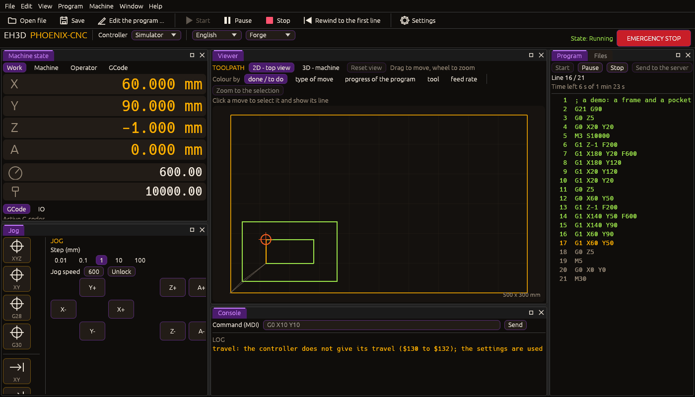
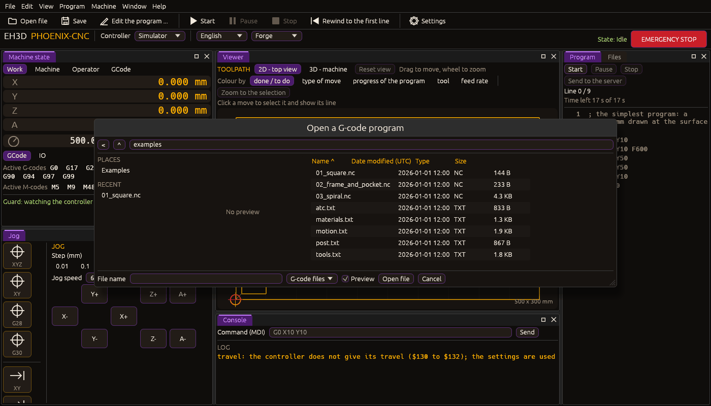

<p align="center">
  
</p>

#  EH3D-PHOENIX-CNC
<p align="center"><a href="README.md">🇺🇸 English</a> | <a href="README_spa.md">🇪🇸 Español</a> | <a href="README_fra.md">🇫🇷 Français</a> | 🇮🇹 <b>Italiano</b> | <a href="README_deu.md">🇩🇪 Deutsch</a> | <a href="README_zho.md">🇨🇳 中文</a> | <a href="README_jpn.md">🇯🇵 日本語</a> | <a href="README_por.md">🇵🇹 Português</a></p>

### La base comune dei programmi di controllo macchina EH3D: la vista di un lavoro, i temi e i testi dell'interfaccia in otto lingue

<p align="center">
  
  
  
  
  
  
</p>

---

**Verifica di onestà - cosa funziona oggi:** un programma Rust con una finestra (`phoenix-cnc`) che pilota una macchina **simulata**: mostra la posizione della macchina (pezzo e macchina), la sposta a mano con un tastierino di jog, imposta lo zero, esegue l'origine, accetta i comandi digitati dall'operatore, esegue un programma G-code riga per riga (con pausa, stop e arresto di emergenza), disegna il percorso del programma sul piano, in pianta o in 3D, con le righe eseguite segnate, e si ferma su ciò che il controllore rifiuta. Inoltre controlla, misura e prepara programmi (archi, cicli fissi, compensazione del raggio, aree vietate, un tastatore, una mappa delle altezze, un cambio utensile, una tabella utensili e una dei materiali), importa disegni e i file Gerber ed Excellon delle schede e invia un programma al server EH3D. L'interfaccia dei controllori (`eh3d-controller`, in EH3D-COMMON) è pilotata per GRBL, grblHAL, Marlin e Klipper contro simulatori dei loro dialetti su cavi simulati; le altre famiglie che elenca non sono pilotate. 1200 test girano su un computer. **Nulla di qui è stato eseguito su una macchina reale**: una porta seriale si apre solo per GRBL, grblHAL o Marlin e una connessione di rete solo quando un programma è inviato al server o si raggiunge Klipper con `--klipper`. Le macchine simulate accettano solo movimenti rettilinei e rifiutano archi, cicli fissi e tastatura, quindi questi sono misurati, controllati e cronometrati sulla carta, il percorso disegnato mostra un arco come la sua corda, e un programma che li contiene si ferma a quella riga sul simulatore. La finestra offre le 37 lingue della vista condivisa di EH3D-COMMON e porta undici temi, ma questo programma promette otto lingue: le parole dei suoi pannelli e strumenti esistono in inglese, spagnolo, tedesco, francese, italiano, giapponese, cinese e portoghese europeo.

---

> **Stato di sicurezza:** questo programma pilota per impostazione predefinita una macchina simulata. Con `--grbl`, `--grblhal` o `--marlin` (una compilazione con `--features serial`) apre una porta seriale e pilota un vero controllore GRBL, grblHAL o Marlin, e con `--klipper HOST[:PORT]` apre una connessione HTTP non cifrata verso Moonraker, l'interfaccia di Klipper (solo la rete locale, a meno che `klipper.allow_non_local` sia attivo; non c'è cifratura, quindi la credenziale `klipper.api_key`, se c'è, viaggia in chiaro in un'intestazione), nulla di ciò mai provato su una macchina reale; con un indirizzo di server nelle impostazioni apre una connessione di rete verso quel server e invia il token in chiaro via HTTP. Quando sarà collegato un controllore vero dovrà dimostrarsi su un simulatore e poi su una macchina reale prima di dirsi funzionante, e i finecorsa e un arresto di emergenza restano compito dell'unità di controllo della macchina; l'arresto di emergenza della finestra non è un circuito di sicurezza.

## 📋 In breve

| | |
|---|---|
| Versione | `0.2.3` |
| Maturità | Funzionale |
| Test | 1200 |
| Stack tecnologico | Rust |
| Su hardware reale | No: per impostazione predefinita pilota una macchina simulata; un vero controllore GRBL (`--grbl`) non è mai stato provato |

**Vai a:** [Panoramica](#-panoramica) · [Architettura](#-architettura) · [Avvio rapido](#-avvio-rapido) · [Test](#-test) · [Struttura](#-struttura-del-repository) · [Correlati](#-progetti-correlati)

## 🚦 Stato del progetto

Ogni riga è una parte di questo repository e la luce dice a che punto è oggi. È scritta in base a ciò che il repository può mostrare (test, compilazioni, esecuzioni), non a ciò che è previsto.

🟢 Fatto e verificato · 🟡 Funziona, con limiti noti · 🟠 Fatto a metà o non ancora verificato · 🔴 Non fatto o non funzionante

| Area | Stato | Cosa significa qui |
|---|---|---|
| Libreria di base | 🟡 | Un crate Rust che riesporta `scene`, `texts` e `theme` di `eh3d-view` con il nome di questo programma; richiede la cartella di EH3D-COMMON accanto. |
| Scena e viste | 🟡 | Scritta e provata in EH3D-COMMON; la finestra di questo programma disegna il percorso di un programma sul piano e la posizione dell'utensile (vista su un computer). |
| Temi e testi | 🟡 | Undici temi e le parole dell'interfaccia: la finestra offre le 37 lingue della vista condivisa, e le parole dei pannelli e degli strumenti propri di questo programma sono in otto; viste nella finestra di questo programma. |
| Test | 🟡 | 1200 test passano su un computer (`cargo test --features gui`): la sessione (jog, zero, origine, un programma, pausa, allarme, arresto di emergenza), il percorso di un programma e la riga di comando; il controllore simulato è provato in EH3D-COMMON. |
| Finestra e jog | 🟡 | Funziona su un computer con il controllore simulato: posizione, tastierino di jog, passi, avanzamento, origine, zero, sblocco, una riga di comandi e un registro; nessuna macchina reale. |
| Controllo della macchina | 🟠 | Solo simulatori: un programma gira riga per riga con pausa, stop e arresto di emergenza sulla macchina simulata o su un GRBL, grblHAL, Marlin o Klipper simulato; la porta seriale per GRBL, grblHAL e Marlin è dietro una funzione di compilazione, il collegamento HTTP di Klipper ha incontrato solo un Moonraker sostitutivo e nessun controllore reale è stato collegato. |
| Documentazione | 🟡 | README in otto lingue, le due immagini, tre programmi di esempio e il changelog. |

## 🎯 Panoramica

* La **finestra** (`src/gui.rs`, `phoenix-cnc`): la posizione della macchina (pezzo e macchina), un tastierino di jog con passi e avanzamento, origine, zero e sblocco, l'arresto di emergenza, una riga di comandi con il suo registro e il programma con il suo percorso sul piano.
* La **finestra a pannelli agganciabili** (`src/gui/shell.rs`, `src/panels.rs` e il telaio `eh3d-dock` di EH3D-COMMON): dodici pannelli che si possono togliere, rimettere, spostare, raggruppare in schede, far fluttuare e ripiegare contro un bordo (il percorso, il controllo manuale, lo stato della macchina, il programma, i file, la tabella utensili, il sensore utensile, la sonda e la mappa delle altezze, l'importazione, la pianificazione e il tempo, il rapporto e la console), quattro aree di lavoro secondo il compito (Prepara, Esegui, Verifica e Compatto), la barra dei menu e una disposizione che resta nel file delle impostazioni (righe `dock.*`), con i testi in otto lingue. Il controllore è avvolto nella guardia (`guard = off` nel file di movimento la toglie): la finestra le dà l'ora a ogni fotogramma, mostra perché ha fermato la macchina e offre il via libera, e un jog che ne incrocia un altro annulla prima il movimento in corso, così la regola di un solo ordine di movimento alla volta non scatta con una normale coppia di jog. Il pannello di pianificazione mostra il tempo con e senza anticipo, il pannello di importazione legge HPGL, DXF o SVG con un post-processore a scelta, e il pannello del sensore utensile manda la macchina al sensore solo dopo che l'operatore conferma che è al suo posto e libero, e scrive la lunghezza nella tabella utensili solo su richiesta. Disegnata e provata senza finestra (fotogrammi di egui nei test); non ancora vista su uno schermo reale né con una macchina reale.
* La **sessione** (`src/session.rs`): ciò che il programma fa con qualsiasi controllore di `eh3d-controller`: jog, zero, origine, inviare una riga, eseguire un programma riga per riga, pausa, stop e gli allarmi; è provata sul controllore simulato.
* Il **percorso di un programma** (`src/gcode.rs`): i movimenti (`G0`, `G1`, `G2`, `G3`, assoluti o relativi, in mm o pollici) disegnati prima dell'esecuzione, in pianta e in 3D; il percorso disegnato prende un arco come la sua corda, mentre la lunghezza, il tempo, le aree vietate e l'anticipo seguono la curva.
* Il **controllore simulato** (`eh3d_controller::sim`, in EH3D-COMMON): una macchina in memoria con limiti di corsa che danno allarme; accetta solo il G-code di base (movimenti rettilinei, unità, modo di distanza, lo zero pezzo, mandrino e refrigerante) e rifiuta archi, cicli fissi e tastatura. `eh3d-controller` elenca le famiglie di controllori del mercato: questo programma pilota GRBL, grblHAL, Marlin e Klipper (contro simulatori dei loro dialetti) e le altre risultano non ancora pilotate.
* I **temi e le parole** di `eh3d-view`: Forge (predefinito), Neon Arcade, Glass Pro, il grigio classico di Windows e uno che segue Windows, e l'interfaccia in inglese, spagnolo, italiano, tedesco, francese, portoghese, cinese e giapponese. Cosa sarà: un programma per forare, fresare e fare CNC 2D e 3D sui motori di EH3D-DRILLPRO ed EH3D-ROUTEPRO; quella parte non esiste ancora.
* I **menu, le impostazioni e i file**: i menu File, Modifica, Visualizza, Programma, Macchina, Finestra e Aiuto con le voci abituali (apri, recenti, salva, modifica, gli zeri, le posizioni memorizzate, il mandrino e il refrigerante); una finestra di impostazioni (unità, lingua, undici temi, limiti di corsa, jog) che si ricorda tra le esecuzioni; e le finestre Apri e Salva della suite (`eh3d-filedialog`: luoghi, ordinamento, filtri, l'estensione di un file salvato e la domanda prima di sostituire).
* **GRBL su una porta seriale:** compilato con `--features serial`, `phoenix-cnc --grbl PORTA[@BAUD]` comanda un controller GRBL (115200 baud di default) al posto del simulatore e `phoenix-cnc --ports` elenca le porte seriali; una build senza la funzione, o una porta che non si apre, lo dice ed esce. Provato solo contro un controller scriptato, mai contro uno reale. Con un controllore reale, `--start` (aprire il file e avviarlo all'apertura della finestra) viene rifiutato se non c'è anche `--start-real`, e `--start-real` da solo è un errore; `busy_wait` nel file delle impostazioni (4 ore per impostazione predefinita) è il tempo massimo in cui una riga attende la risposta mentre la macchina dice di essere al lavoro, e l'arresto si sente nel frattempo.
* **GRBL, grblHAL, Marlin e Klipper, contro simulatori:** `--grblhal PORT[@BAUD]` e `--marlin PORT[@BAUD]` (una compilazione con `--features serial`; Marlin va a 250000 baud se non se ne dà nessuno) pilotano quei controllori dietro la stessa guardia di GRBL, `--klipper HOST[:PORT]` pilota Klipper tramite Moonraker su HTTP non cifrato dietro la stessa guardia (solo la rete locale, a meno che `klipper.allow_non_local` sia attivo; i limiti del collegamento e la credenziale, se Moonraker ne chiede una, sono le chiavi `klipper.*` del file di movimento, e la credenziale non viene mai stampata né riscritta), e `--sim grbl|grblhal|marlin|klipper` pilota il dialetto di uno di essi su un cavo simulato senza nulla di reale: il cavo taglia le risposte in pezzi, aggiunge rumore, inverte bit e tace, con un seme fisso (le chiavi `wire_` del file di movimento), e Marlin può numerare le sue righe con un checksum perché una riga rovinata sia richiesta di nuovo (`marlin_numbering`, disattivato per impostazione predefinita). I controllori, i dispositivi simulati, il cavo e i testi degli errori nelle otto lingue sono quelli di `eh3d-controller` (EH3D-COMMON); questo programma conserva il riconoscimento del dialetto (`src/dialect.rs`), la guardia (`src/guard.rs`), le impostazioni e le parole proprie (`src/ctltext.rs`, `src/problem.rs`). `phoenix-cnc --dialect-check grbl|grblhal|marlin|klipper` fa passare un dialetto per una batteria di passi (stato, movimento, jog, homing, un rifiuto per numero, un controllore muto sotto la guardia, cavi rumorosi) e termina con il codice di uscita 2 se uno non passa. Tutto è simulazione; nulla ha incontrato un vero controllore, e il collegamento HTTP di Klipper ha incontrato solo un Moonraker finto nei test.
* **Le schede dai loro file Gerber ed Excellon:** `phoenix-cnc --import FILE` legge anche uno strato Gerber o un file di foratura Excellon con i lettori di EH3D-CORE-LIBS (quelli che usano gli altri programmi della suite) e stampa il G-code relativo (`src/pcb.rs`): l'isolamento di uno strato di rame (i percorsi a un raggio di utensile dal rame, in tante passate quante richieste), il contorno di uno strato di bordo (fuori dalla scheda e dentro i ritagli, in passate di profondità) e i fori e le asole di un file di foratura (prima la punta più piccola, una pausa per cambiarla, foratura a step). Lo strato è quello che dice il file (`--layer isolation|profile|drill` dice altro), gli strati del lato inferiore vengono specchiati (`--mirror` lo chiede) e il pannello Importa della finestra ha le stesse scelte. L'utensile, le passate, le profondità, gli avanzamenti, gli step, la griglia e i limiti sono le chiavi `pcb_` del file di movimento (`examples/motion.txt`); nessuna è nel codice. Nulla è stato tagliato su una macchina.
* **Una finestra che segue lo schermo:** si apre massimizzata e, da 720p a 1080p e fino a schermi più grandi e larghi, tutto cresce o si riduce con essa.
* **Riprendere dopo un guasto:** mentre un programma gira, la riga raggiunta viene salvata in un piccolo file; se cade la finestra, il computer o il collegamento, al successivo avvio si chiede se riprendere da quella riga o lasciare. Al controllore non viene inviato nulla finché l'operatore non risponde.
* **Inviato al server EH3D:** con l'indirizzo del server, il token di questo programma e l'id della macchina nelle impostazioni (sezione Server della finestra delle impostazioni, oppure `server_address`, `server_token` e `server_machine` nel file delle impostazioni), **Programma > Invia al server** invia il testo del programma come lavoro G-code; il server lo esegue sulla sua macchina (un controllore GRBL sulla sua porta seriale, o il suo simulatore) e la finestra lo segue: lo stato, la percentuale e la riga raggiunta nella barra in alto, nel pannello e nel registro. Avvia, Pausa e Ferma della finestra raggiungono il lavoro sul server, chiudere la finestra non lo ferma, e un lavoro interrotto riprende dalla riga raggiunta dal server (il successivo avvio della finestra lo propone, come per un programma del controllore): il server restituisce i codici in vigore e attende l'operatore prima del primo movimento. Il mandrino e il refrigerante ripartono solo con `server_restore_outputs = yes`. Provato con un server di prova; i test del server stesso inviano le stesse richieste al suo simulatore. Mai su una macchina. Il collegamento è il client comune della suite (`eh3d-serverclient` di EH3D-COMMON): quattro impostazioni in più, `server_timeout_s` (secondi che può durare un tentativo, da 1 a 120, 15 di default), `server_retries` (tentativi in più dopo un guasto di rete, da 0 a 5, 2), `server_mdns` (cercare il server in rete, `on` o `off`, spento di default; il programma non ha ancora un resolver proprio, quindi acceso non trova nulla) e `server_max_answer_mib` (il massimo di MiB letti da una risposta, da 1 a 256, 8); una connessione fallita viene ritentata con pause crescenti e una richiesta che crea qualcosa non viene mai inviata due volte; i rifiuti del server sono detti con il loro codice nella lingua della finestra; un accesso perso termina subito il monitoraggio invece che dopo quaranta risposte fallite; e il registro dice quando il collegamento sale, cade o è senza accesso.
* **Ripresa dopo un guasto:** un programma lasciato a metà viene prima riportato al suo stato: unità e distanze assolute, una Z sicura (`resume_safe_z` nel file delle impostazioni, 5 mm), il mandrino con il tempo per raggiungere la velocità (`resume_spindle_wait`, 3 s), il refrigerante, il punto raggiunto e lo stato modale; il file di recupero conserva lo SHA-256 del programma e non prosegue se il programma è cambiato. La riga da cui si riprende è presa `resume_backoff` righe (16 per impostazione predefinita) prima dell'ultima inviata, perché il controllore tiene alcune righe nel suo buffer; un'immersione alla profondità senza avanzamento del programma usa `resume_plunge_feed` (100 mm/min per impostazione predefinita).
* **Le righe destinate al controllore stesso non vengono inviate per impostazione predefinita:** una riga di programma che inizia con `$` (un'impostazione o un comando di GRBL, come `$130=9999`, `$X` o `$RST=*`) ferma il programma su quella riga senza inviarla; con `program_system_commands = yes` nel file delle impostazioni vengono inviate.
* **Gli aiuti della finestra:** un **riepilogo prima dell'avvio di un programma** (i movimenti, la distanza di taglio, il tempo alle velocità delle impostazioni, l'escursione degli assi e un controllo rispetto alla corsa della macchina, con gli avvisi condivisi dalla suite: un programma minuscolo o lontano dall'angolo, più grande del piano e tagli prima di qualsiasi avanzamento; gli archi sono misurati lungo la curva e ogni cambio utensile aggiunge il suo tempo; **Avvia comunque**, oppure un rifiuto quando il programma esce dalla corsa, che `reject_out_of_travel = no` trasforma in avviso, e `confirm_start = no` disattiva il riepilogo); **tasti della tastiera** (Ctrl+O apri, Ctrl+S salva, Ctrl+E modifica, F5 avvia, Spazio pausa, Esc ferma (con una finestra aperta Esc la chiude, e con la tastiera in una casella di testo Spazio ed Esc restano alla casella), F1 li elenca; `shortcuts = no` li disattiva); una **barra degli strumenti** con disegni e i loro nomi; numeri che si cambiano con meno e più o **scrivendoli**; il percorso **trascinato e ingrandito dall'alto o ruotato e ingrandito in 3D** con l'utensile; un'**anteprima del file G-code** nella finestra Apri; il **registro di un arresto anomalo** (`eh3d-crash.log`); e una sezione Sicurezza nelle impostazioni (`rapid`, `summary_tiny`, `summary_far` e `summary_margin` nel file delle impostazioni).
* **Una coda di programmi e la corsa del controllore:** più file scelti nella finestra Apri con Ctrl+clic, trascinati insieme o dati sulla riga di comando (`phoenix-cnc a.nc b.nc`) vengono eseguiti uno dopo l'altro, ciascuno dopo il proprio riepilogo; la finestra li elenca con il loro stato, permette di rimuovere, saltare e riordinare quelli in attesa, e la coda si ferma quando un programma non termina. Con un controllore GRBL il programma legge `$130`, `$131` e `$132` (la corsa massima di X, Y e Z) alla connessione e usa il minore tra questo e `travel_x`, `travel_y` e `travel_z` per il riepilogo e il rifiuto; se il controllore non risponde o non li fornisce, si usano le impostazioni e il registro lo dice (`read_controller_travel = no` disattiva la lettura).
* **Controlli del programma, limiti software del jog e sonda:** il riepilogo dice anche cosa sembra sbagliato nel programma (un movimento rapido che finisce sotto la superficie, un taglio a mandrino fermo, un mandrino avviato senza velocità, un cambio utensile, un programma senza fine, e un avanzamento o una velocità del mandrino sopra `lint_max_feed` o `lint_max_rpm`, che valgono 5000 mm/min e 24000 giri/min di default e sono spenti a 0; `lint = no` spegne i controlli e `lint_rapid_floor` fissa lo Z sotto il quale si segnala un rapido). Un passo del jog che supererebbe la corsa viene accorciato fino al limite e uno che parte dal limite verso l'esterno viene rifiutato (`jog_soft_limits` è `homing` per impostazione predefinita: il limite vale solo dopo l'homing; `always` lo applica dall'inizio e `no` lo spegne). **Macchina > Tastare Z** esegue il ciclo su una piastra di contatto (`probe_feed`, `probe_depth`, `probe_retract`, `probe_plate` e `probe_clearance` nel file delle impostazioni) e **Macchina > Tastare una griglia** tocca una griglia sui tagli del programma (`probe_grid` mm di distanza) per costruire una mappa delle altezze; **Correggere il programma con la mappa delle altezze** divide ogni movimento di taglio in pezzi di al massimo `heightmap_segment` mm e alza o abbassa ciascuno secondo l'altezza sottostante (un programma in millimetri assoluti senza archi; uno che esce dall'area tastata viene rifiutato) e **Annullare la correzione di altezza** rimette il programma com'era. Le due tastature chiedono prima conferma perché la macchina si muove, e un controllore senza sonda le rifiuta. Provato solo con controfigure; nulla è stato eseguito su una macchina reale. Il controllo segnala anche un arco dato dal centro che finisce a una distanza dal centro diversa da quella di partenza, o dato da un raggio minore della metà della distanza tra i suoi estremi (un controllore li rifiuta con un errore di raggio), un mandrino a cui si ordina di girare nell'altro verso senza fermarlo prima e un avanzamento pari a zero.
* **Gli strumenti del programma, nella finestra e da riga di comando:** **Programma > Controllare il programma...** elenca ciò che trovano i controlli, riga per riga (il numero accanto a ogni rilievo mostra quella riga nel pannello del programma), **Programma > Riquadri vietati...** modifica i punti dove l'utensile non deve andare (un programma che ne attraversa uno non parte, salvo con `keepout_reject = no`) e **Programma > Statistiche e simulazione...** riproduce il percorso sulla carta con il cursore sulla riga, mentre il pannello del programma indica il tempo che manca. La coda ripete un programma (una casella con il numero di passate), chiede all'operatore o attende `queue_pause` secondi tra due passate, mostra il suo tempo totale e viene conservata in un file tra un'esecuzione e l'altra (torna in attesa: nulla parte da solo). Il menu **Macro** esegue dopo conferma le macro di `phoenix-cnc-macros.txt` (accanto al file delle impostazioni); **Macchina > Salvare la mappa delle altezze...** e **Macchina > Caricare una mappa delle altezze...** conservano la mappa in un file (mai sovrascritto senza chiedere) e **File > Esportare il registro della sessione...** salva il registro come testo, CSV o JSON (mai sopra un file). I loro valori (`progcheck`, `keepout`, `keepout_margin`, `keepout_reject`, `queue_repeat_max`, `queue_confirm_between`, `queue_pause`, `queue_remember`, `sim_speed`, `macros_confirm`, `macros_max_lines`, `log_max_entries` e `tool_change_time`) sono nel file delle impostazioni, e la finestra li conserva quando salva le altre impostazioni. `phoenix-cnc --report FILE` stampa gli stessi rilievi con le statistiche e il tempo di un programma senza aprire la finestra (codice di uscita 0 se nulla da leggere, 1 se c'è qualcosa, 2 se il file non si può leggere; `--lang` sceglie la lingua), e `--version` e `--help` rispondono subito. Provato solo sul simulatore; nulla ha girato su una macchina reale. Un movimento su un arco viene verificato rispetto ai riquadri vietati lungo la sua curva e non solo con la corda (un arco la cui curva non si può calcolare resta verificato con la corda e il rapporto lo dice), e le statistiche indicano la Z più bassa raggiunta dai tagli e in quanti livelli di profondità terminano.
* **La finestra delle impostazioni ha cinque sezioni per gli strumenti del programma:** **Controlli** (il primo e il secondo controllo, il margine e il rifiuto delle zone vietate, il limite inferiore dei movimenti rapidi e l'avanzamento e la velocità del mandrino più alti), **Sonda e mappa delle altezze** (la sonda, la griglia, la lunghezza dei pezzi di un taglio corretto e i limiti del movimento manuale) e **Coda, macro e registro** (le ripetizioni e la pausa della coda, la velocità della simulazione, le voci del registro di sessione, le macro e il tempo di un cambio utensile). Ogni numero resta nell'intervallo che il file delle impostazioni accetta (l'intervallo è il suo suggerimento), **Valori predefiniti di questa sezione** riporta una sezione allo stato iniziale e il salvataggio conserva tutte le altre chiavi del file. Seguono altre due sezioni: **Cambio utensile** (se il cambio viene calcolato, il suo magazzino, l'altezza di sicurezza, il blocco e il soffio con i loro intervalli, i posti letti dal file della tabella e le sue righe scartate, e un pulsante che scrive la tabella di esempio senza mai scrivere su una esistente) e **Materiali** (il materiale in uso e i suoi intervalli, il file della libreria, un pulsante che scrive la libreria di esempio senza scrivere su un file, e un piccolo editor della tabella dei materiali che controlla ogni riga e chiede prima di sostituire il file).
* **Un rapporto di lavoro in una sola pagina HTML:** **File > Esporta il rapporto di lavoro...** (o `phoenix-cnc --report FILE.NC --html RAPPORTO.html`) scrive una pagina che contiene tutto, senza script, senza collegamenti e senza immagini a parte: le statistiche e il tempo del programma, gli utensili, ciò che sembra sbagliato con la sua riga, il percorso visto dall'alto con le righe che hanno un avviso cerchiate e la mappa delle altezze come una griglia di colori quando ne è stata misurata una. Segue la lingua, i colori seguono il modo chiaro o scuro del browser e un file esistente non viene mai sovrascritto.
* **Il percorso si può colorare, filtrare per utensile e cliccare:** sotto il titolo del percorso (nel piano e in 3D) una riga sceglie come colorarlo (**fatto / da fare**, **tipo di movimento**: rapido, taglio, penetrazione e arco; **avanzamento del programma**, dal blu al rosso lungo il tragitto; **utensile**; oppure **velocità di taglio**, dalla più lenta alla più veloce), mostra una casella per ogni utensile del programma (un utensile si nasconde o si mostra con la sua casella e l'ultimo visibile resta) e ha **Zoom sulla selezione** per il piano e per il 3D (nel 3D il movimento va al centro della vista, con la rotazione che ha). Un clic su un movimento lo seleziona (viene disegnato spesso), il pannello del programma ne mostra la riga e la riga dice il numero, il suo codice, il tipo di movimento, la lunghezza, l'avanzamento e l'utensile. Il piano e la vista 3D mantengono il trascinamento, la rotella e il doppio clic. Per le immagini, `--color MODO` (`state`, `kind`, `progress`, `tool` o `feed`) e `--select RIGA` (una riga del programma, da 1) avviano la finestra con quella colorazione e quel movimento selezionato, insieme a `--shot`.
* **Un editor per il programma:** l'editor del programma (Ctrl+E) mostra il testo con i **numeri di riga** nel margine (le righe su cui il controllo ha qualcosa da dire sono colorate), **cerca e sostituisci** (con o senza maiuscole; Invio trova il successivo; si sostituisce uno o tutti e si dice quanti), **vai alla riga**, le **note del controllo per il testo così come viene scritto** (un clic sul numero di una nota porta alla sua riga) e **Applica**, che mette il testo nel programma (non mentre un programma è in esecuzione). **Applica e salva** chiede nell'editor stesso, con Sostituisci e Annulla, prima di scrivere sul file da cui viene il programma (la domanda sparisce se il testo cambia), e **Applica e salva come...** passa dalla finestra Salva, che chiede prima di sostituire un file esistente. Le regole (`src/editor.rs`) sono testate senza finestra.
* **Profili macchina:** nella sezione Generale delle impostazioni una macchina può essere salvata come profilo (la corsa dei tre assi, la velocità del mandrino e il suo limite di avviso, l'avanzamento del jog, la velocità rapida e il limite di avviso dell'avanzamento, e i valori della sonda) e ripresa con un clic; OK mantiene la scelta e Annulla lascia le impostazioni com'erano. Il file delle impostazioni contiene una riga `profile = NOME | tx=0,500 | ty=0,300 | tz=-100,50 | spindle=10000 | ...` per profilo (fino a 16, nomi di al massimo 40 caratteri, un valore non valido mantiene quello predefinito) e `profile_active = NOME` per quello in uso. `phoenix-cnc --profile NOME` avvia la finestra (o `--report`) con i valori di quel profilo; un nome non salvato viene segnalato nel registro (o rifiutato da `--report`) e le impostazioni restano come sono. Le regole (`src/profiles.rs`) sono testate senza finestra.
* **Trasforma il programma:** **Programma > Trasforma il programma...** sposta (X, Y, Z), ruota (gradi, attorno a un punto), scala e specchia (X, Y) il programma caricato, e **Programma > Annulla la trasformazione** lo ripristina. Le righe sono riscritte sul posto (le parole che non cambiano, i commenti e la spaziatura restano come scritti), gli archi mantengono i loro centri e uno specchio dispari trasforma un arco orario in antiorario (i codici `G2` e `G3` sono scambiati). Un programma che la modifica potrebbe rendere errato è rifiutato, indicando la riga e il motivo: distanze relative (`G91`), un piano diverso da XY, cicli fissi e movimenti di tastatura, codici che usano posizioni macchina o spostano lo zero (`G10`, `G28`, `G30`, `G53`, `G92`, `G43.1`), centri d'arco assoluti (`G90.1`) o una scala non superiore a 0. Si assume che il programma parta dall'origine, come fa il percorso. Un programma in esecuzione non viene mai modificato. `--window transform` la apre. Quando il primo movimento del programma omette X o Y, la finestra avvisa e chiede dove si trova l'utensile prima del programma (l'origine per impostazione predefinita); la coordinata omessa viene presa da lì e scritta ogni volta che la modifica la sposta. Le regole (`src/transform.rs`) sono testate senza finestra, compreso il fatto che il percorso del nuovo programma è il vecchio trasformato. **Usa la posizione dell'utensile** inserisce in quel punto di partenza la posizione reale dell'utensile (nelle unità del programma).
* **Segnalibri e avvio da una riga:** fai clic su una riga del pannello del programma per selezionarla e doppio clic per segnarla (una riga segnata ha una stella dopo il numero), oppure usa **Programma > Segna la riga selezionata**, **Segnalibro successivo** e **Segnalibro precedente**; **Programma > Segnalibri e avvio da una riga...** (`--window bookmarks`) elenca i segnalibri, salta a uno e parte da lì o dalla riga selezionata. Prima di preparare qualsiasi cosa, la finestra legge le righe precedenti e dice cosa aveva attivo il programma: pollici, un piano diverso da XY, le coordinate di lavoro, la correzione della lunghezza utensile, l'ultimo utensile richiesto (non si fa alcun cambio utensile), il mandrino e la sua velocità, il refrigerante, uno zero spostato e un movimento di taglio prima di qualsiasi avanzamento; un avvio con distanze relative (`G91`), un ciclo fisso o una compensazione del raggio ancora attivi viene rifiutato. **Prepara l'avvio** richiede una spunta che dica che utensile, mandrino e zero sono stati controllati (`startline_confirm = no` nel file delle impostazioni, o la casella nella sezione Coda, macro e registro, la toglie), riporta il controllore in quello stato come per un programma lasciato a metà (fino all'altezza di sicurezza, il mandrino con la sua attesa, sopra il punto del programma) e lascia il programma in pausa alla riga: la macchina si muove solo premendo Riprendi, e un programma in esecuzione non viene mai toccato. I segnalibri appartengono al programma caricato. I segnalibri si possono conservare tra una sessione e l'altra: **Salva i segnalibri accanto al programma** scrive `part.nc.marks` accanto a `part.nc` (le righe e l'impronta del programma, fino a 200 segnalibri e 16 KiB; chiede prima di sostituire un file, cosa che `bookmarks_confirm_replace = no` disattiva, e lascia stare un file che ha già questi segnalibri), il file viene riletto all'apertura del programma (`bookmarks_load`, attivo per impostazione predefinita; un file scritto per un'altra versione del programma viene escluso e il registro lo dice), **Carica i segnalibri salvati** li aggiunge all'elenco, e i tasti **Ctrl+B** (segnalibro sulla riga scelta), **F2** e **Ctrl+F2** (segnalibro successivo e precedente) sono nell'elenco dei tasti e scritti accanto alle voci del menu. Le regole (`src/bookmarks.rs`, `src/startline.rs`) sono testate senza finestra.
* **Un cambio utensile con blocco e soffio, in simulazione:** una riga `atc = on | safe=5 | rack=0,0,-5 | pitch=20,0 | lock=3,0.5 | blow=4,1` nel file delle impostazioni (spento salvo che dica `on`) descrive un cambio: il magazzino (X, Y, Z della posizione dell'utensile 1 e il passo alla successiva), l'altezza di sicurezza, l'uscita e l'attesa del blocco e l'uscita e i secondi del soffio. Per ogni cambio di un programma si calcolano i passi (fermare il mandrino, riporre il vecchio utensile, sbloccare, soffiare il mandrino vuoto, prendere il nuovo utensile, bloccare), le righe di G-code (`M65 P` / `M64 P`, `G4`) e il tempo; `--report` e la finestra delle Statistiche elencano i cambi e la stima usa quel tempo al posto di `tool_change_time`. Non viene inviato nulla alla macchina. Il posto di ogni utensile può venire da una tabella invece che dal passo: `phoenix-cnc-atc.txt`, accanto al file delle impostazioni, ha una riga `tool = NUMERO | pos=X,Y` per ogni utensile del magazzino (`examples/atc.txt` è un modello; fino a 64 utensili numerati da 1 a 255, posti distanti almeno 1 mm, file fino a 16 KiB); un utensile che non c'è conserva il magazzino e il passo, e ogni riga scartata è indicata con il numero e il motivo in `--report` e nella finestra delle statistiche. Con riquadri vietati nelle impostazioni, ogni cambio viene provato anche contro di essi: l'utensile sale, passa sopra i posti e scende nei punti del magazzino (in coordinate macchina), partendo da dove il programma ha l'utensile a quella riga (la sua posizione di lavoro più lo zero del lavoro), e un cambio i cui movimenti attraversano un riquadro viene indicato con la sua riga, l'utensile e il riquadro in `--report`, nella finestra di controllo e nel rapporto di lavoro, e rifiuta l'avvio finché `keepout_reject` è attivo. Le regole (`src/atc.rs`) sono testate senza finestra.
* **Una tabella utensili:** `phoenix-cnc-tools.txt`, accanto al file delle impostazioni (`examples/tools.txt` è un modello), ha una riga `tool = NUMERO | name=NOME | diameter=MM | length=MM | flutes=N` per ogni utensile della macchina (il diametro è necessario; fino a 64 utensili numerati da 1 a 255, file fino a 16 KiB). `phoenix-cnc --report` e la finestra delle statistiche ne elencano la dimensione, le righe scartate con il loro numero e il motivo (negli otto idiomi) e, per ogni utensile che un programma prende (`T` poi `M6`), ciò che la tabella ne dice (il nome, il diametro e i taglienti); un utensile che il programma prende e che la tabella non ha è un avviso con la sua riga (non un problema: il codice di uscita di `--report` resta 0), e a una macchina senza tabella non si dice nulla. Il file viene solo letto. Le regole (`src/tools.rs`) sono testate senza finestra.
* **I cicli fissi vengono espansi nei loro movimenti:** `G73`, da `G81` a `G86` e `G89` (distanze assolute, piano `G17`) sono sostituiti, per il percorso, il tempo, i riquadri vietati e le statistiche, dai movimenti che rappresentano (fino al foro, discesa al piano R, taglio fino alla profondità Z, a passi di Q, una pausa di P, uscita, ritorno al livello di partenza con `G98` o al piano R con `G99`), così un programma di foratura si misura dai suoi fori; il rapporto dice quanti ne sono stati espansi. Un ciclo senza profondità, senza piano R o con uno che non è sopra la profondità, senza passo Q, in modo relativo o in un altro piano, uno mai annullato con `G80` e i cicli di alesatura che non vengono espansi (`G87`, `G88`) sono segnalazioni con la loro riga, in otto lingue. Le regole sono in `src/cycles.rs`. Il percorso disegnato nella finestra prende ancora le righe così come sono. Solo simulazione.
* **Compensazione utensile in simulazione:** `G41` (a sinistra), `G42` (a destra) e `G40` spostano i movimenti di taglio rettilinei del raggio dell'utensile (il suo diametro nella tabella utensili, per l'utensile in uso o quello che nomina una parola `D`) e uniscono gli spigoli dove si incontrano le linee spostate. Il controllo segnala, con la sua riga: una compensazione attivata o disattivata da un movimento che non è rettilineo, una mai disattivata prima di un cambio utensile o della fine del programma, un arco più stretto dell'utensile dal lato della compensazione, un movimento che si inverte perché lo spigolo è più stretto dell'utensile (un pericolo: taglierebbe il pezzo) e un utensile senza diametro nella tabella; il rapporto aggiunge la lunghezza del percorso del centro dell'utensile accanto a quella programmata. Gli archi non vengono spostati. Le regole sono in `src/cutcomp.rs`.
* **Sistemi di coordinate di lavoro e i loro offset:** i controlli indicano gli offset che scrive una riga `G10 L2` o `G10 L20` (il sistema e X, Y, Z, un trattino per un asse che lascia), una `P` che non è un sistema di lavoro, offset scritti dopo che in quel sistema c'erano già stati movimenti, un sistema usato che il programma non scrive mai, e un movimento di taglio subito dopo un cambio di sistema senza un movimento rapido in mezzo; il rapporto elenca i sistemi in uso con i loro movimenti. Le regole sono in `src/wcs.rs`.
* **Quanto consuma un utensile, secondo il materiale:** con la vita di un utensile nella tabella utensili e il materiale delle impostazioni, il rapporto dice quanti minuti di vita il programma consuma in ogni utensile, quale parte della sua vita è e quante esecuzioni gli restano. La vita della tabella vale come vita nel legno e un materiale più duro la consuma più in fretta secondo un fattore preso dal nome del materiale (espanso, legno, plastica, alluminio, ottone e rame, circuiti stampati e compositi, acciaio e titanio, nominati in otto lingue): una regola empirica, mai misurata su una macchina; un nome che non conosce non riceve stima. Le regole sono in `src/consumption.rs`.
* **Validatore delle macro, aiuto delle parole del G-code e test con seme fisso:** `phoenix-cnc --macros FILE` dice cosa lascia attivo ogni macro di un file alla fine (distanze relative, un sistema di lavoro diverso da `G54`, il mandrino o il refrigerante, un ciclo o una compensazione, pollici, un altro piano), una macro senza righe, una che termina il programma e una che si muove senza scegliere `G90` o `G91` (codice di uscita 0 niente, 1 qualcosa da leggere, 2 errore); `phoenix-cnc --gcode G83` stampa, nella lingua di `--lang`, come si scrive un codice e cosa fa (`--gcode "G1 X5 F100"` dà le parole di una riga). Mille programmi inventati con seme fisso attraversano ogni analisi senza panic, e la prima esecuzione ha trovato che una lettera fuori da A-Z fuori da un commento fermava il percorso di un programma (ora viene scartata). Le regole sono in `src/macrocheck.rs`, `src/gcodehelp.rs` e `src/fuzz.rs`.
* **Livello di movimento, solo simulazione:** i pezzi di un programma di controllo generale, tutti provati con controllori simulati e mai su una macchina. `src/dialect.rs` legge la versione (`$I`), le impostazioni (`$$`) e lo stato del parser (`$G`) di GRBL e grblHAL, e `src/ctltext.rs` contiene gli allarmi e gli errori di GRBL nelle otto lingue. `src/guard.rs` fallisce in sicurezza: un movimento non viene mai inviato due volte, un controllore che tace mentre può muoversi viene fermato e la macchina è rifiutata finché l'operatore non ripristina, un secondo ordine di movimento con uno attivo è uno stop, un obiettivo di jog non rinnovato in tempo lascia la macchina ferma e una posizione che salta non viene creduta; ognuna ha il suo interruttore nel file di movimento e parte attiva. Il controllore che sbaglia di proposito (silenzio, occupato, un errore a una riga, una posizione falsa) per provarla è `faulty` di `eh3d-controller`. `phoenix-cnc --lookahead FILE` stampa il tempo con l'anticipazione del pianificatore (`src/lookahead.rs`: la velocità in ogni angolo dalla deviazione di giunzione, l'accelerazione di ogni asse, un profilo di velocità per ogni movimento; gli archi sono ricostruiti come brevi tratti rettilinei solo con `arcs = on`). `phoenix-cnc --import DISEGNO` legge HPGL, DXF o SVG con limiti di dimensione e di punti (nulla viene espanso, nulla provoca un panic) e stampa il G-code che taglia lungo il percorso, passata per passata (`src/import.rs`). `phoenix-cnc --post NOME` fa passare un programma, o un'importazione, per un post-processore scritto come regole in un file di testo (`src/post.rs`; uno script non viene mai eseguito: `post_scripts` è spento per impostazione predefinita e questa versione non ha un motore di script). Il sensore utensile (`src/toolsetter.rs`) misura un utensile toccando un sensore e scrive la sua lunghezza nella tabella utensili. Tutti i valori sono in `phoenix-cnc-motion.txt` accanto al file delle impostazioni (`examples/motion.txt`; `examples/post.txt` è un post-processore). Non provato su una macchina.
* **Conversione, confronto, tempi, correttori e formato da riga di comando:** `phoenix-cnc --convert in FILE` (o `mm`) stampa il programma nell'altra unità (ogni lunghezza e l'avanzamento sono moltiplicati per 25,4 o divisi per 25,4, riga per riga, dall'unità in vigore su quella riga; le parole `G20`/`G21` vengono riscritte; si segnalano un cambio di unità a metà programma, un valore dato da un parametro o da un'espressione, un avanzamento in tempo inverso e un programma che non dice mai la sua unità); `--compare FILE2` dice dove due programmi differiscono (righe con codice, movimenti, lunghezza in rapido e di taglio, tempo, cambi utensile, utensili, estensione, taglio più profondo, segnalazioni); `--times` ripartisce il tempo per tipo di movimento (rapido, taglio, penetrazioni, archi, pause, cambi utensile) e somma il tempo delle statistiche; `--offsets` controlla la `H` di `G43` e la `D` di `G41`/`G42` con la tabella utensili (un utensile che la tabella non ha, uno che non è l'utensile attivo, un utensile con lunghezza che taglia senza `G43`); `--format grbl|full|generic` controlla il formato per un tipo di controller (`grbl` elenca ciò che documenta GRBL, `full` un controller con cicli fissi, compensazione utensile e cambio utensile, `generic` solo la struttura) (lunghezza della riga, decimali, righe `%`, i codici che il profilo elenca, due codici di un gruppo in una riga, una parola due volte in una riga, la fine del programma). Il codice di uscita è 0 se pulito, 1 se c'è qualcosa da leggere (per `--compare`, se differiscono) e 2 in caso di errore. Un codice che un profilo non elenca è un motivo per leggere la riga, non la prova che un controller lo rifiuti. Le regole sono in `src/units.rs`, `src/compare.rs`, `src/timesplit.rs`, `src/offsets.rs`, `src/postcheck.rs` e `src/cli_tools.rs`.
* **Il pannello server della suite e la macchina sul server:** la sezione Server della finestra delle impostazioni è ora il pannello che mostrano tutti i programmi della suite (EH3D-COMMON): l'indirizzo, il token del programma, la macchina, i limiti del collegamento, lo stato del collegamento, una prova della connessione e l'accesso e l'uscita di una persona; l'accesso resta in memoria e il lavoro inviato al server lo usa. **Macchina > Macchina sul server...** (o `--window machine`) mostra dove si trova la macchina del server e chiede le rotte del suo plugin `cnc`: un movimento a mano limitato da `server_jog_max_mm` (da 0,01 a 500, 50 di default) e `server_jog_max_feed` (da 1 a 30000, 1000), che, se supera `server_jog_confirm_mm` (da 0 a 500, 10; 0 chiede a ogni movimento), viene inviato solo dopo una domanda e non viene inviato affatto finché la macchina è bloccata o un lavoro è in corso; l'arresto di emergenza, che parte subito e senza domande; e il rilascio del blocco, inviato solo dopo una domanda e solo con l'accesso di un amministratore. Le richieste girano in un thread a parte. La macchina dietro queste rotte è per ora il simulatore del server: nulla ha mosso una macchina reale. Le regole sono in `src/cncroutes.rs` e `src/serverlink.rs`.
* **Portautensili, usura per passata, ripartenza, modelli di macchina, profili di formato propri e `--out`:** `phoenix-cnc --holder FILE` dice dove un utensile con `reach` nella tabella utensili (`reach=MM`, quanto sporge dal portautensili) entra nel materiale più di quanto sporga, prendendo Z0 come superficie; `--life FILE` segue passata per passata gli utensili con `life` (una serie di movimenti di taglio tra due rapidi) con i minuti di ogni passata, la parte di vita usata dopo di essa e la passata e la riga in cui un utensile si esaurisce; `--restart RIGA FILE` stampa il programma come ripartirebbe da quella riga, con unità, modo delle distanze, piano, sistema di lavoro, correzione di lunghezza, avanzamento e velocità riscritti, ciò che avvierebbe la macchina scritto come commenti e un `M0` prima del primo movimento; `--template NOME` stampa le impostazioni di una piccola fresatrice, una fresatrice per legno, un'incisora o una fresatrice per circuiti da cui partire (`--templates` le elenca); `--format` accetta anche il nome o il percorso di un file di profilo proprio (`base`, `max_line`, `max_decimals`, `percent`, `needs_end`, `allow_g`, `deny_g`, `allow_m`, `deny_m`; un nome si cerca accanto al file delle impostazioni come `phoenix-cnc-format-NOME.txt`); e `--out FILE` scrive ciò che stampa uno strumento in un file nuovo e mai su uno esistente (codice di uscita 2). Le regole sono in `src/holder.rs`, `src/life.rs`, `src/restart.rs`, `src/templates.rs`, `src/postcheck.rs` e `src/cli_tools.rs`.
* **Punti di partenza dei materiali comuni, carico per dente e formati di Marlin e Klipper:** `phoenix-cnc --feeds MATERIALE[,OPERAZIONE[,DIAMETRO[,FRESA]]]` stampa il punto di partenza che il database di lavorazione di EH3D-COMMON dà per un materiale (il suo identificativo, come `wood/mdf`, il nome breve o il nome in una delle otto lingue), un'operazione (`contour`, `pocket`, `engrave`, `drill`) e una fresa di quel diametro: la velocità del mandrino, l'avanzamento, il tuffo, la profondità di una passata e la sovrapposizione, con il carico per dente, la sua quota del diametro e la velocità di taglio, e una riga quando il truciolo è troppo sottile (la fresa striscia) o troppo spesso (può rompersi). Tra due diametri noti traccia una retta tra di essi e lo dice, fuori da essi dice che nulla viene estrapolato (codice di uscita 2), e ogni punto porta la nota che i valori iniziali del database non sono mai stati provati su una macchina; senza diametro elenca i punti del materiale. `--materials FAMIGLIA|all` elenca i materiali che una fresatrice lavora, con il numero di punti di ciascuno e quanti sono stati provati su una macchina (nessuno finora). Il materiale delle impostazioni (`material = wood/mdf`) può ora essere uno di quel database quando la libreria dell'operatore non ha un materiale con quel nome, e il controllo di un programma si regola allora sull'avanzamento e sulla velocità più bassi e più alti dei suoi punti. `--format marlin` e `--format klipper` si aggiungono a `grbl`, `full` e `generic`: Marlin elenca i codici G e M della sua documentazione (`M30` lì non è una fine, cancella un file della scheda) e righe di al massimo 96 caratteri, Klipper accetta solo millimetri e non ha mandrino; un codice che un profilo non elenca è un motivo per leggere la riga, non la prova che il controllore lo rifiuti. Le regole sono in `src/sharedmat.rs` e `src/postcheck.rs`.
* **Una libreria di materiali per i controlli:** la sezione dei controlli delle impostazioni ha un elenco **Materiale** (`material = NOME` nel file delle impostazioni); un programma viene allora confrontato con l'intervallo di avanzamento di taglio e di velocità del mandrino suggerito per quel materiale, e il controllo segnala, con la riga e nelle otto lingue, quando un movimento in X o Y va sotto o sopra l'intervallo di avanzamento (una discesa solo in Z non vi è soggetta) o quando una velocità del mandrino è sotto o sopra l'intervallo di velocità. I valori sono in un file di testo, non nel programma: `examples/materials.txt` è incluso e si usa finché non c'è un file proprio, e `phoenix-cnc-materials.txt` accanto al file delle impostazioni lo sostituisce (una riga `material = NOME | feed=MIN,MAX | rpm=MIN,MAX` per materiale, fino a 64, ciascun intervallo può mancare). `phoenix-cnc --report` usa anch'esso il materiale delle impostazioni. Gli intervalli sono solo punti di partenza: avvisano, non fermano mai un programma. Le regole (`src/materials.rs`) sono testate senza finestra.
* **Usura degli utensili, livelli di profondità, un'accelerazione per il tempo e un interruttore per ogni nuovo controllo:** una riga della tabella degli utensili può dire `life=MIN | used=MIN`, e il rapporto, la finestra delle statistiche e il rapporto di lavoro nominano allora un utensile consumato, uno che il programma consumerebbe e uno a cui resta un quinto della vita o meno; il rapporto, la finestra delle statistiche e il rapporto di lavoro elencano i livelli di profondità dei tagli (la Z, quanti movimenti di taglio finiscono lì e la loro lunghezza) dalla superficie in giù; `accel` nel file delle impostazioni (mm/s2, 0 per impostazione predefinita) mette l'accelerazione della macchina nel tempo stimato, nel tempo rimasto e nel tempo della coda; la sezione dei controlli delle impostazioni ha una casella per gli archi che un controllore rifiuta (con `lint_arc_gap`, lo scarto con cui un arco può finire fuori dal suo cerchio), una per un mandrino a cui si ordina di invertire senza fermarsi e una per un avanzamento pari a zero; e un cambio utensile senza numero di utensile (`T`) scelto prima è un avviso.
* **Viste fisse del visualizzatore:** **Vista > Vista dall'alto, Vista frontale, Vista laterale** e **Vista isometrica** (o **Ctrl+1** a **Ctrl+4**) mettono il percorso in quella vista: quella dall'alto è la pianta, quelle frontale e laterale guardano lungo un asse, a livello del piano, e quella isometrica è la vista con cui parte la finestra. `--view top|front|side|iso` (oltre a `plan` e `3d`) avvia la finestra in una di esse, da usare con `--shot`. Il piano è la vera vista ortografica dall'alto di EH3D-COMMON (`StandardView::Top`): X a destra, Y in alto, la stessa scala su entrambi gli assi, centrata nell'area.
* **Tab completa il codice nella casella dei comandi:** finché la casella in basso nella finestra ha la tastiera, Tab completa il codice che si sta scrivendo (`G38` dà `G38.`, `M30` dà `M30 `, `$J` dà `$J=`) oppure, quando ne stanno bene diversi, scrive ciò che hanno in comune e li elenca accanto alla casella (`G5` elenca da `G53` a `G59`). Agisce sull'ultima parola della riga, non distingue maiuscole e minuscole e non invia nulla: la riga parte sempre con Invio.
* **Progetti della suite** (`src/eh3dfile.rs`, `docs/eh3d-project.md`): `phoenix-cnc project list|save|import|open|take|extract` tiene il lavoro nel ramo `cnc/` di un progetto `.eh3d`, un solo file con un ramo per ogni programma: `save` vi mette il programma, il disegno, la tabella utensili e il file del movimento; `import` conserva byte per byte un programma G-code o un disegno DXF, SVG o HPGL con un rapporto di ciò che è stato letto, di ciò che non lo è stato e di ciò che si perde in esportazione (un disegno dà anche il programma che lo percorre tagliando); `take` copia un contorno o una mesh da un altro ramo, come `cad/`, con l'hash e il formato della sorgente, e `list` e `open` dicono quando è superata. Viene scritto solo `cnc/`: gli altri rami, noti o no, conservano i loro byte. Nulla si muove, ed è stato provato solo con progetti inventati.

## 🧩 Ruolo in EH3D

EH3D-PHOENIX-CNC è il programma di controllo macchina di EH3D, oggi funzionante su una macchina simulata. Dipende per percorso da EH3D-COMMON (la cartella `EH3D-COMMON` deve stare accanto a questa: la vista, i temi, le parole e i controllori) e da EH3D-CORE-LIBS (anche la cartella `EH3D-CORE-LIBS` deve stare accanto: i lettori di Gerber ed Excellon, la geometria e il CAM delle schede) e per ora da nessun altro repository EH3D.

## 🏛️ Architettura

<p align="center">
  
</p>

Come si incastrano le parti: chi lo userà, cosa contiene questo repository e su cosa si appoggia. L'immagine è disegnata da `docs/architecture.json`, verificata rispetto al codice e segna come futuro ciò che è futuro.

## 🖼️ Schermate

<p align="center">
  
</p>

<p align="center"><em>Un programma in corso sulla macchina simulata: le righe eseguite in verde, la riga attuale evidenziata, il percorso disegnato sul piano e l'utensile dove si trova la macchina.</em></p>

<p align="center">
  
</p>

<p align="center"><em>Il tema Mezzanotte, con un programma lungo terminato.</em></p>

<p align="center">
  
</p>

<p align="center"><em>L'interfaccia in tedesco con il tema chiaro Carta: ogni parola della finestra segue la lingua.</em></p>

<p align="center">
  
</p>

<p align="center"><em>La finestra delle impostazioni, con le sezioni a sinistra ad albero: la lingua, gli undici temi e ciò che si mostra.</em></p>

<p align="center">
  
</p>

<p align="center"><em>La finestra Apri della suite: luoghi, recenti, l'elenco della cartella con date e dimensioni, il nome e il tipo.</em></p>

<p align="center">
  
</p>

<p align="center"><em>La finestra della macchina: la posizione, il movimento manuale, l'arresto di emergenza e, sopra il percorso, la finestra della macchina sul server.</em></p>

<p align="center">
  
</p>

<p align="center"><em>La sezione del cambio utensile nella finestra delle impostazioni.</em></p>

## 🔒 Sicurezza e protezione

Questo programma apre una porta seriale solo se avviato per GRBL, grblHAL o Marlin (`--grbl`, `--grblhal` o `--marlin`, una compilazione con `--features serial`), una connessione HTTP non cifrata verso Moonraker solo se avviato con `--klipper` (solo la rete locale, a meno che `klipper.allow_non_local` sia attivo; la credenziale, se c'è, è letta dal file di movimento, inviata in un'intestazione e mai stampata) e una connessione di rete verso il server EH3D il cui indirizzo è nelle impostazioni solo quando l'operatore gli invia un programma; il token è conservato come testo nel file delle impostazioni. Non apre file di altre persone, salvo il file G-code e la mappa delle altezze che sceglie l'operatore (letti come testo, mai eseguiti da soli) e i propri file accanto alle impostazioni (le macro, la coda conservata tra le esecuzioni, la riga raggiunta da un programma); scrive un file solo dove l'operatore lo dice (il programma, la mappa delle altezze, il registro esportato) e non scrive mai il registro sopra un file. La tabella dei posti del cambio utensile, la tabella utensili, la libreria dei materiali e i segnalibri vengono letti dove stanno le impostazioni (o il programma) e scritti solo dai loro pulsanti: la tabella di esempio e la libreria di esempio mai sopra un file esistente, la libreria e i segnalibri dopo una domanda quando il file esiste già (la domanda sui segnalibri si può disattivare nelle impostazioni), e ognuno di questi file ha un limite di dimensione. Le macro che esegue sono righe di G-code su cui chiede prima, e la coda che torna non parte mai da sola. Non è un sistema di sicurezza. Vedi [SECURITY.md](SECURITY.md).

## 🚀 Avvio rapido

Serve una toolchain Rust stabile e la cartella `EH3D-COMMON` accanto a questa.

```bash
cargo build --release --features gui
cargo test --features gui
cargo clippy --all-targets --features gui -- -D warnings
cargo fmt --all --check
python -I tools/ci_validate.py
cargo run --release --features gui -- examples/02_frame_and_pocket.nc
```

`build.bat` / `build.sh` compilano il programma, `test.bat` / `test.sh` eseguono i test e `run.bat` / `run.sh` aprono la finestra su un programma di esempio. Gli script aspettano un tasto alla fine salvo che `NOPAUSE` sia impostato.

## 🧪 Test

`cargo test --features gui` esegue 1200 test: la sessione (jog e zero, un programma riga per riga, pausa e ripresa, una riga rifiutata, l'arresto di emergenza e l'allarme, il registro dei comandi, l'origine), il percorso di un programma e la riga di comando; la vista e il controllore simulato sono provati in EH3D-COMMON. La CI esegue anche `cargo fmt --check` e `cargo clippy` con gli avvisi come errori, e `python -I tools/ci_validate.py` controlla manifesto, versioni, changelog e gli otto README.

## 🏗️ Compilazione e rilascio

La versione sta in `Cargo.toml` e in `eh3d.project.json`, e ogni versione ha la sua voce in [CHANGELOG.md](CHANGELOG.md). Le release sono pubblicate su GitHub con programmi già pronti per Windows (64 e 32 bit), Linux (64 bit) e macOS (Apple silicon e Intel): ogni pacchetto, `phoenix-cnc-<versione>-<sistema>.zip` o `.tar.gz`, arriva con i suoi file `.sha256` e `.sig`. Sono compilati dal workflow manuale Release binaries e pubblicati dalla macchina del manutentore.

## 📂 Struttura del repository

<p align="center">
  
</p>

<details>
<summary>Versione testuale dell'albero</summary>

```text
EH3D-PHOENIX-CNC/
├── src/
│   ├── lib.rs                                   i moduli e la vista di eh3d-view riesportata con il nome di questo programma
│   ├── gui.rs                                   la finestra: stato, barre, blocchi posizione e jog, inizio e fine di ogni fotogramma
│   ├── session.rs                               ciò che si fa con un controllore: jog, zero, origine, un programma riga per riga, pausa, stop, allarmi
│   ├── queue.rs                                 la coda: ordine, stato, passate, saltare, rimuovere, stop in caso di errore, file di stato
│   ├── progcheck.rs                             seconda verifica di un programma: unità, offset, tastatura, piani
│   ├── boxes.rs                                 riquadri vietati e limiti di corsa, movimento per movimento
│   ├── sim.rs                                   il percorso nel tempo: l'utensile in ogni istante
│   ├── estimate.rs                              il tempo di un programma misurato una volta e conservato: il percorso caricato e i file della coda
│   ├── stats.rs                                 statistiche di un programma: distanze, tempo, cambi utensile
│   ├── tools.rs                                 la tabella utensili: nome, diametro, taglienti, da un file, nel rapporto
│   ├── jobs.rs                                  ripetizioni e pause tra i programmi della coda
│   ├── macros.rs                                la libreria di macro: G-code con nome che chiede prima di partire
│   ├── logbook.rs                               registro della sessione in testo, CSV o JSON, senza sovrascrivere
│   ├── report.rs                                il rapporto di --report: statistiche, tempo, anomalie
│   ├── workreport.rs                            il rapporto di lavoro in una pagina HTML: statistiche, avvisi, percorso, mappa delle altezze
│   ├── tuning.rs                                i valori di questi strumenti nel file delle impostazioni
│   ├── ranges.rs                                l'intervallo di ogni chiave di questi strumenti, per la finestra e il file
│   ├── words.rs                                 i messaggi di questi strumenti in otto lingue
│   ├── gcode.rs                                 i movimenti rettilinei di un programma G-code, per disegnarne il percorso
│   ├── heightmap.rs                             la mappa delle altezze del materiale e la correzione di un programma
│   ├── jog.rs                                   i limiti software del jog: un passo oltre la corsa viene accorciato o rifiutato
│   ├── lint.rs                                  ciò che sembra sbagliato in un programma: rapidi, mandrino, avanzamento
│   ├── probe.rs                                 la sonda: il ciclo di Z su una piastra di contatto e la griglia di tocchi per la mappa delle altezze
│   ├── view.rs                                  il piano che si trascina e si ingrandisce e la vista 3D che si ruota, come numeri
│   ├── viewer.rs                                il visualizzatore: tipi, utensili, avanzamento, colori, clic
│   ├── plan.rs                                  il controllo prima dell'avvio: tempo, escursione e corsa dei movimenti
│   ├── cli.rs                                   la riga di comando: il file, la lingua, il tema e le opzioni per l'immagine
│   ├── complete.rs                              Tab nella casella dei comandi: completa i codici G, M e $
│   ├── editor.rs                                l'editor del programma: cerca, sostituisci, riga, note
│   ├── profiles.rs                              profili macchina: corsa, mandrino, avanzamenti e sonda di ognuna
│   ├── transform.rs                             sposta, ruota, scala e specchia un programma, con le sue regole
│   ├── atc.rs                                   il cambio utensile in simulazione: blocco, soffio, i passi, il G-code e il tempo
│   ├── bookmarks.rs                             segnalibri sulle righe di un programma: segna, successivo, precedente
│   ├── startline.rs                             cosa un programma ha attivo a una riga e quando l'avvio da lì viene rifiutato
│   ├── materials.rs                             la libreria di materiali: intervalli di avanzamento e velocità richiesti dai controlli
│   ├── cycles.rs                                i cicli fissi (G73, G81-G89) espansi nei loro movimenti, e cosa non va
│   ├── cutcomp.rs                               compensazione utensile (G41, G42, G40) in simulazione, con ciò che un controller rifiuterebbe
│   ├── wcs.rs                                   i sistemi di coordinate di lavoro (G54-G59) e gli offset che un programma vi scrive
│   ├── consumption.rs                           quanto un programma consuma di ogni utensile, secondo il materiale tagliato
│   ├── macrocheck.rs                            il validatore delle macro: cosa lascia attivo ciascuna alla fine
│   ├── gcodehelp.rs                             l'aiuto delle parole del G-code in otto lingue: come si scrive e cosa fa
│   ├── holder.rs                                il portautensili rispetto al materiale, con la sporgenza di ogni utensile della tabella
│   ├── life.rs                                  l'usura degli utensili passata per passata rispetto alla loro vita, e la passata in cui uno si esaurisce
│   ├── restart.rs                               un programma ripartito da una riga, con lo stato precedente ricostruito
│   ├── sharedmat.rs                             i materiali del database comune: punti di partenza, carico per dente e velocità di taglio
│   ├── fuzz.rs                                  test con seme fisso: programmi inventati in ogni analisi, ogni nuovo messaggio provocato
│   ├── cli_tools.rs                             gli strumenti da riga di comando che stampano un testo (--convert, --times, --holder...)
│   ├── cncroutes.rs                             le rotte della macchina sul server: posizione, movimento, arresto di emergenza, rilascio
│   ├── compare.rs                               il confronto di due programmi: lunghezze, tempo, utensili, estensione, profondità e segnalazioni
│   ├── offsets.rs                               le parole H e D e le lunghezze utensile rispetto alla tabella utensili
│   ├── postcheck.rs                             il formato che accetta un controller (o uno proprio): lunghezza riga, decimali, codici, gruppi
│   ├── templates.rs                             modelli di macchina: corse, velocità e limiti di quattro tipi di macchina
│   ├── timesplit.rs                             il tempo di un programma per tipo di movimento: rapido, taglio, penetrazioni, archi, pause, cambi
│   ├── units.rs                                 la conversione di un programma tra millimetri e pollici, con ciò che non si è potuto convertire
│   ├── dialect.rs                               i rapporti di GRBL e grblHAL come dati: versione, impostazioni $$ e stato del parser
│   ├── ctltext.rs                               i messaggi della guardia e le parole dei controllori, in otto lingue
│   ├── dialcheck.rs                             la verifica di un dialetto sul suo simulatore: passi, rumore, silenzio e la guardia
│   ├── guard.rs                                 la guardia sicura e il suo accesso, a cui la finestra dà l'ora
│   ├── lookahead.rs                             il pianificatore su carta: velocità negli angoli, accelerazione per asse, profili e tempo
│   ├── eh3dfile.rs                              il ramo cnc di un progetto .eh3d: salvare, importare, prendere, aprire, estrarre
│   ├── eh3dcli.rs                               il comando project della riga di comando
│   ├── import.rs                                lettori limitati di HPGL, DXF e SVG, e il G-code che taglia lungo i percorsi
│   ├── pcb.rs                                   schede: file Gerber ed Excellon in programmi di isolamento, contorno e foratura
│   ├── post.rs                                  post-processori come regole in un file di testo: intestazione, coda, parole, numeri, decimali
│   ├── toolsetter.rs                            il sensore utensile: lunghezza misurata al tocco e scritta nella tabella utensili
│   ├── motioncfg.rs                             il file di movimento: pianificatore, guardia, importatori, sensore e collegamento Klipper
│   ├── panels.rs                                pannelli, aree di lavoro e menu della finestra come dati
│   ├── paneltext.rs                             le parole dei nuovi pannelli e voci di menu in otto lingue
│   ├── workflow.rs                              ciò che decidono i pannelli: tempo con/senza anticipo, importazione, regole del sensore
│   ├── notes.rs                                 testi degli importatori e dello strumento del pianificatore in otto lingue
│   ├── problem.rs                               cosa non va in una riga di un file di movimento o di post, in otto lingue
│   ├── bin/phoenix-cnc.rs                       il programma che apre la finestra
│   ├── server.rs                                il collegamento al server EH3D: invia, segui, pausa, ferma
│   ├── serverlink.rs                            le impostazioni del collegamento al server sul pannello della suite, e l'accesso che il lavoro usa
│   ├── settings.rs                              ciò che si ricorda tra esecuzioni
│   ├── gui/dialogs.rs                           impostazioni, Apri, Salva, editor, Informazioni
│   ├── gui/prefs.rs                             le sezioni delle impostazioni degli strumenti: controlli, sonda, coda, cambio, materiali
│   ├── gui/remote.rs                            il programma sul server: Avvia, Pausa, Ferma e riprendi
│   ├── gui/machine.rs                           la macchina sul server: posizione, movimento, arresto di emergenza e rilascio
│   ├── gui/views.rs                             il pannello visualizzatore: il percorso dall'alto o in 3D, con l'utensile
│   ├── gui/shell.rs                             la finestra: i pannelli nel telaio della suite, i menu e i comandi
│   ├── gui/dockpanels.rs                        i pannelli: stato, jog, file, programma, console, utensili, sonda, importa, tempo, rapporto
│   ├── gui/pathview.rs                          la riga del visualizzatore: colori, livelli, zoom, riga cliccata
│   ├── gui/editwin.rs                           la finestra dell'editor: numeri di riga, cerca, note, salva
│   ├── gui/xform.rs                             la finestra Trasforma e Annulla del menu Programma
│   ├── gui/lines.rs                             la finestra dei segnalibri e l'avvio da una riga, con la sua domanda
│   ├── gui/summary.rs                           la finestra di riepilogo prima dell'avvio e l'elenco dei tasti
│   ├── gui/probe.rs                             la sonda nella finestra: domande prima del movimento e parole della mappa
│   ├── gui/numfield.rs                          un numero impostato con i pulsanti meno e più o scrivendolo
│   ├── gui/keys.rs                              i tasti della tastiera e la tabella che legge l'elenco dei tasti
│   ├── gui/queue.rs                             la coda nella finestra: passate, ripetizioni, una domanda o un'attesa tra le passate
│   ├── gui/check.rs                             la finestra di controllo: ciò che trovano i controlli, riga per riga
│   ├── gui/keepout.rs                           l'editor dei riquadri vietati e il rifiuto di un programma che ne attraversa uno
│   ├── gui/sim.rs                               statistiche e simulazione: l'utensile sul percorso, la riga, il tempo che manca
│   ├── gui/macros.rs                            l'elenco delle macro e la domanda prima di eseguirne una
│   ├── gui/files.rs                             la mappa delle altezze e il registro della sessione come file, con le finestre dei file
│   └── gui/icons.rs                             i disegni dei pulsanti, tracciati con linee, e il pulsante della barra degli strumenti
├── examples/                                    tre programmi G-code di esempio, da un quadrato a una lunga spirale
├── tests/                                       test del registro, del README e degli strumenti
├── tools/                                       controllo di CI, del README e strumenti per le immagini
├── docs/                                        ambito, requisiti, stato, idee rimandate e i dati delle immagini
├── .github/                                     workflow di CI, modelli di issue e pull request
├── images/                                      banner, le due immagini e le schermate
├── build.sh build.bat                           compilano il programma
├── run.sh run.bat                               aprono la finestra su un programma di esempio
├── eh3d.project.json                            manifesto: versione, ruolo, maturità e comando di compilazione
├── Cargo.toml Cargo.lock                        il pacchetto Rust e le sue dipendenze bloccate
├── rust-toolchain.toml                          la toolchain Rust fissata
├── CHANGELOG.md                                 cosa è cambiato in ogni versione
├── AGENTS.md                                    le regole per chi modifica il repository
├── SECURITY.md SUPPORT.md                       come segnalare una vulnerabilità e dove chiedere
└── CONTRIBUTING.md CODE_OF_CONDUCT.md LICENSE   come contribuire, codice di condotta e licenza
```

</details>

## 🗺️ Roadmap e limiti noti

**Limiti noti oggi**

* Nulla di qui è stato eseguito su una macchina reale: i controllori sono simulatori (o GRBL, grblHAL e Marlin su una porta seriale e Klipper via HTTP, mai provati) e il server è raggiunto solo dai test.
* Le macchine simulate accettano solo movimenti rettilinei: rifiutano archi, cicli fissi e tastatura, che il programma misura, controlla e cronometra sulla carta; il percorso disegnato mostra un arco come la sua corda.
* Il tastatore, la mappa delle altezze e il cambio utensile sono stati provati solo contro sostituti, e gli script dei post-processori non sono costruiti (le loro regole sì).
* La finestra è stata vista su un computer solo tramite le sue immagini; nessun operatore l'ha usata su una macchina.
* Richiede le cartelle `EH3D-COMMON` ed `EH3D-CORE-LIBS` accanto, perché ne dipende per percorso.

**Prossimi passi**

* Una prima prova su una macchina reale (GRBL, grblHAL, Marlin o Klipper), con una persona alla macchina e l'arresto di emergenza a portata di mano; poi un vero tastatore, un vero misuratore utensile e un vero cambio utensile.
* Il controllore di HYDRA-UMC, una volta accettato il suo contratto.
* Script per i post-processori in una sandbox, quando le regole non bastano.
* Decidere come la vista 3D mostra l'altezza dei tagli.
* Unire i motori di EH3D-DRILLPRO ed EH3D-ROUTEPRO perché un programma fori e fresi.
* Le idee lasciate fuori di proposito sono in [Non ancora](docs/NOT_YET.md).

## 🌍 Lingue

README e testi esistono in inglese, spagnolo, francese, italiano, tedesco, cinese, giapponese e portoghese europeo. La finestra elenca le 37 lingue della vista condivisa di EH3D-COMMON, ma sono promesse solo queste otto; le parole che questo programma aggiunge a quelle condivise compaiono in inglese in qualsiasi altra lingua.

## 🔗 Progetti correlati

* [EH3D-COMMON](https://github.com/JuanenRac/EH3D-COMMON): dove vivono la vista (`eh3d-view`) e lo ZIP dei lavori (`eh3d-archive`)
* [EH3D-DRILLPRO](https://github.com/JuanenRac/EH3D-DRILLPRO): il programma di foratura il cui motore sarà unito qui
* [EH3D-ROUTEPRO](https://github.com/JuanenRac/EH3D-ROUTEPRO): il programma di fresatura il cui motore sarà unito qui

## 📚 Documentazione

* [Registro delle modifiche](CHANGELOG.md)
* [Ambito](docs/SCOPE.md): a cosa serve il programma, cosa non farà e cosa non decide mai.
* [Requisiti](docs/REQUIREMENTS.md): il registro delle capacità, lo stato di ciascuna e il test che la mostra.
* [Stato](docs/STATUS.md): cosa esiste, cosa manca e cosa è ancora aperto.
* [Non ancora](docs/NOT_YET.md): buone idee lasciate fuori da questa versione.
* [Regole per modificare il repository](AGENTS.md): le regole per chi modifica il repository.
* [Politica di sicurezza](SECURITY.md) e [supporto](SUPPORT.md)
* La vista di un lavoro è documentata in EH3D-COMMON, dove vive.

## 🤝 Contribuire e comunità

* Prima di una pull request esegui `cargo fmt --all --check`, `cargo clippy --all-targets -- -D warnings`, `cargo test` e `python -I tools/ci_validate.py`: tutto deve passare. Vedi [CONTRIBUTING.md](CONTRIBUTING.md) e il [codice di condotta](CODE_OF_CONDUCT.md).
* Il README esiste in otto lingue: una modifica al testo si fa in tutti e otto i file, e le due immagini sono disegnate da `docs/architecture.json` e `docs/structure.json` con `tools/make_architecture.py` e `tools/make_structure.py`.
* Non descrivere come funzionante ciò che non è stato eseguito su una macchina.
* Segnala una vulnerabilità in privato: [SECURITY.md](SECURITY.md). Domande, idee e segnalazioni: electrohobby3d@gmail.com ([SUPPORT.md](SUPPORT.md)).

## 👤 AUTORE

**JuanenRac (Electro Hobby 3D)** · electrohobby3d@gmail.com

## 📜 LICENZA

Software: GPL-3.0-or-later. Vedi [LICENSE](LICENSE). I progetti hardware della suite usano CERN OHL-S.
