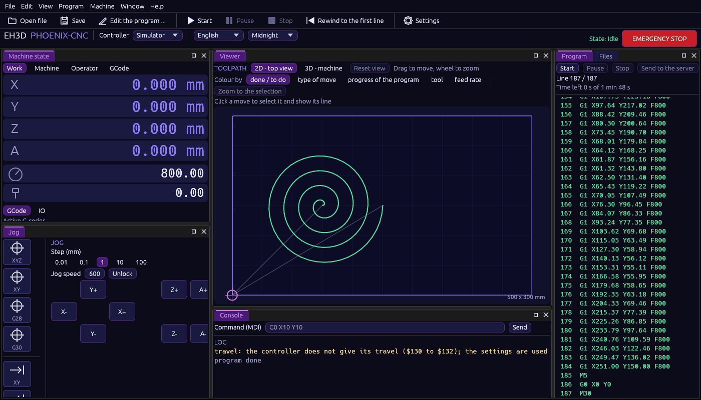

<p align="center">
  
</p>

#  EH3D-PHOENIX-CNC
<p align="center"><a href="README.md">🇺🇸 English</a> | <a href="README_spa.md">🇪🇸 Español</a> | <a href="README_fra.md">🇫🇷 Français</a> | <a href="README_ita.md">🇮🇹 Italiano</a> | <a href="README_deu.md">🇩🇪 Deutsch</a> | <a href="README_zho.md">🇨🇳 中文</a> | 🇯🇵 <b>日本語</b> | <a href="README_por.md">🇵🇹 Português</a></p>

### EH3D のマシン制御プログラムの共通基盤：ジョブの表示、テーマ、8 言語のインターフェース文言

<p align="center">
  
  
  
  
  
  
</p>

---

**正直さの確認 - 現在実際に動くもの：**ウィンドウを持つ Rust プログラム（`phoenix-cnc`）で、**模擬**マシンを制御します。マシンの位置（ワークとマシン）を表示し、ジョグパッドで手動移動し、ゼロを設定し、原点復帰を行い、オペレーターが入力したコマンドを受け付け、G コードのプログラムを 1 行ずつ実行（一時停止、停止、非常停止付き）し、テーブル上にプログラムの経路を描いて実行済みの行に印を付け、コントローラーが拒否したところで止まります。ウィンドウは 37 言語と 11 のテーマに対応します。コントローラーのインターフェース（EH3D-COMMON の `eh3d-controller`）には、スクリプト化した回線に対する GRBL が書かれており、他のファミリーは未対応として一覧にあります。404 件のテストがコンピューター上で動きます。**ここにあるものは実機で実行されたことがなく**、シリアルポートは GRBL のときだけ、ネットワーク接続はサーバーへプログラムを送るときだけ開き、円弧やその他のコードはシミュレーターが描画も実行もしません。

---

> **安全状態：**このプログラムは既定では模擬マシンを制御します。`--grbl`（`--features serial` 付きのビルド）ではシリアルポートを開いて実際の GRBL コントローラーを制御しますが、実機では一度も試されていません。設定にサーバーのアドレスがある場合は、そのサーバーへネットワーク接続を開き、トークンを HTTP で平文のまま送信します。実際のコントローラーを接続する際は、動作すると言う前にまずシミュレーターで、次に実機で実証する必要があります。リミットスイッチと非常停止はマシン自身の制御ユニットの役目のままで、ウィンドウの非常停止は安全回路ではありません。

## 📋 ひと目で

| | |
|---|---|
| バージョン | `0.1.4` |
| 成熟度 | 機能する |
| テスト | 404 |
| 技術スタック | Rust |
| 実機での動作 | いいえ：既定では模擬マシンを制御します。実際の GRBL コントローラー（`--grbl`）は一度も試されていません |

**移動先：** [概要](#-概要) · [アーキテクチャ](#-アーキテクチャ) · [クイックスタート](#-クイックスタート) · [テスト](#-テスト) · [構成](#-リポジトリの構成) · [関連](#-関連プロジェクト)

## 🚦 プロジェクトの状況

各行はこのリポジトリの一部分で、信号は今日どこまで進んでいるかを示します。計画ではなく、リポジトリが示せるもの（テスト、ビルド、実行）に基づいて書かれています。

🟢 完了・検証済み · 🟡 動作する（既知の制限あり） · 🟠 一部のみ、または未検証 · 🔴 未実装または動作しない

| 領域 | 状態 | ここでの意味 |
|---|---|---|
| 基盤ライブラリ | 🟡 | `eh3d-view` の `scene`、`texts`、`theme` をこのプログラム自身の名前で再エクスポートする Rust クレート。隣に EH3D-COMMON のフォルダーが必要です。 |
| シーンと表示 | 🟡 | EH3D-COMMON で作成・テスト済み。このプログラムのウィンドウがテーブル上にプログラムの経路とツールの位置を描きます（コンピューター上で確認済み）。 |
| テーマと文言 | 🟡 | 11 のテーマと 37 言語のインターフェースの言葉を、このプログラムのウィンドウで確認済み。 |
| テスト | 🟡 | コンピューター上で 404 件のテストが通ります（`cargo test --features gui`）：セッション（ジョグ、ゼロ、原点復帰、プログラム、一時停止、アラーム、非常停止）、プログラムの経路、コマンドライン。模擬コントローラーは EH3D-COMMON でテストします。 |
| ウィンドウとジョグ | 🟡 | コンピューター上で模擬コントローラーと動作します：位置、ジョグパッド、ステップ、送り、原点復帰、ゼロ、ロック解除、コマンド行、ログ。実機はありません。 |
| マシン制御 | 🟠 | シミュレーターのみ：プログラムは 1 行ずつ実行され、一時停止、停止、非常停止があります。ここからはまだ実際のコントローラーに接続していません。 |
| ドキュメント | 🟡 | 8 言語の README、2 つの図、3 つのサンプルプログラム、変更履歴。 |

## 🎯 概要

* **ウィンドウ**（`src/gui.rs`、`phoenix-cnc`）：マシンの位置（ワークとマシン）、ステップと送り付きのジョグパッド、原点復帰、ゼロ、ロック解除、非常停止、ログ付きのコマンド行、テーブル上に経路を表示するプログラム。
* **セッション**（`src/session.rs`）：`eh3d-controller` の任意のコントローラーに対してプログラムが行うこと：ジョグ、ゼロ、原点復帰、1 行の送信、プログラムの 1 行ずつの実行、一時停止、停止、アラーム。模擬コントローラーでテストします。
* **プログラムの経路**（`src/gcode.rs`）：直線移動（`G0`、`G1`、絶対または相対、mm またはインチ）を実行前に描画します。円弧は描画しません。
* **模擬コントローラー**（EH3D-COMMON の `eh3d_controller::sim`）：移動範囲を超えるとアラームを出す、メモリ上のマシン。市場のコントローラーファミリーは `eh3d-controller` に一覧があり、GRBL が最初に書かれたもので、他は未対応として表示されます。
* `eh3d-view` の**テーマと言葉**：Forge（既定）、Neon Arcade、Glass Pro、クラシック Windows グレー、Windows に追従するテーマ、そして英語、スペイン語、イタリア語、ドイツ語、フランス語、ポルトガル語、中国語、日本語のインターフェース。将来は EH3D-DRILLPRO と EH3D-ROUTEPRO のエンジンの上で、穴あけ、ルーティング、2D・3D の CNC 加工を行う 1 つのプログラムになります。その部分はまだありません。
* **メニュー、設定、ファイル**：PlanetCNC にある内容を備えた、ファイル、表示、プログラム、マシン、ヘルプのメニュー（開く、最近のファイル、保存、編集、ゼロ、保存位置、主軸、クーラント）。実行間で記憶される設定ウィンドウ（単位、言語、11 のテーマ、移動範囲、ジョグ）。スイート共通の開く・保存ウィンドウ（`eh3d-filedialog`：場所、並べ替え、フィルター、保存時の拡張子、置き換え前の確認）。
* **シリアルポートの GRBL：** `--features serial` でビルドすると、`phoenix-cnc --grbl ポート[@ボー]` がシミュレーターの代わりに GRBL コントローラー（既定 115200 ボー）を動かし、`phoenix-cnc --ports` がシリアルポートを一覧します。この機能なしのビルドや開けないポートはその旨を伝えて終了します。スクリプト化したコントローラーでのみ試し、実機では試していません。実機のコントローラーでは、`--start`（ファイルを開き、ウィンドウが開くと同時に開始）は `--start-real` も指定しない限り拒否され、`--start-real` だけではエラーになります。設定ファイルの `busy_wait`（既定は 4 時間）は、機械が作業中と答えている間に 1 行がその応答を待つ最長時間で、その間も停止は受け付けられます。
* **画面に合わせるウィンドウ：** 最大化で開き、720p から 1080p、さらに大きく広い画面まで、すべてがウィンドウに合わせて拡大縮小します。
* **障害後の再開：** プログラムの実行中、到達した行を小さなファイルに保存します。ウィンドウ、コンピューター、接続のいずれかが落ちた場合、次回の起動時にその行から再開するか破棄するかを尋ねます。オペレーターが答えるまでコントローラーには何も送信されません。
* **EH3D サーバーへの送信:** 設定にサーバーのアドレス、このプログラムのトークン、マシンIDを入れると（設定ウィンドウのサーバーの項目、または設定ファイルの `server_address`、`server_token`、`server_machine`）、**プログラム > サーバーへ送信** がプログラムのテキストを G コードのジョブとして送ります。サーバーは自分のマシン（シリアルポートの GRBL コントローラー、またはシミュレーター）で実行し、ウィンドウは状態・パーセント・到達した行を上部バー、パネル、ログに表示して追います。ウィンドウの開始・一時停止・停止はサーバー上のジョブに届き、ウィンドウを閉じてもジョブは止まりません。止まったジョブはサーバーが到達した行から再開できます（次回のウィンドウ起動時に、コントローラーのプログラムと同じように提案されます）。サーバーは有効だったコードを戻し、最初の移動の前にオペレーターを待ちます。スピンドルとクーラントは `server_restore_outputs = yes` のときだけ再び始動します。代役のサーバーで試しました。サーバー自身のテストが同じリクエストをそのシミュレーターに送ります。実機では未試験です。
* **障害後の再開：** 途中で止まったプログラムは、まず元の状態に戻されます。単位と絶対距離、安全 Z（設定ファイルの `resume_safe_z`、5 mm）、主軸と回転数に達するまでの待ち時間（`resume_spindle_wait`、3 秒）、クーラント、到達していた点、モーダル状態です。復旧ファイルにはプログラムの SHA-256 が保存され、プログラムが変わっていれば再開しません。再開する行は、最後に送った行より `resume_backoff` 行（既定 16）前から取られます。コントローラーがバッファに数行を保持しているためです。プログラムに送り速度がない場合の深さへの切り込みには `resume_plunge_feed`（既定 100 mm/min）を使います。
* **コントローラ自身向けの行は既定では送りません：** `$` で始まるプログラムの行（`$130=9999`、`$X`、`$RST=*` のような GRBL の設定やコマンド）は、送らずにその行でプログラムを止めます。設定ファイルで `program_system_commands = yes` にすると送ります。
* **ウィンドウの補助機能：**プログラム開始前の**概要**（移動回数、切削距離、設定の速度で見積もった時間、各軸の到達範囲、機械の可動範囲との照合。スイート共通の警告つき：極端に小さい、または角から遠いプログラム、テーブルより大きいプログラム、見積もりに含まれない円弧、送り速度の指定前の切削。**それでも開始**、またはプログラムが可動範囲を超える場合の拒否（`reject_out_of_travel = no` で警告に変更、`confirm_start = no` で概要を無効化））；**キーボードのキー**（Ctrl+O 開く、Ctrl+S 保存、Ctrl+E 編集、F5 開始、スペース 一時停止、Esc 停止（ウィンドウが開いているときは Esc で閉じ、テキストボックスにキーボードがあるときはスペースと Esc はボックスに任せる）、F1 で一覧表示。`shortcuts = no` で無効化）；描いた絵と名前を持つ**ツールバー**；マイナス／プラスで刻むか**直接入力**できる数値；上から**ドラッグとズーム**、または 3D で**回転とズーム**できる経路と工具；「開く」ウィンドウの **G コードファイルのプレビュー**；**クラッシュの記録**（`eh3d-crash.log`）；設定の「安全」セクション（設定ファイルの `rapid`、`summary_tiny`、`summary_far`、`summary_margin`）。
* **プログラムのキューとコントローラーのストローク：** 「開く」ウィンドウで Ctrl+クリックして選んだ複数のファイル、まとめてドロップしたファイル、またはコマンドラインで指定したファイル（`phoenix-cnc a.nc b.nc`）は、それぞれ自分の概要を表示したあと順番に実行されます。ウィンドウには状態付きで一覧表示され、待機中のものを削除・スキップ・並べ替えでき、プログラムが完了しないとキューは停止します。GRBL コントローラーでは接続時に `$130`、`$131`、`$132`（X、Y、Z の最大ストローク）を読み取り、概要と拒否の判定にはそれと `travel_x`、`travel_y`、`travel_z` の小さい方を使います。コントローラーが応答しない、または値を返さない場合は設定を使い、ログに記録します（`read_controller_travel = no` で読み取りを無効化）。
* **プログラムの点検、ジョグのソフトリミット、プローブ：** サマリーはプログラム内の疑わしい点も伝えます（表面より下で終わる早送り、スピンドル停止での切削、回転数なしで始動したスピンドル、工具交換、終了のないプログラム、`lint_max_feed` または `lint_max_rpm` を超える送り速度や回転数。既定値は 5000 mm/min と 24000 rpm で、0 では無効。`lint = no` で点検を切り、`lint_rapid_floor` で早送りを知らせる Z を決めます）。移動範囲を超えるジョグのステップは限界まで短縮され、限界から外へ向かうステップは拒否されます（`jog_soft_limits` の既定は `homing`：原点復帰の後だけ限界が効きます。`always` は最初から、`no` は無効）。**マシン > Z プローブ** は接触プレートでのサイクルを実行し（設定ファイルの `probe_feed`、`probe_depth`、`probe_retract`、`probe_plate`、`probe_clearance`）、**マシン > グリッドをプローブ** はプログラムの切削範囲の上でグリッドに接触して（間隔は `probe_grid` mm）高さマップを作ります。**高さマップでプログラムを補正** は各切削移動を最大 `heightmap_segment` mm の断片に分け、それぞれを下の高さに合わせて上げ下げします（絶対座標・ミリメートル・円弧なしのプログラム。プローブした範囲を出るものは拒否）。**高さ補正を元に戻す** でプログラムは元の状態に戻ります。マシンが動くため、どちらのプローブも先に確認を求め、プローブのないコントローラーは拒否します。代用品でのみ試験済みで、実機では何も動かしていません。
* **ウィンドウとコマンドラインのプログラム用ツール：** **プログラム > プログラムを検査...** は検査で見つかったことを行ごとに一覧にします（各項目の番号を押すと、プログラム欄のその行が表示されます）。**プログラム > 進入禁止ボックス...** は工具が入ってはいけない場所を編集します（その中に入るプログラムは、`keepout_reject = no` でない限り開始されません）。**プログラム > 統計とシミュレーション...** は経路を紙の上で再生し、カーソルをその行に置きます。プログラム欄には残り時間が表示されます。キューはプログラムを繰り返し実行でき（実行回数の欄）、2 回の実行の間に操作者に確認するか `queue_pause` 秒待ち、合計時間を表示し、実行と実行の間はファイルに保存されます（戻ってきたときは待機状態で、勝手に始まるものはありません）。**マクロ** メニューは確認のあとで `phoenix-cnc-macros.txt`（設定ファイルの隣）のマクロを実行します。**マシン > 高さマップを保存...** と **マシン > 高さマップを読み込み...** はマップをファイルに保存・読み込みし（確認なしの上書きはしません）、**ファイル > セッションログをエクスポート...** はログをテキスト、CSV、JSON で保存します（既存のファイルには上書きしません）。これらの値（`progcheck`, `keepout`, `keepout_margin`, `keepout_reject`, `queue_repeat_max`, `queue_confirm_between`, `queue_pause`, `queue_remember`, `sim_speed`, `macros_confirm`, `macros_max_lines`, `log_max_entries` と `tool_change_time`）は設定ファイルにあり、ウィンドウは他の設定を保存するときもそれらを保持します。`phoenix-cnc --report FILE` はウィンドウを開かずに、プログラムの統計と時間とともに同じ検査結果を表示します（終了コードは、読む必要がなければ 0、あれば 1、ファイルを読めなければ 2。`--lang` で言語を選びます）。`--version` と `--help` は即座に応答します。シミュレータでのみ試験済みで、実機では動かしていません。
* **設定ウィンドウにはプログラムツール用の3つのセクションがあります：** **チェック**（第1と第2のチェック、進入禁止ボックスの余裕と拒否、早送りの最低高さ、最大送り速度と最高回転数）、**プローブと高さマップ**（プローブ、グリッド、補正した切削の分割長、ジョグの制限）、**キュー、マクロ、ログ**（キューの繰り返しと待機、シミュレーション速度、セッションログの項目数、マクロ、工具交換の時間）。どの数値も設定ファイルが受け付ける範囲内に収まり（範囲はツールチップに表示）、**このセクションを初期値に戻す**でセクションを元に戻し、保存してもファイルの他のキーはすべて保持されます。
* **1ページのHTMLによる作業レポート：** **ファイル > 作業レポートを書き出す...**（または `phoenix-cnc --report FILE.NC --html REPORT.html`）で、スクリプトもリンクも別画像も使わずすべてを含む1ページを書き出します。プログラムの統計と時間、工具、不審な点とその行、警告のある行を丸で囲んだ上から見た経路、測定済みなら色のグリッドで表した高さマップが入ります。言語に従い、色はブラウザの明暗設定に従い、既にあるファイルには上書きしません。
* **経路を色分けし、工具で絞り込み、クリックで選べます：** 経路のタイトルの下（平面でも3Dでも）の1行で、色分けの方法（**完了／未了**、**移動の種類**：早送り・切削・突っ込み・円弧、**プログラムの進捗**：移動距離に沿って青から赤へ、**工具**、**送り速度**：最も遅いものから最も速いものへ）を選び、プログラムの工具ごとにチェックボックスを表示し（工具はチェックボックスで隠したり表示したりでき、最後に表示されている工具は残ります）、平面用の**選択範囲にズーム**があります。移動をクリックすると選択され（太く描かれます）、プログラムパネルにその行が表示され、1行に行番号、コード、移動の種類、長さ、送り速度、工具が表示されます。平面と3D表示のドラッグ、ホイール、ダブルクリックはそのままです。
* **Tab でコマンド欄のコードを補完します：** ウィンドウ下部の欄にキーボードがある間、Tab は入力中のコードを補完し（`G38` は `G38.`、`M30` は `M30 `、`$J` は `$J=` になります）、複数が該当するときは共通部分を書き込んで欄の横に一覧を表示します（`G5` は `G53` から `G59` を表示）。行の最後の語に作用し、大文字と小文字を区別せず、何も送信しません。行はこれまでどおり Enter で送られます。

## 🧩 EH3D での役割

EH3D-PHOENIX-CNC は EH3D のマシン制御プログラムで、現在は模擬マシン上で動作します。パスで EH3D-COMMON に依存し（フォルダー `EH3D-COMMON` をこのフォルダーの隣に置く必要があります：ビュー、テーマ、言葉、コントローラー）、現時点で他の EH3D リポジトリには依存しません。

## 🏛️ アーキテクチャ

<p align="center">
  
</p>

各部分の組み合わせ：誰が使うのか、このリポジトリに何があるのか、何に依存するのか。図は `docs/architecture.json` から描かれ、コードと照合され、将来のものは将来として示されます。

## 🖼️ スクリーンショット

<p align="center">
  
</p>

<p align="center"><em>模擬マシンで実行中のプログラム：実行済みの行は緑、現在の行は明るく表示され、経路がテーブル上に描かれ、ツールはマシンのある位置にあります。</em></p>

<p align="center">
  
</p>

<p align="center"><em>ミッドナイトテーマと、実行が終わった長いプログラム。</em></p>

<p align="center">
  
</p>

<p align="center"><em>明るいペーパーテーマのドイツ語インターフェース：ウィンドウのすべての言葉が言語に従います。</em></p>

<p align="center">
  
</p>

<p align="center"><em>設定ウィンドウ。左のセクションは PlanetCNC のツリーのようで、言語、11 のテーマ、表示内容を選べます。</em></p>

<p align="center">
  
</p>

<p align="center"><em>スイート共通の「開く」ウィンドウ：場所、最近のファイル、日付とサイズ付きのフォルダー一覧、ファイル名、種類。</em></p>

## 🔒 セキュリティと安全

このプログラムは、GRBL 用に起動したとき（`--grbl`、`--features serial` でのビルド）だけシリアルポートを開き、オペレーターがプログラムを送るときだけ、設定にアドレスがある EH3D サーバーへネットワーク接続を開きます。トークンは設定ファイルにテキストで保存されます。オペレーターが選ぶ G コードファイルと高さマップ（テキストとして読み込み、自動では実行しない）、および設定の隣にある自身のファイル（マクロ、実行間で保持されるキュー、プログラムが到達した行）以外の他人のファイルは読みません。ファイルを書くのはオペレーターが指定した場所（プログラム、高さマップ、エクスポートしたログ）だけで、ログを既存のファイルに上書きすることはありません。実行するマクロは事前に確認する G コードの行で、戻ってきたキューが自動で始まることはありません。安全システムではありません。[SECURITY.md](SECURITY.md) を参照してください。

## 🚀 クイックスタート

安定版の Rust ツールチェーンと、このフォルダーの隣の `EH3D-COMMON` フォルダーが必要です。

```bash
cargo build --release --features gui
cargo test --features gui
cargo clippy --all-targets --features gui -- -D warnings
cargo fmt --all --check
python -I tools/ci_validate.py
cargo run --release --features gui -- examples/02_frame_and_pocket.nc
```

`build.bat` / `build.sh` はプログラムをビルドし、`test.bat` / `test.sh` はテストを実行し、`run.bat` / `run.sh` はサンプルプログラムでウィンドウを開きます。`NOPAUSE` を設定しない限り、スクリプトは最後にキー入力を待ちます。

## 🧪 テスト

`cargo test --features gui` は 404 件のテストを実行します：セッション（ジョグとゼロ、プログラムの 1 行ずつの実行、一時停止と再開、拒否された行、非常停止とアラーム、コマンドのログ、原点復帰）、プログラムの経路、コマンドライン。ビューと模擬コントローラーは EH3D-COMMON でテストします。CI は `cargo fmt --check` と警告をエラーとする `cargo clippy` も実行し、`python -I tools/ci_validate.py` がマニフェスト、バージョン、変更履歴、8 つの README を確認します。

## 🏗️ ビルドとリリース

バージョンは `Cargo.toml` と `eh3d.project.json` にあり、各バージョンには [CHANGELOG.md](CHANGELOG.md) に項目があります。まだパッケージ化するプログラムがないため、ビルド済みバイナリはありません。

## 📂 リポジトリの構成

<p align="center">
  
</p>

<details>
<summary>ツリーのテキスト版</summary>

```text
EH3D-PHOENIX-CNC/
├── src/
│   ├── lib.rs                                   モジュールと、このプログラム名で再エクスポートした eh3d-view の表示
│   ├── gui.rs                                   ウィンドウ：位置、ジョグ、プログラム、経路、コマンド、ログ
│   ├── session.rs                               コントローラーで行うこと：ジョグ、ゼロ、原点復帰、プログラムの 1 行ずつの実行、一時停止、停止、アラーム
│   ├── queue.rs                                 キュー：順序、状態、実行回数、スキップ、削除、失敗時の停止、状態ファイル
│   ├── progcheck.rs                             第 2 のプログラム検査：単位、オフセット、プローブ、平面
│   ├── boxes.rs                                 進入禁止ボックスとストローク限界の検査
│   ├── sim.rs                                   時間軸上の経路：各時点の工具と残り時間
│   ├── estimate.rs                              プログラムの時間を一度だけ測って保持：読み込んだ経路とキューのファイル
│   ├── stats.rs                                 プログラム統計：距離、時間、工具交換
│   ├── jobs.rs                                  キュー内プログラムの繰り返しと待機
│   ├── macros.rs                                マクロライブラリ：実行前に確認する G-code
│   ├── logbook.rs                               セッションログ（テキスト/CSV/JSON、上書きなし）
│   ├── report.rs                                --report のレポート：統計、時間、問題点
│   ├── workreport.rs                            1ページのHTML作業レポート：統計、警告、経路、高さマップ
│   ├── tuning.rs                                これらの機能の設定ファイル上の値
│   ├── ranges.rs                                これらのツールの各キーの範囲（ウィンドウとファイルで共通）
│   ├── words.rs                                 これらの機能のメッセージ（8 言語）
│   ├── gcode.rs                                 G コードプログラムの直線移動。経路の描画用
│   ├── heightmap.rs                             材料の高さマップとプログラムの補正
│   ├── jog.rs                                   ジョグのソフトリミット：移動範囲を超えるステップは短縮または拒否されます
│   ├── lint.rs                                  プログラムの疑わしい点：早送り、スピンドル、送り、回転数
│   ├── probe.rs                                 プローブ：接触プレート上の Z サイクルと、高さマップ用の接触グリッド
│   ├── view.rs                                  ドラッグとズームのできる平面図と、回転できる 3D ビュー（数値のみ）
│   ├── viewer.rs                                経路ビューア：種類、工具、進捗、色、クリック
│   ├── plan.rs                                  開始前のチェック：移動の時間・到達範囲・可動範囲
│   ├── cli.rs                                   コマンドライン：ファイル、言語、テーマ、画像のオプション
│   ├── complete.rs                              コマンド欄の Tab：G、M、$ コードを補完
│   ├── bin/phoenix-cnc.rs                       ウィンドウを開くプログラム
│   ├── server.rs                                EH3D サーバーとの接続：送信、追跡、一時停止、停止
│   ├── settings.rs                              実行間で記憶する設定
│   ├── gui/dialogs.rs                           メニュー、設定、開く、保存、編集
│   ├── gui/prefs.rs                             ツールの設定セクション：チェック、プローブ、キュー
│   ├── gui/remote.rs                            サーバー上のプログラム：開始、一時停止、停止、再開
│   ├── gui/views.rs                             ウィンドウの中央：上から見た、または 3D の経路と工具
│   ├── gui/pathview.rs                          ビューアの行：色、レイヤー、ズーム、クリックした行
│   ├── gui/summary.rs                           開始前の概要ウィンドウとキー一覧
│   ├── gui/probe.rs                             ウィンドウ内のプローブ：確認と高さマップの項目
│   ├── gui/numfield.rs                          マイナス／プラスのボタンまたは直接入力で設定する数値
│   ├── gui/keys.rs                              キーボードのキーと、メニューとキー一覧が読む表
│   ├── gui/queue.rs                             ウィンドウ内のキュー：実行、繰り返し、実行間の確認または待機
│   ├── gui/check.rs                             検査ウィンドウ：検査で見つかったことを行ごとに表示
│   ├── gui/keepout.rs                           進入禁止ボックスのエディタと、その中に入るプログラムの拒否
│   ├── gui/sim.rs                               統計とシミュレーション：経路上の工具、行、残り時間
│   ├── gui/macros.rs                            マクロメニューと、マクロ実行前の確認
│   ├── gui/files.rs                             高さマップとセッションログをファイルとして扱う（ファイルウィンドウ経由）
│   └── gui/icons.rs                             線で描いたボタンの絵と、ツールバーのボタン
├── examples/                                    3 つのサンプル G コード：正方形から長い渦巻きまで
├── tests/                                       G コードと設定の追加テスト
├── tools/                                       CI チェック、README チェック、図の生成ツール
├── docs/                                        アーキテクチャ図とリポジトリ構成図の元データ
├── .github/                                     CI ワークフロー、Issue と PR のテンプレート
├── images/                                      バナー、2 つの図、スクリーンショット
├── build.sh build.bat                           ライブラリをビルド
├── run.sh run.bat                               まだプログラムがないことを表示し、テストを実行
├── eh3d.project.json                            マニフェスト：バージョン、役割、成熟度、ビルドコマンド
├── Cargo.toml Cargo.lock                        Rust パッケージと固定された依存関係
├── rust-toolchain.toml                          固定されたRustツールチェーン
├── CHANGELOG.md                                 各バージョンの変更点
├── SECURITY.md SUPPORT.md                       脆弱性の報告方法と問い合わせ先
└── CONTRIBUTING.md CODE_OF_CONDUCT.md LICENSE   貢献方法、行動規範、ライセンス
```

</details>

## 🗺️ ロードマップと既知の制限

**現在の既知の制限**

* ここにあるものは実機で実行されたことがありません。コントローラーはシミュレーター（またはシリアルポートの GRBL。試していません）で、サーバーにはテストからしか接続しません。
* シミュレーターは基本的な G コード（`G0`、`G1`、`G90`、`G91`、`G20`、`G21`、`G92`、`M3` から `M9`）のみ受け付けます。円弧、固定サイクル、プロービングは拒否され、経路は円弧を描きません。
* パスで依存しているため、隣に `EH3D-COMMON` フォルダーが必要です。

**次のステップ**

* 実際のコントローラー：まずシリアルポート経由の GRBL、次に他のファミリー、その後 HYDRA-UMC のコントローラー。
* シミュレーターと経路での円弧とその他の G コード。
* 切削の高さを含む経路の 3D 表示。
* プロービング、ツールチェンジャー、マシンの材料。
* EH3D-DRILLPRO と EH3D-ROUTEPRO のエンジンを統合し、1 つのプログラムで穴あけとルーティングを行う。

## 🌍 言語

README とテキストは、英語、スペイン語、フランス語、イタリア語、ドイツ語、中国語、日本語、ヨーロッパポルトガル語で用意されています。

## 🔗 関連プロジェクト

* [EH3D-COMMON](https://github.com/JuanenRac/EH3D-COMMON)：表示（`eh3d-view`）とジョブ ZIP（`eh3d-archive`）の置き場所
* [EH3D-DRILLPRO](https://github.com/JuanenRac/EH3D-DRILLPRO)：エンジンがここに統合される予定の穴あけプログラム
* [EH3D-ROUTEPRO](https://github.com/JuanenRac/EH3D-ROUTEPRO)：エンジンがここに統合される予定のルーティングプログラム

## 📚 ドキュメント

* [変更履歴](CHANGELOG.md)
* [セキュリティポリシー](SECURITY.md)と[サポート](SUPPORT.md)
* ジョブの表示のドキュメントは、その置き場所である EH3D-COMMON にあります。

## 🤝 コントリビュートとコミュニティ

* プルリクエストの前に `cargo fmt --all --check`、`cargo clippy --all-targets -- -D warnings`、`cargo test`、`python -I tools/ci_validate.py` を実行してください。すべて通る必要があります。[CONTRIBUTING.md](CONTRIBUTING.md) と[行動規範](CODE_OF_CONDUCT.md)を参照してください。
* README は 8 言語あります。文章を変えるときは 8 つのファイルすべてを変更し、2 つの図は `tools/make_architecture.py` と `tools/make_structure.py` が `docs/architecture.json` と `docs/structure.json` から描きます。
* 機械で動かしていないものを、動作するものとして書かないでください。
* 脆弱性は非公開で報告してください：[SECURITY.md](SECURITY.md)。質問、アイデア、報告：electrohobby3d@gmail.com（[SUPPORT.md](SUPPORT.md)）。

## 👤 作者

**JuanenRac (Electro Hobby 3D)** · electrohobby3d@gmail.com

## 📜 ライセンス

ソフトウェア：GPL-3.0-or-later。[LICENSE](LICENSE) を参照。スイートのハードウェア設計は CERN OHL-S を使用します。
