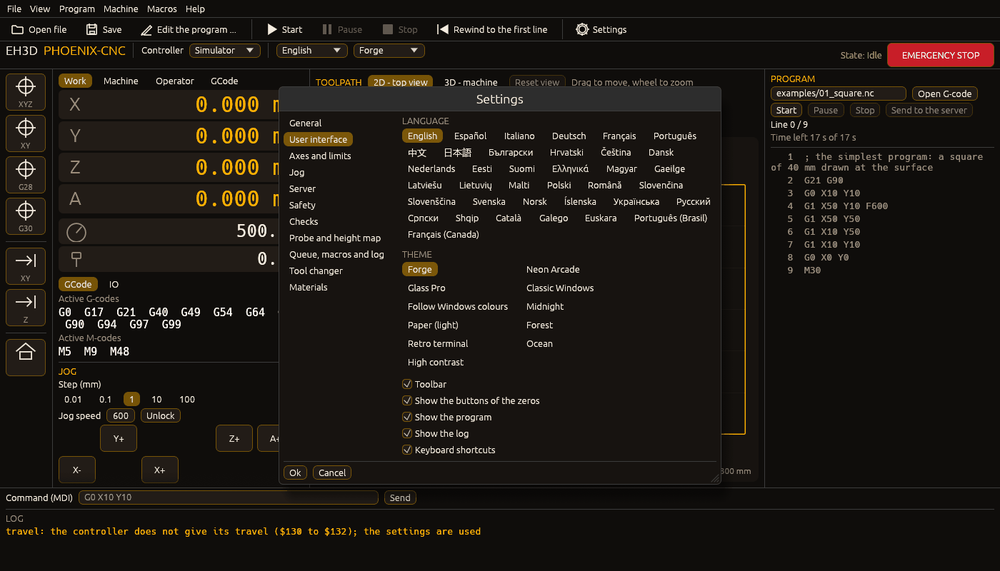

<p align="center">
  
</p>

#  EH3D-PHOENIX-CNC
<p align="center"><a href="README.md">🇺🇸 English</a> | <a href="README_spa.md">🇪🇸 Español</a> | <a href="README_fra.md">🇫🇷 Français</a> | <a href="README_ita.md">🇮🇹 Italiano</a> | <a href="README_deu.md">🇩🇪 Deutsch</a> | <a href="README_zho.md">🇨🇳 中文</a> | <a href="README_jpn.md">🇯🇵 日本語</a> | 🇵🇹 <b>Português</b></p>

### A base partilhada dos programas de controlo de máquina do EH3D: a vista de um trabalho, os temas e os textos da interface em oito idiomas

<p align="center">
  
  
  
  
  
  
</p>

---

**Verificação de honestidade - o que funciona hoje:** um programa em Rust com uma janela (`phoenix-cnc`) que comanda uma máquina **simulada**: mostra a posição da máquina (peça e máquina), move-a à mão com um teclado de jog, põe o zero, faz a referência, aceita os comandos escritos pelo operador, executa um programa G-code linha a linha (com pausa, paragem e paragem de emergência), desenha a trajetória do programa na mesa com as linhas feitas marcadas e pára no que o controlador recusa. A janela fala 37 idiomas e tem onze temas. A interface de controladores (`eh3d-controller`, no EH3D-COMMON) tem o GRBL escrito contra uma linha simulada e lista as outras famílias como ainda sem controlador. 519 testes correm num computador. **Nada aqui foi executado numa máquina real**, só se abre uma porta série para GRBL e uma ligação de rede só ao enviar um programa ao servidor, e os arcos e os outros códigos o simulador nem os desenha nem os executa.

---

> **Estado de segurança:** este programa comanda por defeito uma máquina simulada. Com `--grbl` (uma compilação com `--features serial`) abre uma porta série e comanda um controlador GRBL real, nunca experimentado numa máquina real; com um endereço de servidor nas definições abre uma ligação de rede a esse servidor e envia o token em claro por HTTP. Quando se ligar um controlador real, terá de se provar num simulador e depois numa máquina real antes de se dizer funcional, e os fins de curso e uma paragem de emergência continuam a ser da própria unidade de controlo da máquina; a paragem de emergência da janela não é um circuito de segurança.

## 📋 Num relance

| | |
|---|---|
| Versão | `0.1.6` |
| Maturidade | Funcional |
| Testes | 519 |
| Tecnologias | Rust |
| Em hardware real | Não: por defeito comanda uma máquina simulada; um controlador GRBL real (`--grbl`) nunca foi experimentado |

**Ir para:** [Visão geral](#-visão-geral) · [Arquitetura](#-arquitetura) · [Início rápido](#-início-rápido) · [Testes](#-testes) · [Estrutura](#-estrutura-do-repositório) · [Relacionados](#-projetos-relacionados)

## 🚦 Estado do projeto

Cada linha é uma parte deste repositório e a luz diz até onde chega hoje. Escreve-se com o que o repositório consegue mostrar (testes, compilações, execuções), não com o que está planeado.

🟢 Feito e verificado · 🟡 Funciona, com limites conhecidos · 🟠 Feito a meio ou ainda por verificar · 🔴 Por fazer ou a não funcionar

| Área | Estado | O que significa aqui |
|---|---|---|
| Biblioteca base | 🟡 | Um crate de Rust que reexporta `scene`, `texts` e `theme` do `eh3d-view` com o nome deste programa; precisa da pasta do EH3D-COMMON ao lado. |
| Cena e vistas | 🟡 | Escrita e testada no EH3D-COMMON; a janela deste programa desenha a trajetória de um programa na mesa e a posição da ferramenta (vista num computador). |
| Temas e textos | 🟡 | Onze temas e as palavras da interface em 37 idiomas, vistos na janela deste programa. |
| Testes | 🟡 | Passam 519 testes num computador (`cargo test --features gui`): a sessão (jog, zero, referência, um programa, pausa, alarme, paragem de emergência), a trajetória de um programa e a linha de comandos; o controlador simulado é testado no EH3D-COMMON. |
| Janela e jog | 🟡 | Funciona num computador com o controlador simulado: posição, teclado de jog, passos, avanço, referência, zero, desbloqueio, uma linha de comandos e um registo; sem máquina real. |
| Controlo de máquina | 🟠 | Só o simulador: um programa corre linha a linha com pausa, paragem e paragem de emergência; ainda não se liga nenhum controlador real a partir daqui. |
| Documentação | 🟡 | README em oito idiomas, as duas imagens, três programas de exemplo e o changelog. |

## 🎯 Visão geral

* A **janela** (`src/gui.rs`, `phoenix-cnc`): a posição da máquina (peça e máquina), um teclado de jog com os seus passos e avanço, referência, zero e desbloqueio, a paragem de emergência, uma linha de comandos com o seu registo e o programa com a sua trajetória na mesa.
* A **sessão** (`src/session.rs`): o que o programa faz com qualquer controlador de `eh3d-controller`: jog, zero, referência, enviar uma linha, executar um programa linha a linha, pausa, paragem e os alarmes; é testada com o controlador simulado.
* A **trajetória de um programa** (`src/gcode.rs`): os movimentos retos (`G0`, `G1`, absolutos ou relativos, em mm ou polegadas) desenhados antes de executar o programa; os arcos não se desenham.
* O **controlador simulado** (`eh3d_controller::sim`, no EH3D-COMMON): uma máquina em memória com limites de curso que dão alarme; as famílias de controladores do mercado estão listadas em `eh3d-controller`, o GRBL é a primeira escrita e as outras aparecem como ainda sem controlador.
* Os **temas e as palavras** de `eh3d-view`: Forge (o predefinido), Neon Arcade, Glass Pro, o cinzento clássico do Windows e um que segue o Windows, e a interface em inglês, espanhol, italiano, alemão, francês, português, chinês e japonês. O que será: um programa para furar, fresar e fazer CNC 2D e 3D sobre os motores do EH3D-DRILLPRO e do EH3D-ROUTEPRO; essa parte ainda não existe.
* Os **menus, as definições e os ficheiros**: os menus Ficheiro, Ver, Programa, Máquina e Ajuda com o que o PlanetCNC tem (abrir, recentes, guardar, editar, os zeros, as posições guardadas, o fuso e o refrigerante); uma janela de definições (unidades, idioma, onze temas, limites de curso, jog) que se recorda entre execuções; e as janelas Abrir e Guardar da suite (`eh3d-filedialog`: locais, ordenação, filtros, a extensão de um ficheiro guardado e a pergunta antes de substituir).
* **GRBL numa porta série:** compilado com `--features serial`, `phoenix-cnc --grbl PORTA[@BAUD]` comanda um controlador GRBL (115200 baud por omissão) em vez do simulador e `phoenix-cnc --ports` lista as portas série; uma compilação sem a funcionalidade, ou uma porta que não abre, di-lo e termina. Experimentado apenas contra um controlador guionizado, nunca contra um real. Com um controlador real, `--start` (abrir o ficheiro e iniciá-lo quando a janela abre) é recusado a menos que `--start-real` também seja dado, e `--start-real` sozinho é um erro; `busy_wait` no ficheiro de definições (4 horas por omissão) é o máximo que uma linha espera pela resposta enquanto a máquina diz que está a trabalhar, e a paragem é ouvida entretanto.
* **Uma janela que segue o ecrã:** abre maximizada e, de 720p a 1080p e até ecrãs maiores e mais largos, tudo cresce ou encolhe com ela.
* **Continuar após uma falha:** enquanto um programa corre, a linha alcançada é guardada num ficheiro pequeno; se a janela, o computador ou a ligação cair, o arranque seguinte pergunta se continua a partir dessa linha ou se deixa. Nada é enviado ao controlador até o operador responder.
* **Enviado para o servidor EH3D:** com o endereço do servidor, o token deste programa e o id da máquina nas definições (secção Servidor da janela de definições, ou `server_address`, `server_token` e `server_machine` no ficheiro de definições), **Programa > Enviar para o servidor** envia o texto do programa como um trabalho de G-code; o servidor executa-o na sua máquina (um controlador GRBL na sua porta série, ou o seu simulador) e a janela acompanha-o: o estado, a percentagem e a linha alcançada na barra de topo, no painel e no registo. Iniciar, Pausa e Parar da janela chegam ao trabalho no servidor, fechar a janela não o pára, e um trabalho que parou é retomado a partir da linha a que o servidor chegou (o arranque seguinte da janela oferece-o, como faz com um programa do controlador): o servidor devolve os códigos em vigor e espera pelo operador antes do primeiro movimento. O fuso e o refrigerante só voltam a arrancar com `server_restore_outputs = yes`. Experimentado com um servidor de substituição; os testes do próprio servidor enviam os mesmos pedidos ao seu simulador. Nunca numa máquina.
* **Retomar após uma falha:** um programa que ficou a meio é primeiro devolvido ao seu estado: unidades e distâncias absolutas, um Z seguro (`resume_safe_z` no ficheiro de definições, 5 mm), o fuso com o tempo para atingir a velocidade (`resume_spindle_wait`, 3 s), o refrigerante, o ponto atingido e o estado modal; o ficheiro de recuperação guarda o SHA-256 do programa e não continua se o programa mudou. A linha de retoma é tomada `resume_backoff` linhas (16 por omissão) antes da última enviada, porque o controlador guarda algumas linhas no seu buffer; uma descida à profundidade sem avanço do programa usa `resume_plunge_feed` (100 mm/min por omissão).
* **As linhas para o próprio controlador não são enviadas por omissão:** uma linha de programa que começa por `$` (uma definição ou um comando do GRBL, como `$130=9999`, `$X` ou `$RST=*`) pára o programa nessa linha sem a enviar; com `program_system_commands = yes` no ficheiro de definições, são enviadas.
* **As ajudas da janela:** um **resumo antes de iniciar um programa** (os movimentos, a distância de corte, o tempo às velocidades das definições, o alcance dos eixos e uma verificação face ao curso da máquina, com os avisos que a suite partilha: um programa minúsculo ou longe do canto, maior do que a mesa e cortes antes de qualquer avanço; os arcos são medidos ao longo da curva e cada troca de ferramenta soma o seu tempo; **Iniciar mesmo assim**, ou uma recusa quando o programa sai do curso, que `reject_out_of_travel = no` transforma em aviso, e `confirm_start = no` desativa o resumo); **teclas do teclado** (Ctrl+O abrir, Ctrl+S guardar, Ctrl+E editar, F5 iniciar, Espaço pausa, Esc parar (com uma janela aberta o Esc fecha-a, e com o teclado numa caixa de texto o Espaço e o Esc ficam para a caixa), F1 lista-as; `shortcuts = no` desativa-as); uma **barra de ferramentas** com desenhos e os seus nomes; números que se alteram com menos e mais ou **escrevendo-os**; a trajetória **arrastada e ampliada de cima ou rodada e ampliada em 3D** com a ferramenta; uma **pré-visualização do ficheiro G-code** na janela Abrir; o **registo de uma falha** (`eh3d-crash.log`); e uma secção Segurança nas definições (`rapid`, `summary_tiny`, `summary_far` e `summary_margin` no ficheiro de definições).
* **Uma fila de programas e o curso do controlador:** vários ficheiros escolhidos na janela Abrir com Ctrl+clique, largados em conjunto ou dados na linha de comandos (`phoenix-cnc a.nc b.nc`) correm um a seguir ao outro, cada um depois do seu próprio resumo; a janela lista-os com o seu estado, deixa retirar, ignorar e reordenar os que esperam, e a fila pára quando um programa não termina. Com um controlador GRBL o programa lê `$130`, `$131` e `$132` (o maior curso de X, Y e Z) ao ligar e usa o menor entre isso e `travel_x`, `travel_y` e `travel_z` para o resumo e a recusa; se o controlador não responder ou não os der, usam-se as definições e o registo di-lo (`read_controller_travel = no` desativa a leitura).
* **Verificações do programa, limites por software do jog e a sonda:** o resumo diz também o que parece errado dentro do programa (um movimento rápido que termina abaixo da superfície, um corte com o fuso parado, um fuso arrancado sem velocidade, uma troca de ferramenta, um programa sem fim, e um avanço ou uma velocidade do fuso acima de `lint_max_feed` ou `lint_max_rpm`, que valem 5000 mm/min e 24000 rpm por defeito e ficam desligados a 0; `lint = no` desliga as verificações e `lint_rapid_floor` define o Z abaixo do qual se avisa de um rápido). Um passo do jog que passaria do curso é encurtado até ao limite e um que sai do limite para fora é recusado (`jog_soft_limits` é `homing` por omissão: o limite só vale depois de fazer homing; `always` aplica-o desde o início e `no` desliga-o). **Máquina > Sondar Z** executa o ciclo numa placa de contacto (`probe_feed`, `probe_depth`, `probe_retract`, `probe_plate` e `probe_clearance` no ficheiro de definições) e **Máquina > Sondar uma grelha** toca uma grelha sobre os cortes do programa (`probe_grid` mm de afastamento) para construir um mapa de alturas; **Corrigir o programa com o mapa de alturas** corta cada movimento de corte em pedaços de no máximo `heightmap_segment` mm e sobe ou desce cada um conforme a altura por baixo (um programa em milímetros absolutos e sem arcos; um que sai da zona sondada é recusado) e **Anular a correção de altura** devolve o programa ao que era. As duas sondagens perguntam primeiro porque a máquina se move, e um controlador sem sonda recusa-as. Testado apenas com dobles; nada correu numa máquina real.
* **As ferramentas do programa, na janela e na linha de comandos:** **Programa > Verificar o programa...** lista o que as verificações encontram, linha a linha (o número junto a cada achado mostra essa linha no painel do programa), **Programa > Caixas proibidas...** edita os locais aonde a ferramenta não deve ir (um programa que entre numa delas não arranca, salvo com `keepout_reject = no`) e **Programa > Estatísticas e simulação...** reproduz a trajetória no papel com o cursor na linha, enquanto o painel do programa diz o tempo que falta. A fila repete um programa (uma caixa com o número de passagens), pergunta ao operador ou espera `queue_pause` segundos entre duas passagens, mostra o seu tempo total e fica guardada num ficheiro entre execuções (volta em espera: nada arranca sozinho). O menu **Macros** executa, depois de perguntar, as macros de `phoenix-cnc-macros.txt` (junto ao ficheiro de definições); **Máquina > Guardar o mapa de alturas...** e **Máquina > Carregar um mapa de alturas...** guardam o mapa num ficheiro (nunca escrito por cima sem perguntar) e **Ficheiro > Exportar o registo da sessão...** guarda o registo como texto, CSV ou JSON (nunca por cima de um ficheiro). Os seus valores (`progcheck`, `keepout`, `keepout_margin`, `keepout_reject`, `queue_repeat_max`, `queue_confirm_between`, `queue_pause`, `queue_remember`, `sim_speed`, `macros_confirm`, `macros_max_lines`, `log_max_entries` e `tool_change_time`) estão no ficheiro de definições, e a janela mantém-nos quando guarda as outras definições. `phoenix-cnc --report FICHEIRO` imprime os mesmos achados com as estatísticas e o tempo de um programa sem abrir a janela (código de saída 0 se nada precisa de ser lido, 1 se algo precisa, 2 se o ficheiro não puder ser lido; `--lang` escolhe o idioma), e `--version` e `--help` respondem logo. Experimentado apenas no simulador; nada correu numa máquina real.
* **A janela de definições tem cinco secções para as ferramentas do programa:** **Verificações** (o primeiro e o segundo verificador, a margem e a recusa das zonas proibidas, o piso dos movimentos rápidos e o avanço e a velocidade do veio mais altos), **Sonda e mapa de alturas** (a sonda, a grelha, o comprimento dos troços de um corte corrigido e os limites do movimento manual) e **Fila, macros e registo** (as repetições e a pausa da fila, a velocidade da simulação, as entradas do registo de sessão, as macros e o tempo de uma troca de ferramenta). Cada número fica dentro do intervalo que o ficheiro de definições aceita (o intervalo é a sua dica), **Valores por omissão desta secção** repõe uma secção e, ao guardar, todas as outras chaves do ficheiro são mantidas. Seguem-se mais duas secções: **Trocador de ferramentas** (se o trocador é calculado, o seu armazém, a altura segura, o bloqueio e o sopro com os respetivos intervalos, as posições lidas do ficheiro da tabela e as linhas dele que foram descartadas, e um botão que escreve a tabela de exemplo sem nunca escrever sobre uma existente) e **Materiais** (o material em uso e os seus intervalos, o ficheiro da biblioteca, um botão que escreve a biblioteca de exemplo sem escrever sobre um ficheiro, e um pequeno editor da tabela de materiais que verifica cada linha e pergunta antes de substituir o ficheiro).
* **Um relatório de trabalho numa só página HTML:** **Ficheiro > Exportar o relatório de trabalho...** (ou `phoenix-cnc --report FICHEIRO.NC --html RELATORIO.html`) escreve uma página que leva tudo dentro, sem script, sem ligações e sem imagens à parte: as estatísticas e o tempo do programa, as ferramentas, o que parece errado com a sua linha, a trajetória vista de cima com as linhas que têm um aviso rodeadas e o mapa de alturas como uma grelha de cores quando foi medido um. Segue o idioma, as cores seguem o modo claro ou escuro do navegador e um ficheiro que já exista nunca é substituído.
* **A trajetória pode ser colorida, filtrada por ferramenta e clicada:** por baixo do título da trajetória (no plano e em 3D) uma linha escolhe como é colorida (**feito / por fazer**, **tipo de movimento**: rápido, corte, penetração e arco; **progresso do programa**, de azul a vermelho ao longo do percurso; **ferramenta**; ou **velocidade de corte**, da mais lenta à mais rápida), mostra uma caixa por cada ferramenta do programa (uma ferramenta oculta-se ou mostra-se com a sua caixa e a última visível fica) e tem **Ampliar à seleção** para o plano e para 3D (em 3D o movimento passa para o centro da vista, com a rotação que ela tiver). Um clique num movimento seleciona-o (é desenhado grosso), o painel do programa mostra a sua linha e a linha diz o número, o seu código, o tipo de movimento, o comprimento, o avanço e a ferramenta. O plano e a vista 3D mantêm o arrastar, a roda e o duplo clique. Para as capturas, `--color MODO` (`state`, `kind`, `progress`, `tool` ou `feed`) e `--select LINHA` (uma linha do programa, a partir de 1) abrem a janela com essa coloração e esse movimento selecionado, juntamente com `--shot`.
* **Um editor para o programa:** o editor do programa (Ctrl+E) mostra o texto com os **números de linha** na margem (as linhas sobre as quais a verificação tem algo a dizer são coloridas), **procurar e substituir** (com ou sem maiúsculas; Enter procura a seguinte; substitui-se uma ou todas e diz-se quantas), **ir para a linha**, as **notas da verificação para o texto tal como é escrito** (um clique no número de uma nota leva à sua linha) e **Aplicar**, que passa o texto para o programa (não enquanto um programa corre). **Aplicar e guardar** pergunta no próprio editor, com Substituir e Cancelar, antes de escrever sobre o ficheiro de onde veio o programa (a pergunta desaparece se o texto mudar), e **Aplicar e guardar como...** passa pela janela Guardar, que pergunta antes de substituir um ficheiro existente. As regras (`src/editor.rs`) são testadas sem janela.
* **Perfis de máquina:** na secção Geral das definições pode guardar-se uma máquina como perfil (o curso dos três eixos, a velocidade do fuso e o seu limite de aviso, o avanço do jog, a velocidade rápida e o limite de aviso do avanço, e os valores da sonda) e voltar a tomá-la com um clique; OK guarda a escolha e Cancelar deixa as definições como estavam. O ficheiro de definições guarda uma linha `profile = NOME | tx=0,500 | ty=0,300 | tz=-100,50 | spindle=10000 | ...` por perfil (até 16, nomes de até 40 caracteres, um valor inválido mantém o predefinido) e `profile_active = NOME` para o que está em uso. `phoenix-cnc --profile NOME` arranca a janela (ou `--report`) com os valores desse perfil; um nome que não está guardado é dito no registo (ou recusado por `--report`) e as definições ficam como estão. As regras (`src/profiles.rs`) são testadas sem janela.
* **Transformar o programa:** **Programa > Transformar o programa...** desloca (X, Y, Z), roda (graus, em torno de um ponto), escala e espelha (X, Y) o programa carregado, e **Programa > Anular a transformação** repõe-no como estava. As linhas são reescritas no sítio (as palavras que não mudam, os comentários e os espaços ficam como estavam), os arcos mantêm os seus centros e um espelho ímpar transforma um arco horário em anti-horário (os códigos `G2` e `G3` são trocados). Um programa que a alteração poderia estragar é recusado, indicando a linha e o motivo: distâncias relativas (`G91`), um plano diferente de XY, ciclos fixos e movimentos de apalpação, códigos que usam posições da máquina ou deslocam o zero (`G10`, `G28`, `G30`, `G53`, `G92`, `G43.1`), centros de arco absolutos (`G90.1`) ou uma escala que não é superior a 0. Considera-se que o programa começa na origem, como faz a trajetória. Um programa em curso nunca é alterado. `--window transform` abre-a. Quando o primeiro movimento do programa omite X ou Y, a janela avisa e pergunta onde está a ferramenta antes do programa (a origem por defeito); a coordenada omitida é tirada daí e escrita sempre que a alteração a move. As regras (`src/transform.rs`) são testadas sem janela, incluindo que a trajetória do programa novo é a antiga transformada.
* **Marcadores e começar a partir de uma linha:** clique numa linha do painel do programa para a selecionar e faça duplo clique para a marcar (uma linha marcada tem uma estrela a seguir ao número), ou use **Programa > Marcar a linha selecionada**, **Marcador seguinte** e **Marcador anterior**; **Programa > Marcadores e começar a partir de uma linha...** (`--window bookmarks`) lista os marcadores, salta para um e começa a partir dele ou da linha selecionada. Antes de preparar o que quer que seja, a janela lê as linhas anteriores e diz o que o programa tinha ativo aí: polegadas, um plano diferente de XY, as coordenadas de trabalho, a compensação do comprimento da ferramenta, a última ferramenta pedida (não é feita troca de ferramenta), o fuso e a sua velocidade, o refrigerante, um zero deslocado e um movimento de corte antes de qualquer avanço; é recusado um arranque com distâncias relativas (`G91`), um ciclo fixo ou uma compensação de raio ainda ativos. **Preparar o arranque** precisa de uma marca que diga que a ferramenta, o fuso e o zero foram verificados (`startline_confirm = no` no ficheiro de definições, ou a caixa da secção Fila, macros e registo, retira-a), devolve o controlador a esse estado como num programa deixado a meio (até à altura segura, o fuso com a sua espera, sobre o ponto que o programa tinha) e deixa o programa em pausa na linha: a máquina só se move ao carregar em Continuar, e um programa em execução nunca é tocado. Os marcadores pertencem ao programa carregado. Os marcadores podem ser conservados entre sessões: **Guardar os marcadores junto ao programa** escreve `part.nc.marks` ao lado de `part.nc` (as linhas e a impressão digital do programa, até 200 marcadores e 16 KiB; pergunta antes de substituir um ficheiro, o que `bookmarks_confirm_replace = no` desativa, e deixa em paz um ficheiro que já tenha estes marcadores), o ficheiro é lido de novo ao abrir o programa (`bookmarks_load`, ativado por omissão; um ficheiro escrito para outra versão do programa fica de fora e o registo di-lo), **Carregar os marcadores guardados** junta-os à lista, e as teclas **Ctrl+B** (marcar a linha escolhida), **F2** e **Ctrl+F2** (marcador seguinte e anterior) estão na lista de teclas e escritas junto às entradas do menu. As regras (`src/bookmarks.rs`, `src/startline.rs`) são testadas sem janela.
* **Um trocador de ferramentas com bloqueio e sopro, em simulação:** uma linha `atc = on | safe=5 | rack=0,0,-5 | pitch=20,0 | lock=3,0.5 | blow=4,1` no ficheiro de definições (desligado a não ser que diga `on`) descreve um trocador: o magazine (X, Y, Z da posição da ferramenta 1 e o passo para a seguinte), a altura segura, o pino de saída e a espera do bloqueio e o pino de saída e os segundos do sopro. Para cada troca de um programa calculam-se os passos (parar o fuso, pousar a ferramenta velha, soltar o bloqueio, soprar o fuso vazio, tomar a nova, acionar o bloqueio), as linhas de G-code (`M65 P` / `M64 P`, `G4`) e o tempo; `--report` e a janela de Estatísticas listam as trocas e a estimativa usa esse tempo em vez de `tool_change_time`. Nada é enviado à máquina. A posição de cada ferramenta pode vir de uma tabela em vez do passo: `phoenix-cnc-atc.txt`, junto do ficheiro de definições, tem uma linha `tool = NÚMERO | pos=X,Y` por cada ferramenta do armazém (`examples/atc.txt` é um modelo; até 64 ferramentas numeradas de 1 a 255, posições afastadas pelo menos 1 mm, ficheiro até 16 KiB); uma ferramenta que não conste dela mantém o armazém e o passo, e cada linha descartada é indicada com o número e o motivo em `--report` e na janela de estatísticas. Com caixas proibidas nas definições, cada troca é também verificada contra elas: a ferramenta sobe, passa por cima das posições e desce nos pontos do armazém (em coordenadas da máquina), partindo de onde o programa tem a ferramenta nessa linha (a sua posição de trabalho mais o zero do trabalho), e uma troca cujos movimentos atravessam uma caixa é indicada com a sua linha, a ferramenta e a caixa em `--report`, na janela de verificação e no relatório de trabalho, e recusa o arranque enquanto `keepout_reject` estiver ativado. As regras (`src/atc.rs`) são testadas sem janela.
* **Uma biblioteca de materiais para as verificações:** a secção das verificações das definições tem uma lista **Material** (`material = NOME` no ficheiro de definições); um programa é então comparado com o intervalo de avanço de corte e de velocidade do fuso sugerido para esse material, e a verificação avisa, com a linha e nas oito línguas, quando um movimento em X ou Y fica abaixo ou acima do intervalo de avanço (uma descida só em Z não lhe está sujeita) ou quando uma velocidade do fuso fica abaixo ou acima do intervalo de velocidade. Os valores estão num ficheiro de texto, não no programa: `examples/materials.txt` vem incluído e usa-se enquanto não houver um ficheiro próprio, e `phoenix-cnc-materials.txt` junto ao ficheiro de definições substitui-o (uma linha `material = NOME | feed=MIN,MAX | rpm=MIN,MAX` por material, até 64, qualquer dos intervalos pode faltar). `phoenix-cnc --report` também usa o material das definições. Os intervalos são só pontos de partida: avisam, nunca param um programa. As regras (`src/materials.rs`) são testadas sem janela.
* **Vistas fixas do visualizador:** **Ver > Vista de cima, Vista de frente, Vista lateral** e **Vista isométrica** (ou **Ctrl+1** a **Ctrl+4**) põem a trajetória nessa vista: a de cima é a planta, as de frente e lateral olham ao longo de um eixo, ao nível da mesa, e a isométrica é a vista com que a janela arranca. `--view top|front|side|iso` (além de `plan` e `3d`) arranca a janela numa delas, para usar com `--shot`.
* **Tab completa o código na caixa de comandos:** enquanto a caixa da parte de baixo da janela tem o teclado, Tab completa o código que se escreve (`G38` dá `G38.`, `M30` dá `M30 `, `$J` dá `$J=`) ou, quando servem vários, escreve o que têm em comum e lista-os ao lado da caixa (`G5` lista de `G53` a `G59`). Atua na última palavra da linha, não distingue maiúsculas de minúsculas e não envia nada: a linha continua a sair com Enter.

## 🧩 Papel no EH3D

O EH3D-PHOENIX-CNC é o programa de controlo de máquina do EH3D, hoje a funcionar sobre uma máquina simulada. Depende por caminho do EH3D-COMMON (a pasta `EH3D-COMMON` tem de estar ao lado desta: a vista, os temas, as palavras e os controladores) e de nenhum outro repositório EH3D por agora.

## 🏛️ Arquitetura

<p align="center">
  
</p>

Como as partes se encaixam: quem o vai usar, o que este repositório contém e em que se apoia. A imagem é desenhada a partir de `docs/architecture.json`, verificada contra o código, e marca como futuro o que é futuro.

## 🖼️ Capturas de ecrã

<p align="center">
  
</p>

<p align="center"><em>Um programa em curso na máquina simulada: as linhas feitas a verde, a linha atual realçada, a trajetória desenhada na mesa e a ferramenta onde está a máquina.</em></p>

<p align="center">
  
</p>

<p align="center"><em>O tema Meia-noite, com um programa longo já terminado.</em></p>

<p align="center">
  
</p>

<p align="center"><em>A interface em alemão com o tema claro Papel: cada palavra da janela segue o idioma.</em></p>

<p align="center">
  
</p>

<p align="center"><em>A janela de definições, com as secções à esquerda como a árvore do PlanetCNC: o idioma, os onze temas e o que se mostra.</em></p>

<p align="center">
  
</p>

<p align="center"><em>A janela Abrir da suite: locais, recentes, a lista da pasta com datas e tamanhos, o nome e o tipo.</em></p>

## 🔒 Segurança e proteção

Este programa só abre uma porta série quando é arrancado para GRBL (`--grbl`, uma compilação com `--features serial`) e só abre uma ligação de rede ao servidor EH3D cujo endereço está nas definições, quando o operador lhe envia um programa; o token fica guardado como texto no ficheiro de definições. Não abre ficheiros de outras pessoas, exceto o ficheiro G-code e o mapa de alturas que o operador escolhe (lidos como texto, nunca executados por si) e os seus próprios ficheiros junto às definições (as macros, a fila guardada entre execuções, a linha que um programa tinha alcançado); só escreve um ficheiro onde o operador o diz (o programa, o mapa de alturas, o registo exportado) e nunca escreve o registo por cima de um ficheiro. A tabela de posições do trocador de ferramentas, a biblioteca de materiais e os marcadores são lidos de onde estão as definições (ou o programa) e só são escritos pelos seus próprios botões: a tabela de exemplo e a biblioteca de exemplo nunca por cima de um ficheiro existente, e a biblioteca e os marcadores depois de uma pergunta quando o ficheiro já existe (a pergunta dos marcadores pode ser desativada nas definições), e cada um destes ficheiros tem um limite de tamanho. As macros que executa são linhas de G-code sobre as quais pergunta antes, e a fila que volta nunca arranca sozinha. Não é um sistema de segurança. Ver [SECURITY.md](SECURITY.md).

## 🚀 Início rápido

Precisa de uma cadeia de ferramentas Rust estável e da pasta `EH3D-COMMON` ao lado desta.

```bash
cargo build --release --features gui
cargo test --features gui
cargo clippy --all-targets --features gui -- -D warnings
cargo fmt --all --check
python -I tools/ci_validate.py
cargo run --release --features gui -- examples/02_frame_and_pocket.nc
```

`build.bat` / `build.sh` compilam o programa, `test.bat` / `test.sh` executam os testes e `run.bat` / `run.sh` abrem a janela com um programa de exemplo. Os scripts esperam uma tecla no fim, a menos que `NOPAUSE` esteja definido.

## 🧪 Testes

`cargo test --features gui` executa 519 testes: a sessão (jog e zero, um programa linha a linha, pausa e continuar, uma linha recusada, a paragem de emergência e o alarme, o registo dos comandos, a referência), a trajetória de um programa e a linha de comandos; a vista e o controlador simulado são testados no EH3D-COMMON. A CI também executa `cargo fmt --check` e `cargo clippy` com avisos como erros, e `python -I tools/ci_validate.py` verifica o manifesto, as versões, o changelog e os oito README.

## 🏗️ Compilação e publicação

A versão está em `Cargo.toml` e em `eh3d.project.json`, e cada versão tem a sua entrada em [CHANGELOG.md](CHANGELOG.md). Ainda não há programa para empacotar, por isso não há binários prontos.

## 📂 Estrutura do repositório

<p align="center">
  
</p>

<details>
<summary>Versão em texto da árvore</summary>

```text
EH3D-PHOENIX-CNC/
├── src/
│   ├── lib.rs                                   os módulos e a vista do eh3d-view reexportada com o nome deste programa
│   ├── gui.rs                                   a janela: posição, jog, programa, trajetória, comandos e registo
│   ├── session.rs                               o que se faz com um controlador: jog, zero, referência, um programa linha a linha, pausa, paragem, alarmes
│   ├── queue.rs                                 a fila: ordem, estado, passagens, saltar, remover, parar ao falhar, ficheiro de estado
│   ├── progcheck.rs                             segunda verificação de um programa: unidades, desvios, apalpação, planos
│   ├── boxes.rs                                 caixas proibidas e limites de curso, movimento a movimento
│   ├── sim.rs                                   o trajeto no tempo: a ferramenta em cada instante
│   ├── estimate.rs                              o tempo de um programa medido uma vez e guardado: a trajetória carregada e os ficheiros da fila
│   ├── stats.rs                                 estatísticas de um programa: distâncias, tempo, trocas de ferramenta
│   ├── jobs.rs                                  repetições e pausas entre os programas da fila
│   ├── macros.rs                                a biblioteca de macros: G-code com nome que pergunta antes de correr
│   ├── logbook.rs                               registo da sessão em texto, CSV ou JSON, sem pisar ficheiros
│   ├── report.rs                                o relatório de --report: estatísticas, tempo, o que parece mal
│   ├── workreport.rs                            o relatório de trabalho numa página HTML: estatísticas, avisos, trajetória, mapa de alturas
│   ├── tuning.rs                                os valores destas ferramentas no ficheiro de definições
│   ├── ranges.rs                                o intervalo de cada chave destas ferramentas, comum à janela e ao ficheiro
│   ├── words.rs                                 as mensagens destas ferramentas nos oito idiomas
│   ├── gcode.rs                                 os movimentos retos de um programa G-code, para desenhar a sua trajetória
│   ├── heightmap.rs                             o mapa de alturas do material e a correção de um programa
│   ├── jog.rs                                   os limites por software do jog: um passo além do curso é encurtado ou recusado
│   ├── lint.rs                                  o que parece errado num programa: rápidos, fuso, avanço e velocidade
│   ├── probe.rs                                 a sonda: o ciclo de Z numa placa de contacto e a grelha de toques para o mapa de alturas
│   ├── view.rs                                  o plano que se arrasta e amplia e a vista 3D que se roda, como números
│   ├── viewer.rs                                o visualizador: tipos, ferramentas, progresso, cores, cliques
│   ├── plan.rs                                  a verificação antes do arranque: tempo, alcance e curso dos movimentos
│   ├── cli.rs                                   a linha de comandos: o ficheiro, o idioma, o tema e as opções de imagem
│   ├── complete.rs                              Tab na caixa de comandos: completa os códigos G, M e $
│   ├── editor.rs                                o editor do programa: procurar, substituir, linha, notas
│   ├── profiles.rs                              perfis de máquina: curso, fuso, avanços e sonda de cada uma
│   ├── transform.rs                             deslocar, rodar, escalar e espelhar um programa, com as suas regras
│   ├── atc.rs                                   o trocador de ferramentas em simulação: bloqueio, sopro, os passos, o G-code e o tempo
│   ├── bookmarks.rs                             marcadores nas linhas de um programa: marcar, seguinte, anterior
│   ├── startline.rs                             o que um programa tem ativo numa linha e quando o arranque aí é recusado
│   ├── materials.rs                             a biblioteca de materiais: intervalos de avanço e velocidade que as verificações exigem
│   ├── bin/phoenix-cnc.rs                       o programa que abre a janela
│   ├── server.rs                                a ligação ao servidor EH3D: enviar, acompanhar, pausar, parar
│   ├── settings.rs                              o que se recorda entre execuções
│   ├── gui/dialogs.rs                           menus, definições, Abrir, Guardar, editor
│   ├── gui/prefs.rs                             as secções de definições das ferramentas: verificações, sonda, fila, trocador, materiais
│   ├── gui/remote.rs                            o programa no servidor: Iniciar, Pausa, Parar e retomar
│   ├── gui/views.rs                             o centro da janela: a trajetória vista de cima ou em 3D, com a ferramenta
│   ├── gui/pathview.rs                          a linha do visualizador: cores, camadas, ampliar, linha clicada
│   ├── gui/editwin.rs                           a janela do editor: números de linha, procurar, notas, guardar
│   ├── gui/xform.rs                             a janela Transformar e Anular do menu Programa
│   ├── gui/lines.rs                             a janela de marcadores e o arranque a partir de uma linha, com a sua pergunta
│   ├── gui/summary.rs                           a janela de resumo antes do arranque e a lista de teclas
│   ├── gui/probe.rs                             a sonda na janela: perguntas e entradas do mapa de alturas
│   ├── gui/numfield.rs                          um número definido com os botões menos e mais ou escrevendo-o
│   ├── gui/keys.rs                              as teclas do teclado e a tabela que os menus e a lista de teclas leem
│   ├── gui/queue.rs                             a fila na janela: passagens, repetições, uma pergunta ou uma espera entre passagens
│   ├── gui/check.rs                             a janela de verificação: o que as verificações encontram, linha a linha
│   ├── gui/keepout.rs                           o editor das caixas proibidas e a recusa de um programa que entre numa delas
│   ├── gui/sim.rs                               estatísticas e simulação: a ferramenta na trajetória, a linha, o tempo que falta
│   ├── gui/macros.rs                            o menu de macros e a pergunta antes de executar uma macro
│   ├── gui/files.rs                             o mapa de alturas e o registo da sessão como ficheiros, pelas janelas de ficheiros
│   └── gui/icons.rs                             os desenhos dos botões, traçados com linhas, e o botão da barra de ferramentas
├── examples/                                    três programas G-code de exemplo, de um quadrado a uma espiral longa
├── tests/                                       mais testes do G-code e das definições
├── tools/                                       verificação de CI, do README e ferramentas de imagens
├── docs/                                        as fontes das imagens de Arquitetura e Estrutura do repositório
├── .github/                                     fluxo de CI, modelos de issues e pull requests
├── images/                                      faixa, as duas imagens e as capturas de ecrã
├── build.sh build.bat                           compilam a biblioteca
├── run.sh run.bat                               avisam de que ainda não há programa e executam os testes
├── eh3d.project.json                            manifesto: versão, papel, maturidade e comando de compilação
├── Cargo.toml Cargo.lock                        o pacote Rust e as suas dependências fixadas
├── rust-toolchain.toml                          a toolchain de Rust fixada
├── CHANGELOG.md                                 o que mudou em cada versão
├── SECURITY.md SUPPORT.md                       como comunicar uma vulnerabilidade e onde perguntar
└── CONTRIBUTING.md CODE_OF_CONDUCT.md LICENSE   como contribuir, o código de conduta e a licença
```

</details>

## 🗺️ Roteiro e limites conhecidos

**Limites conhecidos hoje**

* Nada aqui foi executado numa máquina real: o controlador é um simulador (ou GRBL numa porta série, nunca experimentado) e o servidor só é alcançado pelos testes.
* O simulador só aceita G-code básico (`G0`, `G1`, `G90`, `G91`, `G20`, `G21`, `G92`, `M3` a `M9`); os arcos, os ciclos fixos e a apalpação são recusados, e a trajetória não desenha arcos.
* Precisa da pasta `EH3D-COMMON` ao lado, porque depende dela por caminho.

**A seguir**

* Um controlador real: primeiro o GRBL por porta série, depois as outras famílias, depois o controlador do HYDRA-UMC.
* Os arcos e o resto do G-code no simulador e na trajetória.
* Uma vista 3D da trajetória com a altura dos cortes.
* Apalpação, trocador de ferramentas e os materiais da máquina.
* Juntar os motores do EH3D-DRILLPRO e do EH3D-ROUTEPRO para que um programa fure e frese.

## 🌍 Idiomas

O README e os textos existem em inglês, espanhol, francês, italiano, alemão, chinês, japonês e português europeu.

## 🔗 Projetos relacionados

* [EH3D-COMMON](https://github.com/JuanenRac/EH3D-COMMON): onde vivem a vista (`eh3d-view`) e o ZIP de trabalhos (`eh3d-archive`)
* [EH3D-DRILLPRO](https://github.com/JuanenRac/EH3D-DRILLPRO): o programa de furação cujo motor será juntado aqui
* [EH3D-ROUTEPRO](https://github.com/JuanenRac/EH3D-ROUTEPRO): o programa de fresagem cujo motor será juntado aqui

## 📚 Documentação

* [Registo de alterações](CHANGELOG.md)
* [Política de segurança](SECURITY.md) e [suporte](SUPPORT.md)
* A vista de um trabalho está documentada no EH3D-COMMON, onde vive.

## 🤝 Contribuir e comunidade

* Antes de um pull request execute `cargo fmt --all --check`, `cargo clippy --all-targets -- -D warnings`, `cargo test` e `python -I tools/ci_validate.py`: tudo tem de passar. Ver [CONTRIBUTING.md](CONTRIBUTING.md) e o [código de conduta](CODE_OF_CONDUCT.md).
* O README existe em oito idiomas: uma alteração ao texto faz-se nos oito ficheiros, e as duas imagens são desenhadas a partir de `docs/architecture.json` e `docs/structure.json` com `tools/make_architecture.py` e `tools/make_structure.py`.
* Não descreva como a funcionar o que não correu numa máquina.
* Comunique uma vulnerabilidade em privado: [SECURITY.md](SECURITY.md). Perguntas, ideias e relatos: electrohobby3d@gmail.com ([SUPPORT.md](SUPPORT.md)).

## 👤 AUTOR

**JuanenRac (Electro Hobby 3D)** · electrohobby3d@gmail.com

## 📜 LICENÇA

Software: GPL-3.0-or-later. Ver [LICENSE](LICENSE). Os desenhos de hardware da suite usam CERN OHL-S.
