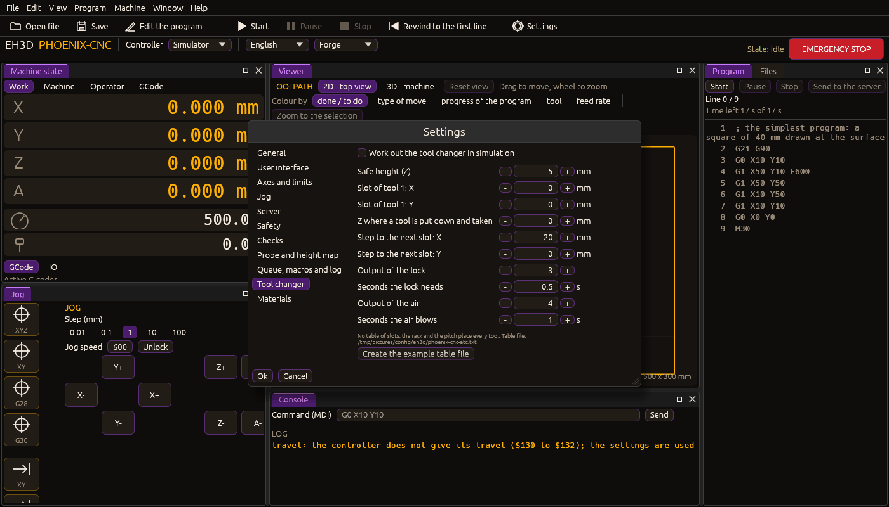
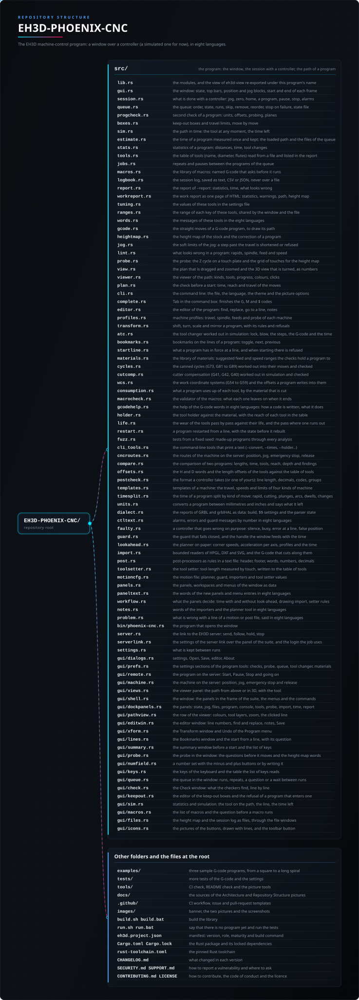

<p align="center">
  
</p>

#  EH3D-PHOENIX-CNC
<p align="center"><a href="README.md">🇺🇸 English</a> | 🇪🇸 <b>Español</b> | <a href="README_fra.md">🇫🇷 Français</a> | <a href="README_ita.md">🇮🇹 Italiano</a> | <a href="README_deu.md">🇩🇪 Deutsch</a> | <a href="README_zho.md">🇨🇳 中文</a> | <a href="README_jpn.md">🇯🇵 日本語</a> | <a href="README_por.md">🇵🇹 Português</a></p>

### La base compartida de los programas de control de máquina de EH3D: la vista de un trabajo, los temas y los textos de la interfaz en ocho idiomas

<p align="center">
  
  
  
  
  
  
</p>

---

**Comprobación de honestidad - lo que se ejecuta hoy:** un programa en Rust con una ventana (`phoenix-cnc`) que maneja una máquina **simulada**: muestra la posición de la máquina (pieza y máquina), la mueve a mano con un teclado de jog, pone el cero, hace la referencia, toma las órdenes que escribe el operador, ejecuta un programa G-code línea a línea (con pausa, parada y parada de emergencia), dibuja la trayectoria del programa en la mesa, en planta o en 3D, con las líneas hechas marcadas, y se detiene en lo que el controlador rechaza. Además comprueba, mide y prepara programas (arcos, ciclos fijos, compensación de radio, cajas prohibidas, un palpador, un mapa de alturas, un cambiador de herramientas, una tabla de herramientas y otra de materiales), importa dibujos y los ficheros Gerber y Excellon de placas, y envía un programa al servidor EH3D. La interfaz de controladores (`eh3d-controller`, en EH3D-COMMON) se maneja para GRBL, grblHAL, Marlin y Klipper contra simuladores de sus dialectos en cables simulados; las demás familias que lista no se manejan. 1187 pruebas se ejecutan en un ordenador. **Nada de aquí se ha ejecutado en una máquina real**: solo se abre un puerto serie para GRBL, grblHAL o Marlin y una conexión de red solo al enviar un programa al servidor o al alcanzar Klipper con `--klipper`. Las máquinas simuladas solo toman movimientos rectos y rechazan arcos, ciclos fijos y palpado, así que estos se miden, se comprueban y se cronometran sobre el papel, la trayectoria dibujada muestra un arco como su cuerda, y un programa que los contiene se detiene en esa línea en el simulador. La ventana ofrece los 37 idiomas de la vista compartida de EH3D-COMMON y lleva once temas, pero este programa promete ocho idiomas: las palabras de sus propios paneles y herramientas existen en inglés, español, alemán, francés, italiano, japonés, chino y portugués de Portugal.

---

> **Estado de seguridad:** este programa maneja por defecto una máquina simulada. Con `--grbl`, `--grblhal` o `--marlin` (una compilación con `--features serial`) abre un puerto serie y maneja un controlador GRBL, grblHAL o Marlin real, y con `--klipper HOST[:PORT]` abre una conexión HTTP sin cifrar con Moonraker, la interfaz de Klipper (solo la red local, salvo que `klipper.allow_non_local` esté activado; no hay cifrado, así que la credencial `klipper.api_key`, si la hay, viaja en claro en una cabecera), nada de ello probado en una máquina real; con una dirección de servidor en los ajustes abre una conexión de red a ese servidor y envía el token en claro por HTTP. Cuando se conecte un controlador real tendrá que demostrarse en un simulador y luego en una máquina real antes de llamarse funcional, y los finales de carrera y una parada de emergencia siguen siendo cosa de la propia unidad de control de la máquina; la parada de emergencia de la ventana no es un circuito de seguridad.

## 📋 De un vistazo

| | |
|---|---|
| Versión | `0.2.3` |
| Madurez | Funcional |
| Pruebas | 1187 |
| Pila tecnológica | Rust |
| En hardware real | No: por defecto maneja una máquina simulada; un controlador GRBL real (`--grbl`) nunca se ha probado |

**Ir a:** [Resumen](#-resumen) · [Arquitectura](#-arquitectura) · [Inicio rápido](#-inicio-rápido) · [Pruebas](#-pruebas) · [Estructura](#-estructura-del-repositorio) · [Relacionados](#-proyectos-relacionados)

## 🚦 Estado del proyecto

Cada línea es una parte de este repositorio y la luz dice hasta dónde llega hoy. Se escribe con lo que el repositorio puede demostrar (pruebas, compilaciones, ejecuciones), no con lo previsto.

🟢 Hecho y verificado · 🟡 Funciona, con límites conocidos · 🟠 Hecho a medias o sin verificar · 🔴 Sin hacer o sin funcionar

| Área | Estado | Qué significa aquí |
|---|---|---|
| Biblioteca base | 🟡 | Un crate de Rust que reexporta `scene`, `texts` y `theme` de `eh3d-view` con el nombre de este programa; necesita la carpeta de EH3D-COMMON al lado. |
| Escena y vistas | 🟡 | Escrita y probada en EH3D-COMMON; la ventana de este programa dibuja la trayectoria de un programa en la mesa y la posición de la herramienta (vista en un ordenador). |
| Temas y textos | 🟡 | Once temas y las palabras de la interfaz: la ventana ofrece los 37 idiomas de la vista compartida, y las palabras de los paneles y herramientas propios de este programa están en ocho; visto en la ventana de este programa. |
| Pruebas | 🟡 | Pasan 1187 pruebas en un ordenador (`cargo test --features gui`): la sesión (jog, cero, referencia, un programa, pausa, alarma, parada de emergencia), la trayectoria de un programa y la línea de comandos; el controlador simulado se prueba en EH3D-COMMON. |
| Ventana y jog | 🟡 | Funciona en un ordenador con el controlador simulado: posición, teclado de jog, pasos, avance, referencia, cero, desbloqueo, una línea de órdenes y un registro; sin máquina real. |
| Control de máquina | 🟠 | Solo simuladores: un programa se ejecuta línea a línea con pausa, parada y parada de emergencia en la máquina simulada o en un GRBL, grblHAL, Marlin o Klipper simulado; el puerto serie de GRBL, grblHAL y Marlin está tras una función de compilación, el enlace HTTP de Klipper solo ha encontrado un Moonraker de pruebas y no se ha conectado ningún controlador real. |
| Documentación | 🟡 | README en ocho idiomas, las dos imágenes, tres programas de ejemplo y el changelog. |

## 🎯 Resumen

* La **ventana** (`src/gui.rs`, `phoenix-cnc`): la posición de la máquina (pieza y máquina), un teclado de jog con sus pasos y avance, referencia, cero y desbloqueo, la parada de emergencia, una línea de órdenes con su registro y el programa con su trayectoria en la mesa.
* La **ventana acoplable** (`src/gui/shell.rs`, `src/panels.rs` y el marco `eh3d-dock` de EH3D-COMMON): doce paneles que se pueden quitar, volver a poner, mover, agrupar en pestañas, flotar y plegar contra un borde (la trayectoria, el control manual, el estado de la máquina, el programa, los archivos, la tabla de herramientas, el sensor de herramienta, la sonda y el mapa de alturas, la importación, la planificación y el tiempo, el informe y la consola), cuatro espacios de trabajo según la tarea (Preparar, Ejecutar, Revisar y Compacto), la barra de menús y una disposición que se guarda en el fichero de ajustes (líneas `dock.*`), con sus textos en ocho idiomas. El controlador va dentro del guardián (`guard = off` en el fichero de movimiento lo quita): la ventana le da la hora en cada fotograma, muestra por qué paró la máquina y ofrece el visto bueno, y un jog que cruza otro cancela antes el movimiento en curso, de modo que la regla de una orden de movimiento a la vez no salta con un par normal de jogs. El panel de planificación muestra el tiempo con y sin anticipación, el panel de importación lee HPGL, DXF o SVG con un postprocesador a elegir, y el panel del sensor de herramienta lleva la máquina al sensor solo cuando el operador confirma que está en su sitio y libre, y escribe la longitud en la tabla de herramientas solo cuando se le pide. Dibujada y probada sin ventana (fotogramas de egui en las pruebas); aún no vista en una pantalla real ni con una máquina real.
* La **sesión** (`src/session.rs`): lo que el programa hace con cualquier controlador de `eh3d-controller`: jog, cero, referencia, enviar una línea, ejecutar un programa línea a línea, pausa, parada y las alarmas; se prueba con el controlador simulado.
* La **trayectoria de un programa** (`src/gcode.rs`): los movimientos (`G0`, `G1`, `G2`, `G3`, absolutos o relativos, en mm o pulgadas) dibujados antes de ejecutar el programa, en planta y en 3D; la trayectoria dibujada toma un arco por su cuerda, mientras que la longitud, el tiempo, las cajas prohibidas y la anticipación siguen la curva.
* El **controlador simulado** (`eh3d_controller::sim`, en EH3D-COMMON): una máquina en memoria con límites de recorrido que dan alarma; toma solo el G-code básico (movimientos rectos, unidades, modo de distancia, el cero de pieza, husillo y refrigerante) y rechaza arcos, ciclos fijos y palpado. `eh3d-controller` lista las familias de controladores del mercado: este programa maneja GRBL, grblHAL, Marlin y Klipper (contra simuladores de sus dialectos) y las demás aparecen como aún sin controlador.
* Los **temas y las palabras** de `eh3d-view`: Forge (el predeterminado), Neon Arcade, Glass Pro, el gris clásico de Windows y uno que sigue a Windows, y la interfaz en inglés, español, italiano, alemán, francés, portugués, chino y japonés. Lo que será: un programa para taladrar, fresar y hacer CNC 2D y 3D sobre los motores de EH3D-DRILLPRO y EH3D-ROUTEPRO; esa parte aún no existe.
* Los **menús, los ajustes y los ficheros**: los menús Archivo, Editar, Ver, Programa, Máquina, Ventana y Ayuda con las entradas habituales (abrir, recientes, guardar, editar, los ceros, las posiciones guardadas, el husillo y el refrigerante); una ventana de ajustes (unidades, idioma, once temas, límites de recorrido, jog) que se recuerda entre ejecuciones; y las ventanas Abrir y Guardar de la suite (`eh3d-filedialog`: lugares, orden, filtros, la extensión de un fichero guardado y la pregunta antes de reemplazar).
* **GRBL por un puerto serie:** compilado con `--features serial`, `phoenix-cnc --grbl PUERTO[@BAUDIOS]` maneja un controlador GRBL (115200 baudios por defecto) en lugar del simulador y `phoenix-cnc --ports` lista los puertos serie; una compilación sin la característica, o un puerto que no se abre, lo dice y termina. Solo se ha probado contra un controlador guionizado, nunca contra uno real. Con un controlador real, `--start` (abrir el fichero e iniciarlo al abrirse la ventana) se rechaza si no se da también `--start-real`, y `--start-real` solo es un error; `busy_wait` en el fichero de ajustes (4 horas por defecto) es lo máximo que una línea espera su respuesta mientras la máquina dice que está trabajando, y la parada se oye entretanto.
* **GRBL, grblHAL, Marlin y Klipper, contra simuladores:** `--grblhal PORT[@BAUD]` y `--marlin PORT[@BAUD]` (una compilación con `--features serial`; Marlin va a 250000 baudios si no se da ninguno) manejan esos controladores detrás de la misma guarda que GRBL, `--klipper HOST[:PORT]` maneja Klipper a través de Moonraker por HTTP sin cifrar detrás de la misma guarda (solo la red local, salvo que `klipper.allow_non_local` esté activado; los límites del enlace y la credencial, si Moonraker pide una, son las claves `klipper.*` del fichero de movimiento, y la credencial nunca se imprime ni se vuelve a escribir), y `--sim grbl|grblhal|marlin|klipper` maneja el dialecto de uno de ellos en un cable simulado sin nada real: el cable corta las respuestas en trozos, añade ruido, cambia bits y se queda en silencio, con una semilla fija (las claves `wire_` del fichero de movimiento), y Marlin puede numerar sus líneas con una suma de comprobación para que una línea estropeada se pida de nuevo (`marlin_numbering`, desactivado por defecto). Los controladores, los dispositivos simulados, el cable y los textos de los errores en los ocho idiomas son los de `eh3d-controller` (EH3D-COMMON); este programa conserva la detección del dialecto (`src/dialect.rs`), la guarda (`src/guard.rs`), los ajustes y las palabras propias (`src/ctltext.rs`, `src/problem.rs`). `phoenix-cnc --dialect-check grbl|grblhal|marlin|klipper` pasa un dialecto por una batería de pasos (estado, movimiento, jog, referencia, un rechazo por número, un controlador mudo bajo la guarda, cables con ruido) y termina con el código de salida 2 si uno no pasa. Todo es simulación; nada ha conocido un controlador real, y el enlace HTTP de Klipper solo ha conocido un Moonraker de pega en las pruebas.
* **Placas a partir de sus archivos Gerber y Excellon:** `phoenix-cnc --import ARCHIVO` también lee una capa Gerber o un archivo de taladros Excellon con los lectores de EH3D-CORE-LIBS (los que usan los demás programas de la suite) e imprime su G-code (`src/pcb.rs`): el aislamiento de una capa de cobre (los caminos a un radio de la herramienta del cobre, en tantas pasadas como se pidan), el contorno de una capa de borde (por fuera de la placa y por dentro de los recortes, en pasadas de profundidad) y los agujeros y ranuras de un archivo de taladros (primero la broca menor, una pausa para cambiarla, picoteo). La capa es la que dice el archivo (`--layer isolation|profile|drill` dice otra cosa), las capas de la cara inferior se reflejan (`--mirror` lo pide) y el panel Importar de la ventana tiene las mismas opciones. La herramienta, las pasadas, las profundidades, los avances, los picoteos, la malla y los límites son las claves `pcb_` del fichero de movimiento (`examples/motion.txt`); ninguna está en el código. Nada se ha cortado en una máquina.
* **Una ventana que sigue a la pantalla:** se abre maximizada y, de 720p a 1080p y hasta pantallas más grandes y anchas, todo crece o se encoge con ella.
* **Seguir tras un fallo:** mientras corre un programa, la línea alcanzada se guarda en un fichero pequeño; si se cae la ventana, el ordenador o el enlace, el siguiente arranque pregunta si seguir desde esa línea o dejarlo. No se envía nada al controlador hasta que el operario responde.
* **Enviado al servidor de EH3D:** con la dirección del servidor, el token de este programa y el id de la máquina en los ajustes (sección Servidor de la ventana de ajustes, o `server_address`, `server_token` y `server_machine` en el fichero de ajustes), **Programa > Enviar al servidor** envía el texto del programa como un trabajo de G-code; el servidor lo ejecuta en su máquina (un controlador GRBL en su puerto serie, o su simulador) y la ventana lo sigue: el estado, el porcentaje y la línea alcanzada en la barra superior, el panel y el registro. Iniciar, Pausa y Detener de la ventana llegan al trabajo del servidor, cerrar la ventana no lo detiene, y un trabajo que se detuvo se retoma desde la línea a la que llegó el servidor (el siguiente arranque de la ventana lo ofrece, como hace con un programa del controlador): el servidor devuelve los códigos en vigor y espera al operador antes del primer movimiento. El husillo y el refrigerante solo se vuelven a arrancar con `server_restore_outputs = yes`. Probado con un servidor de pega; las pruebas del propio servidor envían las mismas peticiones a su simulador. Nunca en una máquina. El enlace es el cliente común de la suite (`eh3d-serverclient` de EH3D-COMMON): cuatro ajustes más, `server_timeout_s` (segundos que puede tardar un intento, de 1 a 120, 15 por defecto), `server_retries` (intentos más tras un fallo de red, de 0 a 5, 2), `server_mdns` (buscar el servidor en la red, `on` u `off`, apagado por defecto; el programa aún no tiene resolutor propio, así que encendido no encuentra nada) y `server_max_answer_mib` (los MiB que se leen como máximo de una respuesta, de 1 a 256, 8); una conexión fallida se reintenta con pausas crecientes y una petición que crea algo nunca se envía dos veces; las negativas del servidor se dicen por su código en el idioma de la ventana; un inicio de sesión perdido termina el seguimiento al instante en vez de tras cuarenta respuestas fallidas; y el registro dice cuándo el enlace sube, baja o pierde la sesión.
* **Reanudar tras un fallo:** un programa que se quedó a medias se devuelve antes a su estado: unidades y distancias absolutas, una Z segura (`resume_safe_z` en el fichero de ajustes, 5 mm), el husillo con el tiempo para alcanzar su velocidad (`resume_spindle_wait`, 3 s), el refrigerante, el punto alcanzado y el estado modal; el fichero de recuperación guarda el SHA-256 del programa y no sigue si el programa cambió. La línea desde la que se sigue se toma `resume_backoff` líneas (16 por defecto) antes de la última enviada, porque el controlador guarda algunas líneas en su búfer; una bajada a la profundidad sin avance del programa usa `resume_plunge_feed` (100 mm/min por defecto).
* **Las líneas para el propio controlador no se envían por defecto:** una línea de programa que empieza por `$` (un ajuste o una orden de GRBL, como `$130=9999`, `$X` o `$RST=*`) detiene el programa en esa línea sin enviarla; con `program_system_commands = yes` en el fichero de ajustes se envían.
* **Las ayudas de la ventana:** un **resumen antes de empezar un programa** (los movimientos, la distancia de corte, el tiempo a las velocidades de los ajustes, el alcance de los ejes y una comprobación frente al recorrido de la máquina, con los avisos que comparte la suite: un programa diminuto o lejos de la esquina, mayor que la mesa y cortes antes de cualquier avance; los arcos se miden por su curva y cada cambio de herramienta suma su tiempo; **Empezar de todos modos**, o un rechazo cuando el programa sale del recorrido, que `reject_out_of_travel = no` convierte en aviso, y `confirm_start = no` desactiva el resumen); **teclas del teclado** (Ctrl+O abrir, Ctrl+S guardar, Ctrl+E editar, F5 empezar, Espacio pausa, Esc parar (con una ventana abierta Esc la cierra, y con el teclado en una caja de texto Espacio y Esc se dejan a la caja), F1 las lista; `shortcuts = no` las desactiva); una **barra de herramientas** con dibujos y sus nombres; números que se cambian con menos y más o **escribiéndolos**; la trayectoria **arrastrada y ampliada desde arriba o girada y ampliada en 3D** con la herramienta; una **vista previa del archivo G-code** en la ventana Abrir; el **registro de un cierre inesperado** (`eh3d-crash.log`); y una sección Seguridad en los ajustes (`rapid`, `summary_tiny`, `summary_far` y `summary_margin` en el archivo de ajustes).
* **Una cola de programas y el recorrido del controlador:** varios archivos elegidos en la ventana Abrir con Ctrl+clic, soltados juntos o dados en la línea de órdenes (`phoenix-cnc a.nc b.nc`) se ejecutan uno tras otro, cada uno tras su propio resumen; la ventana los lista con su estado, deja quitar, saltar y reordenar los que esperan, y la cola se detiene cuando un programa no termina. Con un controlador GRBL el programa lee `$130`, `$131` y `$132` (el mayor recorrido de X, Y y Z) al conectar y usa el menor entre eso y `travel_x`, `travel_y` y `travel_z` para el resumen y el rechazo; si el controlador no responde o no los da, se usan los ajustes y el registro lo dice (`read_controller_travel = no` desactiva la lectura).
* **Comprobaciones del programa, límites suaves del jog y la sonda:** el resumen dice también lo que parece mal dentro del programa (un movimiento rápido que termina bajo la superficie, un corte con el husillo parado, un husillo arrancado sin velocidad, un cambio de herramienta, un programa sin final, y un avance o una velocidad de husillo por encima de `lint_max_feed` o `lint_max_rpm`, que por defecto valen 5000 mm/min y 24000 rpm y con 0 están apagados; `lint = no` apaga las comprobaciones y `lint_rapid_floor` fija la Z por debajo de la cual se avisa de un rápido). Un paso del jog que pasaría del recorrido se acorta hasta el límite y uno que sale del límite hacia fuera se rechaza (`jog_soft_limits` es `homing` por defecto: el límite solo vale después de hacer homing; `always` lo aplica desde el principio y `no` lo apaga). **Máquina > Sondear Z** ejecuta el ciclo sobre una placa de contacto (`probe_feed`, `probe_depth`, `probe_retract`, `probe_plate` y `probe_clearance` en el archivo de ajustes) y **Máquina > Sondear una rejilla** toca una rejilla sobre los cortes del programa (`probe_grid` mm de separación) para construir un mapa de alturas; **Corregir el programa con el mapa de alturas** corta cada movimiento de corte en trozos de como máximo `heightmap_segment` mm y sube o baja cada uno según la altura que hay debajo (un programa en milímetros absolutos y sin arcos; uno que sale de la zona sondeada se rechaza) y **Deshacer la corrección de altura** devuelve el programa a como estaba. Las dos sondas preguntan antes porque la máquina se mueve, y un controlador sin sonda las rechaza. Probado solo con dobles; nada se ha ejecutado en una máquina real. La comprobación también avisa de un arco dado por su centro que termina a una distancia del centro distinta de la de su comienzo, o dado por un radio menor que la mitad de la distancia entre sus extremos (un controlador los rechaza con un error de radio), de un husillo al que se manda girar al otro lado sin pararlo antes y de un avance de cero.
* **Las herramientas del programa, en la ventana y en la línea de órdenes:** **Programa > Comprobar el programa...** lista lo que encuentran las comprobaciones, línea por línea (el número junto a cada hallazgo muestra esa línea en el panel del programa), **Programa > Cajas prohibidas...** edita los lugares a los que la herramienta no debe ir (un programa que entra en una no se inicia salvo con `keepout_reject = no`) y **Programa > Estadísticas y simulación...** reproduce la trayectoria sobre el papel con el cursor en la línea, mientras el panel del programa dice el tiempo que falta. La cola repite un programa (una casilla con el número de pasadas), pregunta al operador o espera `queue_pause` segundos entre dos pasadas, muestra su tiempo total y se guarda en un archivo entre ejecuciones (vuelve en espera: nada empieza solo). El menú **Macros** ejecuta las macros de `phoenix-cnc-macros.txt` (junto al archivo de ajustes) tras preguntar; **Máquina > Guardar el mapa de alturas...** y **Máquina > Cargar un mapa de alturas...** guardan el mapa en un archivo (nunca se escribe encima de otro sin preguntar) y **Archivo > Exportar el registro de la sesión...** guarda el registro como texto, CSV o JSON (nunca sobre un archivo). Sus valores (`progcheck`, `keepout`, `keepout_margin`, `keepout_reject`, `queue_repeat_max`, `queue_confirm_between`, `queue_pause`, `queue_remember`, `sim_speed`, `macros_confirm`, `macros_max_lines`, `log_max_entries` y `tool_change_time`) están en el archivo de ajustes, y la ventana los conserva cuando guarda los demás ajustes. `phoenix-cnc --report FICHERO` imprime los mismos hallazgos con las estadísticas y el tiempo de un programa sin abrir la ventana (código de salida 0 si nada requiere lectura, 1 si algo la requiere, 2 si no se puede leer el archivo; `--lang` elige el idioma), y `--version` y `--help` responden al instante. Probado solo contra el simulador; nada se ha ejecutado en una máquina real. Un movimiento en arco se prueba contra las cajas prohibidas a lo largo de su curva y no solo por su cuerda (un arco cuya curva no se puede calcular se sigue probando por su cuerda y el informe lo dice), y las estadísticas dicen la Z más baja que alcanzan los cortes y en cuántos niveles de profundidad terminan.
* **La ventana de ajustes tiene cinco secciones para las herramientas del programa:** **Revisiones** (el primer y el segundo revisor, el margen y el rechazo de las zonas prohibidas, el suelo de los movimientos rápidos y el avance y la velocidad del husillo más altos), **Sonda y mapa de alturas** (la sonda, la rejilla, el largo de los trozos de un corte corregido y los límites del movimiento manual) y **Cola, macros y registro** (las repeticiones y la pausa de la cola, la velocidad de la simulación, las entradas del registro de sesión, las macros y el tiempo de un cambio de herramienta). Cada número se queda dentro del rango que acepta el fichero de ajustes (el rango es su ayuda emergente), **Valores por defecto de esta sección** devuelve una sección a su estado inicial y al guardar se conservan todas las demás claves del fichero. Siguen dos secciones más: **Cambiador de herramientas** (si se calcula el cambiador, su almacén, la altura segura, el bloqueo y el soplado con sus rangos, los huecos leídos del fichero de la tabla y las líneas de él que se descartaron, y un botón que escribe la tabla de ejemplo sin escribir nunca sobre una existente) y **Materiales** (el material en uso y sus rangos, el fichero de la biblioteca, un botón que escribe la biblioteca de ejemplo sin escribir sobre un fichero, y un pequeño editor de la tabla de materiales que revisa cada fila y pregunta antes de sustituir el fichero).
* **Un informe de trabajo en una sola página HTML:** **Archivo > Exportar el informe de trabajo...** (o `phoenix-cnc --report FICHERO.NC --html INFORME.html`) escribe una página que lo lleva todo dentro, sin script, sin enlaces y sin imágenes aparte: las estadísticas y el tiempo del programa, las herramientas, lo que parece mal con su línea, la trayectoria vista desde arriba con las líneas que tienen un aviso rodeadas y el mapa de alturas como una rejilla de colores cuando se midió uno. Sigue el idioma, los colores siguen el modo claro u oscuro del navegador y nunca se escribe sobre un fichero que ya existe.
* **La trayectoria se puede colorear, filtrar por herramienta y pulsar:** bajo el título de la trayectoria (en el plano y en 3D) una fila elige cómo se colorea (**hecho / por hacer**, **tipo de movimiento**: rápido, corte, penetración y arco; **avance del programa**, de azul a rojo a lo largo del recorrido; **herramienta**; o **velocidad de corte**, de la más lenta a la más rápida), muestra una casilla por cada herramienta del programa (una herramienta se oculta o se muestra con su casilla y la última visible se queda) y tiene **Ampliar a la selección** para el plano y para 3D (en 3D el movimiento pasa al centro de la vista, con el giro que tenga). Pulsar un movimiento lo selecciona (se dibuja grueso), el panel del programa muestra su línea y la fila dice la línea, su código, el tipo de movimiento, su longitud, su avance y su herramienta. El plano y la vista 3D conservan el arrastre, la rueda y el doble clic. Para las capturas, `--color MODO` (`state`, `kind`, `progress`, `tool` o `feed`) y `--select LÍNEA` (una línea del programa, desde 1) abren la ventana con ese coloreado y ese movimiento seleccionado, junto con `--shot`.
* **Un editor para el programa:** el editor del programa (Ctrl+E) muestra el texto con los **números de línea** en el margen (se colorean las líneas de las que la comprobación tiene algo que decir), **buscar y reemplazar** (con o sin mayúsculas; Intro busca la siguiente; se reemplaza una o todas y se dice cuántas), **ir a la línea**, las **notas de la comprobación para el texto tal como se escribe** (pulsar el número de una nota lleva a su línea) y **Aplicar**, que pasa el texto al programa (no mientras un programa corre). **Aplicar y guardar** pregunta en el propio editor, con Reemplazar y Cancelar, antes de escribir sobre el archivo del que vino el programa (la pregunta desaparece si el texto cambia), y **Aplicar y guardar como...** pasa por la ventana de Guardar, que pregunta antes de reemplazar un archivo existente. Las reglas (`src/editor.rs`) se prueban sin ventana.
* **Perfiles de máquina:** en la sección General de los ajustes se puede guardar una máquina como perfil (el recorrido de los tres ejes, la velocidad del husillo y su límite de aviso, el avance del jog, la velocidad rápida y el límite de aviso del avance, y los valores de la sonda) y volver a tomarla con un clic; Aceptar guarda la elección y Cancelar deja los ajustes como estaban. El archivo de ajustes guarda una línea `profile = NOMBRE | tx=0,500 | ty=0,300 | tz=-100,50 | spindle=10000 | ...` por perfil (hasta 16, nombres de hasta 40 caracteres, un valor no válido conserva el de por defecto) y `profile_active = NOMBRE` para el que está en uso. `phoenix-cnc --profile NOMBRE` arranca la ventana (o `--report`) con los valores de ese perfil; un nombre que no está guardado se dice en el registro (o lo rechaza `--report`) y los ajustes quedan como están. Las reglas (`src/profiles.rs`) se prueban sin ventana.
* **Transformar el programa:** **Programa > Transformar el programa...** desplaza (X, Y, Z), gira (grados, alrededor de un punto), escala y refleja (X, Y) el programa cargado, y **Programa > Deshacer la transformación** lo devuelve a como estaba. Las líneas se reescriben en su sitio (las palabras que no cambian, los comentarios y los espacios quedan como estaban), los arcos conservan sus centros y un reflejo impar convierte un arco horario en antihorario (se intercambian los códigos `G2` y `G3`). Un programa que el cambio podría estropear se rechaza, diciendo la línea y el motivo: distancias relativas (`G91`), un plano distinto de XY, ciclos fijos y movimientos de sondeo, códigos que usan posiciones de la máquina o desplazan el cero (`G10`, `G28`, `G30`, `G53`, `G92`, `G43.1`), centros de arco absolutos (`G90.1`) o una escala que no es mayor que 0. Se toma que el programa empieza en el origen, como hace la trayectoria. Un programa en marcha nunca se cambia. `--window transform` la abre. Cuando el primer movimiento del programa omite X o Y, la ventana avisa y pregunta dónde está la herramienta antes del programa (el origen por defecto), y la coordenada que ese movimiento omite se toma de ahí y se escribe siempre que el cambio la mueve. Las reglas (`src/transform.rs`) se prueban sin ventana, incluido que la trayectoria del programa nuevo es la antigua transformada. **Usar la posición de la herramienta** pone en ese inicio la posición real de la herramienta (en las unidades del programa).
* **Marcadores y empezar desde una línea:** pulse una línea del panel del programa para seleccionarla y haga doble clic para marcarla (una línea marcada lleva una estrella tras su número), o use **Programa > Marcar la línea seleccionada**, **Marcador siguiente** y **Marcador anterior**; **Programa > Marcadores y empezar desde una línea...** (`--window bookmarks`) lista los marcadores, salta a uno y empieza desde él o desde la línea seleccionada. Antes de preparar nada, la ventana lee las líneas anteriores y dice qué tenía activo el programa ahí: pulgadas, un plano distinto de XY, las coordenadas de trabajo, la compensación de longitud de herramienta, la última herramienta pedida (no se hace cambio de herramienta), el husillo y su velocidad, el refrigerante, un cero desplazado y un movimiento de corte antes de cualquier avance; se rechaza un inicio con distancias relativas (`G91`), un ciclo fijo o una compensación de radio aún activos. **Preparar el inicio** necesita una marca que diga que se comprobaron la herramienta, el husillo y el cero (`startline_confirm = no` en el archivo de ajustes, o la casilla de la sección Cola, macros y registro, la quita), devuelve el controlador a ese estado igual que un programa dejado a medias (hasta la altura segura, el husillo con su espera, sobre el punto que tenía el programa) y deja el programa en pausa en la línea: la máquina solo se mueve al pulsar Continuar, y un programa en marcha nunca se toca. Los marcadores pertenecen al programa cargado. Los marcadores se pueden conservar entre sesiones: **Guardar los marcadores junto al programa** escribe `part.nc.marks` al lado de `part.nc` (las líneas y la huella del programa, hasta 200 marcadores y 16 KiB; pregunta antes de sustituir un fichero, cosa que `bookmarks_confirm_replace = no` desactiva, y deja en paz un fichero que ya tiene estos marcadores), el fichero se lee de nuevo al abrir el programa (`bookmarks_load`, activado por defecto; un fichero escrito para otra versión del programa se deja fuera y el registro lo dice), **Cargar los marcadores guardados** los añade a la lista, y las teclas **Ctrl+B** (marcar la línea elegida), **F2** y **Ctrl+F2** (marcador siguiente y anterior) están en la lista de teclas y escritas junto a las entradas del menú. Las reglas (`src/bookmarks.rs`, `src/startline.rs`) se prueban sin ventana.
* **Un cambiador de herramientas con bloqueo y soplado, en simulación:** una línea `atc = on | safe=5 | rack=0,0,-5 | pitch=20,0 | lock=3,0.5 | blow=4,1` en el archivo de ajustes (apagado salvo que diga `on`) describe un cambiador: el almacén (X, Y, Z de la posición de la herramienta 1 y el paso a la siguiente), la altura segura, el pin de salida y la espera del bloqueo y el pin de salida y los segundos del soplado. Para cada cambio de un programa se calculan los pasos (parar el husillo, dejar la herramienta vieja en su posición, soltar el bloqueo, soplar el husillo vacío, tomar la nueva, activar el bloqueo), las líneas de G-code (`M65 P` / `M64 P`, `G4`) y el tiempo; `--report` y la ventana de Estadísticas listan los cambios y la estimación usa ese tiempo en lugar de `tool_change_time`. No se envía nada a la máquina. El hueco de cada herramienta puede venir de una tabla en lugar del paso: `phoenix-cnc-atc.txt`, junto al fichero de ajustes, lleva una línea `tool = NÚMERO | pos=X,Y` por cada herramienta del almacén (`examples/atc.txt` es un modelo; hasta 64 herramientas numeradas de 1 a 255, huecos separados al menos 1 mm, fichero de hasta 16 KiB); una herramienta que no está en ella conserva el almacén y el paso, y cada línea que se descarta se nombra con su número y el motivo en `--report` y en la ventana de estadísticas. Con cajas prohibidas en los ajustes, cada cambio se prueba también contra ellas: la herramienta sube, pasa sobre los huecos y baja en los puntos del almacén (en coordenadas de máquina), partiendo de donde el programa tiene la herramienta en esa línea (su posición de trabajo más el cero del trabajo), y un cambio cuyos movimientos atraviesan una caja se nombra con su línea, la herramienta y la caja en `--report`, en la ventana de revisión y en el informe de trabajo, y rechaza el inicio mientras `keepout_reject` esté activado. Las reglas (`src/atc.rs`) se prueban sin ventana.
* **Una tabla de herramientas:** `phoenix-cnc-tools.txt`, junto al fichero de ajustes (`examples/tools.txt` es un modelo), lleva una línea `tool = NÚMERO | name=NOMBRE | diameter=MM | length=MM | flutes=N` por cada herramienta de la máquina (el diámetro es obligatorio; hasta 64 herramientas numeradas de 1 a 255, fichero de hasta 16 KiB). `phoenix-cnc --report` y la ventana de estadísticas listan su tamaño, las líneas que se descartaron con su número y el motivo (en los ocho idiomas) y, por cada herramienta que toma un programa (`T` y luego `M6`), lo que la tabla dice de ella (el nombre, el diámetro y los filos); una herramienta que toma el programa y que la tabla no tiene es un aviso con su línea (no un problema: el código de salida de `--report` sigue en 0), y a una máquina sin tabla no se le dice nada. El fichero solo se lee. Las reglas (`src/tools.rs`) se prueban sin ventana.
* **Los ciclos fijos se calculan en sus movimientos:** `G73`, `G81` a `G86` y `G89` (distancias absolutas, plano `G17`) se sustituyen, para el camino, el tiempo, las cajas prohibidas y las estadísticas, por los movimientos que representan (hasta el agujero, bajada al plano R, corte hasta la profundidad Z, en picoteos de Q, una pausa de P, salida, vuelta al nivel de partida con `G98` o al plano R con `G99`), de modo que un programa de taladrado se mide por sus agujeros; el informe dice cuántos se calcularon. Un ciclo sin profundidad, sin plano R o con uno que no está por encima de la profundidad, sin paso Q, en modo relativo o en otro plano, uno que nunca se cancela con `G80` y los ciclos de mandrinado que no se expanden (`G87`, `G88`) son avisos con su línea, en los ocho idiomas. Las reglas están en `src/cycles.rs`. El camino dibujado en la ventana sigue tomando las líneas tal cual. Solo simulación.
* **Compensación de herramienta en simulación:** `G41` (izquierda), `G42` (derecha) y `G40` desplazan los movimientos rectos de corte según el radio de la herramienta (su diámetro en la tabla de herramientas, para la herramienta activa o la que nombra una palabra `D`) y unen las esquinas donde se cortan las líneas desplazadas. La comprobación dice, con su línea: una compensación activada o desactivada con un movimiento que no es recto, una que nunca se desactiva antes de un cambio de herramienta o del final del programa, un arco más cerrado que la herramienta en el lado de la compensación, un movimiento que sale al revés porque la esquina es más cerrada que la herramienta (un peligro: cortaría la pieza) y una herramienta sin diámetro en la tabla; el informe añade la longitud del camino del centro de la herramienta junto a la programada. Los arcos no se desplazan. Las reglas están en `src/cutcomp.rs`.
* **Sistemas de coordenadas de trabajo y sus desplazamientos:** las comprobaciones dan los desplazamientos que escribe una línea `G10 L2` o `G10 L20` (el sistema y X, Y, Z, un guion para un eje que no toca), una `P` que no es un sistema de trabajo, desplazamientos escritos después de que ya hubiera movimientos en ese sistema, un sistema que se usa y el programa nunca escribe, y un movimiento de corte justo después de cambiar de sistema sin un movimiento rápido en medio; el informe lista los sistemas en uso con sus movimientos. Las reglas están en `src/wcs.rs`.
* **Lo que gasta una herramienta, según el material:** con la vida de una herramienta en la tabla de herramientas y el material de los ajustes, el informe dice cuántos minutos de vida gasta el programa en cada herramienta, qué parte de su vida es y cuántas pasadas le quedan. La vida de la tabla cuenta como su vida en madera y un material más duro la gasta más deprisa según un factor tomado del nombre del material (espuma, madera, plástico, aluminio, latón y cobre, placas de circuito y compuestos, acero y titanio, nombrados en los ocho idiomas): una regla práctica, nunca medida en una máquina; un nombre que no conoce no recibe estimación. Las reglas están en `src/consumption.rs`.
* **Validador de macros, ayuda de las palabras de G-code y pruebas con semilla fija:** `phoenix-cnc --macros FICHERO` dice qué deja activo cada macro de un fichero al terminar (distancias relativas, un sistema de trabajo distinto de `G54`, el husillo o el refrigerante, un ciclo o una compensación, pulgadas, otro plano), una macro sin líneas, una que termina el programa y una que se mueve sin elegir `G90` ni `G91` (código de salida 0 sin nada, 1 algo que leer, 2 error); `phoenix-cnc --gcode G83` imprime, en el idioma de `--lang`, cómo se escribe un código y qué hace (`--gcode "G1 X5 F100"` da las palabras de una línea). Mil programas inventados con semilla fija pasan por todos los análisis sin ningún pánico, y la primera ejecución encontró que una letra fuera de la A a la Z fuera de un comentario detenía el camino de un programa (ahora se descarta). Las reglas están en `src/macrocheck.rs`, `src/gcodehelp.rs` y `src/fuzz.rs`.
* **Capa de movimiento, solo simulación:** las piezas de un programa de control general, todas probadas con controladores simulados y nunca en una máquina. `src/dialect.rs` lee la versión (`$I`), los ajustes (`$$`) y el estado del parser (`$G`) de GRBL y grblHAL, y `src/ctltext.rs` tiene las alarmas y los errores de GRBL en los ocho idiomas. `src/guard.rs` falla hacia lo seguro: un movimiento nunca se envía dos veces, un controlador que calla mientras puede estar moviéndose se detiene y la máquina se rechaza hasta que el operador reinicie, una segunda orden de movimiento con otra activa es una parada, un objetivo de jog que no se renueva a tiempo deja la máquina quieta y una posición que salta no se cree; cada una tiene su interruptor en el fichero de movimiento y empieza activada. El controlador que falla a propósito (silencio, ocupado, un error en una línea, una posición falsa) para probarlo es `faulty` de `eh3d-controller`. `phoenix-cnc --lookahead FICHERO` imprime el tiempo con la anticipación del planificador (`src/lookahead.rs`: la velocidad en cada esquina según la desviación de unión, la aceleración de cada eje, un perfil de velocidad para cada movimiento; los arcos se reconstruyen como tramos rectos cortos solo con `arcs = on`). `phoenix-cnc --import DIBUJO` lee HPGL, DXF o SVG con límites de tamaño y de puntos (nada se expande, nada provoca un pánico) e imprime el G-code que corta siguiéndolo, pasada a pasada (`src/import.rs`). `phoenix-cnc --post NOMBRE` pasa un programa, o una importación, por un postprocesador escrito como reglas en un fichero de texto (`src/post.rs`; un script nunca se ejecuta: `post_scripts` está apagado por defecto y esta versión no tiene motor de scripts). El medidor de herramienta (`src/toolsetter.rs`) mide una herramienta tocando un sensor y escribe su longitud en la tabla de herramientas. Todos los valores están en `phoenix-cnc-motion.txt` junto al fichero de ajustes (`examples/motion.txt`; `examples/post.txt` es un postprocesador). No probado en una máquina.
* **Convertir, comparar, tiempos, correcciones y formato en la línea de órdenes:** `phoenix-cnc --convert in FICHERO` (o `mm`) imprime el programa en la otra unidad (cada longitud y el avance se multiplican por 25,4 o se dividen por 25,4, línea a línea, desde la unidad vigente en esa línea; las palabras `G20`/`G21` se reescriben; se avisa de un cambio de unidad a mitad del programa, de un valor dado por un parámetro o una expresión, de un avance en tiempo inverso y de un programa que nunca dice su unidad); `--compare FICHERO2` dice en qué se diferencian dos programas (líneas con código, movimientos, longitud en rápido y de corte, tiempo, cambios de herramienta, herramientas, alcance, corte más profundo, avisos); `--times` reparte el tiempo por tipo de movimiento (rápido, corte, penetraciones, arcos, pausas, cambios de herramienta) y suma lo mismo que las estadísticas; `--offsets` comprueba la `H` de `G43` y la `D` de `G41`/`G42` con la tabla de herramientas (una herramienta que la tabla no tiene, una que no es la herramienta activa, una herramienta con longitud que corta sin `G43`); `--format grbl|full|generic` comprueba el formato para un tipo de controlador (`grbl` lista lo que documenta GRBL, `full` un controlador con ciclos fijos, compensación de herramienta y cambio de herramienta, `generic` solo la estructura) (longitud de línea, decimales, líneas `%`, los códigos que lista el perfil, dos códigos de un grupo en una línea, una palabra repetida en una línea, el final del programa). El código de salida es 0 si está limpio, 1 si hay algo que leer (en `--compare`, si difieren) y 2 si hay un error. Un código que un perfil no lista es un motivo para leer la línea, no una prueba de que un controlador lo rechace. Las reglas están en `src/units.rs`, `src/compare.rs`, `src/timesplit.rs`, `src/offsets.rs`, `src/postcheck.rs` y `src/cli_tools.rs`.
* **El panel del servidor de la suite y la máquina en el servidor:** la sección Servidor de la ventana de ajustes es ahora el panel que muestran todos los programas de la suite (EH3D-COMMON): la dirección, el token del programa, la máquina, los límites del enlace, el estado del enlace, una prueba de la conexión y el inicio y cierre de sesión de una persona; la sesión se guarda en memoria y el trabajo que se envía al servidor la usa. **Máquina > Máquina en el servidor...** (o `--window machine`) muestra dónde está la máquina del servidor y pide las rutas de su plugin `cnc`: un desplazamiento a mano limitado por `server_jog_max_mm` (0,01 a 500, 50 por defecto) y `server_jog_max_feed` (1 a 30000, 1000), que, si es más largo que `server_jog_confirm_mm` (0 a 500, 10; 0 pregunta en cada desplazamiento), se envía solo tras una pregunta y no se envía mientras la máquina esté enclavada o corra un trabajo; la parada de emergencia, que sale de inmediato y sin preguntas; y la liberación del enclavamiento, que se envía solo tras una pregunta y solo con la sesión de un administrador. Las peticiones corren en un hilo propio. La máquina detrás de estas rutas es hasta ahora el simulador del servidor: nada ha movido una real. Las reglas están en `src/cncroutes.rs` y `src/serverlink.rs`.
* **Portaherramientas, desgaste por pasada, reinicio, plantillas de máquina, perfiles de formato propios y `--out`:** `phoenix-cnc --holder FICHERO` dice dónde una herramienta con `reach` en la tabla de herramientas (`reach=MM`, cuánto sobresale del portaherramientas) entra en el material más de lo que sobresale, tomando Z0 como la superficie; `--life FICHERO` sigue pasada a pasada las herramientas con `life` (una tirada de movimientos de corte entre rápidos) con los minutos de cada pasada, la parte de la vida usada tras ella y la pasada y la línea en que una herramienta se agota; `--restart LÍNEA FICHERO` imprime el programa como se reinicia desde esa línea, con las unidades, el modo de distancias, el plano, el sistema de trabajo, la corrección de longitud, el avance y la velocidad vueltos a escribir, lo que pondría en marcha la máquina escrito como comentarios y un `M0` antes del primer movimiento; `--template NOMBRE` imprime los ajustes de una fresadora pequeña, una fresadora de madera, un grabador o una fresadora de placas para partir de ellos (`--templates` los lista); `--format` también admite el nombre o la ruta de un fichero de perfil propio (`base`, `max_line`, `max_decimals`, `percent`, `needs_end`, `allow_g`, `deny_g`, `allow_m`, `deny_m`; un nombre se busca junto al fichero de ajustes como `phoenix-cnc-format-NOMBRE.txt`); y `--out FICHERO` escribe lo que imprime una herramienta en un fichero nuevo y nunca sobre uno que exista (código de salida 2). Las reglas están en `src/holder.rs`, `src/life.rs`, `src/restart.rs`, `src/templates.rs`, `src/postcheck.rs` y `src/cli_tools.rs`.
* **Puntos de partida de los materiales comunes, carga de viruta y los formatos de Marlin y Klipper:** `phoenix-cnc --feeds MATERIAL[,OPERACIÓN[,DIÁMETRO[,FRESA]]]` imprime el punto de partida que da la base de datos de mecanizado de EH3D-COMMON para un material (su identificador, como `wood/mdf`, su nombre corto o su nombre en cualquiera de los ocho idiomas), una operación (`contour`, `pocket`, `engrave`, `drill`) y una fresa de ese diámetro: la velocidad del husillo, el avance, la penetración, la profundidad de cada pasada y el solape, con la carga de viruta de cada diente, su proporción del diámetro y la velocidad de corte, y una línea cuando la viruta es demasiado fina (la fresa roza) o demasiado gruesa (puede romperse). Entre dos diámetros conocidos traza una recta entre ellos y lo dice, fuera de ellos dice que no se extrapola nada (código de salida 2), y cada punto lleva la nota de que la semilla de la base de datos nunca se probó en una máquina; sin diámetro lista los puntos del material. `--materials FAMILIA|all` lista los materiales que trabaja una fresadora, con el número de puntos de cada uno y cuántos se probaron en una máquina (ninguno por ahora). El material de los ajustes (`material = wood/mdf`) puede ser ahora uno de esa base de datos cuando la biblioteca del operador no tiene un material con ese nombre, y la comprobación de un programa se rige entonces por el avance y la velocidad más bajos y más altos de sus puntos. `--format marlin` y `--format klipper` se suman a `grbl`, `full` y `generic`: Marlin enumera los códigos G y M de su documentación (`M30` no es un final allí, borra un fichero de la tarjeta) y líneas de 96 caracteres como máximo, Klipper solo admite milímetros y no tiene husillo; un código que un perfil no enumera es un motivo para leer la línea, no una prueba de que el controlador lo rechace. Las reglas están en `src/sharedmat.rs` y `src/postcheck.rs`.
* **Una biblioteca de materiales para las comprobaciones:** la sección de comprobaciones de los ajustes tiene una lista de **Material** (`material = NOMBRE` en el archivo de ajustes); el programa se compara entonces con el rango de avance de corte y de velocidad de husillo sugerido para ese material, y la comprobación avisa, con la línea y en los ocho idiomas, cuando un movimiento en X o Y va por debajo o por encima del rango de avance (una bajada solo en Z no se compara) o cuando una velocidad de husillo está por debajo o por encima del rango de velocidad. Los valores están en un archivo de texto, no en el programa: `examples/materials.txt` viene incluido y se usa mientras no haya un archivo propio, y `phoenix-cnc-materials.txt` junto al archivo de ajustes lo sustituye (una línea `material = NOMBRE | feed=MIN,MAX | rpm=MIN,MAX` por material, hasta 64, se puede omitir cualquiera de los rangos). `phoenix-cnc --report` también usa el material de los ajustes. Los rangos son solo sugerencias de partida: avisan, nunca detienen un programa. Las reglas (`src/materials.rs`) se prueban sin ventana.
* **Desgaste de las herramientas, niveles de profundidad, una aceleración para el tiempo y un interruptor para cada comprobación nueva:** una línea de la tabla de herramientas puede decir `life=MIN | used=MIN`, y el informe, la ventana de estadísticas y el informe de trabajo nombran entonces una herramienta gastada, una que el programa gastaría y una a la que le queda una quinta parte de su vida o menos; el informe, la ventana de estadísticas y el informe de trabajo listan los niveles de profundidad de los cortes (la Z, cuántos movimientos de corte terminan allí y su longitud) desde la superficie hacia abajo; `accel` en el archivo de ajustes (mm/s2, 0 por defecto) pone la aceleración de la máquina en el tiempo estimado, el tiempo restante y el tiempo de la cola; la sección de comprobaciones de los ajustes tiene una casilla para los arcos que un controlador rechaza (con `lint_arc_gap`, el desvío con que un arco puede terminar fuera de su círculo), otra para un husillo al que se manda invertir sin parar y otra para un avance de cero; y un cambio de herramienta sin número de herramienta (`T`) elegido antes es un aviso.
* **Vistas fijas del visor:** **Ver > Vista superior, Vista frontal, Vista lateral** y **Vista isométrica** (o **Ctrl+1** a **Ctrl+4**) ponen la trayectoria en esa vista: la superior es el plano, la frontal y la lateral miran a lo largo de un eje, a ras de la mesa, y la isométrica es la vista con la que arranca la ventana. `--view top|front|side|iso` (además de `plan` y `3d`) arranca la ventana en una, para usar con `--shot`. El plano es la vista cenital ortográfica real de EH3D-COMMON (`StandardView::Top`): X a la derecha, Y hacia arriba, la misma escala en ambos ejes, centrada en el área.
* **Tab completa el código en el cuadro de órdenes:** mientras el cuadro de la parte baja tiene el teclado, Tab completa el código que se escribe (`G38` da `G38.`, `M30` da `M30 `, `$J` da `$J=`) o, si encajan varios, escribe lo que comparten y los lista junto al cuadro (`G5` lista de `G53` a `G59`). Actúa sobre la última palabra de la línea, no distingue mayúsculas de minúsculas y no envía nada: la línea sigue saliendo con Intro.

## 🧩 Papel en EH3D

EH3D-PHOENIX-CNC es el programa de control de máquina de EH3D, hoy funcionando sobre una máquina simulada. Depende por ruta de EH3D-COMMON (la carpeta `EH3D-COMMON` debe estar junto a esta: la vista, los temas, las palabras y los controladores) y de EH3D-CORE-LIBS (la carpeta `EH3D-CORE-LIBS` también debe estar junto a esta: los lectores de Gerber y Excellon, la geometría y el CAM de las placas), y de ningún otro repositorio de EH3D por ahora.

## 🏛️ Arquitectura

<p align="center">
  
</p>

Cómo encajan las partes: quién lo usará, qué contiene este repositorio y en qué se apoya. La imagen se dibuja a partir de `docs/architecture.json`, se comprueba contra el código y marca como futuro lo que es futuro.

## 🖼️ Capturas de pantalla

<p align="center">
  
</p>

<p align="center"><em>Un programa en marcha en la máquina simulada: las líneas hechas en verde, la línea actual resaltada, la trayectoria dibujada en la mesa y la herramienta donde está la máquina.</em></p>

<p align="center">
  
</p>

<p align="center"><em>El tema Medianoche, con un programa largo ya terminado.</em></p>

<p align="center">
  
</p>

<p align="center"><em>La interfaz en alemán con el tema claro Papel: cada palabra de la ventana sigue el idioma.</em></p>

<p align="center">
  
</p>

<p align="center"><em>La ventana de ajustes, con las secciones a la izquierda en árbol: el idioma, los once temas y lo que se muestra.</em></p>

<p align="center">
  
</p>

<p align="center"><em>La ventana Abrir de la suite: lugares, recientes, la lista de la carpeta con sus fechas y tamaños, el nombre y el tipo.</em></p>

<p align="center">
  
</p>

<p align="center"><em>La ventana de la máquina: la posición, el desplazamiento manual, la parada de emergencia y, sobre la trayectoria, el diálogo de la máquina en el servidor.</em></p>

<p align="center">
  
</p>

<p align="center"><em>La sección del cambiador de herramientas en la ventana de ajustes.</em></p>

## 🔒 Seguridad y protección

Este programa abre un puerto serie solo si se arranca para GRBL, grblHAL o Marlin (`--grbl`, `--grblhal` o `--marlin`, una compilación con `--features serial`), una conexión HTTP sin cifrar con Moonraker solo si se arranca con `--klipper` (solo la red local, salvo que `klipper.allow_non_local` esté activado; la credencial, si la hay, se lee del fichero de movimiento, se envía en una cabecera y nunca se imprime) y una conexión de red con el servidor EH3D cuya dirección está en los ajustes solo cuando el operador le envía un programa; el token se guarda como texto en el fichero de ajustes. No abre ficheros de otras personas salvo el fichero G-code y el mapa de alturas que elige el operador (se leen como texto y nunca se ejecutan solos) y sus propios ficheros junto a los ajustes (las macros, la cola guardada entre ejecuciones, la línea que había alcanzado un programa); solo escribe un fichero donde el operador lo dice (el programa, el mapa de alturas, el registro exportado) y nunca escribe el registro sobre un fichero. La tabla de huecos del cambiador de herramientas, la tabla de herramientas, la biblioteca de materiales y los marcadores se leen de donde están los ajustes (o el programa) y solo los escriben sus propios botones: la tabla de ejemplo y la biblioteca de ejemplo nunca sobre un fichero que exista, y la biblioteca y los marcadores tras una pregunta cuando el fichero ya existe (la pregunta de los marcadores se puede desactivar en los ajustes), y cada uno de estos ficheros tiene un límite de tamaño. Las macros que ejecuta son líneas de G-code por las que pregunta antes, y la cola que vuelve nunca empieza sola. No es un sistema de seguridad. Véase [SECURITY.md](SECURITY.md).

## 🚀 Inicio rápido

Necesitas una cadena de herramientas estable de Rust y la carpeta `EH3D-COMMON` al lado de esta.

```bash
cargo build --release --features gui
cargo test --features gui
cargo clippy --all-targets --features gui -- -D warnings
cargo fmt --all --check
python -I tools/ci_validate.py
cargo run --release --features gui -- examples/02_frame_and_pocket.nc
```

`build.bat` / `build.sh` compilan el programa, `test.bat` / `test.sh` ejecutan las pruebas y `run.bat` / `run.sh` abren la ventana con un programa de ejemplo. Los scripts esperan una tecla al final salvo que se defina `NOPAUSE`.

## 🧪 Pruebas

`cargo test --features gui` ejecuta 1187 pruebas: la sesión (jog y cero, un programa línea a línea, pausa y continuar, una línea rechazada, la parada de emergencia y la alarma, el registro de las órdenes, la referencia), la trayectoria de un programa y la línea de comandos; la vista y el controlador simulado se prueban en EH3D-COMMON. El CI también ejecuta `cargo fmt --check` y `cargo clippy` con avisos como errores, y `python -I tools/ci_validate.py` comprueba el manifiesto, las versiones, el changelog y los ocho README.

## 🏗️ Compilación y publicación

La versión vive en `Cargo.toml` y en `eh3d.project.json`, y cada versión tiene su entrada en [CHANGELOG.md](CHANGELOG.md). Las releases se publican en GitHub con programas ya hechos para Windows (64 y 32 bits), Linux (64 bits) y macOS (Apple silicon e Intel): cada paquete, `phoenix-cnc-<versión>-<sistema>.zip` o `.tar.gz`, viene con sus ficheros `.sha256` y `.sig`. Los compila el flujo manual Release binaries y se publican desde la máquina del mantenedor.

## 📂 Estructura del repositorio

<p align="center">
  
</p>

<details>
<summary>Versión en texto del árbol</summary>

```text
EH3D-PHOENIX-CNC/
├── src/
│   ├── lib.rs                                   los módulos y la vista de eh3d-view reexportada con el nombre de este programa
│   ├── gui.rs                                   la ventana: estado, barras, bloques de posición y jog, inicio y fin de cada fotograma
│   ├── session.rs                               lo que se hace con un controlador: jog, cero, referencia, un programa línea a línea, pausa, parada, alarmas
│   ├── queue.rs                                 la cola: orden, estado, pasadas, omitir, quitar, reordenar, parar al fallar, archivo de estado
│   ├── progcheck.rs                             segunda revisión de un programa: unidades, desplazamientos, palpado, planos
│   ├── boxes.rs                                 cajas prohibidas y límites de recorrido, movimiento a movimiento
│   ├── sim.rs                                   la trayectoria en el tiempo: la herramienta en cada instante
│   ├── estimate.rs                              el tiempo de un programa medido una vez y guardado: la trayectoria cargada y los archivos de la cola
│   ├── stats.rs                                 estadísticas de un programa: distancias, tiempo, cambios de herramienta
│   ├── tools.rs                                 la tabla de herramientas: nombre, diámetro, filos, de un fichero y del informe
│   ├── jobs.rs                                  repeticiones y pausas entre los programas de la cola
│   ├── macros.rs                                la biblioteca de macros: G-code con nombre que pregunta antes de ejecutarse
│   ├── logbook.rs                               el registro de la sesión, en texto, CSV o JSON, sin pisar ficheros
│   ├── report.rs                                el informe de --report: estadísticas, tiempo, lo que parece mal
│   ├── workreport.rs                            el informe de trabajo en una página HTML: estadísticas, avisos, trayectoria, mapa de alturas
│   ├── tuning.rs                                los valores de estas herramientas en el fichero de ajustes
│   ├── ranges.rs                                el rango de cada clave de estas herramientas, común a la ventana y al fichero
│   ├── words.rs                                 los mensajes de estas herramientas en los ocho idiomas
│   ├── gcode.rs                                 los movimientos rectos de un programa G-code, para dibujar su trayectoria
│   ├── heightmap.rs                             el mapa de alturas del material y la corrección de un programa
│   ├── jog.rs                                   los límites suaves del jog: un paso más allá del recorrido se acorta o se rechaza
│   ├── lint.rs                                  lo que parece mal en un programa: rápidos, husillo, avance y velocidad
│   ├── probe.rs                                 la sonda: el ciclo de Z sobre una placa de contacto y la rejilla de toques para el mapa de alturas
│   ├── view.rs                                  el plano que se arrastra y se amplía y la vista 3D que se gira, como números
│   ├── viewer.rs                                el visor de la trayectoria: tipos, herramientas, avance, colores, clics
│   ├── plan.rs                                  la revisión antes de empezar: tiempo, alcance y recorrido de los movimientos
│   ├── cli.rs                                   la línea de comandos: el fichero, el idioma, el tema y las opciones de imagen
│   ├── complete.rs                              Tab en el cuadro de órdenes: completa los códigos G, M y $
│   ├── editor.rs                                el editor del programa: buscar, reemplazar, ir a línea, notas
│   ├── profiles.rs                              perfiles de máquina: recorrido, husillo, avances y sonda de cada una
│   ├── transform.rs                             desplazar, girar, escalar y reflejar un programa, con sus reglas
│   ├── atc.rs                                   el cambiador de herramientas en simulación: bloqueo, soplado, los pasos, el G-code y el tiempo
│   ├── bookmarks.rs                             marcadores en las líneas de un programa: marcar, siguiente, anterior
│   ├── startline.rs                             lo que un programa tiene activo en una línea, y cuándo se rechaza empezar ahí
│   ├── materials.rs                             la biblioteca de materiales: rangos de avance y velocidad que las comprobaciones exigen
│   ├── cycles.rs                                los ciclos fijos (G73, G81 a G89) calculados en sus movimientos, y lo que falla en ellos
│   ├── cutcomp.rs                               compensación de herramienta (G41, G42, G40) en simulación, y lo que un controlador rechazaría
│   ├── wcs.rs                                   los sistemas de coordenadas de trabajo (G54 a G59) y los desplazamientos que se escriben en ellos
│   ├── consumption.rs                           lo que un programa gasta de cada herramienta, según el material que se corta
│   ├── macrocheck.rs                            el validador de macros: qué deja activo cada una al terminar
│   ├── gcodehelp.rs                             la ayuda de las palabras de G-code en ocho idiomas: cómo se escribe y qué hace
│   ├── holder.rs                                el portaherramientas frente al material, con el alcance de cada herramienta de la tabla
│   ├── life.rs                                  el desgaste de las herramientas pasada a pasada frente a su vida, y la pasada en que una se agota
│   ├── restart.rs                               un programa reiniciado desde una línea, con el estado anterior reconstruido
│   ├── sharedmat.rs                             los materiales de la base de datos común: puntos de partida, carga de viruta y velocidad de corte
│   ├── fuzz.rs                                  pruebas con semilla fija: programas inventados por cada análisis, cada mensaje nuevo provocado
│   ├── cli_tools.rs                             las herramientas de línea de órdenes que imprimen un texto (--convert, --times, --holder...)
│   ├── cncroutes.rs                             las rutas de la máquina en el servidor: posición, desplazamiento, parada de emergencia, liberación
│   ├── compare.rs                               la comparación de dos programas: longitudes, tiempo, herramientas, alcance, profundidad y avisos
│   ├── offsets.rs                               las palabras H y D y las longitudes de las herramientas frente a la tabla de herramientas
│   ├── postcheck.rs                             el formato que admite un controlador (o uno propio): longitud de línea, decimales, códigos, grupos
│   ├── templates.rs                             plantillas de máquina: recorridos, velocidades y límites de cuatro tipos de máquina
│   ├── timesplit.rs                             el tiempo de un programa por tipo de movimiento: rápido, corte, penetraciones, arcos, pausas, cambios
│   ├── units.rs                                 la conversión de un programa entre milímetros y pulgadas, con lo que no pudo convertir
│   ├── dialect.rs                               los informes de GRBL y grblHAL como datos: versión, ajustes $$ y estado del parser
│   ├── ctltext.rs                               los mensajes del guardián y las palabras de los controladores, en ocho idiomas
│   ├── dialcheck.rs                             la prueba de un dialecto contra su simulador: pasos, ruido, silencio y la guarda
│   ├── guard.rs                                 el guardián seguro y el enlace al que la ventana da la hora
│   ├── lookahead.rs                             el planificador en papel: velocidades en esquinas, aceleración por eje, perfiles y tiempo
│   ├── import.rs                                lectores acotados de HPGL, DXF y SVG, y el G-code que corta siguiéndolos
│   ├── pcb.rs                                   placas: archivos Gerber y Excellon a programas de aislamiento, contorno y taladrado
│   ├── post.rs                                  postprocesadores como reglas en un fichero de texto: cabecera, pie, palabras, números
│   ├── toolsetter.rs                            el medidor de herramienta: longitud medida por contacto y escrita en la tabla de herramientas
│   ├── motioncfg.rs                             el fichero de movimiento: planificador, guardián, importadores, medidor y enlace con Klipper
│   ├── panels.rs                                los paneles, espacios de trabajo y menús de la ventana como datos
│   ├── paneltext.rs                             las palabras de los paneles y entradas de menú nuevos en ocho idiomas
│   ├── workflow.rs                              lo que deciden los paneles: tiempo con y sin anticipación, importación, reglas del medidor
│   ├── notes.rs                                 textos de los importadores y de la herramienta del planificador en ocho idiomas
│   ├── problem.rs                               qué falla en una línea de un fichero de movimiento o de postprocesador, en ocho idiomas
│   ├── bin/phoenix-cnc.rs                       el programa que abre la ventana
│   ├── server.rs                                el enlace con el servidor de EH3D: enviar, seguir, pausar, detener
│   ├── serverlink.rs                            los ajustes del enlace con el servidor sobre el panel de la suite, y la sesión que usa el trabajo
│   ├── settings.rs                              lo que se recuerda entre ejecuciones
│   ├── gui/dialogs.rs                           ajustes, Abrir, Guardar, editor, Acerca de
│   ├── gui/prefs.rs                             las secciones de ajustes de las herramientas: revisiones, sonda, cola, cambiador, materiales
│   ├── gui/remote.rs                            el programa en el servidor: Iniciar, Pausa, Detener y seguir
│   ├── gui/machine.rs                           la máquina en el servidor: posición, desplazamiento, parada de emergencia y liberación
│   ├── gui/views.rs                             el panel visor: la trayectoria vista desde arriba o en 3D, con la herramienta
│   ├── gui/shell.rs                             la ventana: los paneles en el marco de la suite, los menús y las órdenes
│   ├── gui/dockpanels.rs                        los paneles: estado, jog, archivos, programa, consola, herramientas, sonda, importar, tiempo, informe
│   ├── gui/pathview.rs                          la fila del visor: colores, capas, ampliar, línea pulsada
│   ├── gui/editwin.rs                           la ventana del editor: números de línea, buscar, notas, Guardar
│   ├── gui/xform.rs                             la ventana Transformar y Deshacer del menú Programa
│   ├── gui/lines.rs                             la ventana de marcadores y el inicio desde una línea, con su pregunta
│   ├── gui/summary.rs                           la ventana de resumen antes de empezar y la lista de teclas
│   ├── gui/probe.rs                             la sonda en la ventana: las preguntas antes de moverse y las palabras del mapa
│   ├── gui/numfield.rs                          un número que se fija con los botones menos y más o escribiéndolo
│   ├── gui/keys.rs                              las teclas del teclado y la tabla que lee la lista de teclas
│   ├── gui/queue.rs                             la cola en la ventana: pasadas, repeticiones, una pregunta o una espera entre pasadas
│   ├── gui/check.rs                             la ventana de comprobación: lo que encuentran las comprobaciones, línea por línea
│   ├── gui/keepout.rs                           el editor de las cajas prohibidas y el rechazo de un programa que entra en una
│   ├── gui/sim.rs                               estadísticas y simulación: la herramienta en la trayectoria, la línea, el tiempo restante
│   ├── gui/macros.rs                            la lista de macros y la pregunta antes de ejecutar una macro
│   ├── gui/files.rs                             el mapa de alturas y el registro de la sesión como archivos, con las ventanas de archivos
│   └── gui/icons.rs                             los dibujos de los botones, trazados con líneas, y el botón de la barra de herramientas
├── examples/                                    tres programas G-code de ejemplo, de un cuadrado a una espiral larga
├── tests/                                       pruebas del registro, del README y de las herramientas
├── tools/                                       comprobación de CI, del README y las herramientas de imágenes
├── docs/                                        alcance, requisitos, estado, ideas aparcadas y los datos de las imágenes
├── .github/                                     flujo de CI, plantillas de issues y pull requests
├── images/                                      banner, las dos imágenes y las capturas de pantalla
├── build.sh build.bat                           compilan el programa
├── run.sh run.bat                               abren la ventana con un programa de ejemplo
├── eh3d.project.json                            manifiesto: versión, rol, madurez y comando de compilación
├── Cargo.toml Cargo.lock                        el paquete de Rust y sus dependencias fijadas
├── rust-toolchain.toml                          la toolchain de Rust fijada
├── CHANGELOG.md                                 qué cambió en cada versión
├── AGENTS.md                                    las reglas para quien cambie el repositorio
├── SECURITY.md SUPPORT.md                       cómo informar de una vulnerabilidad y dónde preguntar
└── CONTRIBUTING.md CODE_OF_CONDUCT.md LICENSE   cómo contribuir, el código de conducta y la licencia
```

</details>

## 🗺️ Hoja de ruta y límites conocidos

**Límites conocidos hoy**

* Nada de aquí se ha ejecutado en una máquina real: los controladores son simuladores (o GRBL, grblHAL y Marlin en un puerto serie y Klipper por HTTP, nunca probados) y al servidor solo llegan las pruebas.
* Las máquinas simuladas solo toman movimientos rectos: rechazan arcos, ciclos fijos y palpado, que el programa mide, comprueba y cronometra sobre el papel; la trayectoria dibujada muestra un arco como su cuerda.
* El palpador, el mapa de alturas y el cambiador de herramientas se han probado solo contra dobles, y los scripts de los postprocesadores no están construidos (sus reglas sí).
* La ventana se ha visto en un ordenador solo por sus imágenes; ningún operador la ha usado en una máquina.
* Necesita las carpetas `EH3D-COMMON` y `EH3D-CORE-LIBS` a su lado, porque depende de ellas por ruta.

**Siguiente**

* Una primera prueba en una máquina real (GRBL, grblHAL, Marlin o Klipper), con una persona en la máquina y la parada de emergencia al alcance; después un palpador, un medidor de herramienta y un cambiador reales.
* El controlador de HYDRA-UMC, cuando se acepte su contrato.
* Scripts para los postprocesadores en un entorno aislado, cuando las reglas no basten.
* Decidir cómo muestra la vista 3D la altura de los cortes.
* Unir los motores de EH3D-DRILLPRO y EH3D-ROUTEPRO para que un programa taladre y fresé.
* Las ideas dejadas fuera a propósito están en [Todavía no](docs/NOT_YET.md).

## 🌍 Idiomas

README y textos existen en inglés, español, francés, italiano, alemán, chino, japonés y portugués de Portugal. La ventana lista los 37 idiomas de la vista compartida de EH3D-COMMON, pero solo se prometen estos ocho; las palabras que este programa añade a las compartidas aparecen en inglés en cualquier otro idioma.

## 🔗 Proyectos relacionados

* [EH3D-COMMON](https://github.com/JuanenRac/EH3D-COMMON): donde viven la vista (`eh3d-view`) y el ZIP de trabajos (`eh3d-archive`)
* [EH3D-DRILLPRO](https://github.com/JuanenRac/EH3D-DRILLPRO): el programa de taladrado cuyo motor se unirá aquí
* [EH3D-ROUTEPRO](https://github.com/JuanenRac/EH3D-ROUTEPRO): el programa de fresado cuyo motor se unirá aquí

## 📚 Documentación

* [Registro de cambios](CHANGELOG.md)
* [Alcance](docs/SCOPE.md): para qué sirve el programa, qué no hará y qué no decide nunca.
* [Requisitos](docs/REQUIREMENTS.md): el registro de capacidades, el estado de cada una y la prueba que la muestra.
* [Estado](docs/STATUS.md): qué existe, qué falta y qué sigue abierto.
* [Todavía no](docs/NOT_YET.md): buenas ideas que quedan fuera de esta versión.
* [Reglas para cambiar el repositorio](AGENTS.md): las reglas para quien cambie el repositorio.
* [Política de seguridad](SECURITY.md) y [soporte](SUPPORT.md)
* La vista de un trabajo está documentada en EH3D-COMMON, donde vive.

## 🤝 Contribuir y comunidad

* Antes de un pull request ejecuta `cargo fmt --all --check`, `cargo clippy --all-targets -- -D warnings`, `cargo test` y `python -I tools/ci_validate.py`: todo debe pasar. Véanse [CONTRIBUTING.md](CONTRIBUTING.md) y el [código de conducta](CODE_OF_CONDUCT.md).
* El README existe en ocho idiomas: un cambio en el texto se hace en los ocho ficheros, y las dos imágenes se dibujan a partir de `docs/architecture.json` y `docs/structure.json` con `tools/make_architecture.py` y `tools/make_structure.py`.
* No describas como funcional lo que no se ha ejecutado en una máquina.
* Informa de una vulnerabilidad en privado: [SECURITY.md](SECURITY.md). Preguntas, ideas e informes: electrohobby3d@gmail.com ([SUPPORT.md](SUPPORT.md)).

## 👤 AUTOR

**JuanenRac (Electro Hobby 3D)** · electrohobby3d@gmail.com

## 📜 LICENCIA

Software: GPL-3.0-or-later. Véase [LICENSE](LICENSE). Los diseños de hardware de la suite usan CERN OHL-S.
