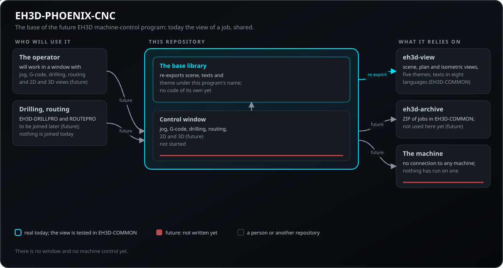

<p align="center">
  
</p>

#  EH3D-PHOENIX-CNC
<p align="center"><a href="README.md">🇺🇸 English</a> | 🇪🇸 <b>Español</b> | <a href="README_fra.md">🇫🇷 Français</a> | <a href="README_ita.md">🇮🇹 Italiano</a> | <a href="README_deu.md">🇩🇪 Deutsch</a> | <a href="README_zho.md">🇨🇳 中文</a> | <a href="README_jpn.md">🇯🇵 日本語</a> | <a href="README_por.md">🇵🇹 Português</a></p>

### La base compartida de los programas de control de máquina de EH3D: la vista de un trabajo, los temas y los textos de la interfaz en ocho idiomas

<p align="center">
  
  
  
  
  
  
</p>

---

**Comprobación de honestidad - lo que se ejecuta hoy:** un programa en Rust con una ventana (`phoenix-cnc`) que maneja una máquina **simulada**: muestra la posición de la máquina (pieza y máquina), la mueve a mano con un teclado de jog, pone el cero, hace la referencia, toma las órdenes que escribe el operador, ejecuta un programa G-code línea a línea (con pausa, parada y parada de emergencia), dibuja la trayectoria del programa en la mesa con las líneas hechas marcadas y se detiene en lo que el controlador rechaza. La ventana habla 37 idiomas y lleva once temas. La interfaz de controladores (`eh3d-controller`, en EH3D-COMMON) tiene GRBL escrito contra una línea simulada y lista las demás familias como aún sin controlador. 436 pruebas se ejecutan en un ordenador. **Nada de aquí se ha ejecutado en una máquina real**, solo se abre un puerto serie para GRBL y una conexión de red solo al enviar un programa al servidor, y los arcos y los demás códigos ni se dibujan ni los ejecuta el simulador.

---

> **Estado de seguridad:** este programa maneja por defecto una máquina simulada. Con `--grbl` (una compilación con `--features serial`) abre un puerto serie y maneja un controlador GRBL real, nunca probado en una máquina real; con una dirección de servidor en los ajustes abre una conexión de red a ese servidor y envía el token en claro por HTTP. Cuando se conecte un controlador real tendrá que demostrarse en un simulador y luego en una máquina real antes de llamarse funcional, y los finales de carrera y una parada de emergencia siguen siendo cosa de la propia unidad de control de la máquina; la parada de emergencia de la ventana no es un circuito de seguridad.

## 📋 De un vistazo

| | |
|---|---|
| Versión | `0.1.4` |
| Madurez | Funcional |
| Pruebas | 436 |
| Pila tecnológica | Rust |
| En hardware real | No: por defecto maneja una máquina simulada; un controlador GRBL real (`--grbl`) nunca se ha probado |

**Ir a:** [Resumen](#-resumen) · [Arquitectura](#-arquitectura) · [Inicio rápido](#-inicio-rápido) · [Pruebas](#-pruebas) · [Estructura](#-estructura-del-repositorio) · [Relacionados](#-proyectos-relacionados)

## 🚦 Estado del proyecto

Cada línea es una parte de este repositorio y la luz dice hasta dónde llega hoy. Se escribe con lo que el repositorio puede demostrar (pruebas, compilaciones, ejecuciones), no con lo previsto.

🟢 Hecho y verificado · 🟡 Funciona, con límites conocidos · 🟠 Hecho a medias o sin verificar · 🔴 Sin hacer o sin funcionar

| Área | Estado | Qué significa aquí |
|---|---|---|
| Biblioteca base | 🟡 | Un crate de Rust que reexporta `scene`, `texts` y `theme` de `eh3d-view` con el nombre de este programa; necesita la carpeta de EH3D-COMMON al lado. |
| Escena y vistas | 🟡 | Escrita y probada en EH3D-COMMON; la ventana de este programa dibuja la trayectoria de un programa en la mesa y la posición de la herramienta (vista en un ordenador). |
| Temas y textos | 🟡 | Once temas y las palabras de la interfaz en 37 idiomas, vistos en la ventana de este programa. |
| Pruebas | 🟡 | Pasan 436 pruebas en un ordenador (`cargo test --features gui`): la sesión (jog, cero, referencia, un programa, pausa, alarma, parada de emergencia), la trayectoria de un programa y la línea de comandos; el controlador simulado se prueba en EH3D-COMMON. |
| Ventana y jog | 🟡 | Funciona en un ordenador con el controlador simulado: posición, teclado de jog, pasos, avance, referencia, cero, desbloqueo, una línea de órdenes y un registro; sin máquina real. |
| Control de máquina | 🟠 | Solo el simulador: un programa se ejecuta línea a línea con pausa, parada y parada de emergencia; aún no se conecta ningún controlador real desde aquí. |
| Documentación | 🟡 | README en ocho idiomas, las dos imágenes, tres programas de ejemplo y el changelog. |

## 🎯 Resumen

* La **ventana** (`src/gui.rs`, `phoenix-cnc`): la posición de la máquina (pieza y máquina), un teclado de jog con sus pasos y avance, referencia, cero y desbloqueo, la parada de emergencia, una línea de órdenes con su registro y el programa con su trayectoria en la mesa.
* La **sesión** (`src/session.rs`): lo que el programa hace con cualquier controlador de `eh3d-controller`: jog, cero, referencia, enviar una línea, ejecutar un programa línea a línea, pausa, parada y las alarmas; se prueba con el controlador simulado.
* La **trayectoria de un programa** (`src/gcode.rs`): los movimientos rectos (`G0`, `G1`, absolutos o relativos, en mm o pulgadas) dibujados antes de ejecutar el programa; los arcos no se dibujan.
* El **controlador simulado** (`eh3d_controller::sim`, en EH3D-COMMON): una máquina en memoria con límites de recorrido que dan alarma; las familias de controladores del mercado están listadas en `eh3d-controller`, GRBL es la primera escrita y las demás aparecen como aún sin controlador.
* Los **temas y las palabras** de `eh3d-view`: Forge (el predeterminado), Neon Arcade, Glass Pro, el gris clásico de Windows y uno que sigue a Windows, y la interfaz en inglés, español, italiano, alemán, francés, portugués, chino y japonés. Lo que será: un programa para taladrar, fresar y hacer CNC 2D y 3D sobre los motores de EH3D-DRILLPRO y EH3D-ROUTEPRO; esa parte aún no existe.
* Los **menús, los ajustes y los ficheros**: los menús Archivo, Ver, Programa, Máquina y Ayuda con lo que tiene PlanetCNC (abrir, recientes, guardar, editar, los ceros, las posiciones guardadas, el husillo y el refrigerante); una ventana de ajustes (unidades, idioma, once temas, límites de recorrido, jog) que se recuerda entre ejecuciones; y las ventanas Abrir y Guardar de la suite (`eh3d-filedialog`: lugares, orden, filtros, la extensión de un fichero guardado y la pregunta antes de reemplazar).
* **GRBL por un puerto serie:** compilado con `--features serial`, `phoenix-cnc --grbl PUERTO[@BAUDIOS]` maneja un controlador GRBL (115200 baudios por defecto) en lugar del simulador y `phoenix-cnc --ports` lista los puertos serie; una compilación sin la característica, o un puerto que no se abre, lo dice y termina. Solo se ha probado contra un controlador guionizado, nunca contra uno real. Con un controlador real, `--start` (abrir el fichero e iniciarlo al abrirse la ventana) se rechaza si no se da también `--start-real`, y `--start-real` solo es un error; `busy_wait` en el fichero de ajustes (4 horas por defecto) es lo máximo que una línea espera su respuesta mientras la máquina dice que está trabajando, y la parada se oye entretanto.
* **Una ventana que sigue a la pantalla:** se abre maximizada y, de 720p a 1080p y hasta pantallas más grandes y anchas, todo crece o se encoge con ella.
* **Seguir tras un fallo:** mientras corre un programa, la línea alcanzada se guarda en un fichero pequeño; si se cae la ventana, el ordenador o el enlace, el siguiente arranque pregunta si seguir desde esa línea o dejarlo. No se envía nada al controlador hasta que el operario responde.
* **Enviado al servidor de EH3D:** con la dirección del servidor, el token de este programa y el id de la máquina en los ajustes (sección Servidor de la ventana de ajustes, o `server_address`, `server_token` y `server_machine` en el fichero de ajustes), **Programa > Enviar al servidor** envía el texto del programa como un trabajo de G-code; el servidor lo ejecuta en su máquina (un controlador GRBL en su puerto serie, o su simulador) y la ventana lo sigue: el estado, el porcentaje y la línea alcanzada en la barra superior, el panel y el registro. Iniciar, Pausa y Detener de la ventana llegan al trabajo del servidor, cerrar la ventana no lo detiene, y un trabajo que se detuvo se retoma desde la línea a la que llegó el servidor (el siguiente arranque de la ventana lo ofrece, como hace con un programa del controlador): el servidor devuelve los códigos en vigor y espera al operador antes del primer movimiento. El husillo y el refrigerante solo se vuelven a arrancar con `server_restore_outputs = yes`. Probado con un servidor de pega; las pruebas del propio servidor envían las mismas peticiones a su simulador. Nunca en una máquina.
* **Reanudar tras un fallo:** un programa que se quedó a medias se devuelve antes a su estado: unidades y distancias absolutas, una Z segura (`resume_safe_z` en el fichero de ajustes, 5 mm), el husillo con el tiempo para alcanzar su velocidad (`resume_spindle_wait`, 3 s), el refrigerante, el punto alcanzado y el estado modal; el fichero de recuperación guarda el SHA-256 del programa y no sigue si el programa cambió. La línea desde la que se sigue se toma `resume_backoff` líneas (16 por defecto) antes de la última enviada, porque el controlador guarda algunas líneas en su búfer; una bajada a la profundidad sin avance del programa usa `resume_plunge_feed` (100 mm/min por defecto).
* **Las líneas para el propio controlador no se envían por defecto:** una línea de programa que empieza por `$` (un ajuste o una orden de GRBL, como `$130=9999`, `$X` o `$RST=*`) detiene el programa en esa línea sin enviarla; con `program_system_commands = yes` en el fichero de ajustes se envían.
* **Las ayudas de la ventana:** un **resumen antes de empezar un programa** (los movimientos, la distancia de corte, el tiempo a las velocidades de los ajustes, el alcance de los ejes y una comprobación frente al recorrido de la máquina, con los avisos que comparte la suite: un programa diminuto o lejos de la esquina, mayor que la mesa y cortes antes de cualquier avance; los arcos se miden por su curva y cada cambio de herramienta suma su tiempo; **Empezar de todos modos**, o un rechazo cuando el programa sale del recorrido, que `reject_out_of_travel = no` convierte en aviso, y `confirm_start = no` desactiva el resumen); **teclas del teclado** (Ctrl+O abrir, Ctrl+S guardar, Ctrl+E editar, F5 empezar, Espacio pausa, Esc parar (con una ventana abierta Esc la cierra, y con el teclado en una caja de texto Espacio y Esc se dejan a la caja), F1 las lista; `shortcuts = no` las desactiva); una **barra de herramientas** con dibujos y sus nombres; números que se cambian con menos y más o **escribiéndolos**; la trayectoria **arrastrada y ampliada desde arriba o girada y ampliada en 3D** con la herramienta; una **vista previa del archivo G-code** en la ventana Abrir; el **registro de un cierre inesperado** (`eh3d-crash.log`); y una sección Seguridad en los ajustes (`rapid`, `summary_tiny`, `summary_far` y `summary_margin` en el archivo de ajustes).
* **Una cola de programas y el recorrido del controlador:** varios archivos elegidos en la ventana Abrir con Ctrl+clic, soltados juntos o dados en la línea de órdenes (`phoenix-cnc a.nc b.nc`) se ejecutan uno tras otro, cada uno tras su propio resumen; la ventana los lista con su estado, deja quitar, saltar y reordenar los que esperan, y la cola se detiene cuando un programa no termina. Con un controlador GRBL el programa lee `$130`, `$131` y `$132` (el mayor recorrido de X, Y y Z) al conectar y usa el menor entre eso y `travel_x`, `travel_y` y `travel_z` para el resumen y el rechazo; si el controlador no responde o no los da, se usan los ajustes y el registro lo dice (`read_controller_travel = no` desactiva la lectura).
* **Comprobaciones del programa, límites suaves del jog y la sonda:** el resumen dice también lo que parece mal dentro del programa (un movimiento rápido que termina bajo la superficie, un corte con el husillo parado, un husillo arrancado sin velocidad, un cambio de herramienta, un programa sin final, y un avance o una velocidad de husillo por encima de `lint_max_feed` o `lint_max_rpm`, que por defecto valen 5000 mm/min y 24000 rpm y con 0 están apagados; `lint = no` apaga las comprobaciones y `lint_rapid_floor` fija la Z por debajo de la cual se avisa de un rápido). Un paso del jog que pasaría del recorrido se acorta hasta el límite y uno que sale del límite hacia fuera se rechaza (`jog_soft_limits` es `homing` por defecto: el límite solo vale después de hacer homing; `always` lo aplica desde el principio y `no` lo apaga). **Máquina > Sondear Z** ejecuta el ciclo sobre una placa de contacto (`probe_feed`, `probe_depth`, `probe_retract`, `probe_plate` y `probe_clearance` en el archivo de ajustes) y **Máquina > Sondear una rejilla** toca una rejilla sobre los cortes del programa (`probe_grid` mm de separación) para construir un mapa de alturas; **Corregir el programa con el mapa de alturas** corta cada movimiento de corte en trozos de como máximo `heightmap_segment` mm y sube o baja cada uno según la altura que hay debajo (un programa en milímetros absolutos y sin arcos; uno que sale de la zona sondeada se rechaza) y **Deshacer la corrección de altura** devuelve el programa a como estaba. Las dos sondas preguntan antes porque la máquina se mueve, y un controlador sin sonda las rechaza. Probado solo con dobles; nada se ha ejecutado en una máquina real.
* **Las herramientas del programa, en la ventana y en la línea de órdenes:** **Programa > Comprobar el programa...** lista lo que encuentran las comprobaciones, línea por línea (el número junto a cada hallazgo muestra esa línea en el panel del programa), **Programa > Cajas prohibidas...** edita los lugares a los que la herramienta no debe ir (un programa que entra en una no se inicia salvo con `keepout_reject = no`) y **Programa > Estadísticas y simulación...** reproduce la trayectoria sobre el papel con el cursor en la línea, mientras el panel del programa dice el tiempo que falta. La cola repite un programa (una casilla con el número de pasadas), pregunta al operador o espera `queue_pause` segundos entre dos pasadas, muestra su tiempo total y se guarda en un archivo entre ejecuciones (vuelve en espera: nada empieza solo). El menú **Macros** ejecuta las macros de `phoenix-cnc-macros.txt` (junto al archivo de ajustes) tras preguntar; **Máquina > Guardar el mapa de alturas...** y **Máquina > Cargar un mapa de alturas...** guardan el mapa en un archivo (nunca se escribe encima de otro sin preguntar) y **Archivo > Exportar el registro de la sesión...** guarda el registro como texto, CSV o JSON (nunca sobre un archivo). Sus valores (`progcheck`, `keepout`, `keepout_margin`, `keepout_reject`, `queue_repeat_max`, `queue_confirm_between`, `queue_pause`, `queue_remember`, `sim_speed`, `macros_confirm`, `macros_max_lines`, `log_max_entries` y `tool_change_time`) están en el archivo de ajustes, y la ventana los conserva cuando guarda los demás ajustes. `phoenix-cnc --report FICHERO` imprime los mismos hallazgos con las estadísticas y el tiempo de un programa sin abrir la ventana (código de salida 0 si nada requiere lectura, 1 si algo la requiere, 2 si no se puede leer el archivo; `--lang` elige el idioma), y `--version` y `--help` responden al instante. Probado solo contra el simulador; nada se ha ejecutado en una máquina real.
* **La ventana de ajustes tiene tres secciones para las herramientas del programa:** **Revisiones** (el primer y el segundo revisor, el margen y el rechazo de las zonas prohibidas, el suelo de los movimientos rápidos y el avance y la velocidad del husillo más altos), **Sonda y mapa de alturas** (la sonda, la rejilla, el largo de los trozos de un corte corregido y los límites del movimiento manual) y **Cola, macros y registro** (las repeticiones y la pausa de la cola, la velocidad de la simulación, las entradas del registro de sesión, las macros y el tiempo de un cambio de herramienta). Cada número se queda dentro del rango que acepta el fichero de ajustes (el rango es su ayuda emergente), **Valores por defecto de esta sección** devuelve una sección a su estado inicial y al guardar se conservan todas las demás claves del fichero.
* **Un informe de trabajo en una sola página HTML:** **Archivo > Exportar el informe de trabajo...** (o `phoenix-cnc --report FICHERO.NC --html INFORME.html`) escribe una página que lo lleva todo dentro, sin script, sin enlaces y sin imágenes aparte: las estadísticas y el tiempo del programa, las herramientas, lo que parece mal con su línea, la trayectoria vista desde arriba con las líneas que tienen un aviso rodeadas y el mapa de alturas como una rejilla de colores cuando se midió uno. Sigue el idioma, los colores siguen el modo claro u oscuro del navegador y nunca se escribe sobre un fichero que ya existe.
* **La trayectoria se puede colorear, filtrar por herramienta y pulsar:** bajo el título de la trayectoria (en el plano y en 3D) una fila elige cómo se colorea (**hecho / por hacer**, **tipo de movimiento**: rápido, corte, penetración y arco; **avance del programa**, de azul a rojo a lo largo del recorrido; **herramienta**; o **velocidad de corte**, de la más lenta a la más rápida), muestra una casilla por cada herramienta del programa (una herramienta se oculta o se muestra con su casilla y la última visible se queda) y tiene **Ampliar a la selección** para el plano y para 3D (en 3D el movimiento pasa al centro de la vista, con el giro que tenga). Pulsar un movimiento lo selecciona (se dibuja grueso), el panel del programa muestra su línea y la fila dice la línea, su código, el tipo de movimiento, su longitud, su avance y su herramienta. El plano y la vista 3D conservan el arrastre, la rueda y el doble clic. Para las capturas, `--color MODO` (`state`, `kind`, `progress`, `tool` o `feed`) y `--select LÍNEA` (una línea del programa, desde 1) abren la ventana con ese coloreado y ese movimiento seleccionado, junto con `--shot`.
* **Un editor para el programa:** el editor del programa (Ctrl+E) muestra el texto con los **números de línea** en el margen (se colorean las líneas de las que la comprobación tiene algo que decir), **buscar y reemplazar** (con o sin mayúsculas; Intro busca la siguiente; se reemplaza una o todas y se dice cuántas), **ir a la línea**, las **notas de la comprobación para el texto tal como se escribe** (pulsar el número de una nota lleva a su línea) y **Aplicar**, que pasa el texto al programa (no mientras un programa corre). **Aplicar y guardar** y **Aplicar y guardar como...** pasan por la ventana de Guardar, que pregunta antes de reemplazar un archivo existente. Las reglas (`src/editor.rs`) se prueban sin ventana.
* **Perfiles de máquina:** en la sección General de los ajustes se puede guardar una máquina como perfil (el recorrido de los tres ejes, la velocidad del husillo y su límite de aviso, el avance del jog, la velocidad rápida y el límite de aviso del avance, y los valores de la sonda) y volver a tomarla con un clic; Aceptar guarda la elección y Cancelar deja los ajustes como estaban. El archivo de ajustes guarda una línea `profile = NOMBRE | tx=0,500 | ty=0,300 | tz=-100,50 | spindle=10000 | ...` por perfil (hasta 16, nombres de hasta 40 caracteres, un valor no válido conserva el de por defecto) y `profile_active = NOMBRE` para el que está en uso. Las reglas (`src/profiles.rs`) se prueban sin ventana.
* **Tab completa el código en el cuadro de órdenes:** mientras el cuadro de la parte baja tiene el teclado, Tab completa el código que se escribe (`G38` da `G38.`, `M30` da `M30 `, `$J` da `$J=`) o, si encajan varios, escribe lo que comparten y los lista junto al cuadro (`G5` lista de `G53` a `G59`). Actúa sobre la última palabra de la línea, no distingue mayúsculas de minúsculas y no envía nada: la línea sigue saliendo con Intro.

## 🧩 Papel en EH3D

EH3D-PHOENIX-CNC es el programa de control de máquina de EH3D, hoy funcionando sobre una máquina simulada. Depende por ruta de EH3D-COMMON (la carpeta `EH3D-COMMON` debe estar junto a esta: la vista, los temas, las palabras y los controladores) y de ningún otro repositorio de EH3D por ahora.

## 🏛️ Arquitectura

<p align="center">
  
</p>

Cómo encajan las partes: quién lo usará, qué contiene este repositorio y en qué se apoya. La imagen se dibuja a partir de `docs/architecture.json`, se comprueba contra el código y marca como futuro lo que es futuro.

## 🖼️ Capturas de pantalla

<p align="center">
  
</p>

<p align="center"><em>Un programa en marcha en la máquina simulada: las líneas hechas en verde, la línea actual resaltada, la trayectoria dibujada en la mesa y la herramienta donde está la máquina.</em></p>

<p align="center">
  
</p>

<p align="center"><em>El tema Medianoche, con un programa largo ya terminado.</em></p>

<p align="center">
  
</p>

<p align="center"><em>La interfaz en alemán con el tema claro Papel: cada palabra de la ventana sigue el idioma.</em></p>

<p align="center">
  
</p>

<p align="center"><em>La ventana de ajustes, con las secciones a la izquierda como el árbol de PlanetCNC: el idioma, los once temas y lo que se muestra.</em></p>

<p align="center">
  
</p>

<p align="center"><em>La ventana Abrir de la suite: lugares, recientes, la lista de la carpeta con sus fechas y tamaños, el nombre y el tipo.</em></p>

## 🔒 Seguridad y protección

Este programa abre un puerto serie solo si se arranca para GRBL (`--grbl`, una compilación con `--features serial`) y una conexión de red solo con el servidor EH3D cuya dirección está en los ajustes, cuando el operador le envía un programa; el token se guarda como texto en el fichero de ajustes. No abre ficheiros de otras personas salvo el fichero G-code y el mapa de alturas que elige el operador (se leen como texto y nunca se ejecutan solos) y sus propios ficheros junto a los ajustes (las macros, la cola guardada entre ejecuciones, la línea que había alcanzado un programa); solo escribe un fichero donde el operador lo dice (el programa, el mapa de alturas, el registro exportado) y nunca escribe el registro sobre un fichero. Las macros que ejecuta son líneas de G-code por las que pregunta antes, y la cola que vuelve nunca empieza sola. No es un sistema de seguridad. Véase [SECURITY.md](SECURITY.md).

## 🚀 Inicio rápido

Necesitas una cadena de herramientas estable de Rust y la carpeta `EH3D-COMMON` al lado de esta.

```bash
cargo build --release --features gui
cargo test --features gui
cargo clippy --all-targets --features gui -- -D warnings
cargo fmt --all --check
python -I tools/ci_validate.py
cargo run --release --features gui -- examples/02_frame_and_pocket.nc
```

`build.bat` / `build.sh` compilan el programa, `test.bat` / `test.sh` ejecutan las pruebas y `run.bat` / `run.sh` abren la ventana con un programa de ejemplo. Los scripts esperan una tecla al final salvo que se defina `NOPAUSE`.

## 🧪 Pruebas

`cargo test --features gui` ejecuta 436 pruebas: la sesión (jog y cero, un programa línea a línea, pausa y continuar, una línea rechazada, la parada de emergencia y la alarma, el registro de las órdenes, la referencia), la trayectoria de un programa y la línea de comandos; la vista y el controlador simulado se prueban en EH3D-COMMON. El CI también ejecuta `cargo fmt --check` y `cargo clippy` con avisos como errores, y `python -I tools/ci_validate.py` comprueba el manifiesto, las versiones, el changelog y los ocho README.

## 🏗️ Compilación y publicación

La versión vive en `Cargo.toml` y en `eh3d.project.json`, y cada versión tiene su entrada en [CHANGELOG.md](CHANGELOG.md). Todavía no hay programa que empaquetar, así que no hay binarios ya hechos.

## 📂 Estructura del repositorio

<p align="center">
  
</p>

<details>
<summary>Versión en texto del árbol</summary>

```text
EH3D-PHOENIX-CNC/
├── src/
│   ├── lib.rs                                   los módulos y la vista de eh3d-view reexportada con el nombre de este programa
│   ├── gui.rs                                   la ventana: posición, jog, programa, trayectoria, órdenes y registro
│   ├── session.rs                               lo que se hace con un controlador: jog, cero, referencia, un programa línea a línea, pausa, parada, alarmas
│   ├── queue.rs                                 la cola: orden, estado, pasadas, omitir, quitar, reordenar, parar al fallar, archivo de estado
│   ├── progcheck.rs                             segunda revisión de un programa: unidades, desplazamientos, palpado, planos
│   ├── boxes.rs                                 cajas prohibidas y límites de recorrido, movimiento a movimiento
│   ├── sim.rs                                   la trayectoria en el tiempo: la herramienta en cada instante
│   ├── estimate.rs                              el tiempo de un programa medido una vez y guardado: la trayectoria cargada y los archivos de la cola
│   ├── stats.rs                                 estadísticas de un programa: distancias, tiempo, cambios de herramienta
│   ├── jobs.rs                                  repeticiones y pausas entre los programas de la cola
│   ├── macros.rs                                la biblioteca de macros: G-code con nombre que pregunta antes de ejecutarse
│   ├── logbook.rs                               el registro de la sesión, en texto, CSV o JSON, sin pisar ficheros
│   ├── report.rs                                el informe de --report: estadísticas, tiempo, lo que parece mal
│   ├── workreport.rs                            el informe de trabajo en una página HTML: estadísticas, avisos, trayectoria, mapa de alturas
│   ├── tuning.rs                                los valores de estas herramientas en el fichero de ajustes
│   ├── ranges.rs                                el rango de cada clave de estas herramientas, común a la ventana y al fichero
│   ├── words.rs                                 los mensajes de estas herramientas en los ocho idiomas
│   ├── gcode.rs                                 los movimientos rectos de un programa G-code, para dibujar su trayectoria
│   ├── heightmap.rs                             el mapa de alturas del material y la corrección de un programa
│   ├── jog.rs                                   los límites suaves del jog: un paso más allá del recorrido se acorta o se rechaza
│   ├── lint.rs                                  lo que parece mal en un programa: rápidos, husillo, avance y velocidad
│   ├── probe.rs                                 la sonda: el ciclo de Z sobre una placa de contacto y la rejilla de toques para el mapa de alturas
│   ├── view.rs                                  el plano que se arrastra y se amplía y la vista 3D que se gira, como números
│   ├── viewer.rs                                el visor de la trayectoria: tipos, herramientas, avance, colores, clics
│   ├── plan.rs                                  la revisión antes de empezar: tiempo, alcance y recorrido de los movimientos
│   ├── cli.rs                                   la línea de comandos: el fichero, el idioma, el tema y las opciones de imagen
│   ├── complete.rs                              Tab en el cuadro de órdenes: completa los códigos G, M y $
│   ├── editor.rs                                el editor del programa: buscar, reemplazar, ir a línea, notas
│   ├── profiles.rs                              perfiles de máquina: recorrido, husillo, avances y sonda de cada una
│   ├── bin/phoenix-cnc.rs                       el programa que abre la ventana
│   ├── server.rs                                el enlace con el servidor de EH3D: enviar, seguir, pausar, detener
│   ├── settings.rs                              lo que se recuerda entre ejecuciones
│   ├── gui/dialogs.rs                           menús, ajustes, Abrir, Guardar, editor
│   ├── gui/prefs.rs                             las secciones de ajustes de las herramientas: revisiones, sonda, cola
│   ├── gui/remote.rs                            el programa en el servidor: Iniciar, Pausa, Detener y seguir
│   ├── gui/views.rs                             el centro de la ventana: la trayectoria vista desde arriba o en 3D, con la herramienta
│   ├── gui/pathview.rs                          la fila del visor: colores, capas, ampliar, línea pulsada
│   ├── gui/editwin.rs                           la ventana del editor: números de línea, buscar, notas, Guardar
│   ├── gui/summary.rs                           la ventana de resumen antes de empezar y la lista de teclas
│   ├── gui/probe.rs                             la sonda en la ventana: preguntas y entradas del mapa de alturas
│   ├── gui/numfield.rs                          un número que se fija con los botones menos y más o escribiéndolo
│   ├── gui/keys.rs                              las teclas del teclado y la tabla que leen los menús y la lista de teclas
│   ├── gui/queue.rs                             la cola en la ventana: pasadas, repeticiones, una pregunta o una espera entre pasadas
│   ├── gui/check.rs                             la ventana de comprobación: lo que encuentran las comprobaciones, línea por línea
│   ├── gui/keepout.rs                           el editor de las cajas prohibidas y el rechazo de un programa que entra en una
│   ├── gui/sim.rs                               estadísticas y simulación: la herramienta en la trayectoria, la línea, el tiempo restante
│   ├── gui/macros.rs                            el menú de macros y la pregunta antes de ejecutar una macro
│   ├── gui/files.rs                             el mapa de alturas y el registro de la sesión como archivos, con las ventanas de archivos
│   └── gui/icons.rs                             los dibujos de los botones, trazados con líneas, y el botón de la barra de herramientas
├── examples/                                    tres programas G-code de ejemplo, de un cuadrado a una espiral larga
├── tests/                                       más pruebas del G-code y los ajustes
├── tools/                                       comprobación de CI, del README y las herramientas de imágenes
├── docs/                                        las fuentes de las imágenes de Arquitectura y Estructura del repositorio
├── .github/                                     flujo de CI, plantillas de issues y pull requests
├── images/                                      banner, las dos imágenes y las capturas de pantalla
├── build.sh build.bat                           compilan la biblioteca
├── run.sh run.bat                               avisan de que aún no hay programa y ejecutan las pruebas
├── eh3d.project.json                            manifiesto: versión, rol, madurez y comando de compilación
├── Cargo.toml Cargo.lock                        el paquete de Rust y sus dependencias fijadas
├── rust-toolchain.toml                          la toolchain de Rust fijada
├── CHANGELOG.md                                 qué cambió en cada versión
├── SECURITY.md SUPPORT.md                       cómo informar de una vulnerabilidad y dónde preguntar
└── CONTRIBUTING.md CODE_OF_CONDUCT.md LICENSE   cómo contribuir, el código de conducta y la licencia
```

</details>

## 🗺️ Hoja de ruta y límites conocidos

**Límites conocidos hoy**

* Nada de aquí se ha ejecutado en una máquina real: el controlador es un simulador (o GRBL en un puerto serie, nunca probado) y al servidor solo llegan las pruebas.
* El simulador solo toma G-code básico (`G0`, `G1`, `G90`, `G91`, `G20`, `G21`, `G92`, `M3` a `M9`); los arcos, los ciclos fijos y el palpado se rechazan, y la trayectoria no dibuja arcos.
* Necesita la carpeta `EH3D-COMMON` a su lado, porque depende de ella por ruta.

**Siguiente**

* Un controlador real: primero GRBL por un puerto serie, luego las demás familias, luego el controlador de HYDRA-UMC.
* Los arcos y el resto del G-code en el simulador y en la trayectoria.
* Una vista 3D de la trayectoria con la altura de los cortes.
* Palpado, cambiador de herramientas y los materiales de la máquina.
* Unir los motores de EH3D-DRILLPRO y EH3D-ROUTEPRO para que un programa taladre y fresé.

## 🌍 Idiomas

README y textos existen en inglés, español, francés, italiano, alemán, chino, japonés y portugués de Portugal.

## 🔗 Proyectos relacionados

* [EH3D-COMMON](https://github.com/JuanenRac/EH3D-COMMON): donde viven la vista (`eh3d-view`) y el ZIP de trabajos (`eh3d-archive`)
* [EH3D-DRILLPRO](https://github.com/JuanenRac/EH3D-DRILLPRO): el programa de taladrado cuyo motor se unirá aquí
* [EH3D-ROUTEPRO](https://github.com/JuanenRac/EH3D-ROUTEPRO): el programa de fresado cuyo motor se unirá aquí

## 📚 Documentación

* [Registro de cambios](CHANGELOG.md)
* [Política de seguridad](SECURITY.md) y [soporte](SUPPORT.md)
* La vista de un trabajo está documentada en EH3D-COMMON, donde vive.

## 🤝 Contribuir y comunidad

* Antes de un pull request ejecuta `cargo fmt --all --check`, `cargo clippy --all-targets -- -D warnings`, `cargo test` y `python -I tools/ci_validate.py`: todo debe pasar. Véanse [CONTRIBUTING.md](CONTRIBUTING.md) y el [código de conducta](CODE_OF_CONDUCT.md).
* El README existe en ocho idiomas: un cambio en el texto se hace en los ocho ficheros, y las dos imágenes se dibujan a partir de `docs/architecture.json` y `docs/structure.json` con `tools/make_architecture.py` y `tools/make_structure.py`.
* No describas como funcional lo que no se ha ejecutado en una máquina.
* Informa de una vulnerabilidad en privado: [SECURITY.md](SECURITY.md). Preguntas, ideas e informes: electrohobby3d@gmail.com ([SUPPORT.md](SUPPORT.md)).

## 👤 AUTOR

**JuanenRac (Electro Hobby 3D)** · electrohobby3d@gmail.com

## 📜 LICENCIA

Software: GPL-3.0-or-later. Véase [LICENSE](LICENSE). Los diseños de hardware de la suite usan CERN OHL-S.
