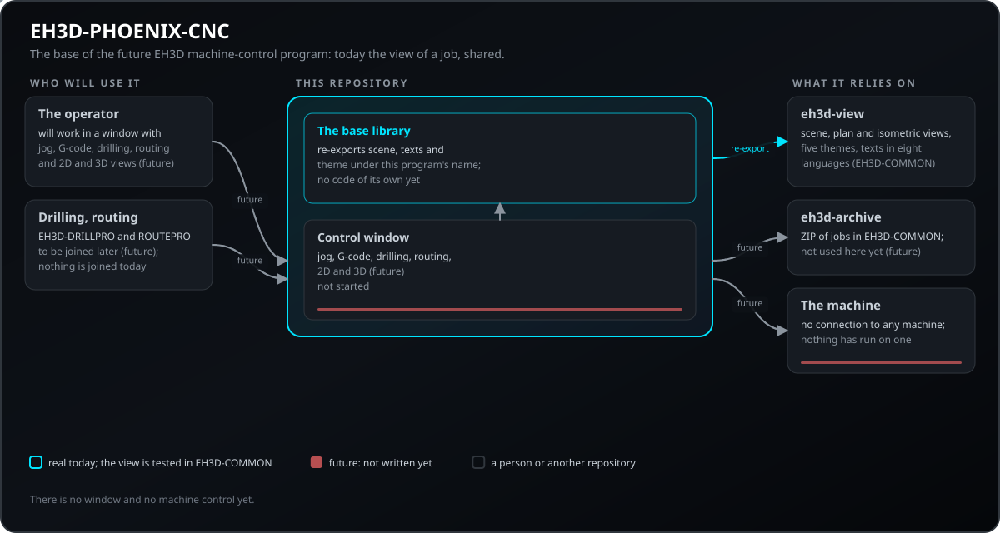
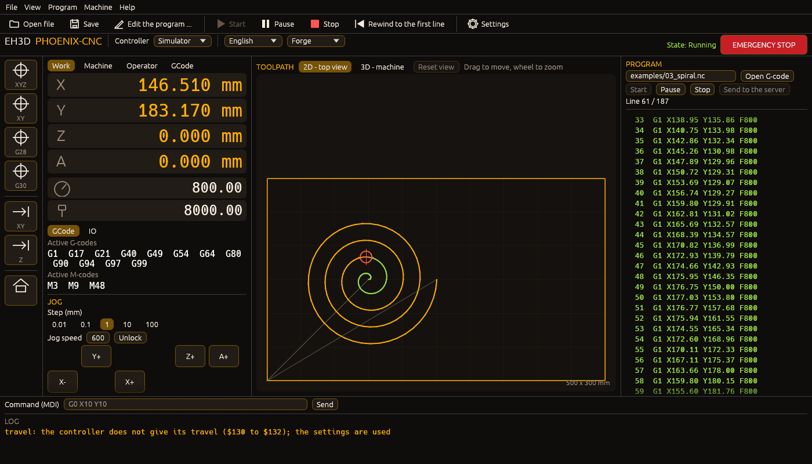
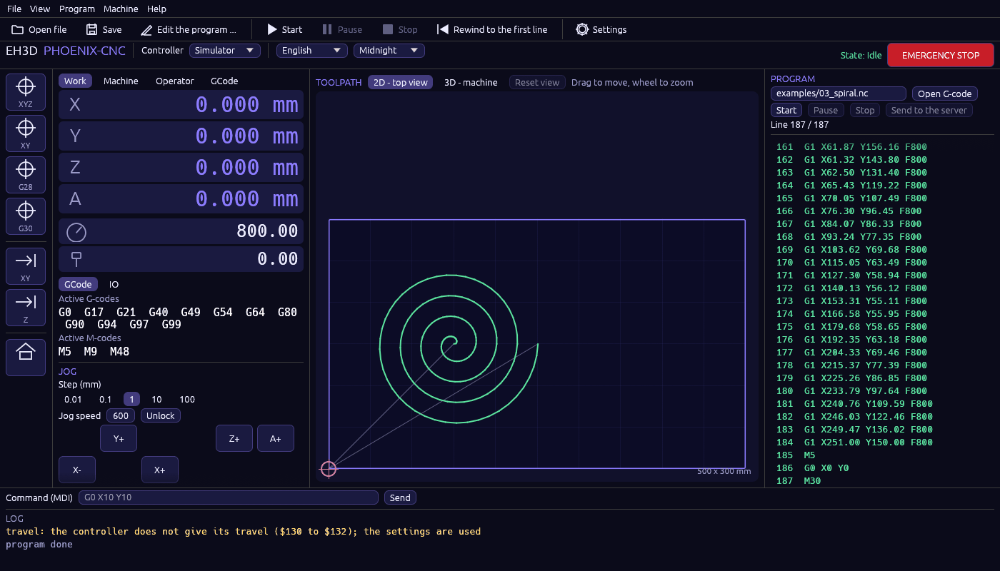
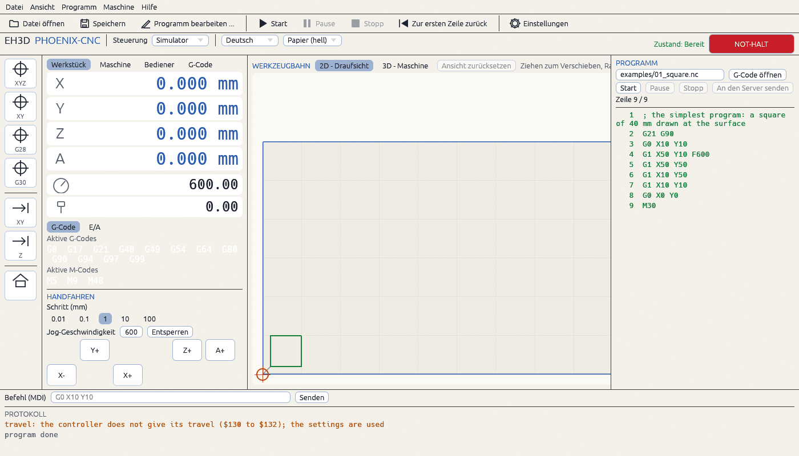
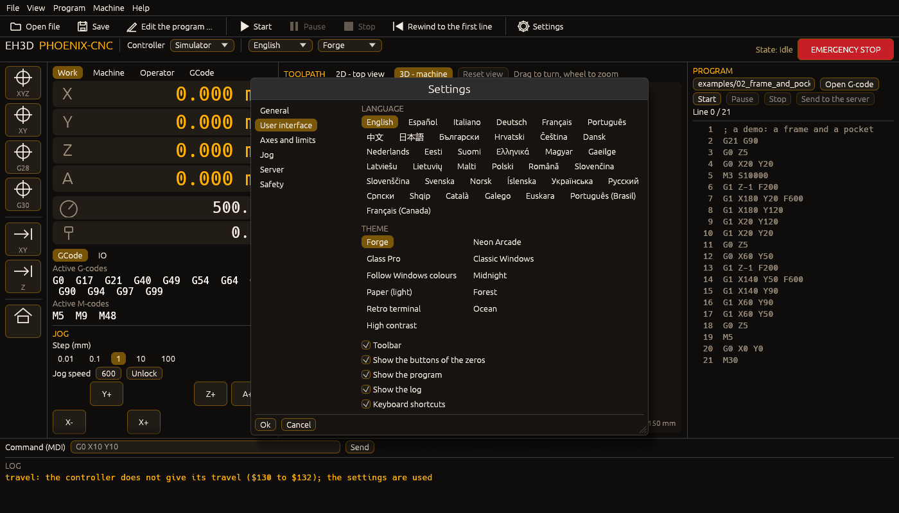
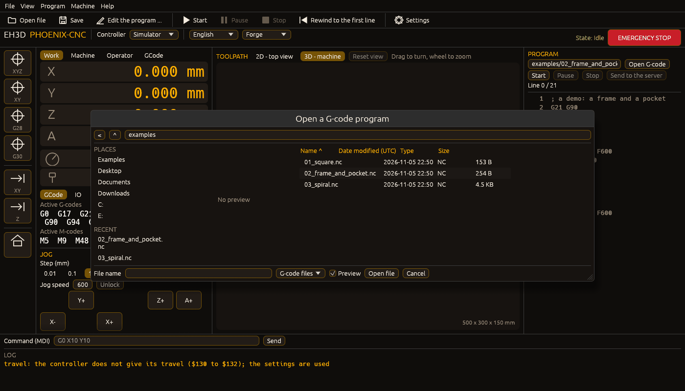
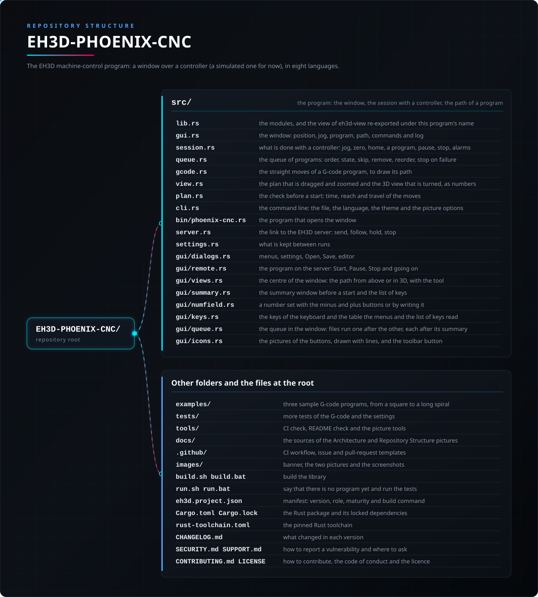

<p align="center">
  
</p>

#  EH3D-PHOENIX-CNC
<p align="center"><a href="README.md">🇺🇸 English</a> | 🇪🇸 <b>Español</b> | <a href="README_fra.md">🇫🇷 Français</a> | <a href="README_ita.md">🇮🇹 Italiano</a> | <a href="README_deu.md">🇩🇪 Deutsch</a> | <a href="README_zho.md">🇨🇳 中文</a> | <a href="README_jpn.md">🇯🇵 日本語</a> | <a href="README_por.md">🇵🇹 Português</a></p>

### La base compartida de los programas de control de máquina de EH3D: la vista de un trabajo, los temas y los textos de la interfaz en ocho idiomas

<p align="center">
  
  
  
  
  
  
</p>

---

**Comprobación de honestidad - lo que se ejecuta hoy:** un programa en Rust con una ventana (`phoenix-cnc`) que maneja una máquina **simulada**: muestra la posición de la máquina (pieza y máquina), la mueve a mano con un teclado de jog, pone el cero, hace la referencia, toma las órdenes que escribe el operador, ejecuta un programa G-code línea a línea (con pausa, parada y parada de emergencia), dibuja la trayectoria del programa en la mesa con las líneas hechas marcadas y se detiene en lo que el controlador rechaza. La ventana habla 37 idiomas y lleva once temas. La interfaz de controladores (`eh3d-controller`, en EH3D-COMMON) tiene GRBL escrito contra una línea simulada y lista las demás familias como aún sin controlador. 130 pruebas se ejecutan en un ordenador. **Nada de aquí se ha ejecutado en una máquina real**, solo se abre un puerto serie para GRBL y una conexión de red solo al enviar un programa al servidor, y los arcos y los demás códigos ni se dibujan ni los ejecuta el simulador.

---

> **Estado de seguridad:** este programa maneja solo una máquina simulada: no abre ningún puerto serie ni conexión de red. Cuando se conecte un controlador real tendrá que demostrarse en un simulador y luego en una máquina real antes de llamarse funcional, y los finales de carrera y una parada de emergencia siguen siendo cosa de la propia unidad de control de la máquina; la parada de emergencia de la ventana no es un circuito de seguridad.

## 📋 De un vistazo

| | |
|---|---|
| Versión | `0.1.0` |
| Madurez | Andamiaje |
| Pruebas | 130 |
| Pila tecnológica | Rust |
| En hardware real | No: maneja solo una máquina simulada |

**Ir a:** [Resumen](#-resumen) · [Arquitectura](#-arquitectura) · [Inicio rápido](#-inicio-rápido) · [Pruebas](#-pruebas) · [Estructura](#-estructura-del-repositorio) · [Relacionados](#-proyectos-relacionados)

## 🚦 Estado del proyecto

Cada línea es una parte de este repositorio y la luz dice hasta dónde llega hoy. Se escribe con lo que el repositorio puede demostrar (pruebas, compilaciones, ejecuciones), no con lo previsto.

🟢 Hecho y verificado · 🟡 Funciona, con límites conocidos · 🟠 Hecho a medias o sin verificar · 🔴 Sin hacer o sin funcionar

| Área | Estado | Qué significa aquí |
|---|---|---|
| Biblioteca base | 🟡 | Un crate de Rust que reexporta `scene`, `texts` y `theme` de `eh3d-view` con el nombre de este programa; necesita la carpeta de EH3D-COMMON al lado. |
| Escena y vistas | 🟡 | Escrita y probada en EH3D-COMMON; la ventana de este programa dibuja la trayectoria de un programa en la mesa y la posición de la herramienta (vista en un ordenador). |
| Temas y textos | 🟡 | Once temas y las palabras de la interfaz en 37 idiomas, vistos en la ventana de este programa. |
| Pruebas | 🟡 | Pasan 130 pruebas en un ordenador (`cargo test --features gui`): la sesión (jog, cero, referencia, un programa, pausa, alarma, parada de emergencia), la trayectoria de un programa y la línea de comandos; el controlador simulado se prueba en EH3D-COMMON. |
| Ventana y jog | 🟡 | Funciona en un ordenador con el controlador simulado: posición, teclado de jog, pasos, avance, referencia, cero, desbloqueo, una línea de órdenes y un registro; sin máquina real. |
| Control de máquina | 🟠 | Solo el simulador: un programa se ejecuta línea a línea con pausa, parada y parada de emergencia; aún no se conecta ningún controlador real desde aquí. |
| Documentación | 🟡 | README en ocho idiomas, las dos imágenes, tres programas de ejemplo y el changelog. |

## 🎯 Resumen

* La **ventana** (`src/gui.rs`, `phoenix-cnc`): la posición de la máquina (pieza y máquina), un teclado de jog con sus pasos y avance, referencia, cero y desbloqueo, la parada de emergencia, una línea de órdenes con su registro y el programa con su trayectoria en la mesa.
* La **sesión** (`src/session.rs`): lo que el programa hace con cualquier controlador de `eh3d-controller`: jog, cero, referencia, enviar una línea, ejecutar un programa línea a línea, pausa, parada y las alarmas; se prueba con el controlador simulado.
* La **trayectoria de un programa** (`src/gcode.rs`): los movimientos rectos (`G0`, `G1`, absolutos o relativos, en mm o pulgadas) dibujados antes de ejecutar el programa; los arcos no se dibujan.
* El **controlador simulado** (`eh3d_controller::sim`, en EH3D-COMMON): una máquina en memoria con límites de recorrido que dan alarma; las familias de controladores del mercado están listadas en `eh3d-controller`, GRBL es la primera escrita y las demás aparecen como aún sin controlador.
* Los **temas y las palabras** de `eh3d-view`: Forge (el predeterminado), Neon Arcade, Glass Pro, el gris clásico de Windows y uno que sigue a Windows, y la interfaz en inglés, español, italiano, alemán, francés, portugués, chino y japonés. Lo que será: un programa para taladrar, fresar y hacer CNC 2D y 3D sobre los motores de EH3D-DRILLPRO y EH3D-ROUTEPRO; esa parte aún no existe.
* Los **menús, los ajustes y los ficheros**: los menús Archivo, Ver, Programa, Máquina y Ayuda con lo que tiene PlanetCNC (abrir, recientes, guardar, editar, los ceros, las posiciones guardadas, el husillo y el refrigerante); una ventana de ajustes (unidades, idioma, once temas, límites de recorrido, jog) que se recuerda entre ejecuciones; y las ventanas Abrir y Guardar de la suite (`eh3d-filedialog`: lugares, orden, filtros, la extensión de un fichero guardado y la pregunta antes de reemplazar).
* **GRBL por un puerto serie:** compilado con `--features serial`, `phoenix-cnc --grbl PUERTO[@BAUDIOS]` maneja un controlador GRBL (115200 baudios por defecto) en lugar del simulador y `phoenix-cnc --ports` lista los puertos serie; una compilación sin la característica, o un puerto que no se abre, lo dice y termina. Solo se ha probado contra un controlador guionizado, nunca contra uno real.
* **Una ventana que sigue a la pantalla:** se abre maximizada y, de 720p a 1080p y hasta pantallas más grandes y anchas, todo crece o se encoge con ella.
* **Seguir tras un fallo:** mientras corre un programa, la línea alcanzada se guarda en un fichero pequeño; si se cae la ventana, el ordenador o el enlace, el siguiente arranque pregunta si seguir desde esa línea o dejarlo. No se envía nada al controlador hasta que el operario responde.
* **Enviado al servidor de EH3D:** con la dirección del servidor, el token de este programa y el id de la máquina en los ajustes (sección Servidor de la ventana de ajustes, o `server_address`, `server_token` y `server_machine` en el fichero de ajustes), **Programa > Enviar al servidor** envía el texto del programa como un trabajo de G-code; el servidor lo ejecuta en su máquina (un controlador GRBL en su puerto serie, o su simulador) y la ventana lo sigue: el estado, el porcentaje y la línea alcanzada en la barra superior, el panel y el registro. Iniciar, Pausa y Detener de la ventana llegan al trabajo del servidor, cerrar la ventana no lo detiene, y un trabajo que se detuvo se retoma desde la línea a la que llegó el servidor (el siguiente arranque de la ventana lo ofrece, como hace con un programa del controlador): el servidor devuelve los códigos en vigor y espera al operador antes del primer movimiento. El husillo y el refrigerante solo se vuelven a arrancar con `server_restore_outputs = yes`. Probado con un servidor de pega; las pruebas del propio servidor envían las mismas peticiones a su simulador. Nunca en una máquina.
* **Reanudar tras un fallo:** un programa que se quedó a medias se devuelve antes a su estado: unidades y distancias absolutas, una Z segura (`resume_safe_z` en el fichero de ajustes, 5 mm), el husillo con el tiempo para alcanzar su velocidad (`resume_spindle_wait`, 3 s), el refrigerante, el punto alcanzado y el estado modal; el fichero de recuperación guarda el SHA-256 del programa y no sigue si el programa cambió.
* **Las ayudas de la ventana:** un **resumen antes de empezar un programa** (los movimientos, la distancia de corte, el tiempo a las velocidades de los ajustes, el alcance de los ejes y una comprobación frente al recorrido de la máquina, con los avisos que comparte la suite: un programa diminuto o lejos de la esquina, mayor que la mesa, arcos que la estimación deja fuera y cortes antes de cualquier avance; **Empezar de todos modos**, o un rechazo cuando el programa sale del recorrido, que `reject_out_of_travel = no` convierte en aviso, y `confirm_start = no` desactiva el resumen); **teclas del teclado** (Ctrl+O abrir, Ctrl+S guardar, Ctrl+E editar, F5 empezar, Espacio pausa, Esc parar (con una ventana abierta Esc la cierra, y con el teclado en una caja de texto Espacio y Esc se dejan a la caja), F1 las lista; `shortcuts = no` las desactiva); una **barra de herramientas** con dibujos y sus nombres; números que se cambian con menos y más o **escribiéndolos**; la trayectoria **arrastrada y ampliada desde arriba o girada y ampliada en 3D** con la herramienta; una **vista previa del archivo G-code** en la ventana Abrir; el **registro de un cierre inesperado** (`eh3d-crash.log`); y una sección Seguridad en los ajustes (`rapid`, `summary_tiny`, `summary_far` y `summary_margin` en el archivo de ajustes).
* **Una cola de programas y el recorrido del controlador:** varios archivos elegidos en la ventana Abrir con Ctrl+clic, soltados juntos o dados en la línea de órdenes (`phoenix-cnc a.nc b.nc`) se ejecutan uno tras otro, cada uno tras su propio resumen; la ventana los lista con su estado, deja quitar, saltar y reordenar los que esperan, y la cola se detiene cuando un programa no termina. Con un controlador GRBL el programa lee `$130`, `$131` y `$132` (el mayor recorrido de X, Y y Z) al conectar y usa el menor entre eso y `travel_x`, `travel_y` y `travel_z` para el resumen y el rechazo; si el controlador no responde o no los da, se usan los ajustes y el registro lo dice (`read_controller_travel = no` desactiva la lectura).

## 🧩 Papel en EH3D

EH3D-PHOENIX-CNC es el programa de control de máquina de EH3D, hoy funcionando sobre una máquina simulada. Depende por ruta de EH3D-COMMON (la carpeta `EH3D-COMMON` debe estar junto a esta: la vista, los temas, las palabras y los controladores) y de ningún otro repositorio de EH3D por ahora.

## 🏛️ Arquitectura

<p align="center">
  
</p>

Cómo encajan las partes: quién lo usará, qué contiene este repositorio y en qué se apoya. La imagen se dibuja a partir de `docs/architecture.json`, se comprueba contra el código y marca como futuro lo que es futuro.

## 🖼️ Capturas de pantalla

<p align="center">
  
</p>

<p align="center"><em>Un programa en marcha en la máquina simulada: las líneas hechas en verde, la línea actual resaltada, la trayectoria dibujada en la mesa y la herramienta donde está la máquina.</em></p>

<p align="center">
  
</p>

<p align="center"><em>El tema Medianoche, con un programa largo ya terminado.</em></p>

<p align="center">
  
</p>

<p align="center"><em>La interfaz en alemán con el tema claro Papel: cada palabra de la ventana sigue el idioma.</em></p>

<p align="center">
  
</p>

<p align="center"><em>La ventana de ajustes, con las secciones a la izquierda como el árbol de PlanetCNC: el idioma, los once temas y lo que se muestra.</em></p>

<p align="center">
  
</p>

<p align="center"><em>La ventana Abrir de la suite: lugares, recientes, la lista de la carpeta con sus fechas y tamaños, el nombre y el tipo.</em></p>

## 🔒 Seguridad y protección

Este programa abre un puerto serie solo si se arranca para GRBL (`--grbl`, una compilación con `--features serial`) y una conexión de red solo con el servidor EH3D cuya dirección está en los ajustes, cuando el operador le envía un programa; el token se guarda como texto en el fichero de ajustes. No abre ficheros de otras personas salvo el fichero G-code que elige el operador (se lee como texto y nunca se ejecuta solo) y no es un sistema de seguridad. Véase [SECURITY.md](SECURITY.md).

## 🚀 Inicio rápido

Necesitas una cadena de herramientas estable de Rust y la carpeta `EH3D-COMMON` al lado de esta.

```bash
cargo build --release --features gui
cargo test --features gui
cargo clippy --all-targets --features gui -- -D warnings
cargo fmt --all --check
python -I tools/ci_validate.py
cargo run --release --features gui -- examples/02_frame_and_pocket.nc
```

`build.bat` / `build.sh` compilan el programa, `test.bat` / `test.sh` ejecutan las pruebas y `run.bat` / `run.sh` abren la ventana con un programa de ejemplo. Los scripts esperan una tecla al final salvo que se defina `NOPAUSE`.

## 🧪 Pruebas

`cargo test --features gui` ejecuta 130 pruebas: la sesión (jog y cero, un programa línea a línea, pausa y continuar, una línea rechazada, la parada de emergencia y la alarma, el registro de las órdenes, la referencia), la trayectoria de un programa y la línea de comandos; la vista y el controlador simulado se prueban en EH3D-COMMON. El CI también ejecuta `cargo fmt --check` y `cargo clippy` con avisos como errores, y `python -I tools/ci_validate.py` comprueba el manifiesto, las versiones, el changelog y los ocho README.

## 🏗️ Compilación y publicación

La versión vive en `Cargo.toml` y en `eh3d.project.json`, y cada versión tiene su entrada en [CHANGELOG.md](CHANGELOG.md). Todavía no hay programa que empaquetar, así que no hay binarios ya hechos.

## 📂 Estructura del repositorio

<p align="center">
  
</p>

<details>
<summary>Versión en texto del árbol</summary>

```text
EH3D-PHOENIX-CNC/
├── src/
│   ├── lib.rs                                   los módulos y la vista de eh3d-view reexportada con el nombre de este programa
│   ├── gui.rs                                   la ventana: posición, jog, programa, trayectoria, órdenes y registro
│   ├── session.rs                               lo que se hace con un controlador: jog, cero, referencia, un programa línea a línea, pausa, parada, alarmas
│   ├── queue.rs                                 la cola de programas: orden, estado, saltar, quitar, reordenar, parada si falla
│   ├── gcode.rs                                 los movimientos rectos de un programa G-code, para dibujar su trayectoria
│   ├── view.rs                                  el plano que se arrastra y se amplía y la vista 3D que se gira, como números
│   ├── plan.rs                                  la revisión antes de empezar: tiempo, alcance y recorrido de los movimientos
│   ├── cli.rs                                   la línea de comandos: el fichero, el idioma, el tema y las opciones de imagen
│   ├── bin/phoenix-cnc.rs                       el programa que abre la ventana
│   ├── server.rs                                el enlace con el servidor de EH3D: enviar, seguir, pausar, detener
│   ├── settings.rs                              lo que se recuerda entre ejecuciones
│   ├── gui/dialogs.rs                           menús, ajustes, Abrir, Guardar, editor
│   ├── gui/remote.rs                            el programa en el servidor: Iniciar, Pausa, Detener y seguir
│   ├── gui/views.rs                             el centro de la ventana: la trayectoria vista desde arriba o en 3D, con la herramienta
│   ├── gui/summary.rs                           la ventana de resumen antes de empezar y la lista de teclas
│   ├── gui/numfield.rs                          un número que se fija con los botones menos y más o escribiéndolo
│   ├── gui/keys.rs                              las teclas del teclado y la tabla que leen los menús y la lista de teclas
│   ├── gui/queue.rs                             la cola en la ventana: archivos uno tras otro, cada uno tras su resumen
│   └── gui/icons.rs                             los dibujos de los botones, trazados con líneas, y el botón de la barra de herramientas
├── examples/                                    tres programas G-code de ejemplo, de un cuadrado a una espiral larga
├── tests/                                       más pruebas del G-code y los ajustes
├── tools/                                       comprobación de CI, del README y las herramientas de imágenes
├── docs/                                        las fuentes de las imágenes de Arquitectura y Estructura del repositorio
├── .github/                                     flujo de CI, plantillas de issues y pull requests
├── images/                                      banner, las dos imágenes y las capturas de pantalla
├── build.sh build.bat                           compilan la biblioteca
├── run.sh run.bat                               avisan de que aún no hay programa y ejecutan las pruebas
├── eh3d.project.json                            manifiesto: versión, rol, madurez y comando de compilación
├── Cargo.toml Cargo.lock                        el paquete de Rust y sus dependencias fijadas
├── rust-toolchain.toml                          la toolchain de Rust fijada
├── CHANGELOG.md                                 qué cambió en cada versión
├── SECURITY.md SUPPORT.md                       cómo informar de una vulnerabilidad y dónde preguntar
└── CONTRIBUTING.md CODE_OF_CONDUCT.md LICENSE   cómo contribuir, el código de conducta y la licencia
```

</details>

## 🗺️ Hoja de ruta y límites conocidos

**Límites conocidos hoy**

* Nada de aquí se ha ejecutado en una máquina real: el controlador es un simulador (o GRBL en un puerto serie, nunca probado) y al servidor solo llegan las pruebas.
* El simulador solo toma G-code básico (`G0`, `G1`, `G90`, `G91`, `G20`, `G21`, `G92`, `M3` a `M9`); los arcos, los ciclos fijos y el palpado se rechazan, y la trayectoria no dibuja arcos.
* Necesita la carpeta `EH3D-COMMON` a su lado, porque depende de ella por ruta.

**Siguiente**

* Un controlador real: primero GRBL por un puerto serie, luego las demás familias, luego el controlador de HYDRA-UMC.
* Los arcos y el resto del G-code en el simulador y en la trayectoria.
* Una vista 3D de la trayectoria con la altura de los cortes.
* Palpado, cambiador de herramientas y los materiales de la máquina.
* Unir los motores de EH3D-DRILLPRO y EH3D-ROUTEPRO para que un programa taladre y fresé.

## 🌍 Idiomas

README y textos existen en inglés, español, francés, italiano, alemán, chino, japonés y portugués de Portugal.

## 🔗 Proyectos relacionados

* [EH3D-COMMON](https://github.com/JuanenRac/EH3D-COMMON): donde viven la vista (`eh3d-view`) y el ZIP de trabajos (`eh3d-archive`)
* [EH3D-DRILLPRO](https://github.com/JuanenRac/EH3D-DRILLPRO): el programa de taladrado cuyo motor se unirá aquí
* [EH3D-ROUTEPRO](https://github.com/JuanenRac/EH3D-ROUTEPRO): el programa de fresado cuyo motor se unirá aquí

## 📚 Documentación

* [Registro de cambios](CHANGELOG.md)
* [Política de seguridad](SECURITY.md) y [soporte](SUPPORT.md)
* La vista de un trabajo está documentada en EH3D-COMMON, donde vive.

## 🤝 Contribuir y comunidad

* Antes de un pull request ejecuta `cargo fmt --all --check`, `cargo clippy --all-targets -- -D warnings`, `cargo test` y `python -I tools/ci_validate.py`: todo debe pasar. Véanse [CONTRIBUTING.md](CONTRIBUTING.md) y el [código de conducta](CODE_OF_CONDUCT.md).
* El README existe en ocho idiomas: un cambio en el texto se hace en los ocho ficheros, y las dos imágenes se dibujan a partir de `docs/architecture.json` y `docs/structure.json` con `tools/make_architecture.py` y `tools/make_structure.py`.
* No describas como funcional lo que no se ha ejecutado en una máquina.
* Informa de una vulnerabilidad en privado: [SECURITY.md](SECURITY.md). Preguntas, ideas e informes: electrohobby3d@gmail.com ([SUPPORT.md](SUPPORT.md)).

## 👤 AUTOR

**JuanenRac (Electro Hobby 3D)** · electrohobby3d@gmail.com

## 📜 LICENCIA

Software: GPL-3.0-or-later. Véase [LICENSE](LICENSE). Los diseños de hardware de la suite usan CERN OHL-S.
