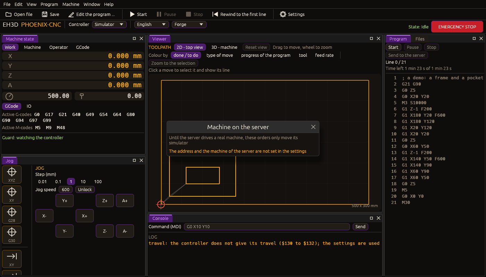
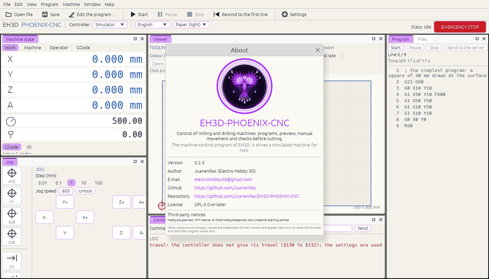

<p align="center">
  
</p>

#  EH3D-PHOENIX-CNC
<p align="center"><a href="README.md">🇺🇸 English</a> | <a href="README_spa.md">🇪🇸 Español</a> | <a href="README_fra.md">🇫🇷 Français</a> | <a href="README_ita.md">🇮🇹 Italiano</a> | <a href="README_deu.md">🇩🇪 Deutsch</a> | 🇨🇳 <b>中文</b> | <a href="README_jpn.md">🇯🇵 日本語</a> | <a href="README_por.md">🇵🇹 Português</a></p>

### EH3D 机床控制程序的共享基础：作业视图、主题以及八种语言的界面文本

<p align="center">
  
  
  
  
  
  
</p>

---

**诚实性检查 - 今天实际能运行的内容：**一个带窗口的 Rust 程序（`phoenix-cnc`），驱动一台**模拟**机床：显示机床位置（工件和机床坐标），用点动面板手动移动，设置零点，回零，接收操作员输入的命令，逐行运行 G 代码程序（可暂停、停止和急停），在工作台上以平面或 3D 画出程序路径并标出已完成的行，并在控制器拒绝处停下。此外它还检查、测量和准备程序（圆弧、固定循环、刀具半径补偿、禁入框、探针、高度图、换刀器、刀具表和材料表），导入图纸以及电路板的 Gerber 和 Excellon 文件，并把程序发送到 EH3D 服务器。控制器接口（`eh3d-controller`，在 EH3D-COMMON 中）已针对 GRBL、grblHAL、Marlin 和 Klipper 在模拟线路上对照其方言的模拟器进行驱动；它列出的其他系列尚未驱动。1221 个测试在计算机上运行。**这里没有任何内容在真实机床上运行过**：仅在使用 GRBL、grblHAL 或 Marlin 时打开串口，仅在向服务器发送程序或用 `--klipper` 连接 Klipper 时建立网络连接。模拟机床只接受直线移动，会拒绝圆弧、固定循环和探测，因此这些内容只在纸面上测量、检查和计时，绘制的路径把圆弧显示为其弦，包含它们的程序会在模拟器中停在那一行。窗口提供十一种主题和八种语言（即 EH3D-COMMON 共享视图的语言）：其文字有英语、西班牙语、德语、法语、意大利语、日语、中文和欧洲葡萄牙语。

---

> **安全状态：**本程序默认驱动模拟机床。使用 `--grbl`、`--grblhal` 或 `--marlin`（带 `--features serial` 的构建）时会打开串口并驱动真实的 GRBL、grblHAL 或 Marlin 控制器，使用 `--klipper HOST[:PORT]` 时会向 Klipper 的接口 Moonraker 打开未加密的 HTTP 连接（除非开启 `klipper.allow_non_local`，否则仅限本地网络；没有加密，所以凭据 `klipper.api_key`（如果有）会在请求头中以明文传送），这些都从未在真实机床上试过；设置中有服务器地址时会向该服务器打开网络连接，并通过 HTTP 以明文发送令牌。连接真实控制器时，必须先在模拟器上、再在真实机床上证明可用，才能称为可用；限位开关和急停仍由机床自己的控制单元负责，窗口里的急停不是安全回路。

## 📋 速览

| | |
|---|---|
| 版本 | `0.2.5` |
| 成熟度 | 可用 |
| 测试 | 1221 |
| 技术栈 | Rust |
| 真实硬件 | 否：默认驱动模拟机床；真实的 GRBL 控制器（`--grbl`）从未试过 |

**跳转到：** [概述](#-概述) · [架构](#-架构) · [快速开始](#-快速开始) · [测试](#-测试) · [结构](#-仓库结构) · [相关项目](#-相关项目)

## 🚦 项目状态

每一行是本仓库的一个部分，灯号表示它今天做到了哪一步。内容依据仓库能够展示的证据（测试、构建、运行），而不是计划。

🟢 已完成并验证 · 🟡 可用，有已知限制 · 🟠 部分完成或尚未验证 · 🔴 未完成或不可用

| 领域 | 状态 | 在这里的含义 |
|---|---|---|
| 基础库 | 🟡 | 一个 Rust crate，以本程序的名称重新导出 `eh3d-view` 的 `scene`、`texts` 和 `theme`；需要旁边有 EH3D-COMMON 文件夹。 |
| 场景与视图 | 🟡 | 在 EH3D-COMMON 中编写并测试；本程序的窗口在工作台上绘制程序路径和刀具位置（已在电脑上看过）。 |
| 主题与文本 | 🟡 | 十一种主题和界面文字：窗口提供共享视图的八种语言，本程序自身面板和工具的文字也是这八种；已在本程序的窗口中看过。 |
| 测试 | 🟡 | 电脑上通过 1221 个测试（`cargo test --features gui`）：会话（点动、零点、回零、程序、暂停、报警、急停）、程序路径和命令行；模拟控制器在 EH3D-COMMON 中测试。 |
| 窗口与点动 | 🟡 | 在电脑上配合模拟控制器运行：位置、点动面板、步长、进给、回零、清零、解锁、命令行和日志；没有真实机床。 |
| 机床控制 | 🟠 | 只有模拟器：程序在模拟机床或模拟的 GRBL、grblHAL、Marlin、Klipper 上逐行运行，可暂停、停止和急停；GRBL、grblHAL 和 Marlin 的串口位于构建功能之后，Klipper 的 HTTP 连接只遇到过替身 Moonraker，尚未连接任何真实控制器。 |
| 文档 | 🟡 | 八种语言的 README、两张图片、三个示例程序和更新日志。 |

## 🎯 概述

* **窗口**（`src/gui.rs`，`phoenix-cnc`）：机床位置（工件和机床坐标）、带步长和进给的点动面板、回零、清零和解锁、急停、带日志的命令行，以及在工作台上显示路径的程序。
* **可停靠窗口**（`src/gui/shell.rs`、`src/panels.rs` 以及 EH3D-COMMON 的框架 `eh3d-dock`）：十三个可以移除、放回、移动、组成标签页、浮动和收起到边缘的面板（路径、手动控制、机床状态、程序、文件、刀具表、对刀仪、探针与高度图、导入、规划与时间、报告和控制台），按任务划分的四个工作区（准备、运行、检查和紧凑），菜单栏，以及保存在设置文件中的布局（`dock.*` 行），文字支持八种语言。控制器被包在守卫里（运动文件中的 `guard = off` 可去掉它）：窗口每帧给它提供时间，显示它为何停下机床并提供解除选项；一个点动与另一个点动交叉时，先取消正在进行的移动，因此“一次只允许一个移动命令”的规则不会在正常的一对点动上触发。规划面板显示有无前瞻的时间，导入面板通过所选的后处理器读取 HPGL、DXF 或 SVG，对刀仪面板只有在操作员确认对刀仪已就位且无干涉之后才让机床前往对刀仪，并且只在被要求时才把长度写入刀具表。已在无窗口的情况下绘制并测试（测试中的 egui 帧）；尚未在真实屏幕或真实机床上看过。
* **会话**（`src/session.rs`）：程序对 `eh3d-controller` 中任何控制器所做的事：点动、清零、回零、发送一行、逐行运行程序、暂停、停止和报警；在模拟控制器上测试。
* **程序路径**（`src/gcode.rs`）：移动（`G0`、`G1`、`G2`、`G3`，绝对或相对，毫米或英寸）在程序运行前以平面和 3D 绘制；绘制的路径把圆弧画成其弦，而长度、时间、禁入框和前瞻则沿曲线计算。
* **模拟控制器**（`eh3d_controller::sim`，在 EH3D-COMMON 中）：内存中的机床，超出行程会报警；它只接受基本 G 代码（直线移动、单位、距离模式、工件零点、主轴和冷却），并拒绝圆弧、固定循环和探测。`eh3d-controller` 列出市场上的控制器系列：本程序驱动 GRBL、grblHAL、Marlin 和 Klipper（对照其方言的模拟器），其余显示为尚未支持。
* `eh3d-view` 的**主题和文字**：Forge（默认）、Neon Arcade、Glass Pro、经典 Windows 灰色和一个跟随 Windows 的主题，以及英语、西班牙语、意大利语、德语、法语、葡萄牙语、中文和日语界面。它将成为：基于 EH3D-DRILLPRO 和 EH3D-ROUTEPRO 引擎的、用于钻孔、铣削以及 2D 和 3D CNC 加工的一个程序；这部分尚不存在。
* **菜单、设置和文件**：文件、编辑、视图、程序、机床、窗口和帮助菜单，包含常用功能（打开、最近文件、保存、编辑、各零点、已存位置、主轴和冷却液）；两次运行之间会记住的设置窗口（单位、语言、十一种主题、行程限位、点动）；以及套件共用的打开和保存窗口（`eh3d-filedialog`：位置、排序、过滤、保存文件的扩展名和替换前的询问）。
* **串口上的 GRBL：** 使用 `--features serial` 构建后，`phoenix-cnc --grbl 端口[@波特率]` 驱动 GRBL 控制器（默认 115200 波特）而不是模拟器，`phoenix-cnc --ports` 列出串口；没有该功能的构建或打不开的端口会给出提示并退出。只对脚本化的控制器试过，从未对真实控制器试过。使用真实控制器时，`--start`（打开文件并在窗口打开时启动）会被拒绝，除非同时给出 `--start-real`；单独使用 `--start-real` 是错误。设置文件中的 `busy_wait`（默认 4 小时）是机器报告正在工作时一行等待其应答的最长时间，其间仍能听到停止。
* **GRBL、grblHAL、Marlin 和 Klipper，对照模拟器：** `--grblhal PORT[@BAUD]` 和 `--marlin PORT[@BAUD]`（带 `--features serial` 的构建；未给出时 Marlin 用 250000 波特）在与 GRBL 相同的防护之后驱动这些控制器；`--klipper HOST[:PORT]` 在同一防护之后通过 Moonraker 以未加密的 HTTP 驱动 Klipper（除非开启 `klipper.allow_non_local`，否则仅限本地网络；链路的限制和 Moonraker 要求时的凭据是运动文件的 `klipper.*` 键，凭据从不打印也不会写回）；`--sim grbl|grblhal|marlin|klipper` 在模拟线缆上驱动其中一种方言，不涉及任何真实设备：线缆按固定种子把应答切成片段、加入噪声、翻转位并陷入静默（运动文件的 `wire_` 键），Marlin 可以给各行编号并附校验和，使损坏的行被重新请求（`marlin_numbering`，默认关闭）。控制器、模拟设备、线缆以及八种语言的错误文本来自 `eh3d-controller`（EH3D-COMMON）；本程序保留方言识别（`src/dialect.rs`）、防护（`src/guard.rs`）、设置和自己的用语（`src/ctltext.rs`、`src/problem.rs`）。`phoenix-cnc --dialect-check grbl|grblhal|marlin|klipper` 让一种方言通过一组步骤（状态、移动、点动、回零、按编号拒绝、防护下静默的控制器、有噪声的线缆），有一步不通过则以退出码 2 结束。全部是模拟，没有任何部分接触过真实控制器，Klipper 的 HTTP 链路在测试中只接触过一个替身 Moonraker。
* **由 Gerber 和 Excellon 文件加工电路板：** `phoenix-cnc --import 文件` 还会用 EH3D-CORE-LIBS 的读取器（套件中其他程序所用的那些）读取 Gerber 图层或 Excellon 钻孔文件，并输出对应的 G 代码（`src/pcb.rs`）：铜层的隔离（离铜一个刀具半径的路径，按要求的道次数）、外形层的轮廓（板外侧和内部切口的内侧，按深度分道次）以及钻孔文件的孔和槽（先用较小的钻头，暂停换钻头，啄钻）。图层按文件所述确定（`--layer isolation|profile|drill` 可另行指定），底面图层会镜像（可用 `--mirror` 要求），窗口的“导入”面板有同样的选项。刀具、道次、深度、进给、啄钻、网格和限制都是运动文件中的 `pcb_` 键（`examples/motion.txt`），不在代码里。尚未在机床上切削过。
* **随屏幕变化的窗口：** 窗口以最大化打开，从 720p 到 1080p 乃至更大更宽的屏幕，所有内容随之放大或缩小。
* **故障后继续：** 程序运行时，已到达的行会保存到一个小文件中；如果窗口、电脑或连接中断，下次启动时会询问是从该行继续还是放弃。操作员回答之前不会向控制器发送任何内容。
* **发送到 EH3D 服务器：** 在设置中填写服务器地址、本程序的令牌和机器 ID（设置窗口的“服务器”部分，或设置文件中的 `server_address`、`server_token`、`server_machine`）后，**程序 > 发送到服务器** 会把程序文本作为 G 代码作业发送；服务器在它的机器上运行（其串口上的 GRBL 控制器，或它的模拟器），窗口跟踪作业：状态、百分比和已到达的行显示在顶部栏、面板和日志中。窗口的开始、暂停和停止会传到服务器上的作业，关闭窗口不会停止它；已停止的作业从服务器到达的行继续（窗口下次启动时会提示，与控制器上的程序相同）：服务器会恢复生效的代码，并在第一次移动前等待操作员。只有设置 `server_restore_outputs = yes` 时才会重新启动主轴和冷却。已用替身服务器试过；服务器自己的测试会向其模拟器发送相同的请求。从未在实机上试过。链接使用套件共用的客户端（EH3D-COMMON 的 `eh3d-serverclient`）：新增四项设置，`server_timeout_s`（一次尝试最多用时的秒数，1 至 120，默认 15）、`server_retries`（网络故障后再尝试的次数，0 至 5，默认 2）、`server_mdns`（在网络中查找服务器，`on` 或 `off`，默认关闭；程序还没有自己的解析器，所以开启也找不到任何东西）和 `server_max_answer_mib`（一次应答最多读取的 MiB，1 至 256，默认 8）；连接失败会以逐渐加长的间隔重试，创建东西的请求绝不会发送两次；服务器的拒绝按其代码用窗口的语言说明；登录失效时立即结束跟踪，而不是等四十次失败的应答；日志会说明链接何时连上、断开或已登出。
* **故障后继续：** 中途停下的程序会先恢复到原来的状态：单位和绝对距离、安全 Z（设置文件中的 `resume_safe_z`，5 mm）、主轴及其达到转速所需的时间（`resume_spindle_wait`，3 秒）、冷却液、已到达的位置和模态状态；恢复文件保存程序的 SHA-256，程序改变后不会继续。继续的那一行取自最后发送的那一行之前 `resume_backoff` 个带运动的行（默认 16），因为控制器的缓冲区里还留着一些运动（规划器更大的控制器请调高）。处于相对距离、固定循环或刀具补偿仍然有效、经过 `G92` 偏移之后、某一轴最后由 `G28`、`G30` 或 `G53` 移动、或 `G10` 行可能已经执行时，不会继续，日志会说明原因。程序没有给出进给时，下刀到深度使用 `resume_plunge_feed`（默认 100 mm/min）。
* **默认不发送给控制器本身的行：** 以 `$` 开头的程序行（GRBL 的设置或命令，如 `$130=9999`、`$X` 或 `$RST=*`）会使程序在该行停止且不发送；在设置文件中写 `program_system_commands = yes` 则会发送。
* **窗口的辅助功能：**程序开始前的**摘要**（移动次数、切削距离、按设置中的速度估算的时间、各轴的行程范围，以及与机器行程的核对，并带有套件共用的警告：程序过小或离角落太远、超过工作台、在设定进给之前的切削；圆弧按曲线长度计算，每次换刀计入其时间；**仍然开始**，或在程序超出行程时拒绝，`reject_out_of_travel = no` 可将拒绝改为警告，`confirm_start = no` 关闭摘要）；**键盘快捷键**（Ctrl+O 打开、Ctrl+S 保存、Ctrl+E 编辑、F5 开始、空格 暂停、Esc 停止（窗口打开时 Esc 关闭窗口；键盘在文本框中时，空格和 Esc 留给文本框）、F1 列出全部；`shortcuts = no` 关闭）；带有绘制图标和名称的**工具栏**；用减号和加号调整或**直接输入**的数值；路径可在俯视图中**拖动和缩放**，或在 3D 中**旋转和缩放**并显示刀具；打开窗口中的 **G 代码文件预览**；**崩溃记录**（`eh3d-crash.log`）；以及设置中的安全部分（设置文件中的 `rapid`、`summary_tiny`、`summary_far` 和 `summary_margin`）。
* **程序队列与控制器行程：** 在“打开”窗口中用 Ctrl+点击选择的多个文件、一起拖入的文件或在命令行中给出的文件（`phoenix-cnc a.nc b.nc`）会依次运行，每个文件先显示自己的摘要；窗口列出它们及其状态，可移除、跳过和重新排序等待中的程序，当某个程序未完成时队列停止。使用 GRBL 控制器时，程序在连接时读取 `$130`、`$131` 和 `$132`（X、Y、Z 的最大行程），并取其与 `travel_x`、`travel_y`、`travel_z` 中较小的值用于摘要和拒绝判断；如果控制器没有应答或不提供这些值，则使用设置，日志会说明（`read_controller_travel = no` 关闭读取）。
* **程序检查、点动软限位与探针：** 摘要还会指出程序内部看起来有问题的地方（终止于表面以下的快速移动、主轴停止时切削、未设转速就启动的主轴、换刀、没有结束的程序，以及超过 `lint_max_feed` 或 `lint_max_rpm` 的进给或主轴转速，默认值为 5000 mm/min 和 24000 rpm，设为 0 即关闭；`lint = no` 关闭这些检查，`lint_rapid_floor` 设定低于哪个 Z 时提示快速移动）。会超出行程的点动步进会被缩短到限位，从限位向外的步进会被拒绝（`jog_soft_limits` 默认为 `homing`：仅在回零之后限位才生效；`always` 从一开始就生效，`no` 则关闭）。**机床 > 探测 Z** 在对刀块上执行循环（设置文件中的 `probe_feed`、`probe_depth`、`probe_retract`、`probe_plate`、`probe_clearance`），**机床 > 探测网格** 在程序的切削范围上接触一个网格（间距 `probe_grid` mm）以建立高度图；**用高度图校正程序** 把每个切削移动切成最长 `heightmap_segment` mm 的小段，并按下方的高度抬高或降低每一段（绝对毫米坐标且无圆弧的程序；超出探测范围的程序会被拒绝），**撤销高度校正** 则把程序恢复原样。因为机床会移动，两种探测都会先确认，没有探针的控制器会拒绝它们。仅用替身测试过；没有任何内容在真实机床上运行过。检查还会报告：由圆心给定的圆弧终点到圆心的距离与起点不同，或由半径给定的圆弧小于两端距离的一半（控制器会以半径错误拒绝），未先停止就让主轴反向旋转，以及进给为零。
* **窗口与命令行中的程序工具：** **程序 > 检查程序...** 按行列出检查发现的问题（每项旁边的行号会在程序面板中显示该行），**程序 > 禁区盒...** 编辑刀具不得进入的位置（进入其中的程序不会启动，除非设置 `keepout_reject = no`），**程序 > 统计与模拟...** 在纸面上回放路径，光标停在对应行；程序面板会显示剩余时间。队列可以重复运行某个程序（有一个运行次数的输入框），在两次运行之间询问操作员或等待 `queue_pause` 秒，显示总时间，并在两次启动之间保存在文件中（恢复后处于等待状态：不会自动开始任何运行）。**宏** 菜单在询问后运行 `phoenix-cnc-macros.txt`（位于设置文件旁）中的宏；**机床 > 保存高度图...** 和 **机床 > 载入高度图...** 把高度图保存到文件或从文件载入（不经询问绝不覆盖文件），**文件 > 导出会话日志...** 把日志保存为文本、CSV 或 JSON（绝不覆盖已有文件）。它们的值（`progcheck`, `keepout`, `keepout_margin`, `keepout_reject`, `queue_repeat_max`, `queue_confirm_between`, `queue_pause`, `queue_remember`, `sim_speed`, `macros_confirm`, `macros_max_lines`, `log_max_entries` 和 `tool_change_time`）在设置文件中，窗口保存其他设置时会保留它们。`phoenix-cnc --report 文件` 不打开窗口，直接输出同样的检查结果以及程序的统计与时间（退出码：无需查看为 0，有需查看的为 1，无法读取文件为 2；`--lang` 选择语言），`--version` 和 `--help` 会立即应答。仅在模拟器上试过；没有在真机上运行过。沿圆弧的移动会沿其曲线与禁区盒比对，而不只是按弦比对（无法算出曲线的圆弧仍按弦比对，报告会说明），统计还会给出切削到达的最低 Z 以及它们结束于多少个深度层。
* **设置窗口为程序工具提供五个分区：** **检查**（第一和第二检查器、禁入区的余量与拒绝、快速移动的最低高度、最高进给和最高主轴转速）、**探针和高度图**（探针、网格、校正后切削的分段长度和点动限制）以及**队列、宏和日志**（队列的重复次数与暂停、模拟速度、会话日志的条目数、宏和换刀时间）。每个数值都保持在设置文件接受的范围内（范围显示在提示中），**恢复本节默认值**可让分区恢复原状，保存时文件中的其他所有键都会保留。后面还有两个分区：**换刀器**（是否计算换刀器、刀库、安全高度、锁紧与吹气及其范围、从表文件读取的刀位和其中被舍弃的行，以及一个绝不覆盖已有表而写出示例表的按钮）和**材料**（使用中的材料及其范围、材料库文件、一个不覆盖文件而写出示例材料库的按钮，以及一个检查每一行并在替换文件前询问的小型材料表编辑器）。
* **一页 HTML 的作业报告：** **文件 > 导出作业报告...**（或 `phoenix-cnc --report FILE.NC --html REPORT.html`）会写出一个自包含的页面，没有脚本、链接和单独的图片：程序的统计和时间、工具、有问题的内容及其行号、用圆圈标出有警告行的俯视轨迹，以及测量过时以彩色网格呈现的高度图。它跟随界面语言，颜色跟随浏览器的浅色或深色设置，并且绝不覆盖已有文件。
* **轨迹可以着色、按工具筛选并可点击：** 轨迹标题下方（平面和 3D 中都有）的一行可选择着色方式（**已完成／待完成**、**移动类型**：快速、切削、下刀和圆弧；**程序进度**：沿行程从蓝到红；**工具**；或**进给速度**：从最慢到最快），为程序中的每把工具显示一个复选框（工具可通过复选框隐藏或显示，最后一个显示的工具会保留），并提供用于平面和 3D 的**缩放到所选内容**（在 3D 中，该移动会按当前旋转角度移到视图中央）。点击一段移动即可选中（以粗线绘制），程序面板会显示它的行，该行还会显示行号、代码、移动类型、长度、进给和工具。平面和 3D 视图仍保留拖动、滚轮和双击。用于截图时，`--color 模式`（`state`、`kind`、`progress`、`tool` 或 `feed`）和 `--select 行`（程序的某一行，从 1 开始）会以该着色和该选中的移动启动窗口，可与 `--shot` 配合使用。
* **程序编辑器：** 程序编辑器（Ctrl+E）在边栏显示**行号**（检查有话要说的行会着色）、**查找和替换**（可区分或不区分大小写；回车查找下一个；替换一处或全部并报告数量）、**转到行**、**对正在书写的文本的检查提示**（点击提示的编号即可转到该行），以及把文本放入程序的**应用**（程序运行时不可用）。**应用并保存**在覆盖程序来源文件之前，会在编辑器内询问（替换或取消；文本一旦改变，询问即消失）；**应用并另存为...**经由“保存”窗口，替换已存在的文件前会先询问。规则（`src/editor.rs`）无需窗口即可测试。
* **机床配置文件：** 在设置的“常规”部分，可以把一台机床保存为配置文件（三个轴的行程、主轴转速及其警告上限、点动进给、快速移动速度及进给警告上限，以及探针数值），并一键重新采用；点击确定保留选择，点击取消则设置保持原样。设置文件中每个配置文件占一行 `profile = 名称 | tx=0,500 | ty=0,300 | tz=-100,50 | spindle=10000 | ...`（最多 16 个，名称不超过 40 个字符，无效的值保留默认值），另有 `profile_active = 名称` 表示正在使用的那个。`phoenix-cnc --profile 名称` 以该配置文件的值启动窗口（或 `--report`）；未保存的名称会写入日志（`--report` 则拒绝），设置保持不变。规则（`src/profiles.rs`）无需窗口即可测试。
* **变换程序：** **程序 > 变换程序...** 对已加载的程序进行平移（X、Y、Z）、旋转（度，绕某一点）、缩放和镜像（X、Y），**程序 > 撤销变换** 可将其还原。各行就地改写（不变的字、注释和空格保持原样），圆弧保持其圆心，奇数次镜像会把顺时针圆弧变为逆时针圆弧（`G2` 与 `G3` 互换）。变换可能出错的程序会被拒绝，并说明行号和原因：相对距离 (`G91`)、XY 以外的平面、固定循环和探测移动、使用机床位置或移动零点的代码（`G10`、`G28`、`G30`、`G53`、`G92`、`G43.1`）、绝对圆弧圆心 (`G90.1`)，或不大于 0 的缩放。程序按轨迹的做法被视为从原点开始。正在运行的程序不会被更改。`--window transform` 可打开该窗口。当程序的第一个移动省略了 X 或 Y 时，窗口会发出警告并询问程序开始前刀具的位置（默认为原点）；被省略的坐标取自该位置，只要变换使其移动就会写入。规则（`src/transform.rs`）无需窗口即可测试，包括新程序的轨迹就是旧轨迹经变换后的结果。**使用刀具当前位置** 会把刀具的实际位置（按程序的单位）填入该起点。
* **书签与从某行开始：** 单击程序面板中的一行即可选中，双击添加书签（有书签的行在行号后带一个星号），也可使用**程序 > 为所选行添加书签**、**下一个书签**和**上一个书签**；**程序 > 书签与从某行开始...**（`--window bookmarks`）列出书签，可跳转到某一个，并从它或从所选行开始。准备任何操作之前，窗口会读取开始行之前的内容，并说明程序在该处生效的设置：英寸、XY 以外的平面、工件坐标系、刀具长度补偿、最后要求的刀具（不会换刀）、主轴及其转速、冷却、被移动的零点，以及在任何进给之前的切削移动；若相对距离（`G91`）、固定循环或刀具半径补偿仍然生效，则拒绝开始。**准备开始**需要勾选一个确认框，表示已检查刀具、主轴和零点（设置文件中的 `startline_confirm = no`，或“队列、宏和日志”部分的复选框，可关闭该确认），然后像恢复中途停止的程序那样让控制器回到该状态（升到安全高度、带等待的主轴、移到程序所在点上方），并让程序停在该行：只有按下“继续”机床才会移动，正在运行的程序绝不会被触碰。书签属于已加载的程序。书签可以在会话之间保留：**将书签保存在程序旁边**会在 `part.nc` 旁边写出 `part.nc.marks`（行号和程序的指纹，最多 200 个书签和 16 KiB；替换已有文件前会询问，可用 `bookmarks_confirm_replace = no` 关闭，已包含这些书签的文件则不会改动），打开程序时会再次读取该文件（`bookmarks_load`，默认开启；为程序另一版本写的文件会被忽略，日志会说明），**载入已保存的书签**会把它们加入列表，快捷键 **Ctrl+B**（给所选行加书签）、**F2** 和 **Ctrl+F2**（下一个和上一个书签）列在快捷键列表中，并写在菜单项旁边。规则（`src/bookmarks.rs`、`src/startline.rs`）无需窗口即可测试。
* **带锁紧和吹气的换刀器（模拟）：** 设置文件中的一行 `atc = on | safe=5 | rack=0,0,-5 | pitch=20,0 | lock=3,0.5 | blow=4,1`（除非写 `on`，否则关闭）描述换刀器：刀库（1 号刀位的 X、Y、Z 以及到下一刀位的间距）、安全高度、锁紧的输出引脚和等待时间，以及吹气的输出引脚和秒数。对程序中的每次换刀，程序会计算步骤（停主轴、放回旧刀、松开锁紧、吹净空主轴、取新刀、锁紧）、G 代码行（`M65 P` / `M64 P`、`G4`）和时间；`--report` 和统计窗口列出各次换刀，估算用该时间代替 `tool_change_time`。不会向机床发送任何内容。每把刀具的刀位也可以来自一张表，而不是间距：设置文件旁的 `phoenix-cnc-atc.txt` 为刀库中的每把刀具写一行 `tool = 编号 | pos=X,Y`（`examples/atc.txt` 是范例；最多 64 把刀具，编号 1 到 255，刀位彼此至少相距 1 mm，文件不超过 16 KiB）；不在表中的刀具仍按刀库和间距定位，被舍弃的每一行都会连同行号和原因显示在 `--report` 和统计窗口中。设置中有禁区盒时，每次换刀还会针对它们进行检查：刀具从程序在该行所处的位置（其工作位置加上工作零点）出发，上升、越过各刀位、并在刀库的位置（机床坐标）下降；移动穿过某个盒子的换刀会连同行号、刀具和盒子显示在 `--report`、检查窗口和工作报告中，并且在 `keepout_reject` 开启时拒绝启动。规则（`src/atc.rs`）无需窗口即可测试。
* **刀具表：** 设置文件旁的 `phoenix-cnc-tools.txt`（`examples/tools.txt` 是范例）为机器的每把刀具写一行 `tool = 编号 | name=名称 | diameter=MM | length=MM | flutes=N`（直径必填；最多 64 把刀具，编号 1 到 255，文件不超过 16 KiB）。`phoenix-cnc --report` 和统计窗口会列出表的大小、被舍弃的行（含行号和原因，八种语言），以及程序所取的每把刀具（`T` 后接 `M6`）在表中的内容（名称、直径和刃数）；程序取用但表中没有的刀具会给出带行号的警告（不算问题：`--report` 的退出码仍为 0），没有表的机器则不提示任何内容。文件只读取。规则（`src/tools.rs`）无需窗口即可测试。
* **固定循环展开为具体移动：** `G73`、`G81` 至 `G86` 和 `G89`（绝对距离，`G17` 平面）在路径、时间、禁区盒和统计中，被它们所代表的移动取代（到孔位、下到 R 平面、切到深度 Z、按 Q 分步、暂停 P、退出、用 `G98` 回到起始高度或用 `G99` 回到 R 平面），因此钻孔程序按孔来计量；报告会说明展开了多少个孔。没有深度、没有 R 平面或 R 平面不高于深度、没有步距 Q、处于相对模式或其他平面、从未用 `G80` 取消的循环，以及不展开的镗孔循环（`G87`、`G88`），都会连同行号给出提示（八种语言）。规则在 `src/cycles.rs`。窗口中绘制的路径仍按原样取各行。仅为模拟。
* **模拟中的刀具半径补偿：** `G41`（左）、`G42`（右）和 `G40` 把直线切削移动按刀具半径（刀具表中的直径，用于当前刀具或 `D` 字指定的刀具）偏移，并在偏移后的线相交处连接拐角。检查会连同行号指出：由非直线移动开启或关闭的补偿、在换刀或程序结束前从未关闭的补偿、补偿一侧比刀具更紧的圆弧、因拐角比刀具更窄而方向反转的移动（危险：会切入工件）、刀具表中没有直径的刀具；报告会在编程路径长度旁加上刀具中心路径的长度。圆弧不偏移。规则在 `src/cutcomp.rs`。
* **工件坐标系及其偏移：** 检查会给出 `G10 L2` 或 `G10 L20` 行写入的偏移（坐标系及 X、Y、Z，未涉及的轴用短横线表示）、不是工件坐标系的 `P`、在该坐标系已发生移动之后才写入的偏移、被使用但程序从未写入的坐标系，以及切换坐标系后紧接着、中间没有快速移动的切削移动；报告会列出使用中的坐标系及其移动数。规则在 `src/wcs.rs`。
* **按材料估算刀具消耗：** 根据刀具表中的刀具寿命和设置中的材料，报告会说明程序在每把刀具上消耗多少分钟寿命、占其寿命的比例以及还能运行多少次。表中的寿命按切削木材计，较硬的材料按取自材料名称的系数更快地消耗它（泡沫、木材、塑料、铝、黄铜和铜、电路板和复合材料、钢和钛，支持八种语言的名称）：这是经验法则，从未在机器上测量；不认识的名称不给出估算。规则在 `src/consumption.rs`。
* **宏验证、G 代码字帮助和固定种子测试：** `phoenix-cnc --macros 文件` 会说明文件中每个宏结束时遗留的有效状态（相对距离、`G54` 以外的工件坐标系、主轴或冷却液、循环或补偿、英寸、其他平面）、没有任何行的宏、结束整个程序的宏，以及不选择 `G90` 或 `G91` 就移动的宏（退出码 0 表示无问题，1 表示需要查看，2 表示错误）；`phoenix-cnc --gcode G83` 以 `--lang` 的语言打印代码的写法和作用（`--gcode "G1 X5 F100"` 给出一行中各字的说明）。用固定种子生成的一千个程序在每项分析中都不会 panic，而首次运行发现注释之外 A 至 Z 以外的字符会使程序的路径中止（现在会被忽略）。规则在 `src/macrocheck.rs`、`src/gcodehelp.rs` 和 `src/fuzz.rs`。
* **运动层，仅限模拟：** 通用控制程序的各个部件，全部用模拟控制器试过，从未在真实机床上运行。`src/dialect.rs` 读取 GRBL 和 grblHAL 的版本（`$I`）、设置（`$$`）和解析器状态（`$G`），`src/ctltext.rs` 提供 GRBL 报警和错误的八种语言文本。`src/guard.rs` 故障即安全：运动命令绝不会发送两次；在可能运动期间失去应答的控制器会被停止，机床在操作员复位前拒绝一切命令；已有运动命令时再来第二个运动命令即为停止；点动目标未及时更新则机床保持静止；跳变的位置不被采信。每一项都在运动文件中有开关，默认开启。故意出错的控制器（静默、忙、某一行的错误、错误的位置）用于测试，来自 `eh3d-controller` 的 `faulty`。`phoenix-cnc --lookahead 文件` 输出含规划器前瞻的时间（`src/lookahead.rs`：由连接偏差得出的每个拐角速度、各轴加速度、每段运动的速度曲线；仅当 `arcs = on` 时才把圆弧重建为短直线段）。`phoenix-cnc --import 图形` 在大小和点数的上限内读取 HPGL、DXF 或 SVG（不展开任何内容，也不会引发 panic），并输出沿路径逐层切割的 G 代码（`src/import.rs`）。`phoenix-cnc --post 名称` 让程序或导入结果通过以文本文件规则写成的后处理器（`src/post.rs`；脚本绝不会运行：`post_scripts` 默认关闭，且此版本没有脚本引擎）。对刀仪（`src/toolsetter.rs`）通过接触传感器测量刀具，并把长度写入刀具表。所有数值都在设置文件旁的 `phoenix-cnc-motion.txt` 中（`examples/motion.txt`；`examples/post.txt` 是一个后处理器）。尚未在机床上试过。
* **命令行中的换算、比较、时间、偏置和格式检查：** `phoenix-cnc --convert in 文件`（或 `mm`）以另一种单位输出程序（所有长度和进给乘以或除以 25.4，逐行按该行当时有效的单位处理；重写 `G20`/`G21` 字；会指出中途切换单位、由参数或表达式给出的值、反时间进给，以及从不声明单位的程序）；`--compare 文件2` 指出两个程序的差异（有代码的行、移动、快速和切削的长度、时间、换刀、刀具、范围、最深切削、发现）；`--times` 按动作类型（快速、切削、下刀、圆弧、暂停、换刀）划分时间，总和与统计中的时间一致；`--offsets` 对照刀具表检查 `G43` 的 `H` 和 `G41`/`G42` 的 `D`（表中没有的刀具、不是当前刀具的刀具、有长度却不用 `G43` 就切削的刀具）；`--format grbl|full|generic` 检查某一类控制器的格式（`grbl` 列出 GRBL 文档中的代码，`full` 指带固定循环、刀具半径补偿和换刀的控制器，`generic` 只检查结构）（行长度、小数位、`%` 行、配置所列的代码、同一行中同组的两个代码、一行中重复的字、程序结尾）。退出码 0 表示干净，1 表示有需要查看的内容（`--compare` 中表示两者不同），2 表示出错。配置没有列出的代码只是需要查看该行的理由，并不证明控制器会拒绝它。规则在 `src/units.rs`、`src/compare.rs`、`src/timesplit.rs`、`src/offsets.rs`、`src/postcheck.rs` 和 `src/cli_tools.rs` 中。
* **套件通用的服务器面板与服务器上的机器：** 设置窗口的“服务器”部分现在是套件中所有程序共用的面板（EH3D-COMMON）：地址、程序的令牌、机器、连接的限制、连接状态、连接测试，以及某人的登录与退出；登录保存在内存中，发送到服务器的作业使用它。**机床 > 服务器上的机器...**（或 `--window machine`）显示服务器机器的位置，并调用其 `cnc` 插件的路由：手动移动受 `server_jog_max_mm`（0.01 至 500，默认 50）和 `server_jog_max_feed`（1 至 30000，默认 1000）限制，超过 `server_jog_confirm_mm`（0 至 500，默认 10；0 表示每次都询问）的移动只有在确认后才会发送，机器被锁定或有作业运行时则完全不发送；紧急停止立即发送、不作询问；解除锁定只在确认后、且只用管理员的登录才发送。请求在独立线程中运行。这些路由背后的机器目前是服务器的模拟器：没有移动过真实机器。规则在 `src/cncroutes.rs` 和 `src/serverlink.rs` 中。
* **刀柄、按道次磨损、重新开始、机器模板、自定义格式配置与 `--out`：** `phoenix-cnc --holder 文件` 指出刀具表中带有 `reach`（伸出刀柄的长度，`reach=MM`）的刀具在哪里切入材料的深度超过其伸出长度，以 Z0 作为材料表面；`--life 文件` 按道次（快速移动之间的一连串切削动作）跟踪带有 `life` 的刀具，给出每道的分钟数、其后已用寿命的比例，以及刀具用尽的那一道和行；`--restart 行 文件` 输出从该行重新开始的程序，重新写回单位、距离模式、平面、工件坐标系、长度偏置、进给和转速，把会启动机器的内容写成注释，并在第一个动作前加入 `M0`；`--template 名称` 输出小型铣床、木工雕刻机、雕刻机或电路板铣床的设置作为起点（`--templates` 列出）；`--format` 也接受自定义配置文件的名称或路径（`base`、`max_line`、`max_decimals`、`percent`、`needs_end`、`allow_g`、`deny_g`、`allow_m`、`deny_m`；名称会在设置文件旁以 `phoenix-cnc-format-名称.txt` 查找）；`--out 文件` 把工具的输出写入新文件，绝不覆盖已有文件（退出码 2）。规则在 `src/holder.rs`、`src/life.rs`、`src/restart.rs`、`src/templates.rs`、`src/postcheck.rs` 和 `src/cli_tools.rs` 中。
* **共享材料的起始点、每齿进给，以及 Marlin 与 Klipper 的格式：** `phoenix-cnc --feeds MATERIAL[,OPERATION[,DIAMETER[,CUTTER]]]` 会打印 EH3D-COMMON 的加工数据库为某种材料（如 `wood/mdf` 的标识符、简称，或八种语言之一的名称）、某项加工（`contour`、`pocket`、`engrave`、`drill`）和该直径的刀具给出的起始点：主轴转速、进给、下刀进给、每层深度和步距，并给出每齿进给、它占直径的比例和切削速度；切屑太薄（刀具摩擦）或太厚（可能折断）时会用一行提示。在两个已知直径之间，它在两者之间取直线并如实说明；超出范围时说明不做外推（退出码 2）；每个起始点都带有说明：数据库的初始数据从未在机器上试过。不给直径时，列出该材料的各个起始点。`--materials FAMILY|all` 列出铣床可加工的材料，以及各自的起始点数量和已在机器上试过的数量（目前为零）。当操作员的材料库没有该名称的材料时，设置中的材料（`material = wood/mdf`）现在可以是该数据库中的材料，程序检查便按其各点的最低与最高进给和转速进行。`--format marlin` 与 `--format klipper` 加入 `grbl`、`full` 和 `generic`：Marlin 列出其文档中的 G 和 M 代码（那里的 `M30` 不是结束，而是删除存储卡上的文件），每行最多 96 个字符；Klipper 只接受毫米，没有主轴；配置未列出的代码，只是需要查看该行的理由，并不证明控制器会拒绝它。规则位于 `src/sharedmat.rs` 和 `src/postcheck.rs`。
* **用于检查的材料库：** 设置的检查部分有一个**材料**列表（设置文件中的 `material = 名称`）；程序随后会与该材料建议的切削进给和主轴转速范围对照，当 X 或 Y 方向的移动低于或高于进给范围（仅 Z 方向的下刀不受此限）或主轴转速低于或高于转速范围时，检查会以八种语言并附行号提示。数值放在文本文件中而不是程序里：`examples/materials.txt` 已内置，在没有自己的文件时使用，设置文件旁的 `phoenix-cnc-materials.txt` 会取代它（每种材料一行 `material = 名称 | feed=下限,上限 | rpm=下限,上限`，最多 64 种，任一范围可省略）。`phoenix-cnc --report` 同样使用设置中的材料。这些范围只是起点建议：只会警告，绝不会停止程序。规则（`src/materials.rs`）无需窗口即可测试。
* **刀具磨损、深度层、用于时间的加速度，以及每项新检查的开关：** 刀具表的一行可以写 `life=分钟 | used=分钟`，之后报告、统计窗口和作业报告会指出已用尽寿命的刀具、程序会将其磨损报废的刀具，以及只剩五分之一或更少寿命的刀具；报告、统计窗口和作业报告从表面向下列出切削的深度层（Z、在该处结束的切削移动数及其长度）；设置文件中的 `accel`（mm/s2，默认 0）把机器的加速度计入预计时间、剩余时间和队列时间；设置的检查部分为控制器会拒绝的圆弧（`lint_arc_gap` 是圆弧终点允许偏离其圆的差值）、未停转就反转的主轴和为零的进给各有一个复选框；在选定刀具号（`T`）之前换刀会给出警告。
* **查看器的固定视图：** **视图 > 俯视图、前视图、侧视图**和**等轴测图**（或 **Ctrl+1** 到 **Ctrl+4**）将路径置于该视图：俯视图即平面图，前视图和侧视图沿某一轴、与工作台齐平地观察，等轴测图是窗口启动时的视图。`--view top|front|side|iso`（除 `plan` 和 `3d` 之外）可让窗口以其中之一启动，配合 `--shot` 使用。平面图使用 EH3D-COMMON 真正的正交俯视图（`StandardView::Top`）：X 向右，Y 向上，两个轴比例相同，在区域内居中。
* **Tab 补全命令框中的代码：** 当窗口下方的命令框拥有键盘时，Tab 会补全正在输入的代码（`G38` 变为 `G38.`，`M30` 变为 `M30 `，`$J` 变为 `$J=`）；若有多个匹配，则写出它们的共同部分并在框旁列出（`G5` 列出 `G53` 至 `G59`）。它只处理该行最后一个词，不区分大小写，也不发送任何内容：该行仍按回车发送。
* **套件工程**（`src/eh3dfile.rs`、`docs/eh3d-project.md`）：`phoenix-cnc project list|save|import|open|take|extract` 将工作保存在 `.eh3d` 工程的 `cnc/` 分支中（一个文件，每个程序一个分支）：`save` 放入程序、图纸、刀具表和运动文件；`import` 逐字节保留 G 代码程序或 DXF、SVG、HPGL 图纸，并附带已读取、未读取以及导出时丢失内容的报告（图纸还会生成沿其切削的程序）；`take` 从其他分支（如 `cad/`）复制轮廓或网格，记录来源的哈希和格式，当来源变化时 `list` 和 `open` 会提示已过期。只写入 `cnc/`：其他分支（无论是否认识）字节保持不变。不会驱动任何机器，目前只用虚构的工程测试过。
* **窗口中的工程**（`src/gui/suite.rs`、`eh3d_project::suiteview`、`docs/eh3d-project.md`）：“文件 > 套件项目 (.eh3d)”可打开工程、保存、另存为（保留所有分支）、导入文件并保留原件、取用其他分支的文件、提取分支以及列出分支。过期内容和签名始终可见；在覆盖未在此打开的工程、读取后已更改的分支或签名之前，窗口会先询问（Esc 表示否，Enter 不写入）。机器运动时不能打开、导入或取用工程；工程的刀具表和运动文件从不生效，仅在勾选时放入工程，含凭据的运动文件绝不放入。逻辑在无屏幕环境下测试；尚无人在屏幕上试用过这些菜单项。
* **项目附件**（“附件”面板，EH3D-COMMON 的 `eh3d-attachpanel` crate）：位于“视图”和“文件 > 套件项目”中，针对窗口当前使用的项目。保存在 `.eh3d` 项目中的数据手册、说明书和任何其他文件可以列出、添加（文件或仅链接）、关联到元件、经询问后提取和移除，并在列表旁显示（PDF 页面、图片、文本以及办公文档的文字）。程序、脚本、含宏的文件、压缩包、HTML、SVG 和未知类型在离开项目前都会询问；程序和脚本绝不会被打开，不会下载任何内容，含服务器令牌的设置文件不会被添加。安装包带有 PDF 库（PDFium）及其许可证。尚无人在屏幕上试用过。可以把文件拖放到面板上，其限制从设置文件读取（`attachments.max_mb`、`viewer.max_*_mb`）。

## 🧩 在 EH3D 中的角色

EH3D-PHOENIX-CNC 是 EH3D 的机床控制程序，目前运行在模拟机床上。它通过路径依赖 EH3D-COMMON（文件夹 `EH3D-COMMON` 必须与本文件夹相邻：视图、主题、文字和控制器），还依赖 EH3D-CORE-LIBS（文件夹 `EH3D-CORE-LIBS` 也必须与本文件夹相邻：Gerber 和 Excellon 读取器、几何库和电路板 CAM），目前不依赖任何其他 EH3D 仓库。

## 🏛️ 架构

<p align="center">
  
</p>

各部分如何配合：谁将使用它、本仓库包含什么、它依赖什么。图片由 `docs/architecture.json` 绘制，并与代码核对，未来的内容标为未来。

## 🖼️ 屏幕截图

<p align="center">
  
</p>

<p align="center"><em>程序在模拟机床上运行：已完成的行为绿色，当前行高亮，路径绘制在工作台上，刀具位于机床所在位置。</em></p>

<p align="center">
  
</p>

<p align="center"><em>午夜主题，一个已运行完的长程序。</em></p>

<p align="center">
  
</p>

<p align="center"><em>使用浅色纸张主题的德语界面：窗口中的每个词都跟随语言。</em></p>

<p align="center">
  
</p>

<p align="center"><em>设置窗口，左侧的分区呈目录树状：语言、十一种主题和显示内容。</em></p>

<p align="center">
  
</p>

<p align="center"><em>套件共用的打开窗口：位置、最近文件、带日期和大小的文件夹列表、文件名和类型。</em></p>

<p align="center">
  
</p>

<p align="center"><em>机器窗口：位置、点动、急停，以及路径上方的服务器上的机器对话框。</em></p>

<p align="center">
  
</p>

<p align="center"><em>设置窗口中的换刀器部分。</em></p>

<p align="center">
  
</p>

<p align="center"><em>浅色主题“纸张”下的关于窗口：程序的版本、作者和链接。</em></p>

## 🔒 安全与防护

本程序只有在为 GRBL、grblHAL 或 Marlin 启动时（`--grbl`、`--grblhal` 或 `--marlin`，用 `--features serial` 构建）才打开串口，只有在用 `--klipper` 启动时才向 Moonraker 打开未加密的 HTTP 连接（除非开启 `klipper.allow_non_local`，否则仅限本地网络；凭据如果有，从运动文件读取，放在请求头中发送，绝不打印），只有在操作员向服务器发送程序时才连接设置中地址所指的 EH3D 服务器；令牌以文本形式保存在设置文件中。它不读取他人的文件，只读取操作员选择的 G 代码文件和高度图（作为文本读取，绝不自行运行），以及设置旁边它自己的文件（宏、两次运行之间保存的队列、程序已到达的行）；它只在操作员指定的位置写文件（程序、高度图、导出的日志），绝不把日志写到已有文件上。换刀器刀位表、刀具表、材料库和书签从设置（或程序）所在的位置读取，只由各自的按钮写入：示例表和示例材料库绝不写到已有文件上，材料库和书签在文件已存在时先询问（书签的询问可在设置中关闭），这些文件都有大小上限。它运行的宏是事先会询问的 G 代码行，恢复的队列绝不会自行开始。它不是安全系统。见 [SECURITY.md](SECURITY.md)。

## 🚀 快速开始

需要稳定版 Rust 工具链，以及本文件夹旁边的 `EH3D-COMMON` 文件夹。

```bash
cargo build --release --features gui
cargo test --features gui
cargo clippy --all-targets --features gui -- -D warnings
cargo fmt --all --check
python -I tools/ci_validate.py
cargo run --release --features gui -- examples/02_frame_and_pocket.nc
```

`build.bat` / `build.sh` 构建程序，`test.bat` / `test.sh` 运行测试，`run.bat` / `run.sh` 用示例程序打开窗口。除非设置了 `NOPAUSE`，脚本结束时会等待按键。

## 🧪 测试

`cargo test --features gui` 运行 1221 个测试：会话（点动和清零、逐行运行程序、暂停和继续、被拒绝的行、急停和报警、命令日志、回零）、程序路径和命令行；视图和模拟控制器在 EH3D-COMMON 中测试。CI 还会运行 `cargo fmt --check` 和把警告当作错误的 `cargo clippy`，`python -I tools/ci_validate.py` 检查清单、版本、更新日志和八个 README。

## 🏗️ 构建与发布

版本号位于 `Cargo.toml` 和 `eh3d.project.json`，每个版本在 [CHANGELOG.md](CHANGELOG.md) 中有对应条目。发布版在 GitHub 上提供适用于 Windows（64 位和 32 位）、Linux（64 位）和 macOS（Apple 芯片和 Intel）的现成程序：每个软件包 `phoenix-cnc-<版本>-<系统>.zip` 或 `.tar.gz` 都附带其 `.sha256` 和 `.sig` 文件。它们由手动工作流 Release binaries 构建，并由维护者的机器发布。

## 📂 仓库结构

<p align="center">
  
</p>

<details>
<summary>目录树的文本版</summary>

```text
EH3D-PHOENIX-CNC/
├── src/
│   ├── lib.rs                                   各模块，以及以本程序名称重新导出的 eh3d-view 视图
│   ├── gui.rs                                   窗口：状态、工具栏、位置与点动区块、每帧的开始与结束
│   ├── session.rs                               对控制器所做的事：点动、清零、回零、逐行运行程序、暂停、停止、报警
│   ├── queue.rs                                 队列：顺序、状态、运行次数、跳过、移除、失败时停止、状态文件
│   ├── progcheck.rs                             程序第二项检查：单位、偏置、探测、平面
│   ├── boxes.rs                                 禁区盒与行程限位检查
│   ├── sim.rs                                   时间轴上的路径：各时刻的刀具与剩余时间
│   ├── estimate.rs                              程序时间只测一次并保存：已载入的路径和队列中的文件
│   ├── stats.rs                                 程序统计：距离、时间、换刀
│   ├── tools.rs                                 刀具表：名称、直径、刃数，从文件读取并列入报告
│   ├── jobs.rs                                  队列中程序的重复与间隔
│   ├── macros.rs                                宏库：执行前会询问的命名 G-code
│   ├── logbook.rs                               会话日志（文本/CSV/JSON，不覆盖文件）
│   ├── report.rs                                --report 的报告：统计、时间、可疑之处
│   ├── workreport.rs                            一页 HTML 作业报告：统计、警告、轨迹、高度图
│   ├── tuning.rs                                这些工具在设置文件中的取值
│   ├── ranges.rs                                这些工具每个键的范围，窗口与文件共用
│   ├── words.rs                                 这些工具的消息（八种语言）
│   ├── gcode.rs                                 G 代码程序的直线移动，用于绘制其路径
│   ├── heightmap.rs                             材料的高度图以及程序校正
│   ├── jog.rs                                   点动的软限位：超出行程的步进会被缩短或拒绝
│   ├── lint.rs                                  程序中看起来有问题的地方：快速移动、主轴、进给、转速
│   ├── probe.rs                                 探针：对刀块上的 Z 循环以及用于高度图的接触网格
│   ├── view.rs                                  可拖动缩放的平面图和可旋转的 3D 视图（仅数值）
│   ├── viewer.rs                                轨迹查看器：类型、工具、进度、颜色、点击
│   ├── plan.rs                                  开始前的检查：移动的时间、范围和行程
│   ├── cli.rs                                   命令行：文件、语言、主题和截图选项
│   ├── complete.rs                              命令框中的 Tab：补全 G、M 和 $ 代码
│   ├── editor.rs                                程序编辑器：查找、替换、转到行、提示
│   ├── profiles.rs                              机床配置文件：每台机床的行程、主轴、进给和探针
│   ├── transform.rs                             程序的平移、旋转、缩放和镜像及其规则
│   ├── atc.rs                                   模拟中的换刀器：锁紧、吹气、步骤、G 代码和时间
│   ├── bookmarks.rs                             程序行上的书签：添加、下一个、上一个
│   ├── startline.rs                             程序在某一行生效的设置，以及何时拒绝从该行开始
│   ├── materials.rs                             材料库：检查所依据的建议进给和转速范围
│   ├── cycles.rs                                把固定循环（G73、G81 至 G89）展开为移动，并指出其中的问题
│   ├── cutcomp.rs                               在模拟中计算的刀具半径补偿（G41、G42、G40），以及会被拒绝的情况
│   ├── wcs.rs                                   工件坐标系（G54 至 G59）及程序写入其中的偏移
│   ├── consumption.rs                           按所切材料估算程序消耗每把刀具的多少
│   ├── macrocheck.rs                            宏的验证：每个宏结束时遗留的有效状态
│   ├── gcodehelp.rs                             G 代码字的帮助（八种语言）：怎么写、起什么作用
│   ├── holder.rs                                刀柄与材料的干涉检查，使用刀具表中每把刀的伸出长度
│   ├── life.rs                                  按道次对照寿命统计刀具磨损，并指出寿命用尽的那一道
│   ├── restart.rs                               从某一行重新开始的程序：重建之前的状态
│   ├── sharedmat.rs                             共享数据库中的材料：起始点、每齿进给和切削速度
│   ├── fuzz.rs                                  固定种子的测试：把编造的程序送入每项分析，并触发每条新消息
│   ├── cli_tools.rs                             输出文本的命令行工具（--convert、--times、--holder 等）
│   ├── cncroutes.rs                             服务器上机器的路由：位置、移动、紧急停止、解除
│   ├── compare.rs                               两个程序的比较：长度、时间、刀具、范围、深度和发现
│   ├── offsets.rs                               对照刀具表检查 H、D 字和刀具长度偏置
│   ├── postcheck.rs                             控制器接受的格式（也可自定义）：行长度、小数位、代码、分组
│   ├── templates.rs                             机器模板：四类机器的行程、速度与限值
│   ├── timesplit.rs                             按动作类型划分程序时间：快速、切削、下刀、圆弧、暂停、换刀
│   ├── units.rs                                 程序在毫米与英寸之间的换算，以及无法换算的内容
│   ├── dialect.rs                               把 GRBL 和 grblHAL 的报告读成数据：版本、$$ 设置和解析器状态
│   ├── ctltext.rs                               守卫消息和控制器用语，八种语言
│   ├── dialcheck.rs                             对照模拟器检查一种方言：步骤、噪声、静默和防护
│   ├── guard.rs                                 故障即安全的守卫，及窗口为其提供时间的句柄
│   ├── lookahead.rs                             纸面规划器：拐角速度、各轴加速度、速度曲线和时间
│   ├── eh3dfile.rs                              .eh3d 工程的 cnc 分支：保存、导入、引用、打开、提取
│   ├── eh3dcli.rs                               命令行的 project 命令
│   ├── gui/suite.rs                             .eh3d 工程的文件菜单
│   ├── import.rs                                有上限的 HPGL、DXF、SVG 读取器，以及沿路径切割的 G 代码
│   ├── pcb.rs                                   电路板：将 Gerber 和 Excellon 文件转为隔离、外形和钻孔程序
│   ├── post.rs                                  以文本文件规则编写的后处理器：头部、尾部、字、行号、小数位
│   ├── toolsetter.rs                            对刀仪：通过接触测量刀具长度并写入刀具表
│   ├── motioncfg.rs                             运动文件：规划器、守卫、导入器、对刀仪和 Klipper 链路的数值
│   ├── panels.rs                                窗口的面板、工作区和菜单数据
│   ├── paneltext.rs                             新面板和菜单项的八种语言文字
│   ├── workflow.rs                              面板的判断：有无前瞻的时间、图纸导入、对刀仪规则
│   ├── notes.rs                                 导入器和规划器工具的文字，八种语言
│   ├── problem.rs                               运动文件或后处理文件某一行的问题，八种语言
│   ├── bin/phoenix-cnc.rs                       打开窗口的程序
│   ├── server.rs                                与 EH3D 服务器的连接：发送、跟踪、暂停、停止
│   ├── serverlink.rs                            基于套件通用面板的服务器连接设置，以及作业所用的登录
│   ├── settings.rs                              两次运行间记住的设置
│   ├── gui/dialogs.rs                           设置、打开、保存、编辑器、关于
│   ├── gui/prefs.rs                             程序工具的设置分区：检查、探针、队列、换刀器、材料
│   ├── gui/remote.rs                            服务器上的程序：开始、暂停、停止与继续
│   ├── gui/machine.rs                           服务器上的机器：位置、移动、紧急停止和解除
│   ├── gui/views.rs                             查看器面板：俯视或 3D 的路径与刀具
│   ├── gui/shell.rs                             窗口：套件框架中的面板、菜单和命令
│   ├── gui/dockpanels.rs                        各面板：状态、点动、文件、程序、控制台、刀具、探针、导入、时间、报告
│   ├── gui/pathview.rs                          查看器的一行：颜色、图层、缩放、被点击的行
│   ├── gui/editwin.rs                           编辑器窗口：行号、查找替换、提示、保存
│   ├── gui/xform.rs                             程序菜单的变换窗口和撤销
│   ├── gui/lines.rs                             书签窗口以及从某行开始（带确认）
│   ├── gui/summary.rs                           开始前的摘要窗口和按键列表
│   ├── gui/probe.rs                             窗口中的探针：移动前的询问与高度图文字
│   ├── gui/numfield.rs                          用减号和加号按钮或直接输入设置的数值
│   ├── gui/keys.rs                              键盘按键以及按键列表所读取的表
│   ├── gui/queue.rs                             窗口中的队列：运行、重复，两次运行之间询问或等待
│   ├── gui/check.rs                             检查窗口：按行显示检查发现的问题
│   ├── gui/keepout.rs                           禁区盒编辑器，以及对进入禁区盒的程序的拒绝
│   ├── gui/sim.rs                               统计与模拟：路径上的刀具、行、剩余时间
│   ├── gui/macros.rs                            宏列表和运行宏之前的询问
│   ├── gui/files.rs                             高度图和会话日志作为文件，通过文件窗口读写
│   └── gui/icons.rs                             用线条绘制的按钮图标和工具栏按钮
├── examples/                                    三个示例 G 代码程序，从正方形到长螺旋
├── tests/                                       需求登记表、README 和工具的测试
├── tools/                                       CI 检查、README 检查和图片工具
├── docs/                                        范围、需求、状态、暂缓的想法和图片数据
├── .github/                                     CI 工作流、Issue 和 PR 模板
├── images/                                      横幅图、两张图片和屏幕截图
├── build.sh build.bat                           构建程序
├── run.sh run.bat                               用示例程序打开窗口
├── eh3d.project.json                            清单：版本、角色、成熟度和构建命令
├── Cargo.toml Cargo.lock                        Rust 包及其锁定的依赖
├── rust-toolchain.toml                          固定的 Rust 工具链
├── CHANGELOG.md                                 每个版本的变更
├── AGENTS.md                                    修改本仓库的人需要遵守的规则
├── SECURITY.md SUPPORT.md                       如何报告漏洞及在哪里提问
└── CONTRIBUTING.md CODE_OF_CONDUCT.md LICENSE   参与贡献、行为准则和许可证
```

</details>

## 🗺️ 路线图与已知限制

**目前已知的限制**

* 这里没有任何内容在真实机床上运行过：控制器是模拟器（或串口上的 GRBL、grblHAL 和 Marlin 以及 HTTP 上的 Klipper，从未试过），只有测试会连接服务器。
* 模拟机床只接受直线移动：它们拒绝圆弧、固定循环和探测，程序在纸面上测量、检查并计时；绘制的路径把圆弧显示为其弦。
* 探针、高度图和换刀器只对照替身试过，后处理器的脚本尚未构建（其规则已有）。
* 窗口只在计算机上通过其图片看过；没有操作员在机床上使用过它。
* 需要相邻的 `EH3D-COMMON` 和 `EH3D-CORE-LIBS` 文件夹，因为它通过路径依赖这两个文件夹。

**下一步**

* 在真实机床（GRBL、grblHAL、Marlin 或 Klipper）上做第一次验证，由一个人在机床旁并伸手可及急停；之后是真实的探针、对刀仪和换刀器。
* HYDRA-UMC 的控制器，待其合约被接受之后。
* 在沙箱中运行的后处理器脚本，当规则不够用时。
* 决定 3D 视图如何显示切削的高度。
* 合并 EH3D-DRILLPRO 和 EH3D-ROUTEPRO 的引擎，使一个程序既能钻孔又能铣削。
* 有意搁置的想法见[暂不包含](docs/NOT_YET.md)。

## 🌍 语言

README 和文本提供英语、西班牙语、法语、意大利语、德语、中文、日语和欧洲葡萄牙语版本。窗口列出的就是这八种，即 EH3D-COMMON 共享视图的语言。

## 🔗 相关项目

* [EH3D-COMMON](https://github.com/JuanenRac/EH3D-COMMON)：视图（`eh3d-view`）和作业 ZIP（`eh3d-archive`）所在的仓库
* [EH3D-DRILLPRO](https://github.com/JuanenRac/EH3D-DRILLPRO)：其引擎将合并到这里的钻孔程序
* [EH3D-ROUTEPRO](https://github.com/JuanenRac/EH3D-ROUTEPRO)：其引擎将合并到这里的铣削程序

## 📚 文档

* [变更日志](CHANGELOG.md)
* [范围](docs/SCOPE.md)： 程序的用途、不做什么，以及永远不由它决定的事。
* [需求](docs/REQUIREMENTS.md)： 功能登记表、每项的状态以及证明它的测试。
* [状态](docs/STATUS.md)： 已有的、缺少的和仍未决定的。
* [暂不包含](docs/NOT_YET.md)： 本版本暂不包含的好想法。
* [修改仓库的规则](AGENTS.md)： 修改本仓库的人需要遵守的规则。
* [安全政策](SECURITY.md)和[支持](SUPPORT.md)
* 作业视图的文档在它所在的 EH3D-COMMON 中。

## 🤝 参与贡献与社区

* 提交 pull request 之前请运行 `cargo fmt --all --check`、`cargo clippy --all-targets -- -D warnings`、`cargo test` 和 `python -I tools/ci_validate.py`：全部必须通过。参见 [CONTRIBUTING.md](CONTRIBUTING.md) 和[行为准则](CODE_OF_CONDUCT.md)。
* README 有八种语言：修改文字时八个文件都要改，两幅图由 `tools/make_architecture.py` 和 `tools/make_structure.py` 根据 `docs/architecture.json` 和 `docs/structure.json` 绘制。
* 不要把没有在机床上运行过的内容描述为可用。
* 请私下报告漏洞：[SECURITY.md](SECURITY.md)。问题、想法和报告：electrohobby3d@gmail.com（[SUPPORT.md](SUPPORT.md)）。

## 👤 作者

**JuanenRac (Electro Hobby 3D)** · electrohobby3d@gmail.com

## 📜 许可证

软件：GPL-3.0-or-later。参见 [LICENSE](LICENSE)。套件的硬件设计使用 CERN OHL-S。
